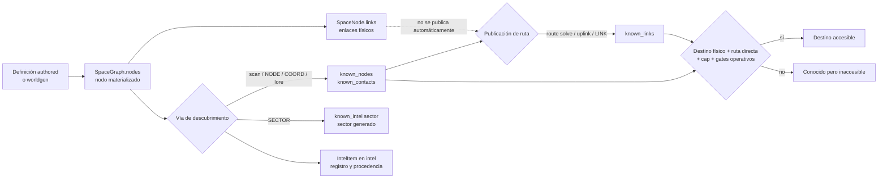

# Descubrimiento, navegación e intel

Estado: **documentación canónica del comportamiento implementado**. El código
productivo se revisó en el commit `3658577`; las pruebas se ejecutaron después
sobre el árbol de trabajo de la Fase 3B, basado en `9f38d2e`.

Versión inglesa: [discovery-navigation-intel.md](discovery-navigation-intel.md)

## 1. Propósito y alcance

Este documento explica cómo RETORNO separa el universo que existe del universo
que el jugador conoce, cómo se descubren contactos y rutas, y qué condiciones
permiten viajar. Cubre `scan`, `route solve`, `uplink`, importación de intel,
navegación, objetivos protegidos y failsafes de exploración.

La materialización física de sectores, nodos y topología se documenta en
[Universo físico y generación procedural](world-generation.es.md). Las rutas de
carga de localizaciones, arcos y singles se documentan en
[Contrato de carga de contenido](../content-loading.es.md). Las guías
`docs/intel_lore*` y `docs/arcs*` siguen pendientes de revisión y no son fuente
normativa para esta descripción.

Etiquetas de evidencia:

- **Implementado:** comportamiento leído directamente en código o datos activos.
- **Cubierto:** además existe una prueba que lo ejercita.
- **Inferencia:** explicación compatible con la implementación, sin contrato de
  diseño explícito.
- **Pendiente:** comportamiento sin cobertura suficiente o que necesita una
  decisión de diseño.

## 2. Modelo conceptual del conocimiento

RETORNO mantiene grafos diferentes para existencia física y conocimiento de
navegación. La accesibilidad no se deduce directamente de la topología física.

### Distinciones esenciales

- Un **nodo físico materializado** existe en `WorldState.space.nodes`. Puede ser
  completamente desconocido para el jugador.
- Un **contacto conocido** aparece en `known_nodes` y, normalmente, también en
  `known_contacts`. Conocerlo no concede una ruta.
- Una **ruta física** es una relación en `SpaceNode.links`. Worldgen y algunos
  creadores de nodos especiales la usan como topología del universo.
- Una **ruta conocida** es una relación en `known_links`. Es la que consulta el
  viaje. No se exige que exista también en `SpaceNode.links`.
- La **intel registrada** es un `IntelItem` de `world.intel`, con tipo,
  procedencia y confianza. Registrar intel y cambiar conocimiento son operaciones
  separadas; no todos los flujos hacen ambas.
- Un **sector generado** está en `generated_sectors`; eso no revela sus nodos.
  No existe un conjunto canónico independiente llamado `known_sectors`.
- Una **coordenada conocida** importada crea o reutiliza un nodo físico
  `NAV_<hash>` de tipo `nav_point`, lo marca conocido y deja metadatos en
  `known_intel`; no crea una ruta hacia él.
- Un destino es **accesible desde la posición actual** sólo si el nodo físico
  existe, es conocido, figura como vecino directo en `known_links`, no supera el
  cap de salto y se cumplen los gates de viaje. Un contacto sin ruta es conocido
  pero inaccesible.

## 3. Estados y estructuras de datos

| Estructura | Papel vigente | Carácter |
| --- | --- | --- |
| `space.nodes: dict[str, SpaceNode]` | Registro de nodos físicos materializados y sus coordenadas. | Canónico para existencia física. |
| `SpaceNode.links` | Vecindad física usada por worldgen y archivos procedurales de salvage. | Canónico para topología física; no concede viaje. |
| `generated_sectors` / `sector_states` | Sectores materializados y metadatos de generación. | Estado de worldgen, no conocimiento del jugador. |
| `known_nodes: set[str]` | Conjunto operativo que UI, mapas, scan, viaje y pools tratan como nodos conocidos. | Canónico de facto para conocimiento de nodos. |
| `known_contacts: set[str]` | Espejo histórico mantenido por la mayoría de escritores; varios consumidores lo unen con `known_nodes` o lo usan como fallback. | Compatibilidad/representación auxiliar. |
| `known_links: dict[str, set[str]]` | Grafo de rutas publicadas al jugador. | Canónico para alcance de viaje y conectividad conocida. |
| `intel: list[IntelItem]` | Registro tipado y deduplicado de intel: `node`, `link`, `sector` o `coord`. | Canónico para historial/procedencia, no para accesibilidad. |
| `known_intel: dict[str, dict]` | Índice disperso escrito principalmente por importaciones `NODE`, `SECTOR` y `COORD`; viaje acepta sus claves como conocimiento heredado. | Caché/compatibilidad, no inventario completo de intel. |
| `fine_ranges_km` | Distancia local refinada para determinados contactos del mismo sector. | Caché derivada. |
| `visited_nodes` | Nodos no temporales alcanzados; también cierra ventanas de pools al entrar en órbita. | Historial de visita. |
| `node_pools` | Archivos, piezas pendientes y pool congelado de rutas uplink por nodo. | Estado persistente de oportunidades, no conocimiento visible por sí mismo. |
| `forced_hidden_nodes` | Nodos físicos creados sin añadirlos a los conjuntos conocidos. | Marcador de ocultación inicial, no barrera contra `scan`. |
| `arc_placements` | Colocación, entrega y flag `primary.unlocked` de piezas de arcos. | Estado narrativo condicional. |

`known_nodes` y `known_contacts` no tienen una función central que imponga su
igualdad. Los escritores principales actualizan ambos, pero un fixture, una
migración o un consumidor nuevo puede hacerlos divergir. La UI de contactos
prioriza `known_nodes` cuando no está vacío y sólo usa `known_contacts` como
fallback; otros subsistemas calculan la unión.

`record_intel` deduplica por la tupla `(kind, from_id, to_id, sector_id, coord)`.
Una segunda fuente para el mismo hecho no crea otro `IntelItem` ni actualiza la
confianza o procedencia del existente.

Los comandos `intel`, `intel show` e `intel export` leen `world.intel`, no
reconstruyen el inventario desde `known_links` o `known_intel`. En consecuencia,
una ruta creada por route solve no aparece en el export salvo que otra vía haya
registrado además su `IntelItem`.

### Sectores y coordenadas conocidas

La implementación representa tres hechos distintos:

1. `generated_sectors` afirma que worldgen ya materializó un sector.
2. `known_intel[sector_id]["sector"]` y un `IntelItem(kind="sector")` afirman
   que se importó intel `SECTOR:`.
3. Las vistas de contactos agrupan sectores derivados de las coordenadas de
   nodos conocidos.

Ninguno implica automáticamente los otros dos. En particular, `SECTOR:` llama
a `ensure_sector_generated`, pero no revela todos los nodos creados allí.

## 4. Vías de descubrimiento e importación

### 4.1 `scan`

Sintaxis pública: `scan`.

**Requisitos iniciales y durante el trabajo:** terminal operativo, estado de
potencia no crítico, calidad de energía por encima del umbral de bloqueo,
sensores al menos `LIMITED` y servicio `sensord` en ejecución. En un nodo de
tipo `transit` también se requiere el unlock de módulo `scan_in_transit`.

El comando encola un trabajo `SCAN` de `Balance.SCAN_TIME_S` (actualmente 8 s)
y guarda el nodo de origen. El trabajo falla si los sensores o `sensord` dejan
de estar disponibles o si cambia el nodo actual antes de completarse. Puede
cancelarse con `job cancel <job_id>`; la cancelación no aplica el escaneo.

Al completarse:

1. Calcula la caja de índices de sector cubierta por el radio de sensores y
   llama a `ensure_sector_generated` para cada celda. Cada llamada puede ampliar
   la materialización por las reglas de worldgen.
2. Considera sólo nodos dentro de la esfera real del radio.
3. Aplica una probabilidad que cae linealmente de `SENSORS_DETECT_P_NEAR` a
   `SENSORS_DETECT_P_FAR` y la multiplica por el factor del estado de sensores.
4. Añade cada detección a `known_nodes` y `known_contacts`.
5. Para una detección nueva registra `IntelItem(kind="node", source_kind="scan",
   confidence=0.6)`.
6. Para ciertos tipos dentro del radio local puede fijar `fine_ranges_km`.

La entrada activa de recuperación de exploración es una excepción: se detecta
con garantía una vez que existe. `scan` no publica `known_links`, no consulta
`SpaceNode.links` y no filtra `locked_primary_targets`.

Completar el trabajo también evalúa deadnodes y el failsafe de recuperación de
exploración. Por tanto, `scan` no es una operación de sólo lectura: puede
materializar sectores y activar nodos o archivos de recuperación.

### 4.2 `route solve`

Sintaxis pública vigente: `route solve <node_id>`. La forma histórica
`route <node_id>` no es válida.

Requiere sensores al menos `LIMITED`, `sensord` activo, potencia y Core OS
compatibles, un nodo actual físico y un destino ya presente en `space.nodes`.
El destino debe estar dentro de `ship.sensors_range_ly` y del cap global
`MAX_ROUTE_HOP_LY` (45 ly).

La acción **no exige que el destino esté en `known_nodes` o `known_contacts`**.
La compleción de comandos sólo propone contactos conocidos y en rango, pero un
id físico escrito manualmente puede resolver una ruta hacia un nodo todavía
desconocido. Permitirlo fue una decisión de diseño deliberada confirmada por el
desarrollador. La razón original no está documentada y podrá revisarse más
adelante si conviene mantener este comportamiento.

Si la ruta ya existe, el comando intenta refinar la distancia local sin encolar
trabajo; si no puede, informa que la ruta ya era conocida. En otro caso encola
un trabajo `ROUTE_SOLVE` cuya duración interpola entre 100 y 6800 s según la
fracción del radio de sensores. Sólo puede haber un `ROUTE_SOLVE` ejecutándose
a la vez.

Al completarse, añade un enlace bidireccional a `known_links` y marca el destino
en ambos conjuntos conocidos. No añade una arista a `SpaceNode.links` y,
contrariamente a la guía antigua, **no llama a `record_intel`**. Durante el
trabajo se revalidan sensores y servicio, pero no se revalida que la nave siga
en el nodo de origen almacenado.

### 4.3 `uplink`

Sintaxis pública: `uplink`; alias: `relay uplink`.

Requisitos:

- nave fuera de tránsito y sin brownout;
- calidad de energía por encima del umbral de bloqueo;
- Core OS que permita el comando;
- nave acoplada al nodo actual;
- nodo de tipo `relay`, `station` o `waystation`;
- `data_core` al menos `LIMITED`, no apagado ni shed;
- servicio `datad` instalado y en ejecución.

`sync_node_pools_for_known_nodes` inicializa una sola vez los pools de nodos
conocidos, nodos `forced_hidden` y anclas actuales. Al preparar un pool uplink:

- materializa el sector actual;
- excluye el placeholder `UNKNOWN`, el propio nodo, rutas ya conocidas y
  objetivos primarios bloqueados;
- pondera nodos conocidos, hubs físicos del sector o vecindad, derelicts y
  candidatos authored activos configurados;
- elige como máximo tres destinos y guarda la lista en
  `NodePoolState.uplink_route_pool`.

La lista queda congelada al inicializar el pool. Nodos materializados o
desbloqueados después no se incorporan a ese pool.

El primer uplink válido intenta publicar bidireccionalmente cada ruta del pool,
descarta las que superen 45 ly, marca como conocidos los destinos aceptados,
registra `IntelItem(kind="link", source_kind="uplink", confidence=0.9)` y escribe
`/logs/nav/uplink_<node>_<seq>.txt`. Después ejecuta el scheduler de lore,
deadnodes y, tras suficientes uplinks sin rutas nuevas, recuperación de
exploración. Finalmente marca `uplink_data_consumed`.

El contador específico `mobility_no_new_uplink_count` sí registra un intento sin
rutas nuevas. En cambio, `lore.counters["uplink_count"]` sólo aumenta si hubo
alguna ruta, archivo, evento narrativo o evento de recuperación.

Los intentos posteriores en el mismo nodo terminan como datos agotados: no
añaden rutas, no escriben otro log y no incrementan el contador de uplinks.

### 4.4 `cat`, `intel import` y formatos

`intel import <path>` procesa cualquier archivo accesible del filesystem del
juego. `cat <path>` autoimporta únicamente rutas reconocidas de navegación,
mail o logs (`/data/nav`, `/mail`, `/logs` y sus equivalentes bajo `/remote`).
`mail read <id|latest>` resuelve la ruta del correo y llama a `render_cat()`;
por tanto, también autoimporta la intel contenida en una ruta de mail reconocida.

La procedencia y confianza dependen de la ruta: mail usa 0.7; logs, fragmentos
y manuales importados explícitamente usan normalmente 0.8.

| Formato | Efecto implementado |
| --- | --- |
| `NODE: <id>` | Añade el texto literalmente a `known_nodes`, `known_contacts` y `known_intel`, y registra intel de nodo. Sólo materializa un sector si el id tiene forma procedural `S...:...`; un id arbitrario puede quedar sin nodo físico. |
| `LINK: <from> -> <to>` | Intenta añadir ruta bidireccional conocida. Si la distancia física conocida supera el cap, conserva ambos extremos como contactos pero no la ruta. |
| `LINK: <to>` | Igual, tomando el nodo actual como origen. |
| `SECTOR: <sector_id>` | Llama a worldgen, registra intel de sector y `known_intel`; no revela los nodos del sector. |
| `COORD: x, y, z` | Crea un `NAV_<hash>` físico si falta, lo marca conocido y registra intel de coordenada; no publica ruta. |

Una ruta `LINK` cuyos extremos no existen puede entrar en `known_links`: la
función de cap considera aceptable una distancia que no puede calcular. Viaje
seguirá bloqueado porque exige que el nodo destino exista físicamente.

#### Bloques `[INTEL]...[/INTEL]`

Cada bloque se procesa primero como una unidad:

- si contiene una línea `LINK:`, se procesa el primer enlace encontrado;
- en caso contrario, el contenido completo debe coincidir exactamente con el
  id, nombre o sector de una localización authored activa para descubrirla;
- si no coincide, entra en el flujo de intel corrupta.

Después, las líneas explícitas `LINK:`, `NODE:`, `SECTOR:` y `COORD:` del mismo
archivo se procesan también por el parser de líneas. Por ello un bloque
multilínea sin `LINK` puede intentar recuperación corrupta antes de importar
sus líneas válidas. La descripción antigua de los bloques como contenedor
general flexible es más amplia que el comportamiento real.

La intel corrupta tiene actualmente un 50 % de fallo. Si se recupera, muestrea
sectores alrededor del nodo actual, puede materializarlos y revela el primer hub
desconocido elegible. Este camino excluye `locked_primary_targets` y registra
intel de nodo con confianza 0.4.

### 4.5 Otras vías reales

- `known_on_start` puede revelar localizaciones durante bootstrap. En los datos
  activos, `UNKNOWN` es el contacto inicial relevante; `RETORNO_SHIP` no se
  convierte en destino mundial ordinario.
- El scheduler de lore puede escribir archivos en mail/logs/salvage para que el
  jugador los importe posteriormente.
- El canal narrativo `uplink_only` aplica directamente un `LINK`, registra intel
  y desbloquea el primary correspondiente si la ruta respeta el cap.
- `drone salvage data` monta archivos bajo `/remote/<node>/`; la adquisición del
  archivo no importa su intel hasta `cat` o `intel import`.
- Recuperación de exploración y deadnodes crean o entregan breadcrumbs como
  archivos. Su mera entrega no concede normalmente la ruta.
- Los comandos de mapas, contactos e intel muestran estado existente; no
  descubren nodos por sí mismos.

## 5. Requisitos de comandos y trabajos

| Acción | Gates al iniciar | Trabajo/tiempo | Revalidación o interrupción |
| --- | --- | --- | --- |
| `scan` | Potencia válida, sensores ≥ `LIMITED`, `sensord`; unlock si está en nodo `transit`. | `SCAN`, 8 s. | Falla si sensores/servicio dejan de servir o cambia el nodo actual; cancelable. |
| `route solve <id>` | Potencia/Core OS, sensores ≥ `LIMITED`, `sensord`, ambos nodos físicos, rango de sensores y cap. | `ROUTE_SOLVE`, 100–6800 s. | Falla si sensores o servicio dejan de servir; cancelable; no revalida el origen. |
| `uplink` | Dock, tipo compatible, potencia, `data_core` ≥ `LIMITED`, `datad`, pool no consumido. | Inmediato en REPL; no es `Job`. | No hay fase interrumpible; el pool se consume tras el intento válido. |
| `intel import` | Archivo existente y nivel de acceso suficiente; Core OS/terminal permiten el comando. | Inmediato. | Puede materializar mundo y mutar conocimiento durante el parseo. |
| `nav <id>` | No estar ya en tránsito ni docked; destino físico y conocido; ruta directa conocida; cap y potencia/Core OS. | Estado de tránsito hasta `arrival_t`; no es `Job`. | `nav abort` crea un waypoint; la llegada ocurre en `Engine.tick`. |

Scan y route solve no reservan un consumo energético específico en el `Job`.
El tiempo transcurrido sigue ejecutando el modelo general de potencia,
degradación y radiación. Iniciar viaje con el perfil automático `CRUISE` apaga
sensores, seguridad, `data_core` y `drone_bay`, lo que puede hacer fallar en el
siguiente tick trabajos de scan o route solve todavía activos.

## 6. Navegación y viaje

Sintaxis de viaje:

- `nav <node_id>`; alias de comando: `navigation` o `travel`;
- `nav --no-cruise <node_id>` para no aplicar el plan automático;
- `nav abort` para interrumpir el tránsito.

El motor valida, en este orden lógico, que la nave no esté en tránsito ni
acoplada, que el destino exista, sea conocido, sea distinto del actual, figure
en `known_links[current]` y no supere 45 ly. En un waypoint temporal sólo se
permiten los extremos originales.

`SpaceNode.links` no participa en esta autorización. Por tanto:

- una arista física desconocida no permite viajar;
- una ruta conocida sin arista física sí permite viajar si ambos nodos existen
  y supera los demás gates;
- una ruta conocida hacia un id inexistente no permite viajar;
- una ruta conocida por encima del cap permanece en el estado, pero el viaje la
  rechaza.

Para distancias muy locales del mismo sector, `fine_ranges_km` permite calcular
el tiempo en kilómetros; el resto usa distancia en años luz y velocidad de
crucero. No existe un gasto de combustible discreto al iniciar el salto. El
tránsito hace avanzar el tiempo y, con él, el modelo energético y ambiental.

Al llegar, el nodo pasa a `visited_nodes`, se actualiza la posición, se cierra
su ventana de pool y se elimina el placeholder inicial `UNKNOWN` cuando
corresponde.

### Aborto y nodo temporal

`nav abort`, tras confirmación de la CLI, interpola la posición actual y crea un
`NAV_PT_<hex>` físico de tipo `transit`. Lo convierte en nodo actual y añade
rutas conocidas bidireccionales hacia origen y destino. No lo añade a
`known_nodes` ni `known_contacts`. Desde él sólo se puede reanudar hacia uno de
los extremos.

Al abandonar el waypoint, `_clear_tmp_node` elimina el nodo y su entrada propia
de `known_links`, pero no elimina explícitamente las referencias inversas al id
temporal almacenadas en los extremos. Las vistas filtran destinos físicos
ausentes, pero el estado puede conservar esas referencias obsoletas.

## 7. Tabla de transiciones

| Acción | Requisitos resumidos | Cambio de estado | Información obtenida |
| --- | --- | --- | --- |
| Worldgen bajo demanda | Un consumidor solicita sector. | Añade nodos físicos, enlaces y `generated_sectors`. | Ninguna por sí mismo. |
| `scan` completado | Sensores/servicio/rango y trabajo estable. | Materializa sectores; añade detecciones a ambos conjuntos conocidos; puede fijar rango fino. | `IntelItem(node)` sólo para contactos nuevos; ninguna ruta. |
| `route solve <id>` completado | Destino físico en rango y sensores disponibles. | Añade `known_links` bidireccional y conoce destino. | Ruta utilizable; no crea `IntelItem`. |
| Primer `uplink` del nodo | Dock, hub compatible, `data_core`/`datad`, pool no consumido. | Añade rutas/contactos aceptados, log, contadores condicionales y consume pool. | `IntelItem(link)` por ruta nueva; posibles entregas de lore/failsafe. |
| `NODE:` | Archivo accesible. | Añade id a conocidos y a `known_intel`. | `IntelItem(node)`; puede ser dangling. |
| `LINK:` | Archivo accesible; cap si se conoce distancia. | Añade extremos conocidos y, si acepta, `known_links`. | `IntelItem(link)` sólo si la ruta era nueva. |
| `SECTOR:` | Archivo accesible. | Materializa sector y marca `known_intel`. | `IntelItem(sector)`; nodos siguen ocultos. |
| `COORD:` | Tres números válidos. | Crea/conoce `NAV_<hash>`. | `IntelItem(coord)`; sin ruta. |
| Lore `uplink_only` | Pieza elegible, canal y cap. | Añade ruta/contactos y marca primary desbloqueado. | `IntelItem(link)` directo. |
| Breadcrumb de lore/failsafe | Trigger elegible. | Escribe archivo local/remoto; puede crear nodos ocultos. | Ningún cambio de rutas hasta importar el archivo. |
| `nav <id>` | Nodo conocido, ruta directa, cap y gates. | Inicia tránsito; al llegar actualiza nodo/posición/visita. | No descubre nuevas rutas. |
| `nav abort` | Nave en tránsito y confirmación CLI. | Crea waypoint temporal y rutas a los extremos. | Acceso de retorno/reanudación, no contacto normal. |

## 8. Protección narrativa y excepciones

`locked_primary_targets` se calcula desde los `primary_intel` de arcos cargados
cuyo objetivo es `link` o `node` y que aún no constan como desbloqueados o
descubiertos. El objetivo sigue existiendo físicamente; el lock no lo elimina
del universo.

Vías que respetan explícitamente el lock:

- preparación procedural del pool de rutas de uplink;
- selección de un hub al recuperar intel corrupta.

Vías que **no** consultan el lock:

- `scan`;
- `route solve <id>` escrito manualmente;
- importación explícita `NODE`, `LINK`, `SECTOR` o `COORD`;
- bootstrap `known_on_start`;
- consulta directa de un id ya presente por otros consumidores.

Importar el `LINK` exacto del primary mediante el parser marca el arco como
descubierto si la ruta es nueva. La entrega narrativa `uplink_only` también
marca el primary desbloqueado incluso si esa ruta ya era conocida. Otros enlaces
hacia el mismo destino pueden conceder acceso sin actualizar ese flag.

Por tanto, la implementación ofrece **protección contra dos revelaciones
procedurales concretas**, no un bloqueo global de descubrimiento. Un nodo en
`forced_hidden_nodes` tampoco es indetectable: sólo se crea sin marcarlo como
conocido; scan puede revelarlo si entra en alcance.

El loader activo devuelve actualmente **cero arcos** porque
`data/arcs/templates/` no se recorre. En una partida normal no hay
`locked_primary_targets` activos. Esta sección describe código condicional, no
una protección narrativa operativa ni contenido activado.

## 9. Interacción con worldgen, lore y failsafes

- `scan`, preparación de uplink, `SECTOR:` e intel corrupta llaman a worldgen.
  Descubrir puede por ello modificar primero el universo físico.
- Los pools uplink se calculan sobre el mundo existente en el momento de su
  inicialización y no se reconstruyen al crecer el universo.
- El scheduler de lore separa entrega de archivos de aplicación de intel. Los
  canales de archivo requieren lectura/importación; `uplink_only` es la
  excepción directa.
- Recuperación de exploración sólo se activa cuando el sistema considera que no
  queda una frontera utilizable y la nave tiene capacidad operativa. Crea una
  entrada oculta dentro de rango, un gateway y un breadcrumb local. No concede
  directamente el primer enlace.
- La entrada de recuperación puede descubrirse por su intel o por scan
  garantizado. Tras llegar, el broadcast o salvage proporciona un `LINK` al
  gateway.
- Deadnodes observa contactos sin ruta alcanzable ni posibilidad de route solve.
  Tras umbrales, crea un relay puente o entrega un `LINK` directo como archivo;
  el jugador todavía debe importarlo.
- Los failsafes pueden añadir nodos después de worldgen. Sus efectos topológicos
  y las limitaciones de sincronización sectorial se detallan en el documento de
  worldgen.

## 10. Invariantes confirmados

1. Materializar un nodo o sector no lo revela automáticamente.
2. Conocer un nodo no crea una ruta; conocer una ruta no prueba que exista una
   arista física equivalente.
3. El viaje consulta una ruta directa desde el nodo actual; no ejecuta pathfinding
   multihop automáticamente.
4. El viaje revalida existencia física y cap aunque `known_links` contenga datos
   inválidos o heredados.
5. `scan` descubre nodos y registra intel nueva, pero nunca rutas.
6. Los flujos principales añaden rutas conocidas bidireccionales y rechazan
   self-links.
7. `IntelItem` conserva procedencia, pero no es por sí mismo una autorización de
   viaje.
8. Uplink tiene un pool congelado y consumible una sola vez por nodo.
9. `SECTOR:` implica materialización e intel de sector, no conocimiento masivo
   de contactos.
10. En el contenido cargado actual no hay arcos ni objetivos primarios bloqueados.

## 11. Casos límite y situaciones de bloqueo

- Un `NODE:` arbitrario puede producir un contacto sin nodo físico; aparecerá
  de forma incompleta y no podrá usarse para route solve o viaje.
- Un `LINK:` con extremos inexistentes puede producir una ruta conocida dangling
  porque la distancia es incalculable y se acepta; el viaje la bloquea.
- Un contacto `COORD:` es físico y conocido, pero queda inaccesible hasta obtener
  o resolver una ruta.
- Los ids de sector malformados llegan a worldgen sin validación estricta; esta
  laguna ya está registrada en la documentación de worldgen.
- El lock narrativo puede eludirse mediante scan, id conocido de antemano o
  importación explícita.
- Un pool uplink creado antes de materializar o desbloquear un destino no lo
  recogerá más tarde; además, un primer intento válido consume el pool aunque
  todas sus rutas sean descartadas por cap.
- Los bloques `[INTEL]` multilínea pueden combinar una tentativa de recuperación
  corrupta con el parseo posterior de líneas válidas.
- El estado `UPGRADED` supera el gate de scan, pero falta en la tabla de factores
  de detección y cae al factor fallback de `CRITICAL` (0.35).
- Route solve no exige conocimiento previo y no comprueba que la nave permanezca
  en el origen; el apagado automático de sensores al entrar en `CRUISE` sí suele
  interrumpirlo en el tick siguiente.
- `intel` ordena el registro por tiempo ascendente y aplica `items[:limit]`, por
  lo que el límite muestra actualmente las entradas más antiguas aunque la ayuda
  pública lo describe como “latest”.
- Abortar viaje puede dejar referencias inversas a un waypoint ya eliminado en
  `known_links`.
- La protección `locked_primary_targets` sólo reconoce primaries `link` y
  `node`; otros tipos no producen un target bloqueado.
- Si una pieza primaria `uplink_only` supera el cap, no añade ruta ni ejecuta el
  desbloqueo dentro de esa rama. El ciclo de entrega posterior necesita revisión
  antes de convertirlo en garantía narrativa.

## 12. Pruebas existentes y lagunas

Las pruebas siguientes se ejecutaron con
`/home/jon/prog/retorno_case/retorno_venv/bin/python` y `PYTHONPATH=src`. Todas
construyen estados en memoria; no se abrió ni modificó ningún save real.

| Prueba | Resultado | Cobertura relevante |
| --- | --- | --- |
| `scan_job_smoke.py` | PASSED | Trabajo scan, duración, detección y salida. |
| `route_hop_cap_smoke.py` | PASSED | Rechazo de viaje por cap y enlaces físicos worldgen. |
| `route_solve_out_of_range_origins_smoke.py` | PASSED | Bloqueo fuera de rango y pistas de otros orígenes conocidos. |
| `contacts_smoke.py` | PASSED | Contacto actual, visita y flag de ruta. |
| `contacts_sector_smoke.py` | PASSED | Alias, agrupación por sector y ocultación de `UNKNOWN`. |
| `drone_completion_context_smoke.py` | PASSED | Sugerencias distintas para route solve y viaje. |
| `uplink_once_per_node_smoke.py` | PASSED | Pool congelado, consumo único y ausencia de segundo log. |
| `uplink_authored_and_failsafe_smoke.py` | PASSED | Candidatos authored sintéticos, ancla actual y recuperación tras uplink vacío. |
| `exploration_recovery_smoke.py` | PASSED | Cadena breadcrumb → route solve → viaje → dock → gateway. |
| `lore_channel_preference_and_unlock_smoke.py` | PASSED | Canal `uplink_only` y desbloqueo primary con ruta preexistente. |
| `energy_policy_smoke.py` | PASSED | Gates energéticos y fallos de scan/route por sistemas durante trabajos. |
| `forced_hidden_ad_hoc_smoke.py` | FAILED | Espera un pool de `HARBOR_12`, pero el sandbox actual no lo incluye entre nodos conocidos, ocultos o anclas que inicializan pools. |

La prueba fallida expone una expectativa de fixture desalineada; no demuestra
que `register_hidden_anchored_node` deba revelar `HARBOR_12`. No se modificó el
test ni el código en esta fase.

Lagunas de cobertura:

- no hay pruebas dedicadas para los cuatro formatos de importación, referencias
  dangling, deduplicación y bloques `[INTEL]` multilínea;
- no hay prueba que demuestre el alcance exacto —y los bypasses— de
  `locked_primary_targets` con un arco cargado de forma aislada;
- no se cubre route solve por id físico aún desconocido ni el cambio de origen
  durante el trabajo;
- no se comprueba la limpieza completa de referencias del waypoint temporal;
- no hay contrato probado de convergencia entre `known_nodes` y
  `known_contacts`;
- no se prueba qué ocurre al desbloquear un target después de congelar el pool
  uplink;
- no existe una prueba integral de importación desde `cat`, `mail read` e
  `intel import` que fije sus diferencias.

## 13. Discrepancias con las guías anteriores

- `docs/intel_lore*` documenta `route <node_id>`; la sintaxis vigente es
  `route solve <node_id>`.
- Esa guía afirma que route solve registra intel; la implementación sólo cambia
  nodos/contactos/rutas conocidas y emite el evento de trabajo.
- Presenta uplink como una consulta genérica repetible, pero el pool se congela
  al primer contacto y se consume una vez por nodo.
- Presenta `[INTEL]` como contenedor flexible de ids/nombres/sectores; el parser
  de bloque sólo trata directamente el primer `LINK` o una coincidencia authored
  del bloque completo, antes del parser de líneas.
- `docs/arcs*` describe la protección de primaries como general. La
  implementación sólo filtra uplink procedural e intel corrupta, y actualmente
  no carga ningún arco activo.
- Las guías antiguas no distinguen con suficiente claridad ruta física,
  `known_links`, registro `intel` e índice `known_intel`.

## 14. Cuestiones pendientes de diseño

1. Decidir si `known_nodes` debe sustituir formalmente a `known_contacts` o si se
   requiere una única API que preserve ambos.
2. Revisar posteriormente si conviene mantener la decisión deliberada de no
   exigir descubrimiento previo en route solve, y decidir si debe revalidar el
   origen al completar.
3. Definir si toda ruta conocida debe corresponder a nodos y/o aristas físicas,
   y cómo tratar intel dangling.
4. Determinar si la protección narrativa debe ser global o seguir siendo un
   filtro parcial de revelaciones procedurales.
5. Decidir cuándo se recalculan pools uplink ante worldgen o desbloqueos tardíos.
6. Unificar los dos parsers de importación y precisar el contrato de bloques
   `[INTEL]` e intel corrupta.
7. Definir y probar la limpieza total del waypoint temporal.
8. Resolver la expectativa desalineada de `forced_hidden_ad_hoc_smoke.py` sin
   convertir accidentalmente nodos authored desconocidos en contactos iniciales.
9. Definir el factor de detección de sensores `UPGRADED` y corregir o renombrar
   la semántica de “latest” en el listado limitado de intel.

Estas son decisiones pendientes; el documento no recomienda activarlas ni
cambiar balance en esta fase.

## 15. Referencias de implementación

- [`src/retorno/model/world.py`](../../src/retorno/model/world.py): estructuras
  de conocimiento, `IntelItem`, rutas conocidas y cap.
- [`src/retorno/core/engine.py`](../../src/retorno/core/engine.py): scan, route
  solve, viaje, aborto, trabajos y llegada.
- [`src/retorno/cli/parser.py`](../../src/retorno/cli/parser.py): sintaxis pública.
- [`src/retorno/cli/repl.py`](../../src/retorno/cli/repl.py): uplink, importación,
  `cat`, mapas, contactos y gates de Core OS.
- [`src/retorno/core/lore.py`](../../src/retorno/core/lore.py): pools, candidatos,
  objetivos bloqueados y entrega narrativa.
- [`src/retorno/core/exploration_recovery.py`](../../src/retorno/core/exploration_recovery.py):
  frontera y recuperación diegética.
- [`src/retorno/core/deadnodes.py`](../../src/retorno/core/deadnodes.py): detección
  de contactos aislados y breadcrumbs.
- [`src/retorno/worldgen/generator.py`](../../src/retorno/worldgen/generator.py):
  materialización bajo demanda.
- [`src/retorno/bootstrap.py`](../../src/retorno/bootstrap.py): conocimiento inicial.
- [`src/retorno/core/power_policy.py`](../../src/retorno/core/power_policy.py) y
  [`src/retorno/config/balance.py`](../../src/retorno/config/balance.py): gates y
  constantes.
- [`docs/systems/world-generation.es.md`](world-generation.es.md): universo
  físico y límites de worldgen.
- [`docs/content-loading.es.md`](../content-loading.es.md): contenido activo e
  inactivo.
