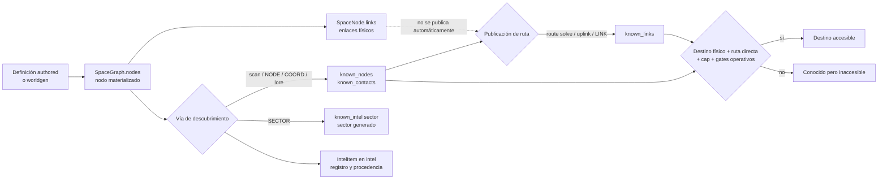

> **4D-3e5 — estado vigente (2026-11-06).** Implementado el selector histórico, confirmación transaccional y recepción/progresión mediante el ledger común. El [contrato productivo](structural-recovery.es.md) y su informe prevalecen sobre las auditorías históricas de este documento: no se fabrican puentes, entradas ni gateways. El núcleo 3b/3c/3d sigue siendo diagnóstico; no autoriza materialización. Sin garantía de salida universal.

> **Actualización implementada 4D-3e4b (2026-11-06).** Señales y broadcasts requieren `comms`/`radiod`, fuente local legítima y recepción efectiva antes de consumir piezas o etapas. Oportunidades pendientes, recibidas y leídas persisten en un ledger común. Las activaciones legacy que fabrican nodos correctivos se aplazan explícitamente hasta e5; las cadenas ya existentes pueden entregar por el canal real. No se alteran políticas del scheduler, scan ni uplink. El [contrato de comunicaciones](passive-communications.es.md) describe gates, cobertura, reintentos y límites; prevalece sobre las descripciones históricas siguientes en estos puntos. F-DEAD-01 sigue pendiente.

> **Actualización implementada 4D-3e4 (2026-11-05).** NODE y bloques authored resuelven también alias declarados y sitios históricos lazy. Lectura e importación explícita comparten parser. Los bloques formados solo por instrucciones explícitas no sortean corrupción. Tokens no resueltos quedan como intel incierta; la recuperación corrupta solo descubre hubs preexistentes dentro de su radio. LINK conserva extremos físicos y cap sin exigir arista histórica; SECTOR no revela inventario y COORD sigue siendo nav_point. No cambian las excepciones de scan y solve manual. La referencia vigente y sus ejemplos ejecutables son [Requisitos narrativos físicos](../narrative-world-contract.es.md). El cuerpo anterior conservado a continuación es histórico donde contradiga esta actualización.

# Descubrimiento, navegación e intel

## Frontera de conocimiento — 4D-3e5a

`C-DATA-004` distingue verdad física, estado interno del motor, observaciones
adquiridas, inferencias y conocimiento consultable. `space.nodes` es existencia;
`known_contacts`/`known_nodes` son conocimiento; `known_links` son rutas
registradas. `lore_placements`, `radio_opportunities`, `recovery_searches` y
`recovery_plans` no son fuentes públicas de descubrimiento. Conocer lugar, ruta
y capacidad actual de recepción son hechos distintos.

Los mapas ordinarios, contactos y autocompletado usan las proyecciones conocidas;
`ship survey <id>` exige además contacto o localización conocidos (incluye posición
actual y extremos de rutas registradas); un destino oculto devuelve el mismo error
localizado que uno ausente, sin datos físicos. Se conservan aliases de nave, datos
adquiridos, scan natural, ruta manual exacta e intel importada. No se redefine la
política deliberada de `route solve`. Los documentos recibidos pueden contener
información falsa sin convertirse por ello en verdad física.

`status` y `diag comms` describen solo receptor/equipo; los datos internos se
consultan mediante `debug radio` y `debug recovery` tras `debug on`. Las consultas
son de solo lectura y `debug off` las bloquea. CLI/Textual comparten frontera,
incluidos paneles, mensajes, errores, eventos, ayuda y compleción.
La resolución de nombres/alias para dock también se limita al conocimiento
adquirido: un nombre oculto no se convierte en un ID secreto dentro de un error.
Los eventos y logs públicos unifican `node_missing`/`unknown_contact` cuando
la nave carece de registro del destino: no permiten deducir existencia física
de una diferencia de error. Los códigos internos y las acciones no cambian;
los detalles de destinos ya adquiridos se conservan.
Prueba: `tests/knowledge_boundary_smoke.py`.

**Compatibilidad 4D-3e2:** el worldgen productivo usa ahora [historia estable versionada](../design/historical-worldgen-integration.es.md).
`NODE:`/`LINK:` resuelven los IDs `S…:WG1_<ámbito>_<índice>` exactos hacia su sector físico,
incluido desbordamiento Z. `SECTOR:`, `COORD:`, bloques de intel y referencias authored
conservan sus contratos; COORD sigue creando un punto de navegación, no una estación
histórica. Declaración física, prosa y revelación son distintas (D18–D20). La regresión
completa authored/arcos/singles/forzado sigue reservada para e4. La memoria de scan
4D-3e3 se describe en §4.1; lore conserva sus mecanismos anteriores.

Estado: **documentación canónica del comportamiento implementado**. El código
productivo se revisó en el commit `3658577`; las pruebas se ejecutaron después
sobre el árbol de trabajo de la Fase 3B, basado en `9f38d2e`.

Actualizado para F-ROUTE-01 en Fase 4D-1 sobre `45f2900` (2026-11-04).

Versión inglesa: [discovery-navigation-intel.md](discovery-navigation-intel.md)

## 1. Propósito y alcance

Este documento explica cómo RETORNO separa el universo que existe del universo
que el jugador conoce, cómo se descubren contactos y rutas, y qué condiciones
permiten viajar. Cubre `scan`, `route solve`, `uplink`, importación de intel,
navegación, objetivos protegidos y failsafes de exploración.

La materialización física de sectores, nodos y topología se documenta en
[Universo físico y generación procedural](world-generation.es.md). Las rutas de
carga de localizaciones, arcos y singles se documentan en
[Contrato de carga de contenido](../content-loading.es.md). Las guías
`docs/intel_lore*` y `docs/arcs*` siguen pendientes de revisión y no son fuente
normativa para esta descripción.

Etiquetas de evidencia:

- **Implementado:** comportamiento leído directamente en código o datos activos.
- **Cubierto:** además existe una prueba que lo ejercita.
- **Inferencia:** explicación compatible con la implementación, sin contrato de
  diseño explícito.
- **Pendiente:** comportamiento sin cobertura suficiente o que necesita una
  decisión de diseño.

## 2. Modelo conceptual del conocimiento

RETORNO mantiene grafos diferentes para existencia física y conocimiento de
navegación. La accesibilidad no se deduce directamente de la topología física.

### Distinciones esenciales

- Un **nodo físico materializado** existe en `WorldState.space.nodes`. Puede ser
  completamente desconocido para el jugador.
- Un **contacto conocido** aparece en `known_nodes` y, normalmente, también en
  `known_contacts`. Conocerlo no concede una ruta.
- Una **ruta física** es una relación en `SpaceNode.links`. Worldgen y algunos
  creadores de nodos especiales la usan como topología del universo.
- Una **ruta conocida** es una relación en `known_links`. Es la que consulta el
  viaje. No se exige que exista también en `SpaceNode.links`.
- La **intel registrada** es un `IntelItem` de `world.intel`, con tipo,
  procedencia y confianza. Registrar intel y cambiar conocimiento son operaciones
  separadas; no todos los flujos hacen ambas.
- Un **sector generado** está en `generated_sectors`; eso no revela sus nodos.
  No existe un conjunto canónico independiente llamado `known_sectors`.
- Una **coordenada conocida** importada crea o reutiliza un nodo físico
  `NAV_<hash>` de tipo `nav_point`, lo marca conocido y deja metadatos en
  `known_intel`; no crea una ruta hacia él.
- Un destino es **accesible desde la posición actual** sólo si el nodo físico
  existe, es conocido, figura como vecino directo en `known_links`, no supera el
  cap de salto y se cumplen los gates de viaje. Un contacto sin ruta es conocido
  pero inaccesible.

## 3. Estados y estructuras de datos

| Estructura | Papel vigente | Carácter |
| --- | --- | --- |
| `space.nodes: dict[str, SpaceNode]` | Registro de nodos físicos materializados y sus coordenadas. | Canónico para existencia física. |
| `SpaceNode.links` | Vecindad física usada por worldgen y archivos procedurales de salvage. | Canónico para topología física; no concede viaje. |
| `generated_sectors` / `sector_states` | Sectores materializados y metadatos de generación. | Estado de worldgen, no conocimiento del jugador. |
| `known_nodes: set[str]` | Conjunto operativo que UI, mapas, scan, viaje y pools tratan como nodos conocidos. | Canónico de facto para conocimiento de nodos. |
| `known_contacts: set[str]` | Espejo histórico mantenido por la mayoría de escritores; varios consumidores lo unen con `known_nodes` o lo usan como fallback. | Compatibilidad/representación auxiliar. |
| `known_links: dict[str, set[str]]` | Grafo de rutas publicadas al jugador. | Registros crudos; la proyección operativa es canónica para alcance y conectividad. |
| `intel: list[IntelItem]` | Registro tipado y deduplicado de intel: `node`, `link`, `sector` o `coord`. | Canónico para historial/procedencia, no para accesibilidad. |
| `known_intel: dict[str, dict]` | Índice disperso escrito principalmente por importaciones `NODE`, `SECTOR` y `COORD`; viaje acepta sus claves como conocimiento heredado. | Caché/compatibilidad, no inventario completo de intel. |
| `fine_ranges_km` | Distancia local refinada para determinados contactos del mismo sector. | Caché derivada. |
| `visited_nodes` | Nodos no temporales alcanzados; también cierra ventanas de pools al entrar en órbita. | Historial de visita. |
| `node_pools` | Archivos, piezas pendientes y pool congelado de rutas uplink por nodo. | Estado persistente de oportunidades, no conocimiento visible por sí mismo. |
| `forced_hidden_nodes` | Nodos físicos creados sin añadirlos a los conjuntos conocidos. | Marcador de ocultación inicial, no barrera contra `scan`. |
| `arc_placements` | Colocación, entrega y flag `primary.unlocked` de piezas de arcos. | Estado narrativo condicional. |

`known_nodes` y `known_contacts` no tienen una función central que imponga su
igualdad. Los escritores principales actualizan ambos, pero un fixture, una
migración o un consumidor nuevo puede hacerlos divergir. La UI de contactos
prioriza `known_nodes` cuando no está vacío y sólo usa `known_contacts` como
fallback; otros subsistemas calculan la unión.

`record_intel` deduplica por la tupla `(kind, from_id, to_id, sector_id, coord)`.
Una segunda fuente para el mismo hecho no crea otro `IntelItem` ni actualiza la
confianza o procedencia del existente.

Los comandos `intel`, `intel show` e `intel export` leen `world.intel`, no
reconstruyen el inventario desde `known_links` o `known_intel`. En consecuencia,
una ruta creada por route solve no aparece en el export salvo que otra vía haya
registrado además su `IntelItem`.

La presentación del listado es de sólo lectura. `intel` muestra los 20 registros
más recientes, `intel N` los N más recientes disponibles e `intel all` el
historial completo. Los tres ordenan por timestamp descendente; a igualdad de
timestamp usan orden de inserción inverso, de modo que aparece primero el
registro añadido después. La lista almacenada no se reordena, y `intel show` e
`intel export` conservan respectivamente su búsqueda por id y el orden de export
almacenado.

### Sectores y coordenadas conocidas

La implementación representa tres hechos distintos:

1. `generated_sectors` afirma que worldgen ya materializó un sector.
2. `known_intel[sector_id]["sector"]` y un `IntelItem(kind="sector")` afirman
   que se importó intel `SECTOR:`.
3. Las vistas de contactos agrupan sectores derivados de las coordenadas de
   nodos conocidos.

Ninguno implica automáticamente los otros dos. En particular, `SECTOR:` llama
a `ensure_sector_generated`, pero no revela todos los nodos creados allí.
El id admitido tiene la forma canónica de worldgen: `S` mayúscula y tres
índices decimales con signo separados por guiones bajos, cada uno formateado
como `{value:+04d}`. La anchura es mínima, por lo que los índices mayores siguen
siendo válidos.

### Rutas operativas y pistas históricas (4D-1)

`is_hop_within_cap` de `model/world.py` es el criterio físico compartido: ambos
extremos deben existir y su distancia debe ser como máximo 45 ly, inclusive.
`add_known_link` rechaza además extremos vacíos y autoenlaces. La validez
estructural no exige una arista física de `SpaceNode.links`, descubrimiento
previo, estado de sensores ni potencia; siguen aplicándose los gates propios
de viaje y resolución.

`reachable_from` proyecta sólo destinos directos válidos de `known_links`;
`reachable_known_nodes` recorre esos saltos dirigidos. Cada salto se comprueba,
por lo que una arista intermedia inválida no vuelve alcanzable un componente
remoto. Las consultas son de sólo lectura: no generan sectores, revelan
contactos ni podan historial.

| Productor/consumidor | Capa necesaria y tratamiento |
| --- | --- |
| Bootstrap, `route solve`, `nav abort` | Publican mediante `add_known_link`; los trabajos solve completados revalidan extremos/cap. Las rutas válidas de waypoint siguen admitidas. |
| Importación explícita, autoimportación `cat`/mail, tokens LINK de `[INTEL]` | Comparten `_import_link_intel`; intentan primero la materialización lazy existente, conservan contactos e historial de enlaces deduplicado y sólo publican saltos válidos. |
| Uplink y lore `uplink_only` | Publican con el mismo criterio de dominio; no cambian ciclo de pools, pesos, entrega narrativa ni probabilidades. La exclusión de candidatos del pool usa rutas operativas. |
| Viaje | Exige una arista directa registrada y el criterio físico compartido, además de los gates vigentes de conocimiento y nave. |
| Grafo/caminos/componentes de navegación, listado de rutas, sugerencias de origen, contactos, survey y compleción CLI/Textual | Usan la proyección operativa para conexiones y flags de ruta; el inventario de contactos sigue siendo independiente. Ambas interfaces comparten renderers/helpers. |
| Recuperación global y deadnodes | Comparten `reachable_known_nodes`; las aristas inválidas no crean frontera, no hacen accesibles payloads remotos mediante un componente inválido ni excluyen un objetivo como conectado. |
| Listado/show/export de intel y diagnósticos debug crudos | Historial/inspección, no autorización. Las pistas inválidas registradas siguen visibles/exportables; los conteos debug de grafo/cap pueden mostrar registros obsoletos crudos. |
| Save/load y limpieza de nodos temporales | La persistencia conserva el estado crudo. Desde 4D-2, `_clear_tmp_node` elimina las referencias vivas del waypoint abandonado/reemplazado; conserva el historial. |

No hace falta normalización destructiva al cargar: la proyección idempotente
filtra registros inválidos inmediatamente, antes y después de save/load.
Contactos, `known_intel`, archivos, procedencia y referencias pendientes se
conservan exactamente. Repetir save/load no muta el mundo ni genera sectores.
Los LINK rechazados nuevos se guardan como registros históricos `IntelItem`,
no como aristas operativas nuevas. Reimportar tras materializar puede publicar
una ruta ahora válida. Las aristas pendientes crudas existentes se reevalúan
contra el estado físico actual en cada consulta. Los archivos incompatibles
conservan su rechazo explícito y nunca se eliminan.

La generación lazy conserva su protocolo vigente. Un `SECTOR:` canónico
materializa el sector antes de validar un LINK posterior a su id generado real;
importar sólo el sector no revela el cluster. El helper existente `S...:...`
también solicita su sector canónico antes de validar, pero no crea alias para
los ids `KIND_HEX` generados por worldgen. Un literal no resuelto sigue siendo
contacto y pista histórica, no ruta operativa. No se introduce un protocolo
nuevo de resolución de ids ni una política de orden de generación.

## 4. Vías de descubrimiento e importación

### 4.1 `scan`

Sintaxis pública: `scan`.

**Requisitos iniciales y durante el trabajo:** terminal operativo, estado de
potencia no crítico, calidad de energía por encima del umbral de bloqueo,
sensores al menos `LIMITED` y servicio `sensord` en ejecución. Un waypoint detenido (`kind="transit"`, `ship.in_transit=False`) usa estos
gates normales y no necesita el unlock `scan_in_transit`. El gate público sigue
rechazando scan durante un viaje activo; los trabajos encolados conservan la
comprobación de `scan_in_transit` cuando `ship.in_transit=True`. No se amplía
el escaneo durante viajes activos.

El comando encola un trabajo `SCAN` de `Balance.SCAN_TIME_S` (actualmente 8 s)
y guarda el nodo de origen. El trabajo falla si los sensores o `sensord` dejan
de estar disponibles o si cambia el nodo actual antes de completarse. Puede
cancelarse con `job cancel <job_id>`; la cancelación no aplica el escaneo.

Al completarse:

1. Calcula la caja de índices de sector cubierta por el radio de sensores y
   llama a `ensure_sector_generated` para cada celda. Cada llamada puede ampliar
   la materialización por las reglas de worldgen.
2. Considera sólo nodos dentro de la esfera real del radio.
3. Aplica una probabilidad que cae linealmente de `SENSORS_DETECT_P_NEAR` a
   `SENSORS_DETECT_P_FAR` y la multiplica por el factor del estado de sensores.
4. Añade cada detección a `known_nodes` y `known_contacts`.
5. Para una detección nueva registra `IntelItem(kind="node", source_kind="scan",
   confidence=0.6)`.
6. Para ciertos tipos dentro del radio local puede fijar `fine_ranges_km`.
7. Al terminar todo el barrido registra una observación inmutable con las
   condiciones efectivamente usadas y los resultados, sin otra tirada RNG.

Los factores efectivos de detección son `UPGRADED=1.00`, `NOMINAL=1.00`,
`LIMITED=0.85`, `DAMAGED=0.60` y `CRITICAL=0.35`; internamente `OFFLINE` usa el
fallback 0.35. El gate público rechaza `DAMAGED`, `CRITICAL` y `OFFLINE` antes
de ejecutar el scan. `UPGRADED` reutiliza deliberadamente el factor nominal como
corrección conservadora de 4C-2a: cualquier bonificación adicional de la mejora
queda para un estudio futuro de balance. La probabilidad final se limita a
`[0, 1]`.

La entrada activa de recuperación de exploración es una excepción: se detecta
con garantía cuando existe y todavía no está en `known_nodes`. Si ya era conocida
se aplica la tirada normal. `scan` no publica `known_links`, no consulta
`SpaceNode.links` y no filtra `locked_primary_targets`.

Completar el trabajo también evalúa deadnodes y el failsafe de recuperación de
exploración. Por tanto, `scan` no es una operación de sólo lectura: puede
materializar sectores y activar nodos o archivos de recuperación.

#### Memoria de observaciones (4D-3e3)

Implementado sobre `590a3e8`, pendiente de revisión externa. Se conserva la
separación entre existencia histórica, nodo materializado, contacto observado y
ruta conocida. Una observación es un registro de lo que el barrido detectó,
no otro inventario del universo ni una certificación de volumen vacío.

`ScanObservation`, en [`model/world.py`](../../src/retorno/model/world.py), es una
dataclass tipada, congelada y serializable. Campos:

| Campos | Significado |
| --- | --- |
| `observation_id`, `t` | ID `SCAN00001…` monotónico y `ClockState.t` exacto en segundos desde inicio. No introduce otro modelo temporal. |
| `position_ly`, `origin_node_id` | Posición realmente usada por scan; ID del origen si el nodo existía, `None` al usar sólo `current_pos_ly`. |
| `radius_ly` | Alcance efectivo usado al completar, no una copia del radio al encolar. |
| `sensors_state`, `sensors_forced_offline`, `sensord_running` | Snapshot del sensor/servicio durante ejecución. |
| `detection_factor`, `near_probability`, `far_probability` | Parámetros reales de la fórmula vigente; sin ajuste por historial. |
| `detected_ids`, `new_ids` | Tuplas ordenadas de detecciones reales y su subconjunto descubierto en ese barrido. Los otros detectados ya eran conocidos. |
| `guaranteed_ids` | Subconjunto realmente detectado mediante la excepción existente de entrada de recuperación, sin publicar candidatos no detectados. |
| `outcome` | `no_signals`, `known_contacts_only` o `new_contacts`. |
| `rng_counter`, `job_key` | Contador RNG usado y clave interna estable del trabajo; `None` en llamadas directas sin trabajo. |

`_perform_scan` es el único punto de registro y conserva su tupla de retorno
anterior. Añade memoria sólo después de completar materialización, evaluación,
intel y distancias finas. El trabajo `SCAN` pasa por ese mismo helper; no añade
un segundo registro. Su marcador persistido `params['scan_observation_id']`
y estado terminal impiden reaplicar efectos, incluso después de podar la entrada.
Ticks repetidos no repiten resultados. Cada nueva invocación directa exitosa es
otro barrido, no el replay de un trabajo anterior.

Se conservan los gates previos: `_perform_scan` es un kernel privado que no los
comprueba por sí mismo (incluido el fallback de factores que prueban los tests).
El trabajo público y `_scan_and_discover` aplican sus gates existentes; el helper
de compatibilidad registra una sola observación, sin cambiar su retorno.
Bloqueo, interrupción por contexto/sensores y cancelación no registran observación.
Si materialización/evaluación lanza una excepción, el trabajo queda `FAILED` con
feedback EN/ES de observación incompleta; no emite resultados vacíos exitosos.
La llamada directa propaga el error. Pueden quedar sectores históricos previamente
materializados, pero no se registran como evidencia de ausencia. La memoria no
promete rollback global de cualquier excepción dentro del motor.

La lista `WorldState.scan_observations` conserva las últimas **128** observaciones,
en orden de ejecución del más antiguo al más reciente; a igualdad de tiempo,
el orden de inserción permanece. `next_scan_observation_seq` persiste y no se
reinicia por retención. Podar no toca contactos, intel, rutas ni pools. Las tuplas
sin referencias a nodos mutables y la dataclass congelada evitan cambios
retroactivos; el ID de un waypoint retirado puede permanecer como procedencia histórica.

`scan_observation_history(world)` devuelve una tupla inmutable del historial y
no materializa ni muta nada. Es la API de consulta; no se añade comando ni panel.
No se reconstruyen escaneos pasados a partir de intel. `WorldState.__setstate__`
ya admite campos añadidos con defaults: las partidas existentes de esquema 3
cargan historial vacío y secuencia 1, sin bump de versión, migración compleja ni
borrado. También se reanudan trabajos encolados antes de añadir esos campos.
Los guardados nuevos conservan historial, orden, IDs y marcadores de trabajos.

Resultados y presentación EN/ES, compartida por CLI y Textual:

- `no_signals`: «No se detectaron señales en esta observación. Esto no confirma
  que el espacio esté vacío». No invalida intel, sectores ni emplazamientos.
- `known_contacts_only`: hay señales realmente detectadas y todos sus contactos
  ya eran conocidos; se indica que no hay contactos nuevos.
- `new_contacts`: contiene descubrimientos nuevos, conservando eventos,
  `record_intel`, distancias finas y comportamiento de sonido actuales.

No se guardan listas de lugares omitidos, secretos consultados del manifiesto,
cobertura exhaustiva ni certificados negativos por sector. Un nodo oculto sólo
entra si la detección real lo observa; sigue vigente la excepción deliberada de
scan natural para primaries protegidos. Consultar manifiesto o memoria no revela
nada. Un negativo puede ir seguido de un descubrimiento legítimo, sin umbral de
repeticiones, probabilidad acumulada, obligación de escanear otra vez ni rutas gratis.

La materialización y consulta inversa `historical-world-v1` no cambian; un outlier
Z se observa desde su posición física aunque su procedencia generadora sea otra.
Pruebas: [`scan_observation_memory_smoke.py`](../../tests/scan_observation_memory_smoke.py),
20 grupos, comparación exacta con kernel `590a3e8`, retención, save/load,
representación anterior de slots, condiciones al completar, fallos y presentación.
[Informe y resultados](../testing/scan-observation-review.es.md).

La memoria no resuelve F-DEAD-01 ni sus bloqueos estructurales; no implementa
nuevos sensores, bayesianismo, triangulación, planificación de recuperación ni
compilación narrativa. D21–D24 y los requisitos físicos de historias instaladas
siguen reservados para e4, con integración del planificador en e5. No se modifica
`narrative/amanecer/`, arcos, singles ni guías de autoría.

### 4.2 `route solve`

Sintaxis pública vigente: `route solve <node_id>`. La forma histórica
`route <node_id>` no es válida.

Requiere sensores al menos `LIMITED`, `sensord` activo, potencia y Core OS
compatibles, un nodo actual físico y un destino ya presente en `space.nodes`.
El destino debe estar dentro de `ship.sensors_range_ly` y del cap global
`MAX_ROUTE_HOP_LY` (45 ly).

La acción **no exige que el destino esté en `known_nodes` o `known_contacts`**.
La compleción de comandos sólo propone contactos conocidos y en rango, pero un
id físico escrito manualmente puede resolver una ruta hacia un nodo todavía
desconocido. Permitirlo fue una decisión de diseño deliberada confirmada por el
desarrollador. La razón original no está documentada y podrá revisarse más
adelante si conviene mantener este comportamiento.

Si la ruta ya existe, el comando intenta refinar la distancia local sin encolar
trabajo; si no puede, informa que la ruta ya era conocida. En otro caso encola
un trabajo `ROUTE_SOLVE` cuya duración interpola entre 100 y 6800 s según la
fracción del radio de sensores. Sólo puede haber un `ROUTE_SOLVE` ejecutándose
a la vez.

Al completarse, añade un enlace bidireccional a `known_links` y marca el destino
en ambos conjuntos conocidos. No añade una arista a `SpaceNode.links` y,
contrariamente a la guía antigua, **no llama a `record_intel`**. Durante el
trabajo se revalidan sensores y servicio, pero no se revalida que la nave siga
en el nodo de origen almacenado.

Al completar se revalidan extremos físicos y cap antes de publicar. Si un
extremo desapareció, se rechaza la publicación sin informar una ruta resuelta.

### 4.3 `uplink`

Sintaxis pública: `uplink`; alias: `relay uplink`.

Requisitos:

- nave fuera de tránsito y sin brownout;
- calidad de energía por encima del umbral de bloqueo;
- Core OS que permita el comando;
- nave acoplada al nodo actual;
- nodo de tipo `relay`, `station` o `waystation`;
- `data_core` al menos `LIMITED`, no apagado ni shed;
- servicio `datad` instalado y en ejecución.

`sync_node_pools_for_known_nodes` inicializa una sola vez los pools de nodos
conocidos, nodos `forced_hidden` y anclas actuales. Al preparar un pool uplink:

- materializa el sector actual;
- excluye el placeholder `UNKNOWN`, el propio nodo, rutas ya conocidas y
  objetivos primarios bloqueados;
- pondera nodos conocidos, hubs físicos del sector o vecindad, derelicts y
  candidatos authored activos configurados;
- elige como máximo tres destinos y guarda la lista en
  `NodePoolState.uplink_route_pool`.

La lista queda congelada al inicializar el pool. Nodos materializados o
desbloqueados después no se incorporan a ese pool.

El primer uplink válido intenta publicar bidireccionalmente cada ruta del pool,
descarta las que superen 45 ly, marca como conocidos los destinos aceptados,
registra `IntelItem(kind="link", source_kind="uplink", confidence=0.9)` y escribe
`/logs/nav/uplink_<node>_<seq>.txt`. Después ejecuta el scheduler de lore,
deadnodes y, tras suficientes uplinks sin rutas nuevas, recuperación de
exploración. Finalmente marca `uplink_data_consumed`.

El contador específico `mobility_no_new_uplink_count` sí registra un intento sin
rutas nuevas. En cambio, `lore.counters["uplink_count"]` sólo aumenta si hubo
alguna ruta, archivo, evento narrativo, efecto de lore aplicado directamente o
evento de recuperación.

Los intentos posteriores en el mismo nodo mantienen agotado el pool de rutas:
no añaden sus rutas, no escriben otro log ni incrementan contadores. Sí
reevalúan exclusivamente cualquier `uplink_only` ya asignado que siga pendiente.
El mensaje localizado de finalización distingue una entrega narrativa pendiente
aplicada con éxito de un pool agotado sin efecto aplicado.

### 4.4 `cat`, `intel import` y formatos

`intel import <path>` procesa cualquier archivo accesible del filesystem del
juego. `cat <path>` autoimporta únicamente rutas reconocidas de navegación,
mail o logs (`/data/nav`, `/mail`, `/logs` y sus equivalentes bajo `/remote`).
`mail read <id|latest>` resuelve la ruta del correo y llama a `render_cat()`;
por tanto, también autoimporta la intel contenida en una ruta de mail reconocida.

La procedencia y confianza dependen de la ruta: mail usa 0.7; logs, fragmentos
y manuales importados explícitamente usan normalmente 0.8.

| Formato | Efecto implementado |
| --- | --- |
| `NODE: <id>` | Añade el texto literalmente a `known_nodes`, `known_contacts` y `known_intel`, y registra intel de nodo. Sólo materializa un sector si el id tiene forma procedural `S...:...`; un id arbitrario puede quedar sin nodo físico. |
| `LINK: <from> -> <to>` | Intenta añadir ruta bidireccional conocida. Si falta un extremo físico o el salto supera el cap, conserva contactos e historial pero no publica la ruta. |
| `LINK: <to>` | Igual, tomando el nodo actual como origen. |
| `SECTOR: <sector_id>` | Para un id canónico, llama a worldgen, registra intel de sector y `known_intel`, pero no revela los nodos del sector. Un id no canónico se rechaza con feedback localizado antes de mutar mundo o intel; las líneas válidas posteriores del archivo siguen procesándose. |
| `COORD: x, y, z` | Crea un `NAV_<hash>` físico si falta, lo marca conocido y registra intel de coordenada; no publica ruta. |

Desde 4D-1, todo LINK no verificable conserva contactos e intel histórica,
pero no se publica como ruta operativa. El feedback distingue extremos ausentes
y saltos sobre cap en EN/ES.

#### Bloques `[INTEL]...[/INTEL]`

Cada bloque se procesa primero como una unidad:

- si contiene una línea `LINK:`, se procesa el primer enlace encontrado;
- si todas las líneas no vacías son `SECTOR:` explícitos, se omite el
  procesamiento unitario y el parser canónico de líneas trata cada una sin
  activar recuperación corrupta;
- en caso contrario, el contenido completo debe coincidir exactamente con el
  id, nombre o sector de una localización authored activa para descubrirla;
- si no coincide, entra en el flujo de intel corrupta.

Después, las líneas explícitas `LINK:`, `NODE:`, `SECTOR:` y `COORD:` del mismo
archivo se procesan también por el parser de líneas. Por ello un bloque
multilínea sin `LINK` puede intentar recuperación corrupta antes de importar
sus líneas válidas. La descripción antigua de los bloques como contenedor
general flexible es más amplia que el comportamiento real. Un bloque que mezcla
`SECTOR:` con texto narrativo desconocido conserva el comportamiento general de
bloques y aún puede entrar en recuperación corrupta antes del parser de líneas;
4C-2b no define una semántica nueva para esa forma mixta.

La intel corrupta tiene actualmente un 50 % de fallo. Si se recupera, muestrea
sectores alrededor del nodo actual, puede materializarlos y revela el primer hub
desconocido elegible. Este camino excluye `locked_primary_targets` y registra
intel de nodo con confianza 0.4.

### 4.5 Otras vías reales

- `known_on_start` puede revelar localizaciones durante bootstrap. En los datos
  activos, `UNKNOWN` es el contacto inicial relevante; `RETORNO_SHIP` no se
  convierte en destino mundial ordinario.
- El scheduler de lore puede escribir archivos en mail/logs/salvage para que el
  jugador los importe posteriormente.
- El canal narrativo `uplink_only` aplica directamente un `LINK`, registra intel
  y desbloquea el primary sólo si ambos extremos físicos existen y la ruta
  respeta el cap.
- `drone salvage data` monta archivos bajo `/remote/<node>/`; la adquisición del
  archivo no importa su intel hasta `cat` o `intel import`.
- Recuperación de exploración y deadnodes crean o entregan breadcrumbs como
  archivos. Su mera entrega no concede normalmente la ruta.
- Los comandos de mapas, contactos e intel muestran estado existente; no
  descubren nodos por sí mismos.

## 5. Requisitos de comandos y trabajos

| Acción | Gates al iniciar | Trabajo/tiempo | Revalidación o interrupción |
| --- | --- | --- | --- |
| `scan` | Potencia válida, sensores ≥ `LIMITED`, `sensord`; unlock si está en nodo `transit`. | `SCAN`, 8 s. | Falla si sensores/servicio dejan de servir o cambia el nodo actual; cancelable. |
| `route solve <id>` | Potencia/Core OS, sensores ≥ `LIMITED`, `sensord`, ambos nodos físicos, rango de sensores y cap. | `ROUTE_SOLVE`, 100–6800 s. | Falla si sensores o servicio dejan de servir; cancelable; no comprueba que la nave siga en origen. |
| `uplink` | Dock, tipo compatible, potencia, `data_core` ≥ `LIMITED`, `datad`; el primer intento usa el pool no consumido. | Inmediato en REPL; no es `Job`. | No hay fase interrumpible; el pool de rutas se consume una vez y los intentos posteriores sólo reevalúan `uplink_only` pendiente. |
| `intel import` | Archivo existente y nivel de acceso suficiente; Core OS/terminal permiten el comando. | Inmediato. | Puede materializar mundo y mutar conocimiento durante el parseo. |
| `nav <id>` | No estar ya en tránsito ni docked; destino físico y conocido; ruta directa conocida; cap y potencia/Core OS. | Estado de tránsito hasta `arrival_t`; no es `Job`. | `nav abort` crea un waypoint; la llegada ocurre en `Engine.tick`. |

Scan y route solve no reservan un consumo energético específico en el `Job`.
El tiempo transcurrido sigue ejecutando el modelo general de potencia,
degradación y radiación. Iniciar viaje con el perfil automático `CRUISE` apaga
sensores, seguridad, `data_core` y `drone_bay`, lo que puede hacer fallar en el
siguiente tick trabajos de scan o route solve todavía activos.

## 6. Navegación y viaje

Sintaxis de viaje:

- `nav <node_id>`; alias de comando: `navigation` o `travel`;
- `nav --no-cruise <node_id>` para no aplicar el plan automático;
- `nav abort` para interrumpir el tránsito.

El motor valida, en este orden lógico, que la nave no esté en tránsito ni
acoplada, que el destino exista, sea conocido, sea distinto del actual, figure
en `known_links[current]` y no supere 45 ly. Un waypoint temporal detenido usa las mismas reglas de ruta operativa;
sus destinos no se limitan a los extremos anteriores.

`SpaceNode.links` no participa en esta autorización. Por tanto:

- una arista física desconocida no permite viajar;
- una ruta conocida sin arista física sí permite viajar si ambos nodos existen
  y supera los demás gates;
- una ruta conocida hacia un id inexistente no permite viajar;
- una ruta conocida por encima del cap permanece en el estado, pero el viaje la
  rechaza.

Para distancias muy locales del mismo sector, `fine_ranges_km` permite calcular
el tiempo en kilómetros; el resto usa distancia en años luz y velocidad de
crucero. No existe un gasto de combustible discreto al iniciar el salto. El
tránsito hace avanzar el tiempo y, con él, el modelo energético y ambiental.

Al llegar, el nodo pasa a `visited_nodes`, se actualiza la posición, se cierra
su ventana de pool y se elimina el placeholder inicial `UNKNOWN` cuando
corresponde.

### Aborto y nodo temporal

`nav abort`, tras confirmación de la CLI, detiene la nave en la posición
interpolada exacta y crea un `NAV_PT_<hex>` físico de tipo `transit`.
`ship.in_transit` pasa a falso; el aborto no avanza tiempo ni produce llegada
o desplazamiento gratuito. Registra rutas conocidas bidireccionales dentro del
cap hacia origen y destino supervivientes. El waypoint es inicialmente la
posición actual, no un contacto descubierto; un scan posterior puede conocerlo.

El jugador puede permanecer allí, utilizar sistemas, guardar/cargar y ejecutar
`scan` con los requisitos normales de sensores, `sensord` y energía. Las
distancias de detección se calculan desde T. `route solve C` puede publicar una
ruta hacia un tercer destino físico elegible dentro de sensores y 45 ly,
aplicando el criterio F-ROUTE-01. Viajar a C exige esa ruta operativa y todos
los gates normales de la nave. No obliga a volver a A ni pasar por B, ni permite
navegar a coordenadas arbitrarias. CLI y Textual comparten
`_travel_targets_for_completion`; mapas y autocompletado usan `reachable_from`.

El waypoint de salida sigue existiendo mientras el viaje lo necesita para
interpolar. Al llegar a otro nodo, o al reemplazarlo por otro aborto,
`_clear_tmp_node` elimina exclusivamente ese id temporal. Un aborto repetido
calcula posición y radiación ambiental antes de eliminar T1; T2 conserva rutas
sólo a extremos supervivientes. El origen eliminado no queda en
`active_tmp_from`. Desde T2 siguen disponibles exploración y route solve; los
destinos históricos necesitan una nueva ruta normal.

#### Inventario de referencias temporales (4D-2)

| Estado / consumidor | Vida útil y limpieza |
| --- | --- |
| `space.nodes`, `SpaceNode.links`, `space.edges`, `known_links` | Elimina T, su entrada saliente y todas las referencias entrantes a T; conserva las demás aristas y direcciones. Sin saneado global. |
| `known_nodes`, `known_contacts`, `known_intel`, `forced_hidden_nodes`, `visited_nodes`, `salvage_tip_nodes`, `fine_ranges_km` | Elimina sólo entradas con clave T, incluido su autodescubrimiento por scan. Conserva contactos legítimos e intel de destinos. |
| `node_pools`, `dead_nodes`, `uplink_route_pool` de los pools | Elimina pool/tracker vivo de T y T como candidato de ruta pendiente en otros pools; conserva contenidos ajenos. |
| `sector_states` | Los waypoints no son miembros generados de sectores; elimina sólo T si aparece en índices de nodos/hubs. Conserva ids de sector, registros de generación, pares intersectoriales y contadores de enlaces permanentes. |
| Jobs SCAN / ROUTE_SOLVE | Cancela jobs activos cuyo objetivo/origen sea T eliminado mediante el finalizador y evento localizado existentes. Conserva jobs terminales como historial. |
| `active_tmp_*`, origen de tránsito de la nave | Restablece metadatos temporales activos; vacía un extremo eliminado tras la llegada y conserva el origen histórico en su evento. El reemplazo registra sólo extremos supervivientes. |
| `intel`, eventos, logs deadnode | Los registros históricos pueden conservar T como fuente/id; no son aristas operativas ni se borran. |
| Placements lore/arcos, anclas recovery, pistas del filesystem | Auditado: creación/scan normal del waypoint no convierte T en host narrativo authored/procedural elegible ni en ancla recovery. Sin edición general de esos sistemas. |
| Save/load | La serialización existente conserva cada fase sin normalización, cambios de esquema ni migración. Los ciclos repetidos y la limpieza son idempotentes. |

Regresión: `tests/nav_abort_waypoint_cleanup_smoke.py`, seed `314159`, acciones
reales de Engine y slots temporales. Cubre `(0,0,0) -> (8,4,2)` abortado al 25%
= `(2,1,0.5)`, detección de C desde T, T→C/A/B, abortos repetidos, jobs
pendientes, gates negativos y cinco fases de persistencia.

## 7. Tabla de transiciones

| Acción | Requisitos resumidos | Cambio de estado | Información obtenida |
| --- | --- | --- | --- |
| Worldgen bajo demanda | Un consumidor solicita sector. | Añade nodos físicos, enlaces y `generated_sectors`. | Ninguna por sí mismo. |
| `scan` completado | Sensores/servicio/rango y trabajo estable. | Materializa sectores; añade detecciones a ambos conjuntos conocidos; puede fijar rango fino. | `IntelItem(node)` sólo para contactos nuevos; ninguna ruta. |
| `route solve <id>` completado | Destino físico en rango y sensores disponibles. | Añade `known_links` bidireccional y conoce destino. | Ruta utilizable; no crea `IntelItem`. |
| Primer `uplink` del nodo | Dock, hub compatible, `data_core`/`datad`, pool no consumido. | Añade rutas/contactos aceptados, log, contadores condicionales y consume pool. | `IntelItem(link)` por ruta nueva; posibles entregas de lore/failsafe. |
| `uplink` posterior | Mismos gates; pool de rutas consumido y `uplink_only` pendiente. | No repite pool/log/contadores; sólo reintenta ese canal narrativo. | `IntelItem(link)` únicamente si el LINK pendiente pasa a ser válido. |
| `NODE:` | Archivo accesible. | Añade id a conocidos y a `known_intel`. | `IntelItem(node)`; puede ser dangling. |
| `LINK:` | Archivo accesible; extremos físicos y cap para publicar. | Conserva contactos/historial; sólo añade `known_links` si es válida. | `IntelItem(link)` deduplicado, también para pistas rechazadas. |
| `SECTOR:` | Archivo accesible e id de sector canónico. | Materializa sector y marca `known_intel`; un id inválido no tiene efecto. | `IntelItem(sector)`; nodos siguen ocultos. |
| `COORD:` | Tres números válidos. | Crea/conoce `NAV_<hash>`. | `IntelItem(coord)`; sin ruta. |
| Lore `uplink_only` | Pieza elegible, ambos extremos físicos y cap. | Añade ruta/contactos y marca primary desbloqueado; si falla, conserva asignación y pendiente. | `IntelItem(link)` directo sólo tras éxito. |
| Breadcrumb de lore/failsafe | Trigger elegible. | Escribe archivo local/remoto; puede crear nodos ocultos. | Ningún cambio de rutas hasta importar el archivo. |
| `nav <id>` | Nodo conocido, ruta directa, cap y gates. | Inicia tránsito; al llegar actualiza nodo/posición/visita. | No descubre nuevas rutas. |
| `nav abort` | Nave en tránsito y confirmación CLI. | Crea waypoint temporal y rutas a los extremos. | Posición detenida para scan, solve y viaje real a destinos válidos. |

## 8. Protección narrativa y excepciones

`locked_primary_targets` se calcula desde los `primary_intel` de arcos cargados
cuyo objetivo es `link` o `node` y que aún no constan como desbloqueados o
descubiertos. El objetivo sigue existiendo físicamente; el lock no lo elimina
del universo.

Vías que respetan explícitamente el lock:

- preparación procedural del pool de rutas de uplink;
- selección de un hub al recuperar intel corrupta.

Vías que **no** consultan el lock:

- `scan`;
- `route solve <id>` escrito manualmente;
- importación explícita `NODE`, `LINK`, `SECTOR` o `COORD`;
- bootstrap `known_on_start`;
- consulta directa de un id ya presente por otros consumidores.

Importar el `LINK` exacto del primary mediante el parser marca el arco como
descubierto si la ruta es nueva. La entrega narrativa `uplink_only` también
marca el primary desbloqueado incluso si esa ruta ya era conocida. Otros enlaces
hacia el mismo destino pueden conceder acceso sin actualizar ese flag.

Por tanto, la implementación ofrece **protección contra dos revelaciones
procedurales concretas**, no un bloqueo global de descubrimiento. Un nodo en
`forced_hidden_nodes` tampoco es indetectable: sólo se crea sin marcarlo como
conocido; scan puede revelarlo si entra en alcance.

El loader activo devuelve actualmente **cero arcos** porque
`data/arcs/templates/` no se recorre. En una partida normal no hay
`locked_primary_targets` activos. Esta sección describe código condicional, no
una protección narrativa operativa ni contenido activado.

## 9. Interacción con worldgen, lore y failsafes

- `scan`, preparación de uplink, `SECTOR:` e intel corrupta llaman a worldgen.
  Descubrir puede por ello modificar primero el universo físico.
- Los pools uplink se calculan sobre el mundo existente en el momento de su
  inicialización y no se reconstruyen al crecer el universo.
- El scheduler de lore separa entrega de archivos de aplicación de intel. Los
  canales de archivo requieren lectura/importación; `uplink_only` es la
  excepción directa.
- Recuperación de exploración sólo se activa cuando el sistema considera que no
  queda una frontera utilizable y la nave tiene capacidad operativa. Crea una
  entrada oculta dentro de rango, un gateway y un breadcrumb local. No concede
  directamente el primer enlace.
- La entrada de recuperación puede descubrirse por su intel o por scan
  garantizado. Tras llegar, el broadcast o salvage proporciona un `LINK` al
  gateway.
- Deadnodes observa contactos sin ruta alcanzable ni posibilidad de route solve.
  Tras umbrales, crea un relay puente o entrega un `LINK` directo como archivo;
  el jugador todavía debe importarlo.
- Los failsafes pueden añadir nodos después de worldgen. Sus efectos topológicos
  y las limitaciones de sincronización sectorial se detallan en el documento de
  worldgen.

## 10. Invariantes confirmados

1. Materializar un nodo o sector no lo revela automáticamente.
2. Conocer un nodo no crea una ruta; conocer una ruta no prueba que exista una
   arista física equivalente.
3. El viaje consulta una ruta directa desde el nodo actual; no ejecuta pathfinding
   multihop automáticamente.
4. El viaje revalida existencia física y cap aunque `known_links` contenga datos
   inválidos o heredados.
5. `scan` descubre nodos y registra intel nueva, pero nunca rutas.
6. Los flujos principales añaden rutas conocidas bidireccionales y rechazan
   self-links.
7. `IntelItem` conserva procedencia, pero no es por sí mismo una autorización de
   viaje.
8. Uplink tiene un pool congelado y consumible una sola vez por nodo.
9. `SECTOR:` implica materialización e intel de sector, no conocimiento masivo
   de contactos.
10. En el contenido cargado actual no hay arcos ni objetivos primarios bloqueados.

## 11. Casos límite y situaciones de bloqueo

- Un `NODE:` arbitrario puede producir un contacto sin nodo físico; aparecerá
  de forma incompleta y no podrá usarse para route solve o viaje.
- Un `LINK:` con extremos inexistentes se conserva como pista histórica y
  contacto; desde 4D-1 no produce ruta operativa ni frontera fantasma.
- Un contacto `COORD:` es físico y conocido, pero queda inaccesible hasta obtener
  o resolver una ruta.
- Los ids de sector malformados se rechazan antes de mutar worldgen o intel.
  Esto corrige el antiguo fallback a coordenadas de origen; el rechazo no
  impide procesar otras líneas de intel válidas del mismo archivo.
- El lock narrativo puede eludirse mediante scan, id conocido de antemano o
  importación explícita.
- Un pool uplink creado antes de materializar o desbloquear un destino no lo
  recogerá más tarde; además, un primer intento válido consume el pool aunque
  todas sus rutas sean descartadas por cap.
- Los bloques `[INTEL]` multilínea pueden combinar una tentativa de recuperación
  corrupta con el parseo posterior de líneas válidas.
- `UPGRADED` usa ahora el factor nominal de detección (1.00). Esto corrige su
  antiguo fallback a `CRITICAL` sin cambiar alcance, energía ni duración del
  trabajo; una bonificación propia de la mejora sigue pendiente de balance.
- Route solve no exige conocimiento previo y no comprueba que la nave permanezca
  en el origen; el apagado automático de sensores al entrar en `CRUISE` sí suele
  interrumpirlo en el tick siguiente.
- Desde 4D-2, eliminar un waypoint limpia sus referencias vivas y cancela
  sus jobs de navegación pendientes; conserva las fuentes históricas de scan/intel.
- La protección `locked_primary_targets` sólo reconoce primaries `link` y
  `node`; otros tipos no producen un target bloqueado.
- Si una pieza primaria `uplink_only` es malformada, carece de un extremo físico
  o supera el cap, no añade ruta, intel ni unlock y permanece pendiente. Un id
  procedural aún no materializado puede tener éxito tras aparecer físicamente;
  4C-1 no define un protocolo nuevo para materializarlo por id.

## 12. Pruebas existentes y lagunas

Las pruebas siguientes se ejecutaron con
`/home/jon/prog/retorno_case/retorno_venv/bin/python` y `PYTHONPATH=src`. Todas
construyen estados en memoria; no se abrió ni modificó ningún save real.

| Prueba | Resultado | Cobertura relevante |
| --- | --- | --- |
| `scan_job_smoke.py` | PASSED | Trabajo scan, duración, detección y salida. |
| `sensor_detection_factor_smoke.py` | PASSED | Matriz determinista de factores por estado, distancia/probabilidad base, límites, gates operativos y detección garantizada de la entrada de recuperación. |
| `route_hop_cap_smoke.py` | PASSED | Rechazo de viaje por cap y enlaces físicos worldgen. |
| `route_solve_out_of_range_origins_smoke.py` | PASSED | Bloqueo fuera de rango, pistas de otros orígenes y resolución por id físico no descubierto sin mutar `SpaceNode.links`. |
| `contacts_smoke.py` | PASSED | Contacto actual, visita y flag de ruta. |
| `contacts_sector_smoke.py` | PASSED | Alias, agrupación por sector y ocultación de `UNKNOWN`. |
| `drone_completion_context_smoke.py` | PASSED | Sugerencias distintas para route solve y viaje. |
| `uplink_once_per_node_smoke.py` | PASSED | Pool congelado, consumo único y ausencia de segundo log. |
| `uplink_only_delivery_retry_smoke.py` | PASSED | Fallos no destructivos, recuento de uplink útil, feedback público localizado separado del pool one-shot y save/load sin duplicados. |
| `uplink_authored_and_failsafe_smoke.py` | PASSED | Candidatos authored sintéticos, ancla actual y recuperación tras uplink vacío. |
| `exploration_recovery_smoke.py` | PASSED | Cadena breadcrumb → route solve → viaje → dock → gateway. |
| `lore_channel_preference_and_unlock_smoke.py` | PASSED | Canal `uplink_only` y desbloqueo primary con ruta preexistente. |
| `energy_policy_smoke.py` | PASSED | Gates energéticos y fallos de scan/route por sistemas durante trabajos. |
| `forced_hidden_ad_hoc_smoke.py` | PASSED | Host sintético conocido/no visitado y breadcrumb únicamente en su pool elegible. |
| `sector_intel_validation_smoke.py` | PASSED | Sectores canónicos existentes y lazy, índices con signo amplios, formatos inválidos sin mutar estado serializable, bloques `[INTEL]` sólo de sector sin recovery corrupta/uso de RNG, feedback EN/ES y continuación de líneas válidas. |
| `intel_recent_order_smoke.py` | PASSED | Historiales vacío/único, límite 20 por defecto, límites N/all, timestamps descendentes, desempate por inserción inversa, EN/ES, adaptador Textual, estado de sólo lectura y show/export sin cambios. |
| `known_routes_integrity_smoke.py` | PASSED | Seed 271828; extremos/cap inclusivo, historial e importación EN/ES, componentes mixtos, frontera real sin fantasmas, candidatos deadnode, sectores lazy, waypoint inerte, jobs y save/load idempotente sin pérdida de pistas. |
| `nav_abort_waypoint_cleanup_smoke.py` | PASSED | Seed 314159; aborto interpolado, scan/solve/viaje C, retorno A/B, CLI/Textual, limpieza dirigida, jobs pendientes, abortos repetidos, gates negativos, EN/ES y cinco fases save/load. |

La fixture desalineada se reparó posteriormente sin revelar `HARBOR_12` ni
cambiar producto. La caracterización deliberada de `route solve` también se
añadió durante la Fase 4A.

Lagunas de cobertura:

- no hay una prueba dedicada al comportamiento combinado de los cuatro formatos
  de importación, referencias dangling, deduplicación y bloques `[INTEL]`
  multilínea; la validación estricta de `SECTOR` sí tiene cobertura aislada;
- no hay prueba que demuestre el alcance exacto —y los bypasses— de
  `locked_primary_targets` con un arco cargado de forma aislada;
- no se cubre el cambio de origen durante un trabajo route solve;
- operación y limpieza de waypoints cubiertas por la regresión 4D-2;
- no hay contrato probado de convergencia entre `known_nodes` y
  `known_contacts`;
- no se prueba qué ocurre al desbloquear un target después de congelar el pool
  uplink;
- no existe una prueba integral de importación desde `cat`, `mail read` e
  `intel import` que fije sus diferencias.

## 13. Discrepancias con las guías anteriores

- `docs/intel_lore*` documenta `route <node_id>`; la sintaxis vigente es
  `route solve <node_id>`.
- Esa guía afirma que route solve registra intel; la implementación sólo cambia
  nodos/contactos/rutas conocidas y emite el evento de trabajo.
- Presenta uplink como una consulta genérica repetible, pero el pool se congela
  al primer contacto y se consume una vez por nodo.
- Presenta `[INTEL]` como contenedor flexible de ids/nombres/sectores; el parser
  de bloque sólo trata directamente el primer `LINK` o una coincidencia authored
  del bloque completo, antes del parser de líneas.
- `docs/arcs*` describe la protección de primaries como general. La
  implementación sólo filtra uplink procedural e intel corrupta, y actualmente
  no carga ningún arco activo.
- Las guías antiguas no distinguen con suficiente claridad ruta física,
  `known_links`, registro `intel` e índice `known_intel`.

## 14. Cuestiones pendientes de diseño

1. Decidir si `known_nodes` debe sustituir formalmente a `known_contacts` o si se
   requiere una única API que preserve ambos.
2. Revisar posteriormente si conviene mantener la decisión deliberada de no
   exigir descubrimiento previo en route solve, y decidir si debe revalidar el
   origen al completar.
3. El contrato operativo quedó implementado en 4D-1: extremos físicos, cap,
   ninguna exigencia de arista física y conservación de pistas.
4. Determinar si la protección narrativa debe ser global o seguir siendo un
   filtro parcial de revelaciones procedurales.
5. Decidir cuándo se recalculan pools uplink ante worldgen o desbloqueos tardíos.
6. Unificar los dos parsers de importación y precisar el contrato de bloques
   `[INTEL]` e intel corrupta.
7. Mantener la regresión de waypoint detenido y limpieza completa añadida en 4D-2.
8. Mantener la fixture sintética reparada de `forced_hidden_ad_hoc_smoke.py` sin
   convertir nodos authored desconocidos en contactos iniciales.
9. Medir si `UPGRADED` debe recibir más adelante una bonificación sobre el factor
   nominal implementado.

Estas son decisiones pendientes; el documento no recomienda activarlas ni
cambiar balance en esta fase.

## 15. Referencias de implementación

- [`src/retorno/model/world.py`](../../src/retorno/model/world.py): estructuras
  de conocimiento, `IntelItem`, rutas conocidas y cap.
- [`src/retorno/core/engine.py`](../../src/retorno/core/engine.py): scan, route
  solve, viaje, aborto, trabajos y llegada.
- [`src/retorno/cli/parser.py`](../../src/retorno/cli/parser.py): sintaxis pública.
- [`src/retorno/cli/repl.py`](../../src/retorno/cli/repl.py): uplink, importación,
  `cat`, mapas, contactos y gates de Core OS.
- [`src/retorno/core/lore.py`](../../src/retorno/core/lore.py): pools, candidatos,
  objetivos bloqueados y entrega narrativa.
- [`src/retorno/core/exploration_recovery.py`](../../src/retorno/core/exploration_recovery.py):
  frontera y recuperación diegética.
- [`src/retorno/core/deadnodes.py`](../../src/retorno/core/deadnodes.py): detección
  de contactos aislados y breadcrumbs.
- [`src/retorno/worldgen/generator.py`](../../src/retorno/worldgen/generator.py):
  materialización bajo demanda.
- [`src/retorno/bootstrap.py`](../../src/retorno/bootstrap.py): conocimiento inicial.
- [`src/retorno/core/power_policy.py`](../../src/retorno/core/power_policy.py) y
  [`src/retorno/config/balance.py`](../../src/retorno/config/balance.py): gates y
  constantes.
- [`docs/systems/world-generation.es.md`](world-generation.es.md): universo
  físico y límites de worldgen.
- [`docs/content-loading.es.md`](../content-loading.es.md): contenido activo e
  inactivo.
