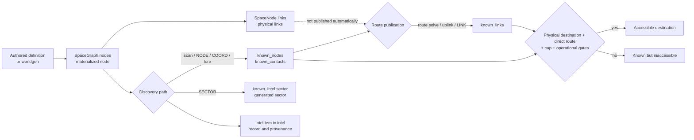

# Discovery, navigation, and intel

Status: **canonical documentation of implemented behavior**. Production code
was reviewed at commit `3658577`; tests were run later on the Phase 3B working
tree based on `9f38d2e`.

Spanish version: [discovery-navigation-intel.es.md](discovery-navigation-intel.es.md)

## 1. Purpose and scope

This document explains how RETORNO separates the universe that exists from the
universe known to the player, how contacts and routes are discovered, and which
conditions permit travel. It covers `scan`, `route solve`, `uplink`, intel
import, navigation, protected targets, and exploration failsafes.

Physical materialization of sectors, nodes, and topology is documented in
[Physical universe and procedural generation](world-generation.md). Location,
arc, and single loading paths are documented in the
[Content loading contract](../content-loading.md). The `docs/intel_lore*` and
`docs/arcs*` guides remain pending review and are not normative sources for this
description.

Evidence labels:

- **Implemented:** behavior read directly from code or active data.
- **Covered:** an existing test also exercises it.
- **Inference:** an explanation consistent with implementation but without an
  explicit design contract.
- **Pending:** behavior without sufficient coverage or requiring a design
  decision.

## 2. Conceptual knowledge model

RETORNO keeps different graphs for physical existence and navigation knowledge.
Accessibility is not inferred directly from physical topology.

### Essential distinctions

- A **materialized physical node** exists in `WorldState.space.nodes`. It may be
  entirely unknown to the player.
- A **known contact** appears in `known_nodes` and usually also in
  `known_contacts`. Knowing it does not grant a route.
- A **physical route** is a relationship in `SpaceNode.links`. Worldgen and
  some special-node creators use it as universe topology.
- A **known route** is a relationship in `known_links`. Travel consults this
  graph. A matching `SpaceNode.links` edge is not required.
- **Recorded intel** is an `IntelItem` in `world.intel`, with type, provenance,
  and confidence. Recording intel and changing knowledge are separate
  operations; not every flow does both.
- A **generated sector** is in `generated_sectors`; this does not reveal its
  nodes. There is no independent canonical `known_sectors` set.
- An imported **known coordinate** creates or reuses a physical `NAV_<hash>`
  node of kind `nav_point`, marks it known, and leaves metadata in
  `known_intel`; it does not create a route to the point.
- A destination is **accessible from the current position** only when the
  physical node exists, it is known, it is a direct neighbor in `known_links`,
  the hop is within the cap, and travel gates pass. A contact without a route is
  known but inaccessible.

## 3. State and data structures

| Structure | Current role | Character |
| --- | --- | --- |
| `space.nodes: dict[str, SpaceNode]` | Registry of materialized physical nodes and coordinates. | Canonical for physical existence. |
| `SpaceNode.links` | Physical neighborhood used by worldgen and procedural salvage files. | Canonical for physical topology; does not grant travel. |
| `generated_sectors` / `sector_states` | Materialized sectors and generation metadata. | Worldgen state, not player knowledge. |
| `known_nodes: set[str]` | Operational set treated by UI, maps, scan, travel, and pools as known nodes. | De facto canonical node knowledge. |
| `known_contacts: set[str]` | Historical mirror maintained by most writers; several consumers union it with `known_nodes` or use it as fallback. | Compatibility/auxiliary representation. |
| `known_links: dict[str, set[str]]` | Graph of routes published to the player. | Canonical for travel reach and known connectivity. |
| `intel: list[IntelItem]` | Typed, deduplicated record of `node`, `link`, `sector`, or `coord` intel. | Canonical for history/provenance, not accessibility. |
| `known_intel: dict[str, dict]` | Sparse index written mainly by `NODE`, `SECTOR`, and `COORD` imports; travel accepts its keys as legacy knowledge. | Cache/compatibility, not a complete intel inventory. |
| `fine_ranges_km` | Refined local distance for selected contacts in the same sector. | Derived cache. |
| `visited_nodes` | Reached non-temporary nodes; orbit entry also closes pool windows. | Visit history. |
| `node_pools` | Files, pending pieces, and frozen per-node uplink route pool. | Persistent opportunity state, not visible knowledge by itself. |
| `forced_hidden_nodes` | Physical nodes created without adding them to known sets. | Initial-hiding marker, not a barrier against `scan`. |
| `arc_placements` | Arc placement, delivery, and `primary.unlocked` flag. | Conditional narrative state. |

There is no central function enforcing equality between `known_nodes` and
`known_contacts`. Main writers update both, but a fixture, migration, or new
consumer may make them diverge. The contacts UI prioritizes `known_nodes` when
it is nonempty and falls back to `known_contacts`; other subsystems compute the
union.

`record_intel` deduplicates by `(kind, from_id, to_id, sector_id, coord)`. A
second source for the same fact does not create another `IntelItem` or update
the existing confidence or provenance.

The `intel`, `intel show`, and `intel export` commands read `world.intel`; they
do not rebuild inventory from `known_links` or `known_intel`. Consequently, a
route created by route solve does not appear in export unless another path also
recorded its `IntelItem`.

### Known sectors and coordinates

The implementation represents three different facts:

1. `generated_sectors` states that worldgen has materialized a sector.
2. `known_intel[sector_id]["sector"]` and an `IntelItem(kind="sector")` state
   that `SECTOR:` intel was imported.
3. Contact views group sectors derived from known-node coordinates.

None automatically implies the other two. In particular, `SECTOR:` calls
`ensure_sector_generated` but does not reveal every node created there.

## 4. Discovery and import paths

### 4.1 `scan`

Public syntax: `scan`.

**Requirements at start and during the job:** operational terminal, noncritical
power state, power quality above the blocking threshold, sensors at least
`LIMITED`, and the `sensord` service running. At a node of kind `transit`, the
`scan_in_transit` module unlock is also required.

The command queues a `SCAN` job lasting `Balance.SCAN_TIME_S` (currently 8 s)
and records the origin node. The job fails if sensors or `sensord` become
unavailable or the current node changes before completion. It can be cancelled
with `job cancel <job_id>`; cancellation applies no scan effect.

On completion it:

1. Computes the sector-index bounding box covered by sensor radius and calls
   `ensure_sector_generated` for each cell. Each call may expand materialization
   according to worldgen rules.
2. Considers only nodes inside the actual radius sphere.
3. Applies a probability falling linearly from `SENSORS_DETECT_P_NEAR` to
   `SENSORS_DETECT_P_FAR`, multiplied by sensor-state factor.
4. Adds every detection to `known_nodes` and `known_contacts`.
5. Records `IntelItem(kind="node", source_kind="scan", confidence=0.6)` for a
   new detection.
6. May set `fine_ranges_km` for selected kinds inside local radius.

The active exploration-recovery entry is an exception: detection is guaranteed
once it exists. `scan` does not publish `known_links`, inspect
`SpaceNode.links`, or filter `locked_primary_targets`.

Completing the job also evaluates deadnodes and the exploration-recovery
failsafe. `scan` is therefore not read-only: it may materialize sectors and
activate recovery nodes or files.

### 4.2 `route solve`

Current public syntax: `route solve <node_id>`. The historical form
`route <node_id>` is invalid.

It requires sensors at least `LIMITED`, active `sensord`, compatible power and
Core OS, a physical current node, and a destination already present in
`space.nodes`. The destination must be within `ship.sensors_range_ly` and the
global `MAX_ROUTE_HOP_LY` cap (45 ly).

The action **does not require the destination to be in `known_nodes` or
`known_contacts`**. Completion only suggests known in-range contacts, but a
manually entered physical id can solve a route to a node that is still unknown.
Allowing this was a deliberate design decision confirmed by the developer. Its
original rationale is undocumented, and whether to retain the behavior may be
reviewed later.

If the route already exists, the command tries to refine local distance without
queuing a job; otherwise it reports that the route was already known. In other
cases it queues a `ROUTE_SOLVE` job whose duration interpolates from 100 to
6800 s by sensor-range fraction. Only one `ROUTE_SOLVE` runs at a time.

On completion it adds a bidirectional edge to `known_links` and marks the
destination in both known sets. It adds no `SpaceNode.links` edge and, contrary
to the old guide, **does not call `record_intel`**. Sensors and service are
revalidated during the job, but continued presence at the stored origin is not.

### 4.3 `uplink`

Public syntax: `uplink`; alias: `relay uplink`.

Requirements:

- ship not in transit and no brownout;
- power quality above the blocking threshold;
- Core OS permitting the command;
- ship docked at the current node;
- node kind `relay`, `station`, or `waystation`;
- `data_core` at least `LIMITED`, neither off nor shed;
- `datad` installed and running.

`sync_node_pools_for_known_nodes` initializes pools once for known nodes,
`forced_hidden` nodes, and current anchors. When preparing an uplink pool it:

- materializes the current sector;
- excludes the `UNKNOWN` placeholder, the node itself, existing routes, and
  locked primary targets;
- weights known nodes, physical hubs in the sector/neighborhood, derelicts, and
  configured active authored candidates;
- selects at most three destinations and stores them in
  `NodePoolState.uplink_route_pool`.

The list is frozen when the pool is initialized. Nodes materialized or unlocked
later are not added to that pool.

The first valid uplink attempts to publish each pool route bidirectionally,
discards those above 45 ly, marks accepted destinations known, records
`IntelItem(kind="link", source_kind="uplink", confidence=0.9)`, and writes
`/logs/nav/uplink_<node>_<seq>.txt`. It then runs the lore scheduler, deadnodes,
and, after enough uplinks without new routes, exploration recovery. Finally it
sets `uplink_data_consumed`.

The dedicated `mobility_no_new_uplink_count` does record an attempt without new
routes. By contrast, `lore.counters["uplink_count"]` only increases when there
was a route, file, narrative event, or recovery event.

Later attempts at the same node end as exhausted data: they add no routes, write
no additional log, and do not increment the uplink counter.

### 4.4 `cat`, `intel import`, and formats

`intel import <path>` processes any accessible in-game filesystem file.
`cat <path>` auto-imports only recognized navigation, mail, or log paths
(`/data/nav`, `/mail`, `/logs`, and their `/remote` equivalents). Reading mail
with `mail read <id|latest>` resolves the mail path and calls `render_cat()`;
therefore it also auto-imports intel from a recognized mail path.

Provenance and confidence depend on path: mail uses 0.7; logs, fragments, and
explicitly imported manuals normally use 0.8.

| Format | Implemented effect |
| --- | --- |
| `NODE: <id>` | Adds the literal text to `known_nodes`, `known_contacts`, and `known_intel`, then records node intel. It only materializes a sector when the id has procedural `S...:...` form; an arbitrary id may have no physical node. |
| `LINK: <from> -> <to>` | Attempts to add a bidirectional known route. If known physical distance exceeds the cap, it keeps both endpoints as contacts but not the route. |
| `LINK: <to>` | Same, with the current node as origin. |
| `SECTOR: <sector_id>` | Calls worldgen, records sector intel and `known_intel`; it does not reveal sector nodes. |
| `COORD: x, y, z` | Creates a physical `NAV_<hash>` if absent, marks it known, and records coordinate intel; it publishes no route. |

A `LINK` whose endpoints do not exist may enter `known_links`: the cap helper
accepts a distance it cannot calculate. Travel remains blocked because it
requires the physical destination node.

#### `[INTEL]...[/INTEL]` blocks

Each block is first processed as a unit:

- if it contains a `LINK:` line, the first link is processed;
- otherwise, the complete content must exactly match an active authored
  location id, name, or sector to discover it;
- if it does not match, it enters corrupt-intel handling.

Explicit `LINK:`, `NODE:`, `SECTOR:`, and `COORD:` lines in the same file are
then also handled by the line parser. A multiline block without `LINK` can
therefore attempt corrupt recovery before its valid lines are imported. The old
description of blocks as a general flexible container is broader than actual
behavior.

Corrupt intel currently has a 50% failure chance. On recovery it samples
sectors around the current node, may materialize them, and reveals the first
eligible unknown hub. This path excludes `locked_primary_targets` and records
node intel with confidence 0.4.

### 4.5 Other real paths

- `known_on_start` may reveal locations during bootstrap. In active data,
  `UNKNOWN` is the relevant initial contact; `RETORNO_SHIP` is not an ordinary
  world destination.
- The lore scheduler may write mail/log/salvage files for later player import.
- Narrative channel `uplink_only` applies a `LINK` directly, records intel, and
  unlocks its primary when the route passes the cap.
- `drone salvage data` mounts files under `/remote/<node>/`; acquiring a file
  does not import its intel until `cat` or `intel import`.
- Exploration recovery and deadnodes create or deliver breadcrumbs as files.
  Delivery alone normally grants no route.
- Map, contacts, and intel display commands show existing state; they do not
  discover nodes by themselves.

## 5. Command and job requirements

| Action | Start gates | Job/time | Revalidation or interruption |
| --- | --- | --- | --- |
| `scan` | Valid power, sensors ≥ `LIMITED`, `sensord`; unlock at a `transit` node. | `SCAN`, 8 s. | Fails if sensors/service stop serving or current node changes; cancellable. |
| `route solve <id>` | Power/Core OS, sensors ≥ `LIMITED`, `sensord`, both physical nodes, sensor range and cap. | `ROUTE_SOLVE`, 100–6800 s. | Fails if sensors/service stop serving; cancellable; origin not revalidated. |
| `uplink` | Dock, compatible hub, power, `data_core` ≥ `LIMITED`, `datad`, unconsumed pool. | Immediate in REPL; not a `Job`. | No interruptible phase; pool is consumed after a valid attempt. |
| `intel import` | Existing file and sufficient access; Core OS/terminal permits command. | Immediate. | May materialize the world and mutate knowledge while parsing. |
| `nav <id>` | Not already in transit or docked; physical known destination; direct known route; cap and power/Core OS. | Transit state until `arrival_t`; not a `Job`. | `nav abort` creates a waypoint; arrival occurs in `Engine.tick`. |

Scan and route solve reserve no specific energy draw in their `Job`. Elapsed
time still runs the general power, degradation, and radiation model. Starting
travel with automatic `CRUISE` switches off sensors, security, `data_core`, and
`drone_bay`, which may fail active scan or route-solve jobs on the next tick.

## 6. Navigation and travel

Travel syntax:

- `nav <node_id>`; command aliases: `navigation` and `travel`;
- `nav --no-cruise <node_id>` to skip the automatic plan;
- `nav abort` to interrupt transit.

The engine logically validates that the ship is neither in transit nor docked,
the destination exists, is known, differs from the current node, appears in
`known_links[current]`, and is no farther than 45 ly. At a temporary waypoint,
only the original endpoints are allowed.

`SpaceNode.links` does not participate in this authorization. Therefore:

- an unknown physical edge does not permit travel;
- a known route without a physical edge permits travel when both nodes exist
  and other gates pass;
- a known route to a missing id does not permit travel;
- an over-cap known route may remain in state, but travel rejects it.

For very local distances in the same sector, `fine_ranges_km` permits travel
time in kilometers; other travel uses light-year distance and cruise speed.
There is no discrete fuel charge on hop start. Transit advances time and thus
the energy and environmental models.

On arrival, the node enters `visited_nodes`, position is updated, its pool
window closes, and the initial `UNKNOWN` placeholder is dropped when relevant.

### Abort and temporary node

After CLI confirmation, `nav abort` interpolates current position and creates a
physical `NAV_PT_<hex>` node of kind `transit`. It becomes the current node and
gets bidirectional known routes to origin and destination. It is not added to
`known_nodes` or `known_contacts`. Only travel toward an endpoint is allowed.

On leaving the waypoint, `_clear_tmp_node` removes the node and its own
`known_links` entry, but does not explicitly remove reverse references to the
temporary id stored at the endpoints. Views filter missing physical
destinations, but state may retain those stale references.

## 7. Transition table

| Action | Summary requirements | State change | Information learned |
| --- | --- | --- | --- |
| On-demand worldgen | A consumer requests a sector. | Adds physical nodes, links, and `generated_sectors`. | None by itself. |
| Completed `scan` | Sensors/service/range and stable job. | Materializes sectors; adds detections to both known sets; may set fine range. | `IntelItem(node)` only for new contacts; no route. |
| Completed `route solve <id>` | Physical target in range and sensors available. | Adds bidirectional `known_links` and knows destination. | Usable route; no `IntelItem`. |
| First node `uplink` | Dock, compatible hub, `data_core`/`datad`, unconsumed pool. | Adds accepted routes/contacts, log, conditional counters, and consumes pool. | `IntelItem(link)` per new route; possible lore/failsafe delivery. |
| `NODE:` | Accessible file. | Adds id to known sets and `known_intel`. | `IntelItem(node)`; may be dangling. |
| `LINK:` | Accessible file; cap when distance is known. | Adds known endpoints and, if accepted, `known_links`. | `IntelItem(link)` only for a new route. |
| `SECTOR:` | Accessible file. | Materializes sector and marks `known_intel`. | `IntelItem(sector)`; nodes remain hidden. |
| `COORD:` | Three valid numbers. | Creates/knows `NAV_<hash>`. | `IntelItem(coord)`; no route. |
| Lore `uplink_only` | Eligible piece, channel, and cap. | Adds route/contacts and marks primary unlocked. | Direct `IntelItem(link)`. |
| Lore/failsafe breadcrumb | Eligible trigger. | Writes local/remote file; may create hidden nodes. | No route change until file import. |
| `nav <id>` | Known node, direct route, cap, and gates. | Starts transit; arrival updates node/position/visit. | Discovers no new routes. |
| `nav abort` | In transit and CLI confirmation. | Creates temporary waypoint and routes to endpoints. | Return/resume access, not a normal contact. |

## 8. Narrative protection and exceptions

`locked_primary_targets` is computed from loaded arc `primary_intel` entries
whose target is `link` or `node` and which are not yet unlocked or discovered.
The target still exists physically; the lock does not remove it from the
universe.

Paths that explicitly respect the lock:

- procedural uplink route-pool preparation;
- hub selection during corrupt-intel recovery.

Paths that **do not** consult the lock:

- `scan`;
- manually entered `route solve <id>`;
- explicit `NODE`, `LINK`, `SECTOR`, or `COORD` import;
- bootstrap `known_on_start`;
- direct use of an id already present by other consumers.

Importing the primary's exact `LINK` through the parser marks the arc discovered
when the route is new. Narrative `uplink_only` delivery also marks the primary
unlocked even when the route was already known. Other links to the same target
may grant access without updating that flag.

The implementation therefore provides **protection against two specific
procedural reveals**, not a global discovery lock. A node in
`forced_hidden_nodes` is not undetectable either: it is merely created without
being marked known; scan may reveal it in range.

The active loader currently returns **zero arcs** because
`data/arcs/templates/` is not traversed. A normal run has no active
`locked_primary_targets`. This section describes conditional code, not
operating narrative protection or activated content.

## 9. Interaction with worldgen, lore, and failsafes

- `scan`, uplink preparation, `SECTOR:`, and corrupt intel call worldgen.
  Discovery may therefore first modify the physical universe.
- Uplink pools are computed from the world present at initialization and are
  not rebuilt as the universe grows.
- The lore scheduler separates file delivery from intel application. File
  channels require reading/import; `uplink_only` is the direct exception.
- Exploration recovery activates only when no usable frontier remains and the
  ship is operationally capable. It creates a hidden in-range entry, a gateway,
  and a local breadcrumb. It does not directly grant the first route.
- The recovery entry can be discovered through its intel or guaranteed scan.
  After arrival, broadcast or salvage provides a `LINK` to the gateway.
- Deadnodes observes contacts without a reachable route or route-solve option.
  After thresholds it creates a relay bridge or delivers a direct `LINK` as a
  file; the player must still import it.
- Failsafes may add nodes after worldgen. Their topological effects and sector
  synchronization limits are detailed in the worldgen document.

## 10. Confirmed invariants

1. Materializing a node or sector does not automatically reveal it.
2. Knowing a node creates no route; knowing a route does not prove a matching
   physical edge exists.
3. Travel checks a direct route from the current node; it does not perform
   automatic multihop pathfinding.
4. Travel revalidates physical existence and cap even when `known_links`
   contains invalid or legacy data.
5. `scan` discovers nodes and records new intel but never routes.
6. Main flows add known routes bidirectionally and reject self-links.
7. `IntelItem` preserves provenance but is not itself travel authorization.
8. Uplink has a frozen pool consumed once per node.
9. `SECTOR:` means materialization plus sector intel, not mass contact
   knowledge.
10. No arcs or locked primary targets exist in currently loaded content.

## 11. Edge cases and blocking situations

- An arbitrary `NODE:` may produce a contact without a physical node; it is
  incomplete in views and cannot be used for route solve or travel.
- A `LINK:` with missing endpoints may produce a dangling known route because
  distance is unavailable and accepted; travel blocks it.
- A `COORD:` contact is physical and known but inaccessible until a route is
  acquired or solved.
- Malformed sector ids reach worldgen without strict validation; this gap is
  already recorded in the worldgen documentation.
- Narrative locks can be bypassed through scan, a pre-known id, or explicit
  import.
- An uplink pool created before a destination is materialized or unlocked will
  not pick it up later; the first valid attempt also consumes the pool when all
  routes are discarded by cap.
- Multiline `[INTEL]` blocks may combine a corrupt-recovery attempt with later
  parsing of valid lines.
- `UPGRADED` passes the scan gate but is absent from the detection-factor table,
  so it falls back to the `CRITICAL` factor (0.35).
- Route solve does not require prior knowledge or check that the ship remains
  at the origin; automatic sensor shutdown on entering `CRUISE` will usually
  interrupt it on the next tick.
- `intel` sorts the record by ascending time and applies `items[:limit]`, so its
  limited view currently shows the oldest entries even though public help calls
  them the “latest”.
- Aborting travel may leave reverse references to a removed waypoint in
  `known_links`.
- `locked_primary_targets` only recognizes `link` and `node` primaries; other
  types produce no locked target.
- If an `uplink_only` primary exceeds the cap, it neither adds the route nor
  runs the unlock inside that branch. The later delivery lifecycle needs review
  before this is treated as a narrative guarantee.

## 12. Existing tests and gaps

The following tests were run with
`/home/jon/prog/retorno_case/retorno_venv/bin/python` and `PYTHONPATH=src`. They
all build in-memory states; no real save was opened or modified.

| Test | Result | Relevant coverage |
| --- | --- | --- |
| `scan_job_smoke.py` | PASSED | Scan job, duration, detection, and output. |
| `route_hop_cap_smoke.py` | PASSED | Travel cap rejection and physical worldgen links. |
| `route_solve_out_of_range_origins_smoke.py` | PASSED | Out-of-range block and hints from other known origins. |
| `contacts_smoke.py` | PASSED | Current contact, visit, and route flag. |
| `contacts_sector_smoke.py` | PASSED | Aliases, sector grouping, and hidden `UNKNOWN`. |
| `drone_completion_context_smoke.py` | PASSED | Different suggestions for route solve and travel. |
| `uplink_once_per_node_smoke.py` | PASSED | Frozen pool, one-time consumption, and no second log. |
| `uplink_authored_and_failsafe_smoke.py` | PASSED | Synthetic authored candidates, current anchor, and recovery after empty uplink. |
| `exploration_recovery_smoke.py` | PASSED | Breadcrumb → route solve → travel → dock → gateway chain. |
| `lore_channel_preference_and_unlock_smoke.py` | PASSED | `uplink_only` and primary unlock with preexisting route. |
| `energy_policy_smoke.py` | PASSED | Energy gates and system-driven scan/route job failures. |
| `forced_hidden_ad_hoc_smoke.py` | FAILED | Expects a `HARBOR_12` pool, but current sandbox does not include it among known, hidden, or anchor nodes that initialize pools. |

The failed test exposes a misaligned fixture expectation; it does not establish
that `register_hidden_anchored_node` should reveal `HARBOR_12`. Neither test nor
product code was changed in this phase.

Coverage gaps:

- no dedicated tests cover all four import formats, dangling references,
  deduplication, and multiline `[INTEL]` blocks;
- no test demonstrates the exact scope and bypasses of
  `locked_primary_targets` with an isolated loaded arc;
- unknown-physical-id route solve and origin changes during the job are not
  covered;
- complete cleanup of temporary-waypoint references is not checked;
- no tested contract enforces convergence of `known_nodes` and
  `known_contacts`;
- unlocking a target after uplink-pool freeze is not tested;
- no end-to-end import test fixes the differences among `cat`, `mail read`, and
  `intel import`.

## 13. Discrepancies with previous guides

- `docs/intel_lore*` documents `route <node_id>`; current syntax is
  `route solve <node_id>`.
- That guide says route solve records intel; implementation only changes known
  nodes/contacts/routes and emits the job event.
- It presents uplink as a generic repeatable lookup, but the pool freezes at
  first contact and is consumed once per node.
- It presents `[INTEL]` as a flexible id/name/sector container; the block parser
  directly handles only the first `LINK` or a whole-block authored match before
  line parsing.
- `docs/arcs*` describes primary protection as general. Implementation only
  filters procedural uplink and corrupt intel, and currently loads no active
  arcs.
- Old guides do not clearly distinguish physical routes, `known_links`, the
  `intel` record, and the `known_intel` index.

## 14. Pending design questions

1. Decide whether `known_nodes` should formally replace `known_contacts` or a
   single API should preserve both.
2. Revisit later whether to retain the deliberate choice not to require prior
   discovery for route solve, and decide whether it should revalidate its origin
   on completion.
3. Define whether every known route must correspond to physical nodes and/or
   edges, and how dangling intel should behave.
4. Determine whether narrative protection should be global or remain a partial
   procedural-reveal filter.
5. Decide when uplink pools are recalculated after worldgen or late unlocks.
6. Unify the two import parsers and define the `[INTEL]` and corrupt-intel
   contract precisely.
7. Define and test complete temporary-waypoint cleanup.
8. Resolve the stale `forced_hidden_ad_hoc_smoke.py` expectation without
   accidentally making unknown authored nodes initial contacts.
9. Define the `UPGRADED` sensor detection factor and fix or rename “latest”
   semantics for the limited intel listing.

These are pending decisions; this document does not recommend activating them
or changing balance in this phase.

## 15. Implementation references

- [`src/retorno/model/world.py`](../../src/retorno/model/world.py): knowledge
  structures, `IntelItem`, known routes, and cap.
- [`src/retorno/core/engine.py`](../../src/retorno/core/engine.py): scan, route
  solve, travel, abort, jobs, and arrival.
- [`src/retorno/cli/parser.py`](../../src/retorno/cli/parser.py): public syntax.
- [`src/retorno/cli/repl.py`](../../src/retorno/cli/repl.py): uplink, import,
  `cat`, maps, contacts, and Core OS gates.
- [`src/retorno/core/lore.py`](../../src/retorno/core/lore.py): pools,
  candidates, locked targets, and narrative delivery.
- [`src/retorno/core/exploration_recovery.py`](../../src/retorno/core/exploration_recovery.py):
  frontier and diegetic recovery.
- [`src/retorno/core/deadnodes.py`](../../src/retorno/core/deadnodes.py): isolated
  contact detection and breadcrumbs.
- [`src/retorno/worldgen/generator.py`](../../src/retorno/worldgen/generator.py):
  on-demand materialization.
- [`src/retorno/bootstrap.py`](../../src/retorno/bootstrap.py): initial knowledge.
- [`src/retorno/core/power_policy.py`](../../src/retorno/core/power_policy.py) and
  [`src/retorno/config/balance.py`](../../src/retorno/config/balance.py): gates
  and constants.
- [`docs/systems/world-generation.md`](world-generation.md): physical universe
  and worldgen limits.
- [`docs/content-loading.md`](../content-loading.md): active and inactive content.
