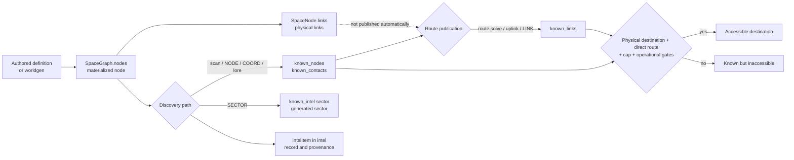

> **4D-3e5 — current implementation (2026-11-06).** Historical selection, transactional confirmation and common-ledger reception/progression are implemented. The [production contract](structural-recovery.md) and its report supersede historical audits below: no corrective bridges, entries or gateways are fabricated. The 3b/3c/3d core remains diagnostic and cannot authorize materialization. No universal exit is guaranteed.

> **Implemented 4D-3e4b update (2026-11-06).** Signals and broadcasts require `comms`/`radiod`, a legitimate local source and actual reception before consuming pieces or stages. Pending, received and read opportunities persist in one ledger. Legacy activations fabricating corrective nodes are explicitly deferred until e5; existing chains can deliver through their real channel. Scheduler policies, scan and uplink are unchanged. The [communications contract](passive-communications.md) specifies gates, coverage, retries and limits, superseding historical descriptions below on these points. F-DEAD-01 remains pending.

> **Implemented 4D-3e4 update (2026-11-05).** NODE and authored blocks also resolve declared aliases and lazy historical sites. Reading and explicit import share a parser. Blocks containing only explicit instructions do not roll corruption. Unresolved tokens remain uncertain intel; corrupt recovery only discovers preexisting hubs within its radius. LINK retains physical endpoints and cap without requiring a historical edge; SECTOR does not reveal inventory and COORD remains a nav_point. Scan and manual solve exceptions are unchanged. The current contract and executable examples are [Physical narrative requirements](../narrative-world-contract.md). The earlier body retained below is historical wherever it contradicts this update.

# Discovery, navigation, and intel

## Knowledge boundary — 4D-3e5a

`C-DATA-004` distinguishes physical truth, engine internals, acquired observations,
inferences and consultable knowledge. `space.nodes` represents existence;
`known_contacts`/`known_nodes` represent knowledge; `known_links` records routes.
`lore_placements`, `radio_opportunities`, `recovery_searches` and `recovery_plans`
are not public discovery sources. Knowing a location, knowing a route and current
reception capability are separate facts.

Ordinary maps, contacts and completion use known projections. `ship survey <id>`
also requires a known contact or location (including current location and recorded
route endpoints); a hidden target returns the same localized error as an absent
one, without physical data. Ship aliases, acquired data, natural scan, exact manual
route solving and imported intel remain available. Deliberate `route solve` policy
is unchanged. Received documents may contain false information without thereby
establishing physical truth.

`status` and `diag comms` describe only receiver/equipment; engine internals are
available through `debug radio` and `debug recovery` after `debug on`. Queries are
read-only and `debug off` blocks them. CLI/Textual share the boundary, including
panels, messages, errors, events, help and completion.
Dock name/alias resolution also uses acquired knowledge: a hidden name cannot
be converted into a secret ID inside an error.
Public events and logs unify `node_missing`/`unknown_contact` when the ship
has no destination record, preventing error differences from exposing physical
existence. Internal codes and actions are unchanged; acquired destination details
remain available.
Test: `tests/knowledge_boundary_smoke.py`.

**4D-3e2 compatibility:** productive worldgen now uses [versioned stable history](../design/historical-worldgen-integration.md).
`NODE:`/`LINK:` resolve exact `S…:WG1_<scope>_<index>` IDs to their physical sector,
including Z spill. `SECTOR:`, `COORD:`, intel blocks and authored references keep
their contracts; COORD remains a navigation point, not a historical station. Physical
declaration, prose and revelation are distinct (D18–D20). Full authored/arc/single/forced
regression remains e4. Scan observation memory from 4D-3e3 is described in §4.1;
lore retains its previous mechanisms.

Status: **canonical documentation of implemented behavior**. Production code
was reviewed at commit `3658577`; tests were run later on the Phase 3B working
tree based on `9f38d2e`.

Updated for F-ROUTE-01 in Phase 4D-1 on top of `45f2900` (2026-11-04).

Spanish version: [discovery-navigation-intel.es.md](discovery-navigation-intel.es.md)

## 1. Purpose and scope

This document explains how RETORNO separates the universe that exists from the
universe known to the player, how contacts and routes are discovered, and which
conditions permit travel. It covers `scan`, `route solve`, `uplink`, intel
import, navigation, protected targets, and exploration failsafes.

Physical materialization of sectors, nodes, and topology is documented in
[Physical universe and procedural generation](world-generation.md). Location,
arc, and single loading paths are documented in the
[Content loading contract](../content-loading.md). The `docs/intel_lore*` and
`docs/arcs*` guides remain pending review and are not normative sources for this
description.

Evidence labels:

- **Implemented:** behavior read directly from code or active data.
- **Covered:** an existing test also exercises it.
- **Inference:** an explanation consistent with implementation but without an
  explicit design contract.
- **Pending:** behavior without sufficient coverage or requiring a design
  decision.

## 2. Conceptual knowledge model

RETORNO keeps different graphs for physical existence and navigation knowledge.
Accessibility is not inferred directly from physical topology.

### Essential distinctions

- A **materialized physical node** exists in `WorldState.space.nodes`. It may be
  entirely unknown to the player.
- A **known contact** appears in `known_nodes` and usually also in
  `known_contacts`. Knowing it does not grant a route.
- A **physical route** is a relationship in `SpaceNode.links`. Worldgen and
  some special-node creators use it as universe topology.
- A **known route** is a relationship in `known_links`. Travel consults this
  graph. A matching `SpaceNode.links` edge is not required.
- **Recorded intel** is an `IntelItem` in `world.intel`, with type, provenance,
  and confidence. Recording intel and changing knowledge are separate
  operations; not every flow does both.
- A **generated sector** is in `generated_sectors`; this does not reveal its
  nodes. There is no independent canonical `known_sectors` set.
- An imported **known coordinate** creates or reuses a physical `NAV_<hash>`
  node of kind `nav_point`, marks it known, and leaves metadata in
  `known_intel`; it does not create a route to the point.
- A destination is **accessible from the current position** only when the
  physical node exists, it is known, it is a direct neighbor in `known_links`,
  the hop is within the cap, and travel gates pass. A contact without a route is
  known but inaccessible.

## 3. State and data structures

| Structure | Current role | Character |
| --- | --- | --- |
| `space.nodes: dict[str, SpaceNode]` | Registry of materialized physical nodes and coordinates. | Canonical for physical existence. |
| `SpaceNode.links` | Physical neighborhood used by worldgen and procedural salvage files. | Canonical for physical topology; does not grant travel. |
| `generated_sectors` / `sector_states` | Materialized sectors and generation metadata. | Worldgen state, not player knowledge. |
| `known_nodes: set[str]` | Operational set treated by UI, maps, scan, travel, and pools as known nodes. | De facto canonical node knowledge. |
| `known_contacts: set[str]` | Historical mirror maintained by most writers; several consumers union it with `known_nodes` or use it as fallback. | Compatibility/auxiliary representation. |
| `known_links: dict[str, set[str]]` | Graph of routes published to the player. | Raw records; the operational projection is canonical for reach/connectivity. |
| `intel: list[IntelItem]` | Typed, deduplicated record of `node`, `link`, `sector`, or `coord` intel. | Canonical for history/provenance, not accessibility. |
| `known_intel: dict[str, dict]` | Sparse index written mainly by `NODE`, `SECTOR`, and `COORD` imports; travel accepts its keys as legacy knowledge. | Cache/compatibility, not a complete intel inventory. |
| `fine_ranges_km` | Refined local distance for selected contacts in the same sector. | Derived cache. |
| `visited_nodes` | Reached non-temporary nodes; orbit entry also closes pool windows. | Visit history. |
| `node_pools` | Files, pending pieces, and frozen per-node uplink route pool. | Persistent opportunity state, not visible knowledge by itself. |
| `forced_hidden_nodes` | Physical nodes created without adding them to known sets. | Initial-hiding marker, not a barrier against `scan`. |
| `arc_placements` | Arc placement, delivery, and `primary.unlocked` flag. | Conditional narrative state. |

There is no central function enforcing equality between `known_nodes` and
`known_contacts`. Main writers update both, but a fixture, migration, or new
consumer may make them diverge. The contacts UI prioritizes `known_nodes` when
it is nonempty and falls back to `known_contacts`; other subsystems compute the
union.

`record_intel` deduplicates by `(kind, from_id, to_id, sector_id, coord)`. A
second source for the same fact does not create another `IntelItem` or update
the existing confidence or provenance.

The `intel`, `intel show`, and `intel export` commands read `world.intel`; they
do not rebuild inventory from `known_links` or `known_intel`. Consequently, a
route created by route solve does not appear in export unless another path also
recorded its `IntelItem`.

List presentation is read-only. `intel` shows the 20 most recent records,
`intel N` the N most recent available, and `intel all` the complete history.
All three order by descending timestamp; equal timestamps use reverse insertion
order, so the later-appended record appears first. The stored list is not
reordered, and `intel show` and `intel export` retain their id lookup and stored
export order respectively.

### Known sectors and coordinates

The implementation represents three different facts:

1. `generated_sectors` states that worldgen has materialized a sector.
2. `known_intel[sector_id]["sector"]` and an `IntelItem(kind="sector")` state
   that `SECTOR:` intel was imported.
3. Contact views group sectors derived from known-node coordinates.

None automatically implies the other two. In particular, `SECTOR:` calls
`ensure_sector_generated` but does not reveal every node created there.
The accepted id is the canonical worldgen form: capital `S` plus three
underscore-separated signed decimal indices, each formatted as `{value:+04d}`.
The width is a minimum, so larger indices remain valid.

### Operational routes and historical clues (4D-1)

`is_hop_within_cap` in `model/world.py` is the shared physical criterion: both
endpoints must exist and their distance must be at most 45 ly, inclusive.
`add_known_link` also rejects empty endpoints and self-links. No physical
`SpaceNode.links` edge, prior discovery, sensor state, or power state is needed
for structural validity; command-specific travel/solve gates still apply.

`reachable_from` projects only valid direct destinations from `known_links`;
`reachable_known_nodes` traverses those directed hops. Every hop is checked, so
an invalid intermediate edge cannot make a remote component reachable. Queries
are read-only and never generate sectors, reveal contacts, or prune history.

| Producer/consumer | Required layer and treatment |
| --- | --- |
| Bootstrap, `route solve`, `nav abort` | Publish through `add_known_link`; completed solve jobs revalidate endpoints/cap. Valid waypoint routes remain supported. |
| Explicit import, `cat`/mail auto-import, `[INTEL]` LINK tokens | Share `_import_link_intel`; attempt existing lazy materialization first, retain contacts and deduplicated link history, publish only valid hops. |
| Uplink and lore `uplink_only` | Publish with the same domain check; no pool lifecycle, weights, narrative delivery, or probability changes. Pool candidate exclusion uses operational routes. |
| Travel | Requires a recorded direct edge and the shared physical criterion, plus its existing knowledge and ship gates. |
| Navigation graph/path/components, route list, origin hints, contacts, survey, CLI/Textual completion | Use the operational projection for connections and route flags; contact inventory stays independent. Both interfaces share the same renderers/helpers. |
| Global recovery and deadnodes | Share `reachable_known_nodes`; invalid edges cannot create frontier, expose remote payloads through an invalid component, or exclude a target as connected. |
| Intel list/show/export and raw debug diagnostics | History/inspection, not authorization. Invalid recorded clues remain visible/exportable; debug graph/cap counts may still expose raw stale records. |
| Save/load and temporary-node cleanup | Persistence retains raw state. Since 4D-2, `_clear_tmp_node` removes the departed/replaced waypoint's live references; history remains intact. |

No destructive load normalization is needed: the idempotent projection filters
invalid records immediately, before or after save/load. Existing contacts,
`known_intel`, files, provenance and pending references are retained exactly.
Repeated save/load does not mutate the world or generate sectors. New rejected
LINK imports are stored as historical `IntelItem` records, not new operational
edges. Reimport after materialization can publish a now-valid route. Existing
raw pending edges are reevaluated against current physical state on each query.
Incompatible files retain their explicit rejection and are never deleted.

Lazy generation keeps its current protocol. A canonical `SECTOR:` materializes
the sector before a subsequent LINK to its actual generated id is validated;
sector import alone does not reveal the cluster. The existing `S...:...` helper
also requests its canonical sector before validation, but creates no alias for
the `KIND_HEX` ids worldgen generates. An unresolved literal remains a contact
and historical clue, not an operational route. No new id-resolution protocol
or generation-order policy is introduced.

## 4. Discovery and import paths

### 4.1 `scan`

Public syntax: `scan`.

**Requirements at start and during the job:** operational terminal, noncritical
power state, power quality above the blocking threshold, sensors at least
`LIMITED`, and the `sensord` service running. A stopped waypoint (`kind="transit"`, `ship.in_transit=False`) uses these
normal gates and needs no `scan_in_transit` unlock. The public action gate still
rejects scans during active travel; queued scans retain the `scan_in_transit`
check when `ship.in_transit=True`. This does not expand active-travel scanning.

The command queues a `SCAN` job lasting `Balance.SCAN_TIME_S` (currently 8 s)
and records the origin node. The job fails if sensors or `sensord` become
unavailable or the current node changes before completion. It can be cancelled
with `job cancel <job_id>`; cancellation applies no scan effect.

On completion it:

1. Computes the sector-index bounding box covered by sensor radius and calls
   `ensure_sector_generated` for each cell. Each call may expand materialization
   according to worldgen rules.
2. Considers only nodes inside the actual radius sphere.
3. Applies a probability falling linearly from `SENSORS_DETECT_P_NEAR` to
   `SENSORS_DETECT_P_FAR`, multiplied by sensor-state factor.
4. Adds every detection to `known_nodes` and `known_contacts`.
5. Records `IntelItem(kind="node", source_kind="scan", confidence=0.6)` for a
   new detection.
6. May set `fine_ranges_km` for selected kinds inside local radius.
7. After the entire sweep succeeds, records an immutable observation of actual
   execution conditions and results, without another RNG draw.

The effective detection factors are `UPGRADED=1.00`, `NOMINAL=1.00`,
`LIMITED=0.85`, `DAMAGED=0.60`, and `CRITICAL=0.35`; `OFFLINE` uses the 0.35
fallback internally. The public gate rejects `DAMAGED`, `CRITICAL`, and
`OFFLINE` before scan execution. `UPGRADED` deliberately reuses the nominal
factor as the conservative 4C-2a correction: any additional upgrade bonus
remains a future balance study. The final probability is clamped to `[0, 1]`.

The active exploration-recovery entry is an exception: detection is guaranteed
when it exists and is not yet in `known_nodes`. Already-known entries use the
normal roll. `scan` does not publish `known_links`, inspect
`SpaceNode.links`, or filter `locked_primary_targets`.

Completing the job also evaluates deadnodes and the exploration-recovery
failsafe. `scan` is therefore not read-only: it may materialize sectors and
activate recovery nodes or files.

#### Observation memory (4D-3e3)

Implemented on `590a3e8`, pending external review. Historical existence,
materialized nodes, observed contacts and known routes remain separate.
An observation records what a sweep detected; it is neither another universe
inventory nor certification of an empty volume.

`ScanObservation` in [`model/world.py`](../../src/retorno/model/world.py) is a
typed, frozen, serializable dataclass. Fields:

| Fields | Meaning |
| --- | --- |
| `observation_id`, `t` | Monotonic `SCAN00001…` ID and exact `ClockState.t`, seconds since start. No new time model. |
| `position_ly`, `origin_node_id` | Position actually used by scan; origin ID if its physical node existed, otherwise `None` for `current_pos_ly` fallback. |
| `radius_ly` | Effective range at completion, not range copied at enqueue time. |
| `sensors_state`, `sensors_forced_offline`, `sensord_running` | Execution snapshot of sensors/service. |
| `detection_factor`, `near_probability`, `far_probability` | Actual parameters of the existing formula; no history-based adjustment. |
| `detected_ids`, `new_ids` | Sorted tuples of actual detections and their newly discovered subset. Other detected contacts were already known. |
| `guaranteed_ids` | Actually detected subset using the existing recovery-entry exception; no undetected candidate disclosure. |
| `outcome` | `no_signals`, `known_contacts_only` or `new_contacts`. |
| `rng_counter`, `job_key` | RNG counter used and stable internal job key; `None` for direct calls without a job. |

`_perform_scan` is the sole recording point and keeps its former return tuple.
It appends only after materialization, evaluation, intel and fine ranges finish.
The timed `SCAN` job calls that same helper without adding another record.
Its persisted `params['scan_observation_id']` marker and terminal state prevent
reapplying effects even after retention prunes the entry. Repeated ticks do not
repeat results. Each successful new direct invocation is another sweep, not a
replay of a previous job.

Existing gates remain: `_perform_scan` is a private kernel that does not check
them itself, including the tested sensor-factor fallback. Public jobs and
`_scan_and_discover` apply their existing gates; the compatibility helper records
once without changing its return shape. Blocked scans, context/sensor
interruptions and cancellations do not record. A materialization/evaluation
exception makes the job `FAILED` with EN/ES incomplete-observation feedback,
not a successful empty result. Direct calls propagate errors. Previously
materialized historical sectors may remain, but are not absence evidence.
Memory does not promise global rollback of arbitrary engine exceptions.

`WorldState.scan_observations` retains the most recent **128** observations,
oldest to newest in execution order; insertion order resolves equal timestamps.
`next_scan_observation_seq` persists and is not reset by retention. Pruning does
not touch contacts, intel, routes or pools. Frozen dataclass/tuple values retain
no mutable node references, preventing retrospective edits. A removed waypoint
ID may remain as historical provenance.

`scan_observation_history(world)` returns an immutable history tuple without
materialization or state changes. This is the read API; no command or panel was
added. Old sweeps are not reconstructed from intel. Existing
`WorldState.__setstate__` defaults added slots safely: old schema-3 games load
empty history and sequence 1, without a version bump, complex migration or file
deletion. Previously queued jobs can resume. New saves preserve history, order,
IDs and job markers.

EN/ES presentation is shared by CLI and Textual:

- `no_signals`: “No signals detected in this observation. This does not confirm
  that space is empty.” It invalidates no intel, sector or historical site.
- `known_contacts_only`: signals were detected, all contacts were already known,
  and the report explicitly says there are no new contacts.
- `new_contacts`: new discoveries retain existing events, `record_intel`, fine
  ranges and sound behavior.

Records contain no omitted-site lists, manifest-query secrets, exhaustive
coverage or sector absence certificates. A hidden node enters only through an
actual detection; the deliberate natural-scan exception for protected primaries
remains. Reading manifest/history reveals nothing. A negative can precede a
legitimate later discovery, without repetition thresholds, cumulative probability,
mandatory rescanning or free routes.

`historical-world-v1` materialization/inverse queries are unchanged: a Z spill
is observed at its actual physical position despite different generation
provenance. Tests: [`scan_observation_memory_smoke.py`](../../tests/scan_observation_memory_smoke.py),
20 groups, exact comparison with the `590a3e8` kernel, retention, save/load,
former pickle slots, completion conditions, failures and presentation.
[Report and results](../testing/scan-observation-review.md).

Memory does not solve F-DEAD-01 or structural exploration blocks. No new sensor
simulation, Bayesian model, triangulation, recovery planner or narrative compiler.
D21–D24 and installed-story physical requirements remain e4; planner integration
is e5. No `narrative/amanecer/`, arc, single or authoring-guide changes.

### 4.2 `route solve`

Current public syntax: `route solve <node_id>`. The historical form
`route <node_id>` is invalid.

It requires sensors at least `LIMITED`, active `sensord`, compatible power and
Core OS, a physical current node, and a destination already present in
`space.nodes`. The destination must be within `ship.sensors_range_ly` and the
global `MAX_ROUTE_HOP_LY` cap (45 ly).

The action **does not require the destination to be in `known_nodes` or
`known_contacts`**. Completion only suggests known in-range contacts, but a
manually entered physical id can solve a route to a node that is still unknown.
Allowing this was a deliberate design decision confirmed by the developer. Its
original rationale is undocumented, and whether to retain the behavior may be
reviewed later.

If the route already exists, the command tries to refine local distance without
queuing a job; otherwise it reports that the route was already known. In other
cases it queues a `ROUTE_SOLVE` job whose duration interpolates from 100 to
6800 s by sensor-range fraction. Only one `ROUTE_SOLVE` runs at a time.

On completion it adds a bidirectional edge to `known_links` and marks the
destination in both known sets. It adds no `SpaceNode.links` edge and, contrary
to the old guide, **does not call `record_intel`**. Sensors and service are
revalidated during the job, but continued presence at the stored origin is not.

Completion revalidates physical endpoints and the cap before publication. If
an endpoint disappeared, publication is rejected without reporting a solved route.

### 4.3 `uplink`

Public syntax: `uplink`; alias: `relay uplink`.

Requirements:

- ship not in transit and no brownout;
- power quality above the blocking threshold;
- Core OS permitting the command;
- ship docked at the current node;
- node kind `relay`, `station`, or `waystation`;
- `data_core` at least `LIMITED`, neither off nor shed;
- `datad` installed and running.

`sync_node_pools_for_known_nodes` initializes pools once for known nodes,
`forced_hidden` nodes, and current anchors. When preparing an uplink pool it:

- materializes the current sector;
- excludes the `UNKNOWN` placeholder, the node itself, existing routes, and
  locked primary targets;
- weights known nodes, physical hubs in the sector/neighborhood, derelicts, and
  configured active authored candidates;
- selects at most three destinations and stores them in
  `NodePoolState.uplink_route_pool`.

The list is frozen when the pool is initialized. Nodes materialized or unlocked
later are not added to that pool.

The first valid uplink attempts to publish each pool route bidirectionally,
discards those above 45 ly, marks accepted destinations known, records
`IntelItem(kind="link", source_kind="uplink", confidence=0.9)`, and writes
`/logs/nav/uplink_<node>_<seq>.txt`. It then runs the lore scheduler, deadnodes,
and, after enough uplinks without new routes, exploration recovery. Finally it
sets `uplink_data_consumed`.

The dedicated `mobility_no_new_uplink_count` does record an attempt without new
routes. By contrast, `lore.counters["uplink_count"]` only increases when there
was a route, file, narrative event, directly applied lore effect, or recovery
event.

Later attempts at the same node keep the route pool exhausted: they add none of
its routes, write no additional log, and increment no counters. They do
reevaluate only an already assigned `uplink_only` piece that remains pending.
The localized completion message distinguishes a successful pending narrative
delivery from an exhausted pool with no applied effect.

### 4.4 `cat`, `intel import`, and formats

`intel import <path>` processes any accessible in-game filesystem file.
`cat <path>` auto-imports only recognized navigation, mail, or log paths
(`/data/nav`, `/mail`, `/logs`, and their `/remote` equivalents). Reading mail
with `mail read <id|latest>` resolves the mail path and calls `render_cat()`;
therefore it also auto-imports intel from a recognized mail path.

Provenance and confidence depend on path: mail uses 0.7; logs, fragments, and
explicitly imported manuals normally use 0.8.

| Format | Implemented effect |
| --- | --- |
| `NODE: <id>` | Adds the literal text to `known_nodes`, `known_contacts`, and `known_intel`, then records node intel. It only materializes a sector when the id has procedural `S...:...` form; an arbitrary id may have no physical node. |
| `LINK: <from> -> <to>` | Attempts to add a bidirectional known route. If a physical endpoint is missing or the hop exceeds the cap, it retains contacts/history without publishing a route. |
| `LINK: <to>` | Same, with the current node as origin. |
| `SECTOR: <sector_id>` | For a canonical id, calls worldgen, records sector intel and `known_intel`, but does not reveal sector nodes. A noncanonical id is rejected with localized feedback before world or intel mutation; later valid lines in the file still run. |
| `COORD: x, y, z` | Creates a physical `NAV_<hash>` if absent, marks it known, and records coordinate intel; it publishes no route. |

Since 4D-1, an unverifiable LINK retains contacts and historical intel but is
not published as an operational route. Feedback distinguishes missing endpoints
and over-cap hops in EN/ES.

#### `[INTEL]...[/INTEL]` blocks

Each block is first processed as a unit:

- if it contains a `LINK:` line, the first link is processed;
- if every nonempty line is an explicit `SECTOR:`, unit processing is skipped
  and the canonical line parser handles each line without invoking corrupt
  recovery;
- otherwise, the complete content must exactly match an active authored
  location id, name, or sector to discover it;
- if it does not match, it enters corrupt-intel handling.

Explicit `LINK:`, `NODE:`, `SECTOR:`, and `COORD:` lines in the same file are
then also handled by the line parser. A multiline block without `LINK` can
therefore attempt corrupt recovery before its valid lines are imported. The old
description of blocks as a general flexible container is broader than actual
behavior. A block mixing `SECTOR:` with unknown narrative text retains the
general block behavior and may still enter corrupt recovery before line parsing;
4C-2b does not define new semantics for that mixed form.

Corrupt intel currently has a 50% failure chance. On recovery it samples
sectors around the current node, may materialize them, and reveals the first
eligible unknown hub. This path excludes `locked_primary_targets` and records
node intel with confidence 0.4.

### 4.5 Other real paths

- `known_on_start` may reveal locations during bootstrap. In active data,
  `UNKNOWN` is the relevant initial contact; `RETORNO_SHIP` is not an ordinary
  world destination.
- The lore scheduler may write mail/log/salvage files for later player import.
- Narrative channel `uplink_only` applies a `LINK` directly, records intel, and
  unlocks its primary only when both physical endpoints exist and the route
  passes the cap.
- `drone salvage data` mounts files under `/remote/<node>/`; acquiring a file
  does not import its intel until `cat` or `intel import`.
- Exploration recovery and deadnodes create or deliver breadcrumbs as files.
  Delivery alone normally grants no route.
- Map, contacts, and intel display commands show existing state; they do not
  discover nodes by themselves.

## 5. Command and job requirements

| Action | Start gates | Job/time | Revalidation or interruption |
| --- | --- | --- | --- |
| `scan` | Valid power, sensors ≥ `LIMITED`, `sensord`; unlock at a `transit` node. | `SCAN`, 8 s. | Fails if sensors/service stop serving or current node changes; cancellable. |
| `route solve <id>` | Power/Core OS, sensors ≥ `LIMITED`, `sensord`, both physical nodes, sensor range and cap. | `ROUTE_SOLVE`, 100–6800 s. | Fails if sensors/service stop serving; cancellable; ship co-location with origin is not revalidated. |
| `uplink` | Dock, compatible hub, power, `data_core` ≥ `LIMITED`, `datad`; the first attempt uses the unconsumed pool. | Immediate in REPL; not a `Job`. | No interruptible phase; the route pool is consumed once and later attempts only reevaluate pending `uplink_only`. |
| `intel import` | Existing file and sufficient access; Core OS/terminal permits command. | Immediate. | May materialize the world and mutate knowledge while parsing. |
| `nav <id>` | Not already in transit or docked; physical known destination; direct known route; cap and power/Core OS. | Transit state until `arrival_t`; not a `Job`. | `nav abort` creates a waypoint; arrival occurs in `Engine.tick`. |

Scan and route solve reserve no specific energy draw in their `Job`. Elapsed
time still runs the general power, degradation, and radiation model. Starting
travel with automatic `CRUISE` switches off sensors, security, `data_core`, and
`drone_bay`, which may fail active scan or route-solve jobs on the next tick.

## 6. Navigation and travel

Travel syntax:

- `nav <node_id>`; command aliases: `navigation` and `travel`;
- `nav --no-cruise <node_id>` to skip the automatic plan;
- `nav abort` to interrupt transit.

The engine logically validates that the ship is neither in transit nor docked,
the destination exists, is known, differs from the current node, appears in
`known_links[current]`, and is no farther than 45 ly. A stopped temporary waypoint uses the same operational-route rules;
its destinations are not restricted to the previous endpoints.

`SpaceNode.links` does not participate in this authorization. Therefore:

- an unknown physical edge does not permit travel;
- a known route without a physical edge permits travel when both nodes exist
  and other gates pass;
- a known route to a missing id does not permit travel;
- an over-cap known route may remain in state, but travel rejects it.

For very local distances in the same sector, `fine_ranges_km` permits travel
time in kilometers; other travel uses light-year distance and cruise speed.
There is no discrete fuel charge on hop start. Transit advances time and thus
the energy and environmental models.

On arrival, the node enters `visited_nodes`, position is updated, its pool
window closes, and the initial `UNKNOWN` placeholder is dropped when relevant.

### Abort and temporary node

After CLI confirmation, `nav abort` stops the ship at the exact interpolated
position and creates a physical `NAV_PT_<hex>` node of kind `transit`.
`ship.in_transit` becomes false; abort itself advances no time and causes no
arrival or free displacement. It records cap-valid bidirectional known routes
to the surviving origin and destination. The waypoint is initially the current
position rather than a discovered contact; a later scan can discover it too.

The player can remain there, operate ship systems, save/load, and run `scan`
with normal sensors, `sensord`, and power requirements. Detection distances are
measured from T. `route solve C` can publish a route to an eligible physical
third destination within sensor range and 45 ly, using the F-ROUTE-01 criterion.
Travel to C then requires that operational route and all normal ship gates.
There is no obligation to return to A or pass through B, and no navigation to
arbitrary coordinates. CLI and Textual completion share
`_travel_targets_for_completion`; maps and completion use `reachable_from`.

The departure waypoint remains physical while travel needs it for interpolation.
On arrival elsewhere, or replacement by a repeated abort, `_clear_tmp_node`
removes only that temporary id. A repeated abort computes position and ambient
radiation before removing T1; T2 retains links only to surviving endpoints.
The deleted origin is not retained in `active_tmp_from`. Exploration and route
solve from T2 remain available; historical destinations need a normal new route.

#### Temporary-reference inventory (4D-2)

| State / consumer | Lifetime and cleanup |
| --- | --- |
| `space.nodes`, `SpaceNode.links`, `space.edges`, `known_links` | Remove T, its outgoing entry and every incoming reference to T; preserve all other edges and directions. No global sanitation. |
| `known_nodes`, `known_contacts`, `known_intel`, `forced_hidden_nodes`, `visited_nodes`, `salvage_tip_nodes`, `fine_ranges_km` | Remove only entries keyed by T, including self-discovery from scan. Keep legitimate contacts and target intel. |
| `node_pools`, `dead_nodes`, pool `uplink_route_pool` | Remove T's live pool/tracker and T as a pending route candidate in other pools; preserve unrelated payloads. |
| `sector_states` | Waypoints are not generated sector members; remove T alone if present in node/hub indexes. Sector ids, generated-sector records, intersector pairs and permanent link counts remain intact. |
| SCAN / ROUTE_SOLVE jobs | Cancel active jobs whose target/origin is removed T through the existing finalizer and localized cancellation event. Keep terminal jobs as history. |
| `active_tmp_*`, ship transit origin | Reset active temporary metadata; clear a deleted transit endpoint after arrival, keeping the arrival event's historical origin. Replacement records only surviving endpoints. |
| `intel`, events, deadnode logs | Historical records can retain T as a source/id; they are not operational graph edges and are not deleted. |
| Lore/arc placements, recovery anchors, filesystem hints | Audited: normal waypoint creation/scan does not make T an eligible authored/procedural narrative host or recovery anchor. No blanket edits to these systems. |
| Save/load | Existing serialization preserves each phase without normalization, schema changes or migration. Repeated cycles and cleanup are idempotent. |

Regression: `tests/nav_abort_waypoint_cleanup_smoke.py`, seed `314159`, real
Engine actions and temporary save slots. It covers `(0,0,0) -> (8,4,2)` aborted
at 25% = `(2,1,0.5)`, scan detection of C from T, T→C/A/B, repeated aborts,
pending jobs, negative gates, and five persistence phases.

## 7. Transition table

| Action | Summary requirements | State change | Information learned |
| --- | --- | --- | --- |
| On-demand worldgen | A consumer requests a sector. | Adds physical nodes, links, and `generated_sectors`. | None by itself. |
| Completed `scan` | Sensors/service/range and stable job. | Materializes sectors; adds detections to both known sets; may set fine range. | `IntelItem(node)` only for new contacts; no route. |
| Completed `route solve <id>` | Physical target in range and sensors available. | Adds bidirectional `known_links` and knows destination. | Usable route; no `IntelItem`. |
| First node `uplink` | Dock, compatible hub, `data_core`/`datad`, unconsumed pool. | Adds accepted routes/contacts, log, conditional counters, and consumes pool. | `IntelItem(link)` per new route; possible lore/failsafe delivery. |
| Later `uplink` | Same gates; consumed route pool and pending `uplink_only`. | Does not repeat pool/log/counters; retries only that narrative channel. | `IntelItem(link)` only if the pending LINK has become valid. |
| `NODE:` | Accessible file. | Adds id to known sets and `known_intel`. | `IntelItem(node)`; may be dangling. |
| `LINK:` | Accessible file; physical endpoints and cap for publication. | Retains contacts/history; adds `known_links` only if valid. | Deduplicated `IntelItem(link)`, including rejected clues. |
| `SECTOR:` | Accessible file and canonical sector id. | Materializes sector and marks `known_intel`; an invalid id has no effect. | `IntelItem(sector)`; nodes remain hidden. |
| `COORD:` | Three valid numbers. | Creates/knows `NAV_<hash>`. | `IntelItem(coord)`; no route. |
| Lore `uplink_only` | Eligible piece, both physical endpoints, and cap. | Adds route/contacts and marks primary unlocked; on failure keeps assignment and pending state. | Direct `IntelItem(link)` only after success. |
| Lore/failsafe breadcrumb | Eligible trigger. | Writes local/remote file; may create hidden nodes. | No route change until file import. |
| `nav <id>` | Known node, direct route, cap, and gates. | Starts transit; arrival updates node/position/visit. | Discovers no new routes. |
| `nav abort` | In transit and CLI confirmation. | Creates temporary waypoint and routes to endpoints. | Stopped position for scan, solve, and real travel to valid destinations. |

## 8. Narrative protection and exceptions

`locked_primary_targets` is computed from loaded arc `primary_intel` entries
whose target is `link` or `node` and which are not yet unlocked or discovered.
The target still exists physically; the lock does not remove it from the
universe.

Paths that explicitly respect the lock:

- procedural uplink route-pool preparation;
- hub selection during corrupt-intel recovery.

Paths that **do not** consult the lock:

- `scan`;
- manually entered `route solve <id>`;
- explicit `NODE`, `LINK`, `SECTOR`, or `COORD` import;
- bootstrap `known_on_start`;
- direct use of an id already present by other consumers.

Importing the primary's exact `LINK` through the parser marks the arc discovered
when the route is new. Narrative `uplink_only` delivery also marks the primary
unlocked even when the route was already known. Other links to the same target
may grant access without updating that flag.

The implementation therefore provides **protection against two specific
procedural reveals**, not a global discovery lock. A node in
`forced_hidden_nodes` is not undetectable either: it is merely created without
being marked known; scan may reveal it in range.

The active loader currently returns **zero arcs** because
`data/arcs/templates/` is not traversed. A normal run has no active
`locked_primary_targets`. This section describes conditional code, not
operating narrative protection or activated content.

## 9. Interaction with worldgen, lore, and failsafes

- `scan`, uplink preparation, `SECTOR:`, and corrupt intel call worldgen.
  Discovery may therefore first modify the physical universe.
- Uplink pools are computed from the world present at initialization and are
  not rebuilt as the universe grows.
- The lore scheduler separates file delivery from intel application. File
  channels require reading/import; `uplink_only` is the direct exception.
- Exploration recovery activates only when no usable frontier remains and the
  ship is operationally capable. It creates a hidden in-range entry, a gateway,
  and a local breadcrumb. It does not directly grant the first route.
- The recovery entry can be discovered through its intel or guaranteed scan.
  After arrival, broadcast or salvage provides a `LINK` to the gateway.
- Deadnodes observes contacts without a reachable route or route-solve option.
  After thresholds it creates a relay bridge or delivers a direct `LINK` as a
  file; the player must still import it.
- Failsafes may add nodes after worldgen. Their topological effects and sector
  synchronization limits are detailed in the worldgen document.

## 10. Confirmed invariants

1. Materializing a node or sector does not automatically reveal it.
2. Knowing a node creates no route; knowing a route does not prove a matching
   physical edge exists.
3. Travel checks a direct route from the current node; it does not perform
   automatic multihop pathfinding.
4. Travel revalidates physical existence and cap even when `known_links`
   contains invalid or legacy data.
5. `scan` discovers nodes and records new intel but never routes.
6. Main flows add known routes bidirectionally and reject self-links.
7. `IntelItem` preserves provenance but is not itself travel authorization.
8. Uplink has a frozen pool consumed once per node.
9. `SECTOR:` means materialization plus sector intel, not mass contact
   knowledge.
10. No arcs or locked primary targets exist in currently loaded content.

## 11. Edge cases and blocking situations

- An arbitrary `NODE:` may produce a contact without a physical node; it is
  incomplete in views and cannot be used for route solve or travel.
- A `LINK:` with missing endpoints retains contact/history; since 4D-1 it
  cannot produce an operational route or phantom frontier.
- A `COORD:` contact is physical and known but inaccessible until a route is
  acquired or solved.
- Malformed sector ids are rejected before worldgen or intel mutation. This
  fixes the former fallback to origin coordinates; rejection does not stop
  other valid intel lines in the same file.
- Narrative locks can be bypassed through scan, a pre-known id, or explicit
  import.
- An uplink pool created before a destination is materialized or unlocked will
  not pick it up later; the first valid attempt also consumes the pool when all
  routes are discarded by cap.
- Multiline `[INTEL]` blocks may combine a corrupt-recovery attempt with later
  parsing of valid lines.
- `UPGRADED` now uses the nominal detection factor (1.00). This corrects its
  former fallback to `CRITICAL` without changing range, energy, or job duration;
  a distinct upgrade bonus remains undecided balance work.
- Route solve does not require prior knowledge or check that the ship remains
  at the origin; automatic sensor shutdown on entering `CRUISE` will usually
  interrupt it on the next tick.
- Since 4D-2, waypoint removal cleans its live references and cancels its
  pending navigation jobs; historical scan/intel sources remain intact.
- `locked_primary_targets` only recognizes `link` and `node` primaries; other
  types produce no locked target.
- If an `uplink_only` primary is malformed, lacks a physical endpoint, or
  exceeds the cap, it adds no route, intel, or unlock and remains pending. An
  unmaterialized procedural id may succeed after it becomes physical; 4C-1 does
  not define a new protocol for materializing it by id.

## 12. Existing tests and gaps

The following tests were run with
`/home/jon/prog/retorno_case/retorno_venv/bin/python` and `PYTHONPATH=src`. They
all build in-memory states; no real save was opened or modified.

| Test | Result | Relevant coverage |
| --- | --- | --- |
| `scan_job_smoke.py` | PASSED | Scan job, duration, detection, and output. |
| `sensor_detection_factor_smoke.py` | PASSED | Deterministic state-factor matrix, distance/base probability, clamps, operational gates, and guaranteed recovery-entry detection. |
| `route_hop_cap_smoke.py` | PASSED | Travel cap rejection and physical worldgen links. |
| `route_solve_out_of_range_origins_smoke.py` | PASSED | Out-of-range block, alternative-origin hints, and exact undiscovered physical-id solve without mutating `SpaceNode.links`. |
| `contacts_smoke.py` | PASSED | Current contact, visit, and route flag. |
| `contacts_sector_smoke.py` | PASSED | Aliases, sector grouping, and hidden `UNKNOWN`. |
| `drone_completion_context_smoke.py` | PASSED | Different suggestions for route solve and travel. |
| `uplink_once_per_node_smoke.py` | PASSED | Frozen pool, one-time consumption, and no second log. |
| `uplink_only_delivery_retry_smoke.py` | PASSED | Non-destructive failures, useful-uplink counting, localized public retry feedback separated from the one-shot pool, and duplicate-free save/load. |
| `uplink_authored_and_failsafe_smoke.py` | PASSED | Synthetic authored candidates, current anchor, and recovery after empty uplink. |
| `exploration_recovery_smoke.py` | PASSED | Breadcrumb → route solve → travel → dock → gateway chain. |
| `lore_channel_preference_and_unlock_smoke.py` | PASSED | `uplink_only` and primary unlock with preexisting route. |
| `energy_policy_smoke.py` | PASSED | Energy gates and system-driven scan/route job failures. |
| `forced_hidden_ad_hoc_smoke.py` | PASSED | Known/unvisited synthetic host with breadcrumb only in its eligible pool. |
| `sector_intel_validation_smoke.py` | PASSED | Existing and lazy canonical sectors, wide signed indices, invalid formats without serializable-state mutation, sector-only `[INTEL]` blocks without corrupt recovery/RNG use, EN/ES feedback, and continued valid-line processing. |
| `intel_recent_order_smoke.py` | PASSED | Empty/single histories, default 20, N/all limits, descending timestamps, reverse-insertion ties, EN/ES, Textual adapter, read-only state, and unchanged show/export. |
| `known_routes_integrity_smoke.py` | PASSED | Seed 271828; endpoints/inclusive cap, EN/ES import/history, mixed components, real recovery without phantom frontier, deadnode candidates, lazy sectors, inert waypoint, jobs, and idempotent save/load without clue loss. |
| `nav_abort_waypoint_cleanup_smoke.py` | PASSED | Seed 314159; interpolated abort, scan/solve/travel C, A/B return, CLI/Textual, targeted cleanup, pending jobs, repeated aborts, negative gates, EN/ES and five save/load phases. |

The stale fixture was later repaired without revealing `HARBOR_12` or changing
product code. The deliberate `route solve` characterization was also added in
Phase 4A.

Coverage gaps:

- no dedicated test covers the combined behavior of all four import formats,
  dangling references, deduplication, and multiline `[INTEL]` blocks; strict
  `SECTOR` validation is covered independently;
- no test demonstrates the exact scope and bypasses of
  `locked_primary_targets` with an isolated loaded arc;
- origin changes during a route-solve job are not covered;
- temporary-waypoint operation and cleanup are covered by the 4D-2 regression;
- no tested contract enforces convergence of `known_nodes` and
  `known_contacts`;
- unlocking a target after uplink-pool freeze is not tested;
- no end-to-end import test fixes the differences among `cat`, `mail read`, and
  `intel import`.

## 13. Discrepancies with previous guides

- `docs/intel_lore*` documents `route <node_id>`; current syntax is
  `route solve <node_id>`.
- That guide says route solve records intel; implementation only changes known
  nodes/contacts/routes and emits the job event.
- It presents uplink as a generic repeatable lookup, but the pool freezes at
  first contact and is consumed once per node.
- It presents `[INTEL]` as a flexible id/name/sector container; the block parser
  directly handles only the first `LINK` or a whole-block authored match before
  line parsing.
- `docs/arcs*` describes primary protection as general. Implementation only
  filters procedural uplink and corrupt intel, and currently loads no active
  arcs.
- Old guides do not clearly distinguish physical routes, `known_links`, the
  `intel` record, and the `known_intel` index.

## 14. Pending design questions

1. Decide whether `known_nodes` should formally replace `known_contacts` or a
   single API should preserve both.
2. Revisit later whether to retain the deliberate choice not to require prior
   discovery for route solve, and decide whether it should revalidate its origin
   on completion.
3. The operational contract was implemented in 4D-1: physical endpoints, cap,
   no physical-edge requirement, and retained clues.
4. Determine whether narrative protection should be global or remain a partial
   procedural-reveal filter.
5. Decide when uplink pools are recalculated after worldgen or late unlocks.
6. Unify the two import parsers and define the `[INTEL]` and corrupt-intel
   contract precisely.
7. Maintain the stopped-waypoint and complete-cleanup regression added in 4D-2.
8. Keep the repaired synthetic `forced_hidden_ad_hoc_smoke.py` fixture from
   accidentally making unknown authored nodes initial contacts.
9. Measure whether `UPGRADED` should later receive a bonus above its implemented
   nominal factor.

These are pending decisions; this document does not recommend activating them
or changing balance in this phase.

## 15. Implementation references

- [`src/retorno/model/world.py`](../../src/retorno/model/world.py): knowledge
  structures, `IntelItem`, known routes, and cap.
- [`src/retorno/core/engine.py`](../../src/retorno/core/engine.py): scan, route
  solve, travel, abort, jobs, and arrival.
- [`src/retorno/cli/parser.py`](../../src/retorno/cli/parser.py): public syntax.
- [`src/retorno/cli/repl.py`](../../src/retorno/cli/repl.py): uplink, import,
  `cat`, maps, contacts, and Core OS gates.
- [`src/retorno/core/lore.py`](../../src/retorno/core/lore.py): pools,
  candidates, locked targets, and narrative delivery.
- [`src/retorno/core/exploration_recovery.py`](../../src/retorno/core/exploration_recovery.py):
  frontier and diegetic recovery.
- [`src/retorno/core/deadnodes.py`](../../src/retorno/core/deadnodes.py): isolated
  contact detection and breadcrumbs.
- [`src/retorno/worldgen/generator.py`](../../src/retorno/worldgen/generator.py):
  on-demand materialization.
- [`src/retorno/bootstrap.py`](../../src/retorno/bootstrap.py): initial knowledge.
- [`src/retorno/core/power_policy.py`](../../src/retorno/core/power_policy.py) and
  [`src/retorno/config/balance.py`](../../src/retorno/config/balance.py): gates
  and constants.
- [`docs/systems/world-generation.md`](world-generation.md): physical universe
  and worldgen limits.
- [`docs/content-loading.md`](../content-loading.md): active and inactive content.
