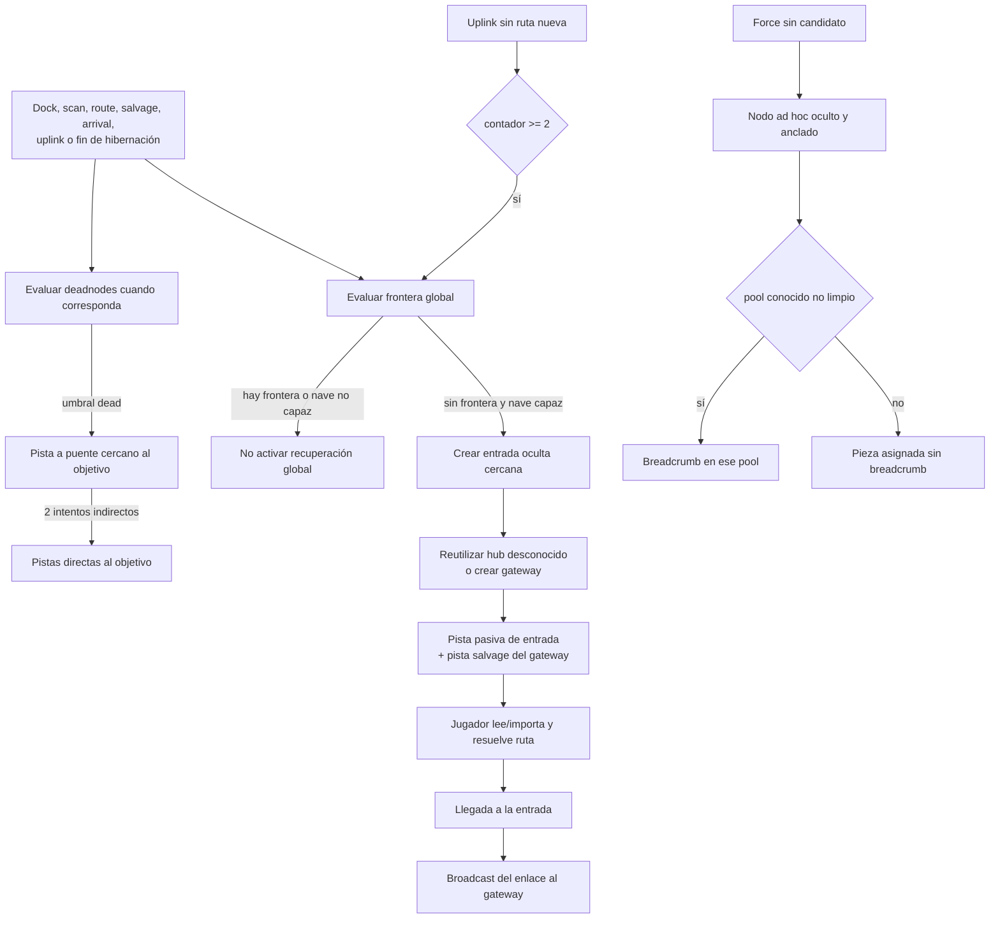

> **Actualización implementada 4D-3e4b (2026-11-06).** Señales y broadcasts requieren `comms`/`radiod`, fuente local legítima y recepción efectiva antes de consumir piezas o etapas. Oportunidades pendientes, recibidas y leídas persisten en un ledger común. Las activaciones legacy que fabrican nodos correctivos se aplazan explícitamente hasta e5; las cadenas ya existentes pueden entregar por el canal real. No se alteran políticas del scheduler, scan ni uplink. El [contrato de comunicaciones](passive-communications.es.md) describe gates, cobertura, reintentos y límites; prevalece sobre las descripciones históricas siguientes en estos puntos. F-DEAD-01 sigue pendiente.

# Failsafes de exploración, deadnodes y recuperación

Versión inglesa: [exploration-failsafes.md](exploration-failsafes.md)

## 1. Propósito y alcance

Esta referencia describe el comportamiento vigente de los mecanismos que tratan
de crear una nueva oportunidad cuando la exploración, un contacto o una pieza
forzada de lore quedan sin una vía utilizable. Fue contrastada con el código
productivo del árbol basado en `696f3ea` y con pruebas aisladas ejecutadas el
2026-11-02. No cambia balance ni declara que exista una garantía global de
progreso.

El modelo espacial, el conocimiento del jugador y la colocación narrativa se
documentan por separado en [worldgen](world-generation.es.md),
[descubrimiento y navegación](discovery-navigation-intel.es.md) y
[scheduler de lore](lore-scheduler.es.md). Aquí sólo se repiten los detalles
necesarios para explicar sus interacciones con los failsafes.

## 2. Modelo conceptual de los mecanismos

Los mecanismos no forman una única máquina de recuperación. Comparten estado,
pero responden a problemas diferentes:

| Mecanismo | Problema observado | Resultado principal | Garantía real |
| --- | --- | --- | --- |
| Guardrail inicial de worldgen | Primer vecindario trivialmente bloqueado | Promueve una vez el origen y, si hace falta, un vecino temprano | Sólo mejora el primer clúster; no garantiza progreso posterior |
| Recuperación global de exploración | No queda ninguna frontera reconocida y la nave puede explorar | Crea una entrada oculta cercana y obtiene o crea un gateway; entrega pistas diegéticas | Crea una cadena consumible bajo sus precondiciones, no obliga al jugador a importarla |
| Deadnodes | Un contacto u oculto forzado no tiene ruta desde el componente conocido y no está a alcance de sensores | Tras umbral `dead`, publica pistas a un puente y luego al objetivo | Intenta publicar rutas; no demuestra que sean válidas ni alcanzables |
| Lore forzado ad hoc | Una pieza `force` habilitada no encuentra receptor legal | Crea un nodo oculto anclado, su pool y, si puede, un breadcrumb | Garantiza la asignación sólo si la creación cumple reglas; no garantiza breadcrumb |
| Recuperación de intel corrupta | Un token importado no coincide con contenido authored | Puede materializar sectores y revelar un hub procedural | Es probabilística y sólo revela un contacto; no publica ruta |
| Sugerencias de origen para `route solve` | Objetivo conocido fuera del rango local | Enumera otros orígenes conocidos cercanos al objetivo | Sólo asesora; no modifica el universo ni el conocimiento |

## 3. Responsabilidades y límites de cada subsistema

`exploration_recovery.py` decide si existe una frontera reconocible, comprueba
la capacidad operativa, crea la cadena entrada/gateway y registra su estado.
No conduce la nave, no importa automáticamente sus archivos y no repara
contactos individuales.

`deadnodes.py` observa `known_contacts` y `forced_hidden_nodes`, conserva
umbrales por objetivo y emite notas de navegación. No consulta el plan del
scheduler, no excluye objetivos narrativos protegidos y no valida que una pista
publicada vaya a superar el límite de salto al ser importada.

`lore.py` crea candidatos ad hoc sólo para piezas forzadas cuya política permite
esa vía. Aplica las restricciones de la pieza, ancla físicamente el nodo y trata
de sembrar un breadcrumb. El pool y la pista son infraestructura de entrega, no
una promesa de acceso.

`generator.py` aporta worldgen lazy, sincronización sectorial y el guardrail del
origen. `engine.py` y `repl.py` determinan el orden de evaluación. El importador
de intel es quien convierte texto en conocimiento/rutas y aplica el cap de
45 ly. El recorrido compartido comprueba el componente conocido operativo;
no garantiza conectividad universal.

## 4. Condiciones de activación

### Recuperación global

Se evalúa al completar `dock`, `salvage data`, `scan` o `route`, al llegar a un
nodo, al terminar hibernación y, de forma condicionada, tras `uplink`. Para
activar una generación nueva deben cumplirse todas estas condiciones:

- `EXPLORATION_RECOVERY_ENABLED` está activo; la nave no está en tránsito ni
  hibernando, no hay `terminal_lock` ni brownout y la calidad de energía alcanza
  el umbral de bloqueo.
- El nodo actual existe y no es de tipo `transit`; `core_os` está al menos
  nominal; sensores al menos limitados con `sensord` instalado y activo.
- No existe ninguna frontera que el algoritmo reconozca.

La frontera se comprueba, en este orden conceptual, como: ruta conocida hacia
un nodo no visitado; contacto conocido no visitado resoluble desde algún nodo
del componente alcanzable dentro del rango real de sensores y de 45 ly; payload
de uplink pendiente en un hub alcanzable si `data_core/datad` están operativos;
archivo o push no-uplink pendiente; o una pista pasiva previa todavía no
importada. La prueba de uplink no exige que la nave esté actualmente docked en
ese hub.

En el flujo de `uplink`, la evaluación global sólo se solicita después de dos
uplinks sin rutas nuevas (`UPLINK_FAILSAFE_N = 2`). Como cada pool de uplink es
de un solo uso y un segundo intento en el mismo nodo retorna antes de incrementar
el contador, el flujo normal necesita dos hubs no consumidos sin rutas nuevas.
Los demás triggers no dependen de ese contador.

### Deadnodes

Se evalúa al completar `dock`, `salvage data`, `scan`, `route` y durante un
uplink no consumido. Si el pool del nodo actual está `node_cleaned`, toda la
evaluación retorna sin actuar.

Un candidato debe estar en `known_contacts` o `forced_hidden_nodes`, no tener
una ruta conocida directa desde ningún nodo del componente alcanzable, no estar
a 2,5 ly o menos de ningún nodo físico de ese componente y no tener su propio
pool limpio. `known_nodes` por sí solo no basta.

Al detectarlo se guardan umbrales deterministas por seed: `stuck` de 10–15
uplinks útiles o 25–35 años y `dead` de 20–30 uplinks útiles o 50–100 años. En
la implementación actual los umbrales `stuck` no participan en ninguna
condición: el estado se registra inmediatamente y sólo los umbrales `dead`, con
semántica OR entre uplinks y años, habilitan una acción.

### Lore forzado ad hoc

El scheduler llega a esta vía cuando una pieza forzada habilitada no tiene
candidatos legales y sus candidatos declarados permiten clases procedurales.
No relaja una lista compuesta sólo por identificadores explícitos no
procedurales. Se respetan kinds, región, distancia, ventana temporal y
`max_hops_from_start`.

### Mecanismos auxiliares

El guardrail sparse se ejecuta una sola vez cuando el clúster generado contiene
el sector del origen. La recuperación de intel corrupta se evalúa al importar
un token no reconocido: tiene 50 % de fallo y, si tiene éxito, busca hasta 32
veces un hub procedural desconocido materializando sectores alrededor de la
posición actual. Las propuestas alternativas de `route solve` sólo se calculan
después de un rechazo por distancia.

## 5. Flujos completos de recuperación

### Cadena global entrada → gateway

1. La evaluación no encuentra frontera y confirma capacidad operativa.
2. Se crea una estación/hub oculta a 0,6–1,8 ly del nodo actual, con máximo
   adicional del 85 % del rango de sensores. Queda físicamente enlazada al
   ancla, en `forced_hidden_nodes`, pero no conocida.
3. Se reutiliza el hub físico desconocido, no authored, más cercano situado
   entre 12 y 45 ly de la entrada; si no existe, se crea una estación/hub a
   12–22 ly en otro sector y se materializa el clúster de ese sector.
4. El pool de la entrada recibe
   `/logs/nav/recovery_gateway_<generación>.txt` con `LINK entrada -> gateway`.
5. Se escribe una pista `NODE` + `COORD` de la entrada. El canal es
   `ship_os_mail` para fin de hibernación, `station_broadcast` para trigger de
   dock, `uplink_trace` para uplink y `captured_signal` para el resto.
6. El jugador debe leer/importar la pista o detectar la entrada mediante scan.
   El scan garantiza la detección de la entrada vigente cuando está dentro del
   radio, aunque las demás detecciones sigan siendo probabilísticas.
7. Tras conocer la entrada, `route solve`, viaje y llegada abren el siguiente
   paso. Al llegar se escribe un `station_broadcast` con el enlace al gateway.
   El nombre interno `dock_hint` y la prueba existente sugieren dock, pero el
   código sólo exige que el nodo actual sea la entrada: la entrega ocurre en la
   evaluación de llegada, antes de comprobar capacidad o frontera.
8. El jugador importa el broadcast o recupera/importa el archivo salvage para
   publicar la ruta al gateway.

La importación de las pistas es necesaria; crear el nodo o escribir el archivo
no añade por sí mismo `known_links`.

### Cadena deadnode

1. Un contacto elegible comienza a ser rastreado y conserva su instante,
   contador y umbrales.
2. Cuando alcanza cualquiera de los umbrales `dead`, el primer intento crea un
   relay a 1,5 ly del objetivo y publica `LINK nodo_actual -> puente` como
   `captured_signal`, o `station_broadcast` si el trigger es dock.
3. Tras el cooldown de cinco años, el segundo intento indirecto reutiliza el
   mismo puente y repite la pista.
4. Los intentos posteriores publican directamente
   `LINK nodo_actual -> objetivo`, también separados por cooldown.
5. El jugador debe leer/importar la nota. En una evaluación que alcanza el pase
   de candidatos, el estado se elimina sin marca de resolución histórica cuando
   el objetivo deja de ser candidato: por ruta, cercanía, limpieza del pool o
   desaparición de los conjuntos fuente. El retorno temprano por pool actual
   limpio ni actúa ni depura estados.

### Cadena de lore forzado

1. Se seleccionan como anclas todos los nodos físicos que cumplan el límite de
   hops, si existe.
2. Las coordenadas se muestrean cerca del ancla si no hay restricciones
   globales; con restricciones de región/distancia se muestrean respecto al
   nodo inicial y luego se elige el ancla física más cercana.
3. La creación sólo continúa si la distancia al ancla no supera 45 ly. Se añade
   un enlace físico mutuo, el nodo queda oculto y se inicializa su pool.
4. Se escoge de forma determinista un pool perteneciente a un nodo conocido y
   no limpio. Allí se inyecta
   `/logs/nav/forced_hint_<nodo>.txt` con un enlace al nodo oculto.
5. El scheduler asigna la pieza al nuevo pool. Si no había pool conocido no
   limpio, la función de breadcrumb retorna sin error y la asignación puede
   quedar sin pista recuperable.

## 6. Generación y publicación de nodos, rutas y pistas

Hay tres capas distintas que no deben confundirse:

- Un `SpaceNode` y sus `SpaceNode.links` describen existencia y enlaces físicos.
- `known_nodes`/`known_contacts` describen contactos revelados.
- `known_links` contiene rutas publicadas que navegación puede usar.

La entrada, el gateway creado y los nodos ad hoc usan
`register_hidden_anchored_node`: añaden enlaces físicos mutuos con su ancla,
sin revelar contacto ni ruta. Un gateway existente se reutiliza sin añadir un
enlace físico nuevo; su pista sí puede publicar una ruta navegable si la
distancia respeta el cap.

El puente deadnode es diferente: se inserta físicamente cerca del objetivo, pero
se crea sin `SpaceNode.links`, sin pool y sin `forced_hidden_nodes`. La pista se
origina en el nodo actual, que puede estar a más de 45 ly del puente. En ese caso
el importador conserva los contactos pero descarta la ruta.

Los archivos de pista evitan duplicados por ruta/nombre sólo en ámbitos
concretos: el breadcrumb ad hoc no duplica el mismo path dentro del pool; la
pista salvage global usa una generación creciente; el broadcast global sólo se
escribe una vez por estado. Deadnodes puede repetir contenido después de cada
cooldown.

## 7. Relación con pools y scheduler

`sync_node_pools_for_known_nodes` incluye nodos conocidos, ocultos forzados y
anclas operativas definidas por lore. Por eso los nodos creados mediante el
registro compartido obtienen pool aunque sigan ocultos. El puente deadnode no
usa ese registro y no obtiene pool automáticamente.

Una ventana cerrada impide que el scheduler seleccione un pool para una pieza
nueva, pero no equivale a `node_cleaned`. El breadcrumb forzado comprueba sólo
`node_cleaned`, no `window_open`, por lo que puede inyectarse en un pool ya
cerrado. La recuperación global considera archivos pendientes incluso en pools
cerrados o marcados limpios si el cómputo del estado es inconsistente; no usa la
ventana como filtro. Deadnodes, en cambio, se desactiva globalmente cuando el
pool actual está limpio y omite objetivos cuyo pool está limpio.

Los nodos ad hoc pueden alojar la pieza forzada que motivó su creación. Los
deadnodes consideran todos los `forced_hidden_nodes`, incluidos esos receptores
narrativos. La recuperación global excluye ubicaciones authored al reutilizar
gateway, pero no excluye un hub ad hoc oculto ni consulta objetivos primarios
bloqueados. Por tanto ambos mecanismos pueden revelar antes un receptor
narrativo procedural. El fallback de intel corrupta sí excluye los objetivos
primarios bloqueados al elegir un hub.

## 8. Contadores, cooldowns y persistencia

| Estado | Uso | Reinicio/eliminación |
| --- | --- | --- |
| `mobility_no_new_uplink_count` | Activa la evaluación global en el segundo uplink sin ruta | Se pone a cero si hay ruta nueva o si la recuperación produce eventos |
| `mobility_failsafe_count` | Cuenta activaciones globales exitosas | No se reinicia en ejecución normal |
| `mobility_hints` | Historial resumido de entrada/gateway/canal | Se acumula; debug muestra los cinco últimos |
| `ExplorationRecoveryState.generation` | Hace únicas las generaciones y paths salvage | Sólo incrementa tras crear entrada y gateway con éxito |
| IDs y flags de `ExplorationRecoveryState` | Evitan repetir broadcast y describen la cadena vigente | Una nueva activación sustituye los IDs anteriores; los nodos previos no se retiran |
| `DeadNodeState` | Umbrales, origen temporal, intentos, cooldown y puente; `attempts > 0` es el indicador persistente de que existe una acción anterior | Se elimina en cuanto el objetivo deja de ser candidato |
| `LoreSchedulerState.counters.uplink_count` | Reloj de uplinks útiles para deadnodes | En el primer uplink sólo sube si añadió ruta, aplicó lore, produjo archivos/eventos de lore o recuperación; se incrementa tras evaluar deadnodes y nunca en reintentos con el pool agotado |
| `sparse_guardrail_done` | Evita repetir la promoción inicial | Persiste durante la partida |

Todo este estado pertenece a `WorldState` y se serializa con la partida. La
prueba genérica de save/load confirma persistencia del mundo y del flag sparse;
`deadnode_cooldown_zero_smoke.py` demuestra específicamente la persistencia del
contador de acciones deadnode, timestamp, puente, pista y cooldown.

El cooldown deadnode sigue siendo de cinco años. `attempts == 0` significa que
no ha ocurrido ninguna acción; desde `attempts > 0`, `last_action_t` es un
timestamp real, incluido exactamente `t = 0`. El cooldown usa ese contador
persistente en vez de interpretar cero como centinela de ausencia. Una
evaluación bloqueada no cambia contador, timestamp, puente, secuencia de eventos,
archivos de pista, rutas ni intel, y save/load conserva los mismos límites.

### Integridad de rutas conocidas: F-ROUTE-01 corregido en 4D-1

Recuperación global y deadnodes comparten `reachable_known_nodes` de
`model/world.py`. Recorre sólo los vecinos operativos de `reachable_from`:
ambos extremos físicos existen y el salto satisface `is_hop_within_cap`, con
45 ly inclusivos. Cada salto se valida: una arista inválida intermedia tampoco
da acceso a payloads remotos ni acerca artificialmente un objetivo al componente.
La frontera de rutas usa esos mismos vecinos; solve conserva contacto, rango
real de sensores y cap como requisitos.

Los registros dangling/sobre cap del estado vigente quedan inertes en la
proyección de sólo lectura. Save/load no poda contactos, intel, archivos ni
referencias lazy. Los LINK nuevos rechazados se registran como historial, sin
publicar ruta. La [referencia de navegación](discovery-navigation-intel.es.md)
inventaría productores/consumidores y detalla la resolución lazy antes de validar.

`known_routes_integrity_smoke.py`, seed `271828`, reprodujo antes de corregir
frontera fantasma, contaminación multihop y exclusión falsa de deadnodes. Ahora
demuestra activación global real sin frontera válida, bloqueo con ruta válida
no visitada, candidatos deadnode rastreados sin alcanzar umbrales ni crear
puentes, historial/export EN/ES y save/load repetido sin mutaciones. F-NAV-01
conserva pendiente su limpieza; sus referencias inversas ya no son operativas.
F-DEAD-01 sigue pendiente: no cambian puentes, cadenas, thresholds, cooldowns
ni recepción.

## 9. Interacciones entre mecanismos

En `dock`, `salvage data`, `scan` y `route`, el motor ejecuta primero lore cuando
corresponde, después deadnodes y finalmente recuperación global. En uplink, se
publican rutas del pool, se evalúa lore, luego deadnodes y por último recuperación
global si el contador sin rutas alcanza dos. El `uplink_count` útil sube después
de estas evaluaciones. Al llegar sólo se evalúa recuperación global, después del
tick del scheduler.

Consecuencias observables:

- Una pista deadnode escrita en el mismo evento queda en el filesystem local,
  pero el detector global no cuenta archivos locales arbitrarios como frontera;
  por sí sola no evita una activación global en ese mismo flujo.
- Un nodo ad hoc recién creado entra en `forced_hidden_nodes` y puede convertirse
  inmediatamente en candidato deadnode, aunque la pieza o el breadcrumb sigan
  pendientes.
- Una ruta importada puede sacar un objetivo de deadnodes y, si lleva a un nodo
  no visitado, pasa a contar como frontera global.
- Desde 4D-1, una referencia inexistente o sobre cap no conecta componentes
  ni cuenta como frontera global; su historial permanece disponible.
- Los enlaces físicos no se convierten automáticamente en rutas conocidas, y
  una ruta conocida no requiere un `SpaceNode.link` físico equivalente.

Worldgen lazy añade otra diferencia. `sync_sector_state_for_node` sólo registra
un nodo especial si su sector ya existe en `generated_sectors` o
`sector_states`. La entrada y los nodos ad hoc conservan de todos modos el enlace
manual a su ancla. El gateway nuevo fuerza generación del clúster después de
insertarse y participa en sus metadatos; un puente deadnode en un sector aún no
materializado queda fuera del estado sectorial hasta otra operación, y no fuerza
worldgen.

Si un sector ya cerró `internal_links_built`, insertar un nodo no reconstruye su
topología interna. El enlace manual de los nodos anclados mitiga ese caso; el
puente deadnode carece de esa protección. Tampoco se reevalúan pares
intersectoriales ya registrados.

## 10. Tabla de bloqueos y posibles recuperaciones

| Situación | Clasificación | Mecanismo posible | Límite observado |
| --- | --- | --- | --- |
| Contacto físico conocido sin ruta y a más de sensores | Comportamiento admitido; se vuelve problema si persiste | Deadnodes tras umbral `dead` | La pista al puente puede superar 45 ly |
| Contacto conocido dentro de sensores desde un origen alcanzable | Deliberadamente recuperable | `route solve` desde ese origen; recuperación global ve frontera | Requiere llegar al origen y ejecutar el solve |
| Universo local sin rutas, solve, payloads ni pistas | Caso objetivo confirmado | Recuperación global | Requiere nave operativa y acción del jugador sobre la pista |
| Nodo ad hoc oculto sin pool conocido no limpio para breadcrumb | Riesgo confirmado por flujo de código | Scan si queda cerca; deadnodes con el tiempo | La pieza puede quedar asignada sin pista inicial |
| Pieza forzada asignada a receptor inaccesible | Riesgo potencial con impacto narrativo | Breadcrumb, deadnodes o scan | No hay prueba extremo a extremo ni exclusión de objetivos protegidos |
| Pista obtenida pero no importada | Comportamiento deliberado | Leer/importar; autoimport sólo en rutas de lectura reconocidas | Mientras el archivo exista puede contar como frontera y bloquear otra generación |
| Registro de ruta hacia nodo inexistente | F-ROUTE-01 corregido en 4D-1 | Contacto e historial conservados; ruta operativa excluida | Ya no suprime deadnodes ni mantiene una frontera fantasma |
| Nodo insertado tras cierre topológico sectorial | Limitación confirmada | Enlace manual de nodos anclados | Puentes deadnode no tienen enlace manual ni rebuild |
| Pool cerrado, pero no limpio | Comportamiento admitido | Breadcrumb puede inyectarse; archivos existentes siguen contando | El scheduler no lo elige como receptor normal |
| Pool actual limpio | Bloqueo específico de deadnodes | Recuperación global se evalúa después | Deadnodes no revisa ningún objetivo en ese trigger |
| Pistas deadnode repetidas sin ruta válida | Riesgo confirmado | Tras dos intentos pasa a pista directa | Cooldown no prueba utilidad y no hay máximo de intentos directos |
| Gateway reutilizado sin enlace físico a entrada | Divergencia deliberadamente tolerada por navegación | Importar la ruta publicada | No expresa conectividad física en `SpaceNode.links` |
| Token de intel corrupta | Fallback probabilístico | Revelación de hub procedural | 50 % falla; no crea ruta y puede crear otro deadnode |

## 11. Invariantes y garantías realmente existentes

- Todo enlace creado por `register_hidden_anchored_node` está a 45 ly o menos
  del ancla y se escribe en ambos conjuntos físicos.
- Una entrada global nueva está dentro del rango configurado de sensores y el
  scan de esa entrada tiene detección garantizada.
- Un gateway global creado está a 12–22 ly de la entrada y en otro sector. Uno
  reutilizado está entre 12 y 45 ly y es un hub desconocido no authored.
- La recuperación global no activa otra generación mientras reconozca una
  frontera o una de sus pistas pendientes.
- La publicación y consulta operativa exigen ambos nodos físicos y el cap
  inclusivo de 45 ly; las pistas rechazadas se conservan como historial.
- El guardrail de origen y los thresholds por deadnode son deterministas para
  la seed y las claves correspondientes.
- El scheduler no relaja candidatos explícitos no procedurales para forzar un
  nodo ad hoc.

No existe una garantía de que todo contacto sea alcanzable, que cada pista sea
importada, que toda ruta textual sea físicamente válida, que un breadcrumb
siempre tenga receptor, que los objetivos narrativos permanezcan ocultos frente
a todos los failsafes ni que el grafo global permanezca conectado.

## 12. Casos límite y riesgos de bloqueo permanente

1. F-ROUTE-01 quedó corregido en 4D-1: los registros inválidos no cuentan como
   frontera ni contaminan componentes. Se conserva la pista histórica original.
2. Deadnodes todavía admite un `known_contact` inexistente y puede escribir
   pistas inviables; su planificador sigue pendiente (F-DEAD-01). El importador
   ya no publica esas pistas como rutas ni resuelve falsamente su seguimiento.
3. El puente se coloca cerca del objetivo, no cerca de la nave. La nota
   `actual -> puente` puede exceder el cap y ser descartada en ambos intentos.
4. Los umbrales `stuck` y `dead_since_uplinks` se almacenan pero no gobiernan
   comportamiento. El diagnóstico puede sugerir una fase intermedia que no
   existe funcionalmente.
5. Una nueva activación global sustituye los IDs activos, pero no elimina nodos
   de generaciones anteriores. Estados manipulados o pistas perdidas pueden
   acumular topología oculta.
6. La recuperación global considera un payload uplink utilizable sin exigir que
   haya un dock actual alcanzable en términos de acciones inmediatas; esto puede
   aplazar la recuperación aunque aún haga falta navegar y dockear.
7. `MOBILITY_FAILSAFE_MAX_DIST_LY = 20` permanece en balance, pero no se consulta
   en la implementación vigente. La frontera route-solve usa el rango real de
   sensores y el cap.
8. El fallback de intel corrupta usa offsets cartesianos de ±40 ly por eje; el
   nombre “radius” no implica una esfera de 40 ly. Puede materializar muchos
   clústeres sin ofrecer una ruta.

## 13. Pruebas ejecutadas y lagunas

Las pruebas se ejecutaron con
`/home/jon/prog/retorno_case/retorno_venv/bin/python` sobre estados aislados o
directorios temporales. No se abrió ni modificó ninguna partida real.

| Prueba | Resultado | Evidencia / primer fallo |
| --- | --- | --- |
| `exploration_recovery_smoke.py` | PASSED | Creación, pista pasiva, import, solve, viaje y acceso al gateway; no prueba que el broadcast requiera dock |
| `uplink_authored_and_failsafe_smoke.py` | PASSED | Segundo uplink preparado, `uplink_trace`, nodos ocultos, pool y contadores |
| `route_hop_cap_smoke.py` | PASSED | Bloqueo de viaje largo y enlaces worldgen bajo cap |
| `route_solve_out_of_range_origins_smoke.py` | PASSED | Rechazo local y propuestas de otros orígenes |
| `worldgen_sparse_archetypes_smoke.py` | PASSED | Guardrail inicial, reglas, determinismo y topología sparse |
| `scan_job_smoke.py` | PASSED | Scan por job y tratamiento especial de la entrada vigente |
| `uplink_once_per_node_smoke.py` | PASSED | Consumo único del pool de uplink |
| `drone_salvage_survey_smoke.py` | PASSED | Survey y salvage de datos aislados |
| `save_load_smoke.py` | PASSED | Serialización temporal general y guardrail sparse |
| `known_routes_integrity_smoke.py` | PASSED | Rutas válidas/límite, ausencia de frontera fantasma, componentes mixtos, candidatos deadnode, lazy, historial EN/ES y save/load idempotente; F-NAV-01/F-DEAD-01 no corregidos |
| `deadnode_cooldown_zero_smoke.py` | PASSED | Reproducción previa al fix, timestamps cero/positivos, bloqueo inmediato y anterior al límite, expiración exacta, candidatos independientes, efectos observables y persistencia save/load específica |
| `forced_hidden_ad_hoc_smoke.py` | PASSED | Host sintético conocido/no visitado, nodo oculto y breadcrumb sólo en el pool elegible |
| `lore_secondary_count_weights_hard_smoke.py` | PASSED | Receptores sintéticos y casos independientes de count, pesos y hard-force |
| `debug_lore_arcs_smoke.py` | PASSED | Cero arcos activos reales y contrato de formato sobre arco sintético |

Las tres fixtures desalineadas se repararon posteriormente en Fase 4A sin
cambios productivos. La regresión deadnode focalizada cubre estado y persistencia
del cooldown, pero aún no hay prueba extremo a extremo de importación de pistas
deadnode válidas e inválidas, de ambos estados de recuperación juntos, de ad hoc
sin breadcrumb ni de interferencia con objetivos protegidos.

## 14. Decisiones cerradas y cuestiones técnicas pendientes

- Los umbrales `stuck` y la utilidad de uplink siguen pendientes de estudio de
  balance; no forman parte de las decisiones cerradas.
- Implementar la cadena completa aprobada: cada salto bajo cap desde un origen
  alcanzable, revelación progresiva e integración coherente con topología y
  pools.
- F-ROUTE-01 corregido en 4D-1: el criterio compartido excluye identificadores
  inexistentes y saltos sobre cap de rutas, componentes y fronteras operativas.
- La recepción de un broadcast al llegar a cobertura está aprobada para el
  futuro `comms` + `radiod`; no debe adelantar triggers de lore que exigen dock.
  Nombre, evento y tests deberán expresar esa distinción.
- Aplicar protección común a primaries frente a automatismos de recuperación,
  conservando las excepciones deliberadas de `scan` y `route solve` manual.
- Una oportunidad forzosa sin breadcrumb o cadena válida debe permanecer
  pendiente y reintentable; falta diseñar su commit técnico e idempotencia.
- Aclarar la semántica de “uplink útil” para los años/umbrales deadnode y si los
  intentos consumidos sin contenido deben contar.
- Determinar si `MOBILITY_FAILSAFE_MAX_DIST_LY` es legado eliminable o una regla
  que falta aplicar, sin cambiar balance en esta fase.
- Añadir cobertura sin cambiar antes el balance: deadnodes completo,
  persistencia, generación tardía, rutas sobre cap y ausencia de breadcrumb.

Las decisiones aprobadas proceden del
[contrato de navegación y recuperación](../design/navigation-recovery-contract.es.md);
las correcciones implementadas se identifican expresamente; las demás siguen pendientes.

## 15. Referencias al código

- [`exploration_recovery.py`](../../src/retorno/core/exploration_recovery.py):
  capacidad, frontera, creación y pistas de recuperación global.
- [`deadnodes.py`](../../src/retorno/core/deadnodes.py): candidatos, thresholds,
  puente y estrategia directa.
- [`lore.py`](../../src/retorno/core/lore.py): pools, breadcrumbs, restricciones,
  nodos anclados y scheduler.
- [`engine.py`](../../src/retorno/core/engine.py): orden de triggers, scan,
  llegada y jobs.
- [`repl.py`](../../src/retorno/cli/repl.py): uplink, importación de intel,
  contacto por intel corrupta, debug y fin de hibernación.
- [`world.py`](../../src/retorno/model/world.py): estado persistente y capas de
  conocimiento/topología.
- [`generator.py`](../../src/retorno/worldgen/generator.py): worldgen lazy,
  metadatos sectoriales, cierre topológico y guardrail inicial.
- [`balance.py`](../../src/retorno/config/balance.py): umbrales y límites.
- [`tests/exploration_recovery_smoke.py`](../../tests/exploration_recovery_smoke.py),
  [`tests/uplink_authored_and_failsafe_smoke.py`](../../tests/uplink_authored_and_failsafe_smoke.py)
  y las demás pruebas inventariadas en la sección 13.
