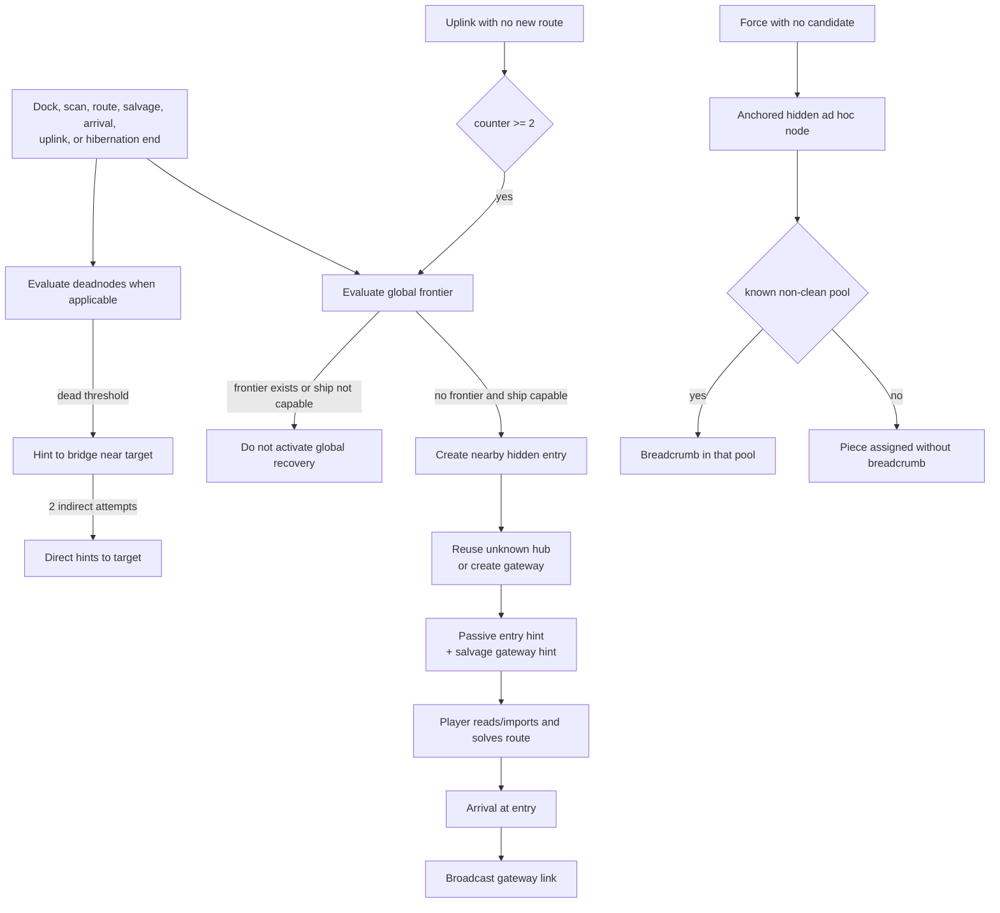

> **Implemented 4D-3e4b update (2026-11-06).** Signals and broadcasts require `comms`/`radiod`, a legitimate local source and actual reception before consuming pieces or stages. Pending, received and read opportunities persist in one ledger. Legacy activations fabricating corrective nodes are explicitly deferred until e5; existing chains can deliver through their real channel. Scheduler policies, scan and uplink are unchanged. The [communications contract](passive-communications.md) specifies gates, coverage, retries and limits, superseding historical descriptions below on these points. F-DEAD-01 remains pending.

# Exploration failsafes, deadnodes, and recovery

Spanish version: [exploration-failsafes.es.md](exploration-failsafes.es.md)

## 1. Purpose and scope

This reference describes the current mechanisms that try to create a new
opportunity when exploration, a contact, or a forced lore piece has no usable
path. It was checked against production code in the worktree based on
`696f3ea` and against isolated tests run on 2026-11-02. It changes no balance
and does not claim that the game provides a global progress guarantee.

The spatial model, player knowledge, and narrative placement are documented
separately in [worldgen](world-generation.md),
[discovery and navigation](discovery-navigation-intel.md), and the
[lore scheduler](lore-scheduler.md). This document repeats only the details
needed to explain their interactions with failsafes.

## 2. Conceptual model

These mechanisms do not form one recovery state machine. They share state but
address different failures:

| Mechanism | Observed problem | Main result | Actual guarantee |
| --- | --- | --- | --- |
| Initial worldgen guardrail | A trivially blocked first neighborhood | Promotes the origin once and, when needed, one early neighbor | Improves only the first cluster; it does not guarantee later progress |
| Global exploration recovery | No recognized frontier remains and the ship can explore | Creates a nearby hidden entry and obtains or creates a gateway; delivers diegetic hints | Creates a consumable chain under its preconditions; it cannot make the player import it |
| Deadnodes | A contact or forced-hidden node has no route from the known component and is outside sensor range | After the `dead` threshold, publishes bridge hints and then direct hints | Attempts to publish routes; it does not prove that they are valid or reachable |
| Forced-lore ad hoc node | An enabled `force` piece has no legal receiver | Creates an anchored hidden node, its pool, and a breadcrumb when possible | Guarantees assignment only when creation satisfies the rules; it does not guarantee a breadcrumb |
| Corrupt-intel recovery | An imported token matches no authored content | May materialize sectors and reveal a procedural hub | Probabilistic and reveals only a contact, not a route |
| Alternative `route solve` origins | A known target is outside local range | Lists other known origins near the target | Advisory only; it changes neither universe nor knowledge |

## 3. Subsystem responsibilities and limits

`exploration_recovery.py` decides whether a recognized frontier exists, checks
operational capability, creates the entry/gateway chain, and records its state.
It does not fly the ship, automatically import its files, or repair individual
contacts.

`deadnodes.py` observes `known_contacts` and `forced_hidden_nodes`, retains
per-target thresholds, and emits navigation notes. It does not inspect the
scheduler plan, exclude protected narrative targets, or validate that a
published hint will pass the hop cap when imported.

`lore.py` creates ad hoc candidates only for forced pieces whose policy permits
that path. It applies piece constraints, physically anchors the node, and tries
to seed a breadcrumb. A pool and a hint are delivery infrastructure, not an
access guarantee.

`generator.py` supplies lazy worldgen, sector synchronization, and the origin
guardrail. `engine.py` and `repl.py` determine evaluation order. The intel
importer turns text into knowledge/routes and enforces the 45 ly cap. None of
these components guarantees universal connectivity. The shared traversal
checks the operational known component.

## 4. Activation conditions

### Global recovery

It is evaluated when `dock`, `salvage data`, `scan`, or `route` completes, on
arrival, at the end of hibernation, and conditionally after `uplink`. A new
generation requires all of the following:

- `EXPLORATION_RECOVERY_ENABLED` is on; the ship is neither in transit nor
  hibernating; there is no `terminal_lock` or brownout; and power quality meets
  the block threshold.
- The current node exists and is not `transit`; `core_os` is at least nominal;
  sensors are at least limited with `sensord` installed and running.
- No frontier recognized by the algorithm exists.

The frontier check, in conceptual order, is: a known route to an unvisited
node; a known unvisited contact that can be solved from some node in the
reachable component within actual sensor range and 45 ly; pending uplink
payload at a reachable hub while `data_core/datad` are usable; a pending file or
non-uplink push; or an earlier passive recovery hint that has not been imported.
The uplink check does not require the ship to be docked at that hub now.

In the `uplink` flow, global evaluation is requested only after two uplinks with
no new routes (`UPLINK_FAILSAFE_N = 2`). Because each uplink pool is one-shot
and a repeated attempt at the same node returns before incrementing the counter,
normal play needs two distinct unconsumed hubs with no new routes. Other
triggers do not depend on this counter.

### Deadnodes

Deadnodes is evaluated when `dock`, `salvage data`, `scan`, or `route` completes
and during an unconsumed uplink. If the current node's pool is `node_cleaned`,
the entire evaluation returns without acting.

A candidate must be in `known_contacts` or `forced_hidden_nodes`, have no direct
known route from any node in the reachable component, be more than 2.5 ly from
every physical node in that component, and not have a clean target pool.
Membership in `known_nodes` alone is insufficient.

On first observation, deterministic seed-based thresholds are stored: `stuck`
at 10–15 useful uplinks or 25–35 years and `dead` at 20–30 useful uplinks or
50–100 years. In the current implementation the `stuck` thresholds are not used
by any condition: tracking begins immediately, and only the `dead` thresholds,
with OR semantics between uplinks and years, enable an action.

### Forced-lore ad hoc nodes

The scheduler reaches this path when an enabled forced piece has no legal
candidate and its declared candidates permit procedural classes. It does not
relax a list made solely of explicit non-procedural IDs. Kinds, region,
distance, time window, and `max_hops_from_start` are respected.

### Supporting mechanisms

The sparse guardrail runs once when a generated cluster contains the origin
sector. Corrupt-intel recovery runs when an imported token is unrecognized: it
has a 50% failure chance and, on success, tries up to 32 times to find an
unknown procedural hub while materializing sectors around the current
position. Alternative `route solve` origins are computed only after an
out-of-range rejection.

## 5. Complete recovery flows

### Global entry → gateway chain

1. Evaluation finds no frontier and confirms operational capability.
2. It creates a hidden station/hub 0.6–1.8 ly from the current node, additionally
   capped at 85% of sensor range. It is physically linked to the anchor and
   entered in `forced_hidden_nodes`, but remains unknown.
3. It reuses the nearest unknown, non-authored physical hub 12–45 ly from the
   entry; if none exists, it creates a station/hub 12–22 ly away in another
   sector and materializes that sector's cluster.
4. The entry pool receives `/logs/nav/recovery_gateway_<generation>.txt` with
   `LINK entry -> gateway`.
5. A `NODE` + `COORD` entry hint is written. The channel is `ship_os_mail` for
   hibernation end, `station_broadcast` for a dock trigger, `uplink_trace` for
   uplink, and `captured_signal` otherwise.
6. The player must read/import the hint or detect the entry by scan. Scan
   guarantees detection of the current recovery entry when it is in range,
   although other detections remain probabilistic.
7. Once the entry is known, `route solve`, travel, and arrival open the next
   step. Arrival writes a `station_broadcast` containing the gateway link. The
   internal `dock_hint` name and existing test suggest docking, but code only
   requires the current node to be the entry: delivery occurs during arrival
   evaluation, before capability or frontier checks.
8. The player imports the broadcast or salvages/imports the pool file to
   publish the gateway route.

Import remains necessary: creating the node or writing the file does not add a
`known_links` edge by itself.

### Deadnode chain

1. An eligible contact starts being tracked with its time, counter, and
   thresholds.
2. Once either `dead` threshold is met, the first attempt creates a relay 1.5 ly
   from the target and publishes `LINK current_node -> bridge` through
   `captured_signal`, or `station_broadcast` when the trigger is dock.
3. After the five-year cooldown, the second indirect attempt reuses the same
   bridge and repeats the hint.
4. Later attempts publish `LINK current_node -> target` directly, also separated
   by cooldown.
5. The player must read/import the note. On an evaluation that reaches the
   candidate pass, state is deleted with no historical resolution marker when
   the target stops being a candidate because of a route, proximity, a clean
   pool, or removal from the source sets. The clean-current-pool early return
   neither acts nor prunes state.

### Forced-lore chain

1. Every physical node satisfying the hop limit, if any, is an anchor candidate.
2. Coordinates are sampled near the anchor when there are no global constraints;
   with region/distance constraints, they are sampled from the run's start node
   and the nearest physical anchor is selected afterward.
3. Creation continues only if the selected anchor is no more than 45 ly away. A
   mutual physical link is added, the node remains hidden, and its pool is
   initialized.
4. A deterministic known, non-clean node pool is selected. It receives
   `/logs/nav/forced_hint_<node>.txt` with a link to the hidden node.
5. The scheduler assigns the piece to the new pool. If no known non-clean pool
   existed, breadcrumb seeding silently returns and the assignment can remain
   without a recoverable hint.

## 6. Node, route, and hint generation/publication

Three distinct layers must not be conflated:

- A `SpaceNode` and its `SpaceNode.links` describe physical existence and links.
- `known_nodes`/`known_contacts` describe revealed contacts.
- `known_links` contains published routes usable by navigation.

The entry, created gateway, and ad hoc nodes use
`register_hidden_anchored_node`: they add a mutual physical link to the anchor
without revealing a contact or route. Reusing an existing gateway adds no new
physical link; its hint can still publish a navigable route when distance is
under the cap.

The deadnode bridge differs: it is inserted physically near the target but is
created without `SpaceNode.links`, a pool, or `forced_hidden_nodes`. Its hint
starts at the current node, which may be more than 45 ly from the bridge. The
importer then keeps the contacts but drops the route.

Hints prevent duplicates only in local scopes: an ad hoc breadcrumb does not
duplicate the same path in its pool; the global salvage hint uses an increasing
generation; and the global broadcast is written once per state. Deadnodes may
repeat content after every cooldown.

## 7. Pools and scheduler relationship

`sync_node_pools_for_known_nodes` includes known nodes, forced-hidden nodes, and
operational anchors defined by lore. Nodes created through the shared registry
therefore get pools while remaining hidden. A deadnode bridge bypasses that
registry and gets no pool automatically.

A closed window prevents scheduler selection for a new piece but is not the
same as `node_cleaned`. Forced breadcrumb seeding checks only `node_cleaned`,
not `window_open`, so it may inject into an already closed pool. Global recovery
counts pending files even in closed or nominally clean pools if state is
inconsistent; it does not filter on the window. Deadnodes, by contrast, is
globally disabled when the current pool is clean and skips targets with clean
pools.

Ad hoc nodes can host the forced piece that caused their creation. Deadnodes
considers every `forced_hidden_nodes` entry, including these narrative
receivers. Global recovery excludes authored locations when reusing a gateway,
but does not exclude a hidden ad hoc hub or inspect locked primary targets.
Either mechanism may therefore expose a procedural narrative receiver earlier.
The corrupt-intel fallback does exclude locked primary targets when choosing a
hub.

## 8. Counters, cooldowns, and persistence

| State | Use | Reset/removal |
| --- | --- | --- |
| `mobility_no_new_uplink_count` | Requests global recovery on the second uplink with no route | Reset on a new route or when recovery produces events |
| `mobility_failsafe_count` | Counts successful global activations | Not reset in normal execution |
| `mobility_hints` | Short history of entry/gateway/channel | Accumulates; debug shows the last five |
| `ExplorationRecoveryState.generation` | Makes generations and salvage paths unique | Increments only after entry and gateway are both created |
| `ExplorationRecoveryState` IDs/flags | Prevent duplicate broadcast and describe the current chain | A new activation replaces active IDs; old nodes are not removed |
| `DeadNodeState` | Thresholds, start points, attempts, cooldown, and bridge; `attempts > 0` is the persisted indicator that an earlier action exists | Deleted as soon as the target stops being a candidate |
| `LoreSchedulerState.counters.uplink_count` | Useful-uplink clock for deadnodes | On the first uplink, increments only when it added a route, applied lore, produced lore events/files, or recovery; it increments after deadnode evaluation and never on exhausted-pool retries |
| `sparse_guardrail_done` | Prevents another initial promotion | Persists for the run |

All of this state belongs to `WorldState` and is serialized with the save. The
generic save/load smoke proves world persistence and the sparse flag, while
`deadnode_cooldown_zero_smoke.py` specifically proves persistence of the
deadnode action counter, timestamp, bridge, hint, and cooldown.

The deadnode cooldown remains five years. `attempts == 0` means that no action
has occurred; once `attempts > 0`, `last_action_t` is a real timestamp, including
exactly `t = 0`. Cooldown checks use that persisted action counter rather than
treating zero as an absence sentinel. A blocked evaluation changes neither the
counter, timestamp, bridge, event sequence, hint files, routes, nor intel, and
save/load preserves the same boundary behavior.

### Known-route integrity: F-ROUTE-01 fixed in 4D-1

Global recovery and deadnodes share `reachable_known_nodes` from
`model/world.py`. It traverses only operational neighbors from `reachable_from`:
both physical endpoints exist and the hop satisfies `is_hop_within_cap`, with
an inclusive 45 ly cap. Every hop is checked: an invalid intermediate edge
cannot expose remote payloads or artificially bring a target near the component.
Route frontier uses those same neighbors; solve retains its contact, actual
sensor range, and cap requirements.

Dangling/over-cap current-version records are inert in the read-only projection.
Save/load does not prune contacts, intel, files, or lazy references. New rejected
LINK clues are recorded as history without publishing routes. The
[navigation reference](discovery-navigation-intel.md) inventories producers and
consumers and details lazy resolution before validation.

`known_routes_integrity_smoke.py`, seed `271828`, reproduced phantom frontier,
multihop contamination, and false deadnode exclusion before correction. It now
proves actual global activation without a valid frontier, suppression with a
valid unvisited route, retained deadnode tracking without reaching thresholds
or creating bridges, EN/ES history/export, and mutation-free repeated save/load.
F-NAV-01 cleanup remains pending; its leftover reverse references are no longer
operational. F-DEAD-01 remains pending: bridges, chains, thresholds, cooldowns,
and reception are unchanged.

## 9. Mechanism interactions

For `dock`, `salvage data`, `scan`, and `route`, the engine runs lore when
applicable, then deadnodes, then global recovery. Uplink publishes pool routes,
evaluates lore, then deadnodes, and finally global recovery if the no-route
counter reaches two. The useful `uplink_count` increases afterward. Arrival
evaluates only global recovery after the scheduler tick.

Observable consequences include:

- A deadnode hint written in the same event stays in the local filesystem, but
  the global detector does not count arbitrary local files as a frontier; by
  itself it does not prevent global activation in that same flow.
- A newly created ad hoc node enters `forced_hidden_nodes` and can immediately
  become a deadnode candidate while its piece or breadcrumb is still pending.
- An imported route can remove a target from deadnodes and, if it leads to an
  unvisited node, become a global frontier.
- Since 4D-1, a missing/over-cap reference cannot connect components or count
  as global frontier; its history remains available.
- Physical links are not automatically known routes, and known routes need not
  have a matching `SpaceNode.link`.

Lazy worldgen adds another distinction. `sync_sector_state_for_node` registers
a special node only if its sector already exists in `generated_sectors` or
`sector_states`. Entry and ad hoc nodes still retain their manual anchor link.
A newly created gateway forces cluster generation after insertion and joins its
metadata; a deadnode bridge in an unmaterialized sector remains outside sector
state until another operation and does not force worldgen.

If a sector already closed `internal_links_built`, inserting a node does not
rebuild internal topology. The manual link mitigates this for anchored nodes;
deadnode bridges have no such protection. Previously recorded intersector pairs
are not reevaluated either.

## 10. Blocking conditions and possible recoveries

| Situation | Classification | Possible mechanism | Observed limit |
| --- | --- | --- | --- |
| Known physical contact without route and beyond sensors | Accepted behavior; problematic if persistent | Deadnodes after the `dead` threshold | Bridge hint may exceed 45 ly |
| Known contact within sensors of a reachable origin | Deliberately recoverable | `route solve` from that origin; global recovery sees a frontier | Player must reach the origin and run solve |
| Local universe with no route, solve, payload, or hint | Confirmed target case | Global recovery | Needs an operational ship and player action on the hint |
| Hidden ad hoc node with no known non-clean pool for breadcrumb | Risk confirmed by control flow | Scan if nearby; deadnodes over time | Piece may be assigned without an initial hint |
| Forced piece assigned to an inaccessible receiver | Potential narrative-impact risk | Breadcrumb, deadnodes, or scan | No end-to-end test or protected-target exclusion |
| Hint obtained but not imported | Deliberate behavior | Read/import; autoimport only on recognized read paths | Existing file can count as frontier and block another generation |
| Route record to a nonexistent node | F-ROUTE-01 fixed in 4D-1 | Contact/history retained; operational route excluded | Cannot suppress deadnodes or retain phantom frontier |
| Node inserted after sector topology closes | Confirmed limitation | Manual link for anchored nodes | Deadnode bridges have neither manual link nor rebuild |
| Closed but non-clean pool | Accepted behavior | Breadcrumb may be injected; existing files still count | Scheduler will not select it as a normal receiver |
| Clean current pool | Deadnodes-specific block | Global recovery is evaluated later | Deadnodes checks no target on that trigger |
| Repeated deadnode hints with no valid route | Confirmed risk | Changes to direct hint after two indirect attempts | Cooldown does not prove usefulness; no direct-attempt cap |
| Reused gateway without physical link to entry | Navigation tolerates the divergence | Import the published route | No connectivity is expressed in `SpaceNode.links` |
| Corrupt intel token | Probabilistic fallback | Reveal a procedural hub | 50% failure; creates no route and may create another deadnode |

## 11. Existing invariants and guarantees

- Every link created by `register_hidden_anchored_node` is no more than 45 ly
  from its anchor and is written into both physical link sets.
- A new global entry lies within configured sensor range, and scanning that
  entry has guaranteed detection.
- A created global gateway is 12–22 ly from the entry and in another sector. A
  reused gateway is 12–45 ly away and is an unknown non-authored hub.
- Global recovery does not activate another generation while it recognizes a
  frontier or one of its pending hints.
- Operational publication/queries require both physical nodes and the
  inclusive 45 ly cap; rejected clues remain in history.
- The origin guardrail and per-deadnode thresholds are deterministic for their
  seed and keys.
- The scheduler does not relax explicit non-procedural candidates to force an
  ad hoc node.

There is no guarantee that every contact is reachable, every hint is imported,
every textual route is physically valid, every breadcrumb gets a receiver,
narrative targets remain hidden from every failsafe, or the global graph stays
connected.

## 12. Edge cases and permanent-block risks

1. F-ROUTE-01 was fixed in 4D-1: invalid records cannot count as frontier or
   contaminate components. The original historical clue is retained.
2. Deadnodes still accepts a nonexistent `known_contact` and may write unusable
   clues; its planner remains pending (F-DEAD-01). The importer no longer
   publishes those clues as routes or falsely resolves tracking.
3. The bridge is placed near the target, not the ship. The
   `current -> bridge` note may exceed the cap and be dropped on both indirect
   attempts.
4. `stuck` thresholds and `dead_since_uplinks` are stored but govern no behavior.
   Diagnostics can suggest an intermediate phase that does not functionally
   exist.
5. A new global activation replaces active IDs but does not remove nodes from
   older generations. Manipulated state or lost hints can accumulate hidden
   topology.
6. Global recovery treats an uplink payload as usable without requiring a dock
   that is immediately actionable, which can postpone recovery while the player
   still needs to navigate and dock.
7. `MOBILITY_FAILSAFE_MAX_DIST_LY = 20` remains in balance but is not read by
   current implementation. Route-solve frontier uses actual sensor range and
   the cap.
8. Corrupt-intel fallback uses Cartesian offsets of ±40 ly on each axis; the
   name “radius” does not define a 40 ly sphere. It can materialize many clusters
   without providing a route.

## 13. Tests run and gaps

Tests used `/home/jon/prog/retorno_case/retorno_venv/bin/python` with isolated
states or temporary directories. No real save was opened or modified.

| Test | Result | Evidence / first failure |
| --- | --- | --- |
| `exploration_recovery_smoke.py` | PASSED | Creation, passive hint, import, solve, travel, and gateway access; does not prove broadcast requires dock |
| `uplink_authored_and_failsafe_smoke.py` | PASSED | Prepared second uplink, `uplink_trace`, hidden nodes, pool, and counters |
| `route_hop_cap_smoke.py` | PASSED | Long-travel block and worldgen links under cap |
| `route_solve_out_of_range_origins_smoke.py` | PASSED | Local rejection and alternative origins |
| `worldgen_sparse_archetypes_smoke.py` | PASSED | Initial guardrail, rules, determinism, and sparse topology |
| `scan_job_smoke.py` | PASSED | Job-based scan and current-entry special case |
| `uplink_once_per_node_smoke.py` | PASSED | One-shot uplink pool |
| `drone_salvage_survey_smoke.py` | PASSED | Isolated survey and data salvage |
| `save_load_smoke.py` | PASSED | General temporary serialization and sparse guardrail |
| `known_routes_integrity_smoke.py` | PASSED | Valid/boundary routes, no phantom frontier, mixed components, deadnode candidates, lazy generation, EN/ES history, and idempotent save/load; F-NAV-01/F-DEAD-01 not corrected |
| `deadnode_cooldown_zero_smoke.py` | PASSED | Pre-fix reproduction plus zero/positive timestamps, immediate and pre-limit blocking, exact expiry, independent candidates, observable effects, and focused save/load persistence |
| `forced_hidden_ad_hoc_smoke.py` | PASSED | Known/unvisited synthetic host, hidden node, and breadcrumb only in the eligible pool |
| `lore_secondary_count_weights_hard_smoke.py` | PASSED | Synthetic receivers and independent count, weight, and hard-force cases |
| `debug_lore_arcs_smoke.py` | PASSED | Zero real active arcs and synthetic-arc formatting contract |

The three stale fixtures were later repaired in Phase 4A without production
changes. The focused deadnode regression covers cooldown state and persistence,
but there is still no end-to-end test for valid and invalid deadnode hint import,
both recovery state types together, ad hoc creation without a breadcrumb, or
protected-target interference.

## 14. Closed decisions and pending technical questions

- The `stuck` thresholds and useful-uplink semantics remain separate balance
  studies; they are not part of the closed decisions.
- Implement the approved complete chain: every hop under the cap from a
  reachable origin, progressive reveal, and coherent topology/pool integration.
- F-ROUTE-01 fixed in 4D-1: the shared criterion excludes nonexistent ids and
  over-cap hops from operational routes, components, and frontiers.
- Receiving a broadcast on entering coverage is approved for future
  `comms` + `radiod`; it must not advance lore triggers that require dock. Its
  name, event, and tests must express that distinction.
- Apply shared primary protection against recovery automation while preserving
  the deliberate natural `scan` and manual `route solve` exceptions.
- A forced opportunity without a breadcrumb or valid chain must remain pending
  and retryable; its technical commit and idempotency still need design.
- Clarify useful-uplink semantics for deadnode thresholds and whether consumed
  no-content attempts should count.
- Determine whether `MOBILITY_FAILSAFE_MAX_DIST_LY` is removable legacy or an
  unapplied rule, without changing balance in this phase.
- Add coverage before changing balance: complete deadnodes, persistence, late
  insertion, over-cap routes, and missing breadcrumbs.

The approved decisions come from the
[navigation and recovery contract](../design/navigation-recovery-contract.md);
implemented corrections are explicitly identified; the others remain pending.

## 15. Code references

- [`exploration_recovery.py`](../../src/retorno/core/exploration_recovery.py):
  capability, frontier, creation, and global recovery hints.
- [`deadnodes.py`](../../src/retorno/core/deadnodes.py): candidates, thresholds,
  bridge, and direct strategy.
- [`lore.py`](../../src/retorno/core/lore.py): pools, breadcrumbs, constraints,
  anchored nodes, and scheduler.
- [`engine.py`](../../src/retorno/core/engine.py): trigger order, scan, arrival,
  and jobs.
- [`repl.py`](../../src/retorno/cli/repl.py): uplink, intel import,
  corrupt-intel contact, debug, and hibernation end.
- [`world.py`](../../src/retorno/model/world.py): persistent state and the
  knowledge/topology layers.
- [`generator.py`](../../src/retorno/worldgen/generator.py): lazy worldgen,
  sector metadata, topology closure, and initial guardrail.
- [`balance.py`](../../src/retorno/config/balance.py): thresholds and limits.
- [`tests/exploration_recovery_smoke.py`](../../tests/exploration_recovery_smoke.py),
  [`tests/uplink_authored_and_failsafe_smoke.py`](../../tests/uplink_authored_and_failsafe_smoke.py),
  and the other tests inventoried in section 13.
