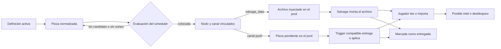
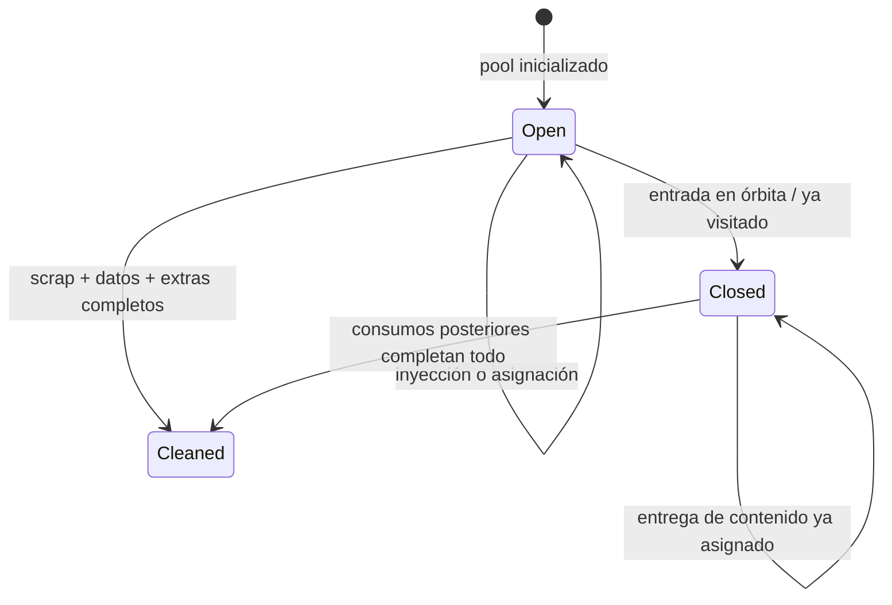

> **4D-3e5c-B1 — preparación de archivos.** Los archivos base y hasta tres registros uplink de partidas nuevas proceden de [historical-information-v1](historical-information.es.md). Asignación, pesos, deadlines y triggers del scheduler siguen separados y no cambian. La divulgación protegida filtra proyecciones sin reescribir ni sustituir registros. Las partidas legacy conservan sus productores.

> **4D-3e5b — recepción física.** El ledger común revalida distancia 3D,
> potencia, sensibilidad y ventana propagada al capturar. `radio_emission` optativo
> vincula una pieza a un emisor declarado; no modifica pesos, sorteos, deadlines,
> ventanas ni triggers dock/uplink/salvage. La escucha remota automática solo prepara
> emisiones independientes; nunca reactiva una pieza aún no autorizada.
> [Contrato vigente](radio-spacetime.es.md). Los apartados históricos conservan su contexto.

> **Actualización implementada 4D-3e4b (2026-11-06).** Señales y broadcasts requieren `comms`/`radiod`, fuente local legítima y recepción efectiva antes de consumir piezas o etapas. Oportunidades pendientes, recibidas y leídas persisten en un ledger común. Las activaciones legacy que fabrican nodos correctivos se aplazan explícitamente hasta e5; las cadenas ya existentes pueden entregar por el canal real. No se alteran políticas del scheduler, scan ni uplink. El [contrato de comunicaciones](passive-communications.es.md) describe gates, cobertura, reintentos y límites; prevalece sobre las descripciones históricas siguientes en estos puntos. F-DEAD-01 sigue pendiente.

> **Actualización implementada 4D-3e4 (2026-11-05).** El scheduler usa hosts preexistentes certificados y reservas validadas antes de jugar. Ya no fabrica nodos para una pieza forzosa; no reabre pools cerrados o agotados. Las políticas siguen forzando intentos, no descubrimiento ni entrega garantizada. Las definiciones y textos quedan ligados al catálogo de la partida. La referencia vigente y sus ejemplos ejecutables son [Requisitos narrativos físicos](../narrative-world-contract.es.md). El cuerpo anterior conservado a continuación es histórico donde contradiga esta actualización.

# Scheduler de lore, arcos y singles

> Referencia técnica canónica en español. Describe la implementación observada
> en el árbol de trabajo basado en `3b99bf4`. Las guías `docs/arcs*` y
> `docs/intel_lore*` son históricas y no prevalecen sobre este documento.

## 1. Propósito y alcance

Este documento reconstruye cómo RETORNO carga, coloca, entrega y conserva las
piezas narrativas gestionadas por `src/retorno/core/lore.py`. Cubre arcos,
singles, canales, políticas de forzado, pools por nodo, desbloqueos y su interfaz
con navegación y worldgen.

No describe en profundidad deadnodes ni la recuperación global de exploración;
esa arquitectura corresponde a la Fase 3D. Tampoco activa contenido. En los
datos actuales hay **cero arcos activos** y **cinco singles activos**.

La carga física de datos se documenta en el
[contrato de carga](../content-loading.es.md), el universo en
[worldgen](world-generation.es.md) y el conocimiento del jugador en
[descubrimiento, navegación e intel](discovery-navigation-intel.es.md).

## 2. Modelo conceptual

Una definición narrativa no aparece directamente ante el jugador. Atraviesa
estados distintos:

Conviene separar siempre estos conceptos:

- **colocación:** se asignan una `piece_key`, un nodo y un canal;
- **disponibilidad:** existe un archivo recuperable o una entrega pendiente;
- **entrega:** un trigger consume la pieza pendiente, o el salvage monta su
  archivo;
- **lectura/importación:** una acción posterior del jugador interpreta el
  contenido;
- **descubrimiento/desbloqueo:** el contenido produce intel y, para un primary
  concreto, actualiza el estado del arco.

Colocar no garantiza entregar; entregar un archivo no garantiza leerlo; leer
texto sin intel válida no garantiza progresión.

## 3. Componentes y estructuras de estado

| Componente | Responsabilidad real |
| --- | --- |
| `load_arcs()` | Lee sólo `data/arcs/*.json`, sin recorrer subdirectorios. |
| `load_singles()` | Lee la lista de `data/lore/singles/index.json`. |
| `run_lore_scheduler_tick()` | Sincroniza pools, cierra ventanas visitadas, evalúa piezas forzadas y ejecuta ciclos periódicos no forzados. |
| `maybe_deliver_lore()` | Cuenta ciertos triggers y entrega piezas ya asignadas compatibles con el trigger. Devuelve si hubo aplicación efectiva y admite filtrar canales para reintentos acotados; no selecciona piezas nuevas. |
| `LorePlacementState` | Persiste `piece_to_node`, `piece_channel_bindings`, próximo ciclo no forzado y `eval_seq`. |
| `LoreSchedulerState` | Persiste piezas entregadas, contadores, instante de última entrega y un log parcial de entregas. |
| `arc_placements` | Estado condicional por arco: colocación primary/secundaria, `discovered` y `primary.unlocked`. |
| `NodePoolState` | Oportunidades y consumos ligados a un nodo; se detalla en la sección 8. |

Las claves canónicas son `arc:<arc_id>:<piece_id>` y
`single:<single_id>`. `piece_to_node` impide asignar dos veces una misma clave;
`LoreSchedulerState.delivered` impide volver a entregarla.

El estado forma parte de `WorldState` y se serializa con la partida. Las
definiciones y textos, en cambio, se vuelven a cargar desde datos cuando hacen
falta. Retirar o renombrar una definición ya asignada puede dejar una referencia
persistida que el índice actual no sepa entregar.

`delivery_log` sólo recibe entradas de mail, señal y broadcast. No es un ledger
completo de salvage ni `uplink_only`. `last_delivery_t` sólo se actualiza cuando
una pieza asignada se entrega con un efecto válido.

## 4. Arcos y singles

### 4.1 Arcos

Un arco es un JSON con `arc_id`, un `primary_intel` opcional, cero o más
`secondary_lore_docs` y `placement_rules` separados para primary y secundarios.
El scheduler normaliza cada primary y cada documento como una pieza autónoma.

El primary puede declarar, entre otros campos, `id`, `kind`, `line`,
`content_ref_*`, `preferred_sources`, `allowed_channels`, `constraints`,
`force`, `force_policy` y `force_deadline`. Los secundarios usan el mismo
contrato de entrega y pueden declarar `path_template`.

No existe un grafo general de dependencias entre piezas. Los secundarios no
esperan automáticamente al primary y el primary no depende de que se hayan
entregado secundarios. `placement_rules.secondary.count` limita el número total
de secundarios asignados del arco, pero no define orden narrativo.

`arc_placements` distingue:

- primary `placed`, `node_id`, ruta de archivo si la hubo y `unlocked`;
- secundarios asignados por id, nodo y ruta;
- ids `discovered` tras importar el intel primary correspondiente.

Actualmente los cuatro JSON existentes están bajo `data/arcs/templates/`.
Como el loader sólo hace `glob("*.json")` en `data/arcs/`, `load_arcs()` devuelve
una lista vacía. Sus recursos narrativos también permanecen inactivos aunque
existan en disco.

### 4.2 Singles

Un single es una pieza independiente de `data/lore/singles/index.json`. No tiene
`placement_rules` de arco ni estado de desbloqueo. Usa `single_id`, `channels`,
`constraints`, `weight` y referencias de contenido. Puede colocarse en cualquier
pool abierto y no limpio cuyo nodo satisfaga restricciones y admita al menos un
canal.

En cada ciclo no forzado, **cada pieza** hace un sorteo independiente:

`p_pieza = clamp(LORE_NON_FORCED_INJECT_P, 0, 1) × max(weight, 0)`

y el resultado se vuelve a limitar a `[0, 1]`. El valor activo general es
`0.05`; `LORE_SINGLES_BASE_P` sólo es fallback legado si falta el knob nuevo.
Los pesos no son probabilidades relativas dentro de una elección entre singles.
Por ejemplo, peso `0.4` da `2 %` por evaluación elegible, no el 40 % de una
bolsa ponderada. Los arcos no forzados usan la probabilidad general sin weight.

La evaluación periódica está activa cada año de juego. El sorteo decide una
**asignación**, no una aparición inmediata. Si no hay candidato válido, el
sorteo acertado se pierde y la pieza podrá intentarlo en otro ciclo mientras
siga sin asignar.

### 4.3 Singles activos

| `single_id` | Canales, en orden | Restricciones | Probabilidad por ciclo elegible |
| --- | --- | --- | --- |
| `sig_echo_fragment_01` | señal, mail, salvage | ninguna | `5 %` |
| `sig_nav_whisper_02` | señal | año ≥ 0.2; distancia ≤ 20 ly | `3 %` |
| `mail_ops_brief_03` | mail | año ≥ 0.1; región `disk` o `halo` | `1.75 %` |
| `salvage_fieldnote_04` | salvage | distancia ≥ 5 ly; año ≤ 6 | `4 %` |
| `broadcast_notice_05` | broadcast | distancia ≤ 25 ly; región `bulge` o `disk` | `2 %` |

“Señal”, “mail”, “salvage” y “broadcast” son abreviaturas de los canales de la
sección 6. La distancia se mide desde `UNKNOWN` si ese nodo existe, no desde el
origen galáctico ni necesariamente desde la posición actual.

## 5. Flujo completo de colocación y entrega

1. **Carga:** cada tick reconstruye la lista normalizada desde arcos y singles
   activos. Un archivo en una carpeta de plantillas no participa.
2. **Selección:** primero se recorren todas las piezas forzadas; después, cuando
   toca el intervalo, cada pieza no forzada hace su sorteo independiente.
3. **Reglas:** se aplican ventana y limpieza del pool, ids evitados, kinds,
   candidatos, saltos máximos, restricciones temporales/espaciales/regionales y
   viabilidad de canal.
4. **Nodo receptor:** se elige de forma determinista para igual semilla, estado,
   secuencia de evaluación y tiempo entre los candidatos ordenados.
5. **Vinculación:** se persisten nodo y canal. Salvage añade un archivo a
   `injected_files`; los otros canales añaden la clave a
   `pending_push_piece_ids`.
6. **Disponibilidad:** el archivo salvage ya puede ser detectado y recuperado;
   una pieza push espera su trigger.
7. **Entrega:** `dock`, `uplink` o `salvage_data` intentan las piezas asignadas
   cuyo canal acepta el trigger; sólo un resultado aplicado las consume.
8. **Consumo:** el jugador usa `cat`, `mail read` o `intel import`. `uplink_only`
   no requiere lectura porque intenta aplicar el LINK directamente.
9. **Progresión:** importar el LINK primary exacto puede marcar el arco
   descubierto; `uplink_only` tiene una vía especial de desbloqueo.
10. **Persistencia y cierre:** asignaciones, entregas, pools y desbloqueos quedan
    en `WorldState`; visitar un nodo cierra su ventana para nuevas colocaciones,
    pero no borra lo ya asignado.

| Transición | Garantía |
| --- | --- |
| Definición activa → evaluación | Sí, mientras el engine ejecute ticks; los ciclos no forzados respetan el intervalo. |
| Evaluación → colocación | Condicional a política/sorteo, candidato, reglas y canal. |
| Colocación → disponibilidad | Sí para el estado asignado; un recurso ausente puede producir contenido vacío. |
| Disponibilidad → entrega | Depende de que el jugador ejecute el trigger compatible. |
| Entrega → lectura/importación | Depende del jugador, salvo `uplink_only`. |
| Importación → desbloqueo | Sólo si el formato, dirección, extremos físicos y cap satisfacen la ruta concreta de código. |

## 6. Canales y triggers

El canal se elige **al colocar** la pieza y queda persistido. No se vuelve a
elegir según el trigger que ocurra después.

| Canal | Nodo viable | Trigger | Efecto | Consumo por el jugador |
| --- | --- | --- | --- | --- |
| `salvage_data` | cualquiera con pool | `salvage_data` | Inserta el archivo en el pool desde la colocación; el trabajo de salvage lo monta bajo `/remote/<nodo>/...`. | `cat` o `intel import`; requiere recuperar datos con dron. |
| `station_broadcast` | relay, station o waystation | `dock` | Escribe `/logs/broadcasts/...` y emite `BROADCAST_RECEIVED`. | `cat`; el evento indica la ruta. |
| `uplink_only` | relay, station o waystation | `uplink` | Interpreta únicamente un `piece.line` con `LINK`, exige ambos extremos físicos y comprueba cap antes de publicar ruta e intel. No crea archivo ni evento narrativo. | Ninguna lectura; el efecto es directo si es válido. |
| `ship_os_mail` | cualquiera | `dock`, `uplink` o `salvage_data` | Escribe `/mail/inbox/<seq>.<lang>.txt`, registra el mail y emite `MAIL_RECEIVED`. | `mail read` o `cat`, que también autoimportan intel. |
| `captured_signal` | cualquiera | `dock`, `uplink` o `salvage_data` | Escribe `/logs/signals/<seq>.<lang>.txt`, incrementa `signal_count` y emite `SIGNAL_CAPTURED`. | `cat`; el evento indica la ruta. |

`preferred_sources` sí afecta al scheduler actual. Se mapea, en orden, de
`mail`, `log`/`salvage`, `signal`, `broadcast` o `uplink` al primer canal viable.
Si ninguna preferencia puede cumplirse, gana el primer canal configurado.
`allowed_channels` es el campo de arcos; los singles usan `channels`. El alias
`uplink` añade `uplink_only` a la lista normalizada.

`path_template` se usa para archivos `salvage_data`. Los canales push generan
su propia ruta secuencial y no respetan esa plantilla. Sólo se montan rutas
remotas que comienzan por `/mail`, `/logs` o `/data`.

## 7. Políticas de forzado

`force=false` envía la pieza al flujo probabilístico, con independencia de un
`force_policy` residual. `force=true` la excluye del flujo no forzado y aplica:

| Política | Cuándo intenta colocar |
| --- | --- |
| `none` o desconocida | Nunca. Una pieza con `force=true` y `none` queda sin vía de colocación. |
| `soft` | Sorteo determinista con `p = min(0.5, 0.1 + 0.02×eventos + 0.02×años)`. |
| `deadline` | Cuando un límite se alcanza o entra en el umbral “near” del 90 %. |
| `hard` | En cada tick en que `min_year`/`max_year` lo permiten. El candidato todavía debe cumplir todas las demás restricciones. |

Los deadlines admiten `max_year`, `max_events`, `max_docks`, `max_uplinks` y
`max_salvage_data`. `max_events` suma todos los contadores, incluido
`signal_count`; no es un contador independiente. Dock incrementa al completar
el trigger. Uplink y salvage incrementan sólo cuando la integración considera
que hubo rutas, datos, lore aplicado o recuperación útil, por lo que no
equivalen a todo comando intentado. Un efecto directo `uplink_only` válido cuenta
por tanto en el primer uplink aunque no produzca ruta del pool, archivo ni evento
narrativo.

Las piezas forzadas se evalúan incluso si `LORE_SCHEDULER_ENABLED` es falso;
ese flag sólo corta el tramo periódico no forzado.

Las reglas de candidato se aplican tanto al flujo forzado como al no forzado:

| Campo | Semántica vigente |
| --- | --- |
| `candidates` | Vacío admite cualquier nodo. Un id exacto —también comparado con el id en minúsculas— admite ese nodo. Los tokens `procedural_station`, `procedural_relay`, `procedural_derelict` y `procedural_ship` sólo admiten nodos no authored del kind correspondiente. |
| `require_kind_any` | Exige que el `SpaceNode.kind` pertenezca a la lista. |
| `avoid_node_ids` | Excluye ids exactos. |
| `max_hops_from_start` | Si es positivo, exige una ruta física BFS desde `UNKNOWN` —o current si no existe— dentro del límite. |
| `secondary.count` | Máximo total de secundarios ya asignados para ese arco. |
| `constraints` | Aplica `min_year`, `max_year`, `min_dist_ly`, `max_dist_ly` y `regions_any` sobre el contexto del candidato. |

Además, el pool debe seguir abierto, no estar limpio, tener nodo físico y
admitir al menos un canal. Un nodo authored puede ser candidato por id explícito
o por reglas vacías, pero no se convierte en “procedural” por compartir kind.

Forzado significa **forzar un intento de colocación**, no garantizar entrega:

- no salta `constraints`, `placement_rules`, ventana, limpieza ni viabilidad;
- si no hay candidato, se intenta crear un nodo ad hoc sólo cuando las reglas
  admiten una familia procedural compatible;
- si tampoco puede crearse, la pieza queda pendiente para otro tick;
- si se coloca, aún necesita el trigger y, normalmente, lectura/importación.

El fallback ad hoc crea un nodo físico oculto enlazado a un ancla dentro del cap,
lo registra en `forced_hidden_nodes`, le crea pool y trata de inyectar un
breadcrumb en un pool conocido y no limpio. Si no existe tal pool, no hay
breadcrumb aunque el nodo y la asignación puedan existir. Esta es sólo la
interfaz del scheduler; no sustituye a los failsafes globales.

## 8. Pools y ventanas de oportunidad

`sync_node_pools_for_known_nodes()` inicializa una sola vez pools para la unión
de `known_nodes`, `known_contacts`, `forced_hidden_nodes` y las anclas current,
ship y docked. Ser authored no basta: un nodo authored desconocido y no anclado
no recibe pool.

Al inicializar se congelan:

- `initialized_t`;
- `base_files`, procedentes de la localización authored o generados
  proceduralmente;
- `uplink_route_pool`, con hasta tres destinos: proyección lazy de registros
  históricos fijos en partidas nuevas y selección runtime original en legacy;
- metadatos de contrato/reglas y `uplink_records` tipados en partidas nuevas.

El pool uplink no se amplía con nodos materializados o desbloqueados después.
Sí pueden incorporarse más tarde `injected_files` del scheduler o de
breadcrumbs, y piezas push pendientes.

`window_open` sólo gobierna **nuevas colocaciones**. Llegar o dockear añade el
nodo a `visited_nodes` y cierra la ventana antes de futuras evaluaciones. No se
eliminan archivos inyectados ni pendientes push; un dock, uplink o salvage
posterior aún puede consumirlos.

Los flags se recalculan así:

- `scrap_complete`: no queda scrap físico;
- `extras_complete`: no quedan módulos ni drones recuperables;
- `data_complete`: no quedan rutas nuevas de archivos de salvage en un host
  con esa interfaz física, no hay push pendiente y se consumió el pool de rutas
  de la interfaz uplink cuando existe;
- `node_cleaned`: los tres anteriores son ciertos.

El [criterio de capacidades físicas de información](information-capabilities.es.md)
filtra recuperabilidad y finalización. Los archivos internos de waystation se
conservan sin contar como oportunidades de salvage; su uplink es independiente.
No cambian preparación, asignación de canales, probabilidades ni políticas del
scheduler. La carga de esquema 3 recalcula indicadores obsoletos de hosts sin
salvage.

Montar un archivo no borra su entrada del pool. Se considera consumido porque
la ruta destino ya existe en el filesystem. `uplink_data_consumed` sólo agota el
pool congelado de rutas: un `uplink_only` pendiente puede reevaluarse mediante
otro `uplink` sin regenerar rutas, logs, recompensas ni contadores. Un mensaje
localizado de finalización indica si ese reintento aplicó la entrega narrativa
pendiente o sólo encontró el pool ya agotado.

La deduplicación se apoya en cuatro niveles: una `piece_key` sólo puede aparecer
en `piece_to_node`; el pool registra `delivered_piece_ids`; el scheduler global
registra `delivered`; y la proyección de montaje deduplica rutas. Un archivo base
y uno inyectado con la misma ruta colisionan y la colección prioriza el base.

## 9. Desbloqueos y progreso narrativo

Para un arco cargado, `locked_primary_targets` sólo reconoce primary de kind
`link` o `node`. La protección filtra dos vías procedurales: preparación de
uplink e intel corrupta. Scan, route solve manual, imports explícitos y otros
consumidores no consultan ese lock. Con cero arcos activos no hay objetivos
primary bloqueados en una partida normal.

Un primary distribuido como archivo, mail, señal o broadcast no se desbloquea
por la entrega. El jugador debe leer/importar el LINK exacto. `cat` autoimporta
intel desde `/mail`, `/logs`, `/data` y sus equivalentes remotos; `mail read`
delega en `cat`; `intel import` lo hace explícitamente.

El parser marca el arco descubierto cuando añade por primera vez el enlace
exacto y en la misma dirección. Si la ruta ya existía, esa vía no actualiza el
flag. `uplink_only` es la excepción: si ambos extremos existen y el LINK pasa el
cap, marca el primary desbloqueado incluso cuando la ruta ya era conocida.

Si un `uplink_only` no contiene un LINK parseable, falta un extremo físico o
excede el cap, no desbloquea ni produce archivo/evento y permanece pendiente con
su asignación y canal. Sólo el éxito actualiza `delivered`, el pool y
`last_delivery_t`.

## 10. Casos límite

- Los pools iniciales de nodos ya visitados se crean cerrados. Los singles
  necesitan normalmente un contacto conocido pero todavía no visitado.
- El intervalo anual puede dejar sin asignación un contacto descubierto y
  visitado antes del siguiente ciclo.
- Un sorteo exitoso sin candidato no reserva la pieza ni crea deuda; se vuelve a
  intentar en ciclos futuros.
- `max_hops_from_start` usa BFS sobre enlaces físicos; no hay fallback a
  distancia ly.
- Candidatos procedurales no incluyen nodos authored del mismo kind salvo que su
  id se permita explícitamente.
- Una pieza forzada sin candidato procedural compatible no relaja sus reglas.
- Referencias de contenido ausentes se convierten en texto vacío; no hay
  validación previa de recursos.
- Eliminar una definición después de persistir su asignación hace que la entrega
  no encuentre la pieza y puede dejar un push pendiente.
- Los secundarios se recorren por orden de definición. Un `count` bajo y
  sorteos independientes pueden favorecer ids tempranos sin constituir una
  elección ponderada.
- Los saltos grandes de reloj pueden ejecutar varios ciclos acumulados con el
  tiempo actual, no reconstruyendo el contexto histórico de cada aniversario.
- Desactivar el scheduler no desactiva la rama forzada.
- Un extremo procedural aún no materializado no se publica como ruta: la pieza
  permanece pendiente y podrá tener éxito si ese id aparece físicamente antes
  de un `uplink` posterior. Esta fase no define ni añade materialización por id.

## 11. Interacción con worldgen y navegación

Los pools dependen del conocimiento del jugador: sólo conocidos, ocultos
forzados y anclas reciben uno. Al preparar un uplink, lore puede materializar el
sector actual mediante worldgen. La lista resultante queda congelada, por lo que
el orden entre descubrimiento, worldgen e inicialización afecta oportunidades.

La selección por distancia toma como referencia `UNKNOWN` si existe. La
selección por saltos recorre `SpaceNode.links`, no `known_links`; mide topología
física, no conocimiento navegable del jugador.

Un nodo ad hoc forzado modifica el universo físico, enlaza topología y sincroniza
estado de sector. Se crea oculto, pero no es indetectable: navegación y scan
mantienen los límites descritos en la referencia de descubrimiento.

El lock de primary no es una barrera global y no debe documentarse como tal.

## 12. Interfaz con failsafes

El scheduler comparte pools, breadcrumbs, nodos ocultos y contadores con los
mecanismos de movilidad, pero sus responsabilidades son distintas:

- el fallback ad hoc de lore sólo busca un receptor legal para una pieza
  forzada;
- deadnodes y exploration recovery detectan problemas de accesibilidad y pueden
  crear su propia cadena de pistas;
- `uplink_trace` es un canal local de recuperación, no uno de los cinco canales
  de piezas del scheduler;
- `pending_push_piece_ids` participa en la evaluación de si un nodo está limpio,
  lo que puede influir indirectamente en recuperación.

La fixture histórica `forced_hidden_ad_hoc_smoke.py` ya no depende de
`HARBOR_12`: usa un host sintético conocido, no visitado y con pool elegible.
Así caracteriza el breadcrumb sin convertir nodos authored desconocidos en
contactos iniciales ni cambiar código productivo.

## 13. Invariantes observadas

1. Una `piece_key` se asigna como máximo a un nodo y un canal.
2. Sólo pools abiertos, no limpios y con nodo físico son candidatos nuevos.
3. Cerrar una ventana no revoca asignaciones existentes.
4. Una pieza globalmente entregada no se vuelve a ofrecer.
5. `force` no elimina constraints ni reglas de colocación.
6. El canal se fija en colocación; los triggers sólo consumen bindings
   compatibles.
7. Salvage coloca el archivo antes del trigger; los demás canales mantienen un
   push pendiente.
8. Adquirir un archivo y aplicar su intel son transiciones separadas.
9. Los cuatro arcos en `templates/` no forman parte del conjunto activo.
10. El estado “unlocked” de primary y el conocimiento real de rutas pueden
    divergir por los bypasses y casos límite descritos.

## 14. Pruebas, discrepancias y lagunas

### 14.1 Evidencia ejecutada

Todas las ejecuciones usaron
`/home/jon/prog/retorno_case/retorno_venv/bin/python` con `PYTHONPATH=src`. Los
estados fueron en memoria; la prueba de salvage usa sólo un directorio temporal
para persistencia. No se abrió ni modificó ninguna partida real.

| Prueba o comprobación | Resultado | Alcance real |
| --- | --- | --- |
| `lore_smoke.py` | PASSED | Tipo de retorno y ausencia de entrega sin asignación; cobertura estrecha. |
| `lore_channel_preference_and_unlock_smoke.py` | PASSED | Preferencias de canal y desbloqueo `uplink_only` con ruta preexistente, mediante fixture. |
| `lore_distance_from_start_smoke.py` | PASSED | Distancia respecto al nodo inicial. |
| `mail_metadata_and_log_header_smoke.py` | PASSED | Metadatos de mail y cabecera de log en fixtures. |
| `drone_salvage_survey_smoke.py` | PASSED | Pools, montaje, recuentos y repetición de salvage en estado aislado. |
| `uplink_once_per_node_smoke.py` | PASSED | Pool uplink congelado y consumo único. |
| `uplink_only_delivery_retry_smoke.py` | PASSED | Malformed, extremo ausente, sobre-cap, LINK nuevo/preexistente, recuento de uplink útil, reintento público localizado y persistencia pendiente/entregada sin duplicados. |
| `lore_secondary_count_weights_hard_smoke.py` | PASSED | Casos independientes de `count=1`, pesos 0/1, hard, constraints y no-relax con receptores/arcos sintéticos. |
| `debug_lore_arcs_smoke.py` | PASSED | Cero arcos activos reales y formato primary/estado/clave canónica con loader sintético restaurado. |
| `forced_hidden_ad_hoc_smoke.py` | PASSED | Host sintético conocido/no visitado; nodo oculto y breadcrumb sólo en el pool elegible. |

Comprobaciones aisladas con datos activos confirmaron `load_arcs() == []`, los
cinco singles y su elegibilidad sobre un pool conocido/no visitado compatible.
Un stress aislado con probabilidad general `1.0` e intervalo `0` asignó los cinco
singles reales y produjo los bindings y el archivo salvage esperados. Esta
prueba confirma compatibilidad de datos, **no** frecuencia normal ni un flujo de
jugador extremo a extremo.

Las tres fixtures históricas se repararon en Fase 4A sin activar templates,
revelar nodos authored ni modificar código productivo.

### 14.2 Matriz de discrepancias históricas

| Afirmación en `docs/arcs*` / `docs/intel_lore*` | Implementación vigente |
| --- | --- |
| El arco de ejemplo es activo en `data/arcs/`. | Los cuatro JSON están en `data/arcs/templates/`; no se cargan. |
| Hay colocación procedural mediante `Engine._maybe_inject_arc_content`. | Ese método no existe; la asignación está unificada en `core/lore.py`. |
| `placement_rules` sólo controla una ruta procedural separada. | El scheduler usa directamente esas reglas para candidatos. |
| `preferred_sources` no afecta al scheduler. | Decide el binding de canal cuando puede mapearse. |
| Deadline o hard garantizan entrega. | Sólo fuerzan intentos de colocación; quedan candidato, trigger, lectura y desbloqueo. |
| Los targets primary están protegidos contra revelación procedural general. | Sólo uplink procedural e intel corrupta consultan el lock; hay varios bypasses. |
| El canal se elige según el trigger actual. | Se fija al colocar y después espera un trigger compatible. |
| Los pesos de singles son relativos en una selección ponderada. | Multiplican una probabilidad independiente por pieza y ciclo. |
| `LORE_SINGLES_BASE_P` es el knob activo. | `LORE_NON_FORCED_INJECT_P` es primario; el anterior es fallback. |
| La probabilidad se evalúa al trigger de entrega. | Se evalúa periódicamente para asignar; los triggers sólo entregan bindings. |
| `max_hops_from_start` cae a distancia ly. | Sólo usa BFS físico; un nodo inalcanzable queda fuera. |
| Los enlaces antiguos a `retorno_docs/...` identifican la referencia. | Las rutas actuales están bajo `docs/`; esta referencia sustituye esas afirmaciones. |

### 14.3 Lagunas y cuestiones pendientes de diseño

1. Definir si `force=true` + `force_policy=none` debe ser inválido o tener una
   semántica útil.
2. Decidir si `LORE_SCHEDULER_ENABLED` debe controlar también piezas forzadas.
3. Decidir si el intervalo anual y el cierre al visitar pueden dejar demasiado
   contenido sin oportunidad, y si debe existir reserva o recálculo.
4. Mantener integridad de asignaciones dentro de la versión vigente y rechazar
   saves incompatibles; la prealfa no exige migraciones históricas.
5. Aclarar si rutas secuenciales de canales push deben respetar
   `path_template`.
6. Validar de antemano referencias, tipos de primary y rutas mountables.
7. Fijar por contrato el significado del umbral “near”, de `max_events` y de los
   contadores condicionales.
8. Añadir una prueba extremo a extremo con singles activos: descubrimiento de
    contacto, evaluación, visita, trigger, lectura, importación y persistencia.

## 15. Referencias de implementación

- [`src/retorno/core/lore.py`](../../src/retorno/core/lore.py): normalización,
  candidatos, políticas, pools, canales, ad hoc y scheduler.
- [`src/retorno/model/world.py`](../../src/retorno/model/world.py): estados
  persistentes de mundo, pools y lore.
- [`src/retorno/core/engine.py`](../../src/retorno/core/engine.py): ticks, dock,
  llegada, salvage y cierre de ventanas.
- [`src/retorno/cli/repl.py`](../../src/retorno/cli/repl.py): uplink, lectura,
  importación, desbloqueo y diagnósticos.
- [`src/retorno/runtime/data_loader.py`](../../src/retorno/runtime/data_loader.py):
  contrato activo de arcos y singles.
- [`src/retorno/config/balance.py`](../../src/retorno/config/balance.py): intervalo,
  probabilidad, determinismo y cap.
- [`data/lore/singles/index.json`](../../data/lore/singles/index.json): cinco
  singles activos.
- [`data/arcs/templates/`](../../data/arcs/templates/): arcos de plantilla
  inactivos.
- [Contrato de carga](../content-loading.es.md),
  [worldgen](world-generation.es.md) y
  [descubrimiento, navegación e intel](discovery-navigation-intel.es.md).
