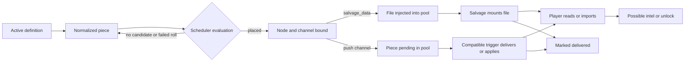
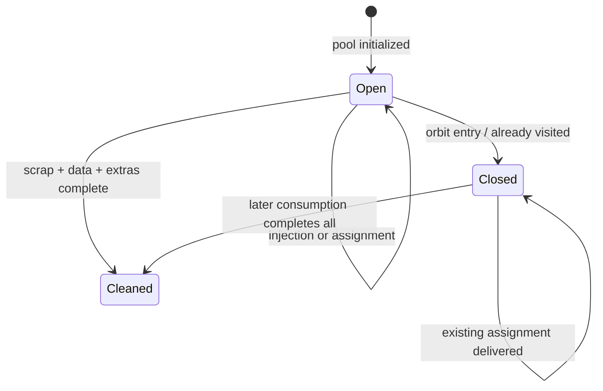

> **Implemented 4D-3e4 update (2026-11-05).** The scheduler uses certified preexisting hosts and reservations validated before play. It no longer fabricates nodes for forced pieces or reopens closed/exhausted pools. Policies still force attempts, not discovery or guaranteed delivery. Definitions and texts are tied to the saved catalogue. The current contract and executable examples are [Physical narrative requirements](../narrative-world-contract.md). The earlier body retained below is historical wherever it contradicts this update.

# Lore scheduler, arcs, and singles

> Canonical English technical reference. It describes the implementation
> observed in the working tree based on `3b99bf4`. The `docs/arcs*` and
> `docs/intel_lore*` guides are historical and do not override this document.

## 1. Purpose and scope

This document reconstructs how RETORNO loads, places, delivers, and preserves
narrative pieces managed by `src/retorno/core/lore.py`. It covers arcs, singles,
channels, forcing policies, per-node pools, unlocks, and their interface with
navigation and world generation.

It does not describe deadnodes or global exploration recovery in depth; that
architecture belongs to Phase 3D. It activates no content. Current data has
**zero active arcs** and **five active singles**.

Physical data loading is documented in the
[content loading contract](../content-loading.md), the universe in
[world generation](world-generation.md), and player knowledge in
[discovery, navigation, and intel](discovery-navigation-intel.md).

## 2. Conceptual model

A narrative definition does not appear directly to the player. It crosses
separate states:

These concepts must remain distinct:

- **placement:** a `piece_key`, node, and channel are assigned;
- **availability:** a recoverable file or pending delivery exists;
- **delivery:** a trigger consumes the pending piece, or salvage mounts it;
- **reading/import:** a later player action interprets its content;
- **discovery/unlock:** content produces intel and, for a matching primary,
  updates arc state.

Placement does not guarantee delivery; delivering a file does not guarantee it
will be read; reading text without valid intel does not guarantee progression.

## 3. Components and state structures

| Component | Actual responsibility |
| --- | --- |
| `load_arcs()` | Reads only `data/arcs/*.json`; it does not recurse. |
| `load_singles()` | Reads the list in `data/lore/singles/index.json`. |
| `run_lore_scheduler_tick()` | Synchronizes pools, closes visited windows, evaluates forced pieces, and runs periodic non-forced cycles. |
| `maybe_deliver_lore()` | Counts selected triggers and delivers already assigned pieces compatible with that trigger. It reports whether an effect was applied and accepts a channel filter for bounded retries; it does not choose new pieces. |
| `LorePlacementState` | Persists `piece_to_node`, `piece_channel_bindings`, the next non-forced cycle, and `eval_seq`. |
| `LoreSchedulerState` | Persists delivered pieces, counters, last delivery time, and a partial delivery log. |
| `arc_placements` | Conditional per-arc placement, delivery, `discovered`, and `primary.unlocked` state. |
| `NodePoolState` | Node-bound opportunities and consumption; detailed in section 8. |

Canonical keys are `arc:<arc_id>:<piece_id>` and `single:<single_id>`.
`piece_to_node` prevents assigning the same key twice;
`LoreSchedulerState.delivered` prevents redelivery.

This state belongs to `WorldState` and is serialized with the game. Definitions
and text are instead reloaded from data when needed. Removing or renaming an
already assigned definition may leave persisted state that the current index
cannot deliver.

`delivery_log` only records mail, signal, and broadcast entries. It is not a
complete ledger for salvage or `uplink_only`. `last_delivery_t` is updated only
when an assigned piece is delivered with a valid effect.

## 4. Arcs and singles

### 4.1 Arcs

An arc is a JSON object with an `arc_id`, an optional `primary_intel`, zero or
more `secondary_lore_docs`, and separate primary/secondary `placement_rules`.
The scheduler normalizes every primary and document as an independent piece.

A primary may declare `id`, `kind`, `line`, `content_ref_*`,
`preferred_sources`, `allowed_channels`, `constraints`, `force`,
`force_policy`, and `force_deadline`, among other fields. Secondary documents
use the same delivery contract and may declare `path_template`.

There is no general dependency graph between pieces. Secondaries do not
automatically wait for the primary, and the primary does not depend on
secondaries. `placement_rules.secondary.count` limits the total assigned
secondary pieces in the arc but establishes no narrative order.

`arc_placements` distinguishes:

- primary `placed`, `node_id`, file path when applicable, and `unlocked`;
- assigned secondary ids with their node and path;
- `discovered` ids after importing the corresponding primary intel.

All four existing JSON files currently live under `data/arcs/templates/`.
Because the loader only runs `glob("*.json")` in `data/arcs/`, `load_arcs()`
returns an empty list. Their narrative resources remain inactive as well even
though those files exist on disk.

### 4.2 Singles

A single is an independent piece from `data/lore/singles/index.json`. It has no
arc `placement_rules` or unlock state. It uses `single_id`, `channels`,
`constraints`, `weight`, and content references. It may be placed in any open,
unclean pool whose node satisfies its constraints and supports at least one
channel.

At every non-forced cycle, **each piece** makes an independent roll:

`p_piece = clamp(LORE_NON_FORCED_INJECT_P, 0, 1) × max(weight, 0)`

and the result is clamped again to `[0, 1]`. The active general value is `0.05`;
`LORE_SINGLES_BASE_P` is only a legacy fallback if the newer knob is absent.
Weights are not relative probabilities in a selection among singles. A `0.4`
weight means `2%` per eligible evaluation, not 40% of a weighted bag.
Non-forced arc pieces use the general probability without a weight.

Periodic evaluation is active once per game year. The roll decides an
**assignment**, not immediate appearance. If no valid candidate exists, a
successful roll is lost and the unassigned piece may try again in a later cycle.

### 4.3 Active singles

| `single_id` | Channels, in order | Constraints | Probability per eligible cycle |
| --- | --- | --- | --- |
| `sig_echo_fragment_01` | signal, mail, salvage | none | `5%` |
| `sig_nav_whisper_02` | signal | year ≥ 0.2; distance ≤ 20 ly | `3%` |
| `mail_ops_brief_03` | mail | year ≥ 0.1; `disk` or `halo` region | `1.75%` |
| `salvage_fieldnote_04` | salvage | distance ≥ 5 ly; year ≤ 6 | `4%` |
| `broadcast_notice_05` | broadcast | distance ≤ 25 ly; `bulge` or `disk` region | `2%` |

“Signal,” “mail,” “salvage,” and “broadcast” abbreviate the channels in section
6. Distance is measured from `UNKNOWN` when that node exists, not from the
galactic origin and not necessarily from the current position.

## 5. Complete placement and delivery flow

1. **Loading:** every tick rebuilds the normalized list from active arcs and
   singles. Files in a template directory do not participate.
2. **Selection:** all forced pieces are visited first; when the interval is due,
   each non-forced piece makes its independent roll.
3. **Rules:** pool window/clean status, avoided ids, kinds, candidate tokens,
   maximum hops, time/distance/region constraints, and channel feasibility are
   applied.
4. **Receiver node:** equal seed, state, evaluation sequence, and time select
   deterministically from sorted candidates.
5. **Binding:** node and channel are persisted. Salvage adds a file to
   `injected_files`; other channels add the key to `pending_push_piece_ids`.
6. **Availability:** the salvage file can now be detected/recovered; a push
   piece waits for its trigger.
7. **Delivery:** `dock`, `uplink`, or `salvage_data` attempts assigned pieces
   whose binding accepts that trigger; only an applied result consumes them.
8. **Consumption:** the player uses `cat`, `mail read`, or `intel import`.
   `uplink_only` needs no reading because it applies the LINK directly.
9. **Progression:** importing the exact primary LINK may mark the arc discovered;
   `uplink_only` has a special unlock path.
10. **Persistence and closure:** assignments, deliveries, pools, and unlocks
    stay in `WorldState`; visiting a node closes it to new placement but does
    not erase existing assignments.

| Transition | Guarantee |
| --- | --- |
| Active definition → evaluation | Yes while engine ticks run; non-forced cycles respect their interval. |
| Evaluation → placement | Conditional on policy/roll, candidates, rules, and channel. |
| Placement → availability | Yes as assigned state; a missing asset may still yield empty content. |
| Availability → delivery | Requires the player to perform a compatible trigger. |
| Delivery → reading/import | Requires player action except for `uplink_only`. |
| Import → unlock | Only when format, direction, physical endpoints, cap, and link state match the specific code path. |

## 6. Channels and triggers

The channel is selected **at placement time** and persisted. It is not selected
again for whichever trigger happens later.

| Channel | Feasible node | Trigger | Effect | Player consumption |
| --- | --- | --- | --- | --- |
| `salvage_data` | any node with a pool | `salvage_data` | Injects a file into the pool at placement; the salvage job mounts it below `/remote/<node>/...`. | `cat` or `intel import`, after drone data salvage. |
| `station_broadcast` | relay, station, or waystation | `dock` | Writes `/logs/broadcasts/...` and emits `BROADCAST_RECEIVED`. | `cat`; the event reports the path. |
| `uplink_only` | relay, station, or waystation | `uplink` | Interprets only a `piece.line` containing `LINK`, requires both physical endpoints, and checks the cap before publishing route/intel. It creates no narrative file or event. | No reading; a valid effect is direct. |
| `ship_os_mail` | any | `dock`, `uplink`, or `salvage_data` | Writes `/mail/inbox/<seq>.<lang>.txt`, registers mail, and emits `MAIL_RECEIVED`. | `mail read` or `cat`, both of which auto-import intel. |
| `captured_signal` | any | `dock`, `uplink`, or `salvage_data` | Writes `/logs/signals/<seq>.<lang>.txt`, increments `signal_count`, and emits `SIGNAL_CAPTURED`. | `cat`; the event reports the path. |

`preferred_sources` does affect the current scheduler. In declared order, it
maps `mail`, `log`/`salvage`, `signal`, `broadcast`, or `uplink` to the first
feasible channel. If no preference can be honored, the first configured channel
wins. Arcs use `allowed_channels`; singles use `channels`. The `uplink` alias
adds `uplink_only` to the normalized list.

`path_template` is used for `salvage_data` files. Push channels generate their
own sequential path and ignore that template. Only remote paths beginning with
`/mail`, `/logs`, or `/data` are mountable.

## 7. Forcing policies

`force=false` sends a piece through the probabilistic flow regardless of a
leftover `force_policy`. `force=true` removes it from that flow and applies:

| Policy | Placement attempt |
| --- | --- |
| `none` or unknown | Never. A `force=true` piece with `none` has no placement path. |
| `soft` | Deterministic roll with `p = min(0.5, 0.1 + 0.02×events + 0.02×years)`. |
| `deadline` | Once a limit is reached or enters the 90% “near” threshold. |
| `hard` | Every tick for which `min_year`/`max_year` permit it. Candidates must still pass every other constraint. |

Deadlines support `max_year`, `max_events`, `max_docks`, `max_uplinks`, and
`max_salvage_data`. `max_events` is the sum of every counter, including
`signal_count`; it is not independent. Dock increments at completed delivery
trigger. Uplink and salvage increment only when their integration considers
routes, data, applied lore, or recovery useful, so they do not count every
command. A direct valid `uplink_only` effect therefore counts on the first
uplink even when no pool route, file, or narrative event was produced.

Forced pieces are evaluated even when `LORE_SCHEDULER_ENABLED` is false; that
flag only stops the periodic non-forced branch.

Candidate rules apply to both forced and non-forced flows:

| Field | Current semantics |
| --- | --- |
| `candidates` | Empty accepts any node. An exact id —also compared with the lowercased node id— accepts that node. `procedural_station`, `procedural_relay`, `procedural_derelict`, and `procedural_ship` only accept non-authored nodes of the corresponding kind. |
| `require_kind_any` | Requires `SpaceNode.kind` to belong to the list. |
| `avoid_node_ids` | Excludes exact ids. |
| `max_hops_from_start` | When positive, requires a physical BFS route from `UNKNOWN` —or current if absent— within the limit. |
| `secondary.count` | Maximum total secondary pieces already assigned for that arc. |
| `constraints` | Applies `min_year`, `max_year`, `min_dist_ly`, `max_dist_ly`, and `regions_any` to the candidate context. |

The pool must also remain open and unclean, have a physical node, and support at
least one channel. An authored node can be selected by explicit id or empty
rules, but does not become “procedural” merely by sharing a kind.

Forcing means **forcing a placement attempt**, not guaranteed delivery:

- it does not bypass constraints, placement rules, window, cleaning, or channel
  feasibility;
- with no candidate, an ad hoc node is attempted only when rules allow a
  compatible procedural family;
- if that also fails, the piece stays pending for another tick;
- after placement, it still needs the trigger and usually reading/import.

The ad hoc fallback creates a hidden physical node connected to an anchor within
the hop cap, records it in `forced_hidden_nodes`, creates its pool, and tries to
inject a breadcrumb into a known, unclean pool. If no such pool exists, there is
no breadcrumb even though the node and assignment may exist. This is only the
scheduler interface and does not replace global failsafes.

## 8. Pools and opportunity windows

`sync_node_pools_for_known_nodes()` initializes pools once for the union of
`known_nodes`, `known_contacts`, `forced_hidden_nodes`, and current/ship/docked
anchors. Being authored is insufficient: an unknown, unanchored authored node
gets no pool.

Initialization freezes:

- `initialized_t`;
- `base_files`, from authored location data or procedural generation;
- `uplink_route_pool`, with at most three destinations calculated then.

The uplink pool does not grow when nodes are materialized or unlocked later.
Scheduler and breadcrumb `injected_files` and pending push pieces may be added
after initialization.

`window_open` controls only **new placement**. Arrival or docking adds the node
to `visited_nodes` and closes its window before later evaluations. It does not
remove injected files or pending pushes; later dock, uplink, or salvage may
still consume them.

Completion flags are recomputed as follows:

- `scrap_complete`: no physical scrap remains;
- `extras_complete`: no recoverable modules or drones remain;
- `data_complete`: no new file paths remain to mount, no push is pending, and a
  hub's uplink has been consumed;
- `node_cleaned`: all three are true.

Mounting does not remove the pool entry. It counts as consumed because the
destination path now exists in the filesystem. `uplink_data_consumed` only
exhausts the frozen route pool: a pending `uplink_only` piece can be reevaluated
by another `uplink` without regenerating routes, logs, rewards, or counters. A
localized completion message reports whether that retry applied the pending
narrative delivery or found only an already exhausted pool.

Deduplication has four layers: one `piece_key` in `piece_to_node`; per-pool
`delivered_piece_ids`; global `delivered`; and mount path projection. A base and
injected file at the same path collide, and collection gives the base file
priority.

## 9. Unlocks and narrative progression

For a loaded arc, `locked_primary_targets` only recognizes `link` or `node`
primaries. Protection filters two procedural paths: uplink preparation and
corrupt intel. Scan, manual route solve, explicit imports, and other consumers
do not consult the lock. With zero active arcs, normal games have no locked
primary targets.

A primary delivered as file, mail, signal, or broadcast is not unlocked by
delivery. The player must read/import the exact LINK. `cat` auto-imports from
`/mail`, `/logs`, `/data`, and their remote equivalents; `mail read` delegates
to `cat`; `intel import` is explicit.

The parser marks an arc discovered when it adds the exact link for the first
time in the same direction. If that route already exists, this path does not
update the flag. `uplink_only` is the exception: if both endpoints exist and the
LINK passes the cap, it unlocks the primary even when the route was already
known.

If `uplink_only` has no parseable LINK, lacks a physical endpoint, or exceeds
the cap, it unlocks nothing, creates no file/event, and remains pending with its
assignment and channel. Only success updates `delivered`, the pool, and
`last_delivery_t`.

## 10. Edge cases

- Pools for already visited initial nodes are created closed. Singles normally
  need a known but unvisited contact.
- The annual interval can miss a contact discovered and visited before the next
  cycle.
- A successful roll without a candidate creates no reservation or debt.
- `max_hops_from_start` uses BFS over physical links; there is no ly-distance
  fallback.
- Procedural tokens exclude authored nodes of the same kind unless their id is
  explicitly allowed.
- A forced piece without a compatible procedural candidate does not relax its
  rules.
- Missing content references become empty text; assets are not prevalidated.
- Removing a definition after persisting its assignment can leave an
  undeliverable pending push.
- Secondaries are visited in definition order. A low `count` and independent
  rolls may favor earlier ids without being a weighted selection.
- Large clock jumps can run accumulated cycles with the current time rather
  than reconstructing historical context for each anniversary.
- Disabling the scheduler does not disable its forced branch.
- An unmaterialized procedural endpoint is not published as a route: the piece
  remains pending and may succeed if that id becomes physical before a later
  `uplink`. This phase neither defines nor adds id-based materialization.

## 11. Interaction with world generation and navigation

Pools depend on player knowledge: only known nodes, forced-hidden nodes, and
anchors receive one. Preparing an uplink pool may materialize the current
sector through world generation. The result is frozen, so the order of
discovery, generation, and initialization affects opportunities.

Distance selection uses `UNKNOWN` as its reference when present. Hop selection
walks `SpaceNode.links`, not `known_links`; it measures physical topology rather
than player-known navigation.

A forced ad hoc node mutates the physical universe, connects topology, and
synchronizes sector state. It starts hidden but is not undetectable; navigation
and scan keep the limits described in the discovery reference.

The primary lock is not a global barrier and must not be documented as one.

## 12. Failsafe interface

The scheduler shares pools, breadcrumbs, hidden nodes, and counters with
mobility mechanisms, but their responsibilities differ:

- the lore ad hoc fallback only seeks a legal receiver for a forced piece;
- deadnodes and exploration recovery detect accessibility problems and may
  create their own hint chain;
- `uplink_trace` is a local recovery channel, not one of the scheduler's five
  piece channels;
- `pending_push_piece_ids` affects whether a node is considered clean and may
  therefore interact indirectly with recovery.

The historical `forced_hidden_ad_hoc_smoke.py` fixture no longer depends on
`HARBOR_12`: it uses a synthetic known, unvisited host with an eligible pool.
This characterizes the breadcrumb without making unknown authored nodes initial
contacts or changing production code.

## 13. Observed invariants

1. A `piece_key` is assigned to at most one node and channel.
2. Only open, unclean pools backed by a physical node are new candidates.
3. Closing a window does not revoke existing assignments.
4. A globally delivered piece is not offered again.
5. `force` does not remove constraints or placement rules.
6. The channel is fixed at placement; triggers only consume compatible bindings.
7. Salvage places its file before the trigger; other channels retain a pending
   push.
8. Acquiring a file and applying its intel are separate transitions.
9. The four arcs under `templates/` are not active content.
10. Primary `unlocked` state and actual route knowledge can diverge through the
    bypasses and edge cases above.

## 14. Tests, discrepancies, and gaps

### 14.1 Executed evidence

Every command used
`/home/jon/prog/retorno_case/retorno_venv/bin/python` with `PYTHONPATH=src`.
States were in memory; the salvage test uses only a temporary directory for its
persistence check. No real save was opened or modified.

| Test or check | Result | Actual scope |
| --- | --- | --- |
| `lore_smoke.py` | PASSED | Return type and no delivery without assignment; narrow coverage. |
| `lore_channel_preference_and_unlock_smoke.py` | PASSED | Channel preference and `uplink_only` unlock with an existing route, using fixtures. |
| `lore_distance_from_start_smoke.py` | PASSED | Distance from the start node. |
| `mail_metadata_and_log_header_smoke.py` | PASSED | Mail metadata and fixture log header. |
| `drone_salvage_survey_smoke.py` | PASSED | Pools, mounting, counts, and repeat salvage in isolated state. |
| `uplink_once_per_node_smoke.py` | PASSED | Frozen uplink pool and one-time consumption. |
| `uplink_only_delivery_retry_smoke.py` | PASSED | Malformed, missing endpoint, over-cap, new/preexisting valid LINK, useful-uplink counting, localized public retry, and pending/delivered persistence without duplicates. |
| `lore_secondary_count_weights_hard_smoke.py` | PASSED | Independent `count=1`, weight 0/1, hard, constraint, and no-relax cases with synthetic receivers/arcs. |
| `debug_lore_arcs_smoke.py` | PASSED | Zero real active arcs plus synthetic-loader primary/status/canonical-key formatting with restoration. |
| `forced_hidden_ad_hoc_smoke.py` | PASSED | Known/unvisited synthetic host, hidden node, and breadcrumb only in the eligible pool. |

Isolated checks with active data confirmed `load_arcs() == []`, all five singles,
and their eligibility against a compatible known/unvisited pool. An isolated
stress run with general probability `1.0` and interval `0` assigned all five
real singles and produced their expected bindings and salvage file. This proves
data compatibility, **not** normal frequency or an end-to-end player flow.

The three historical fixtures were repaired in Phase 4A without activating
templates, revealing authored nodes, or changing production code.

### 14.2 Historical discrepancy matrix

| Claim in `docs/arcs*` / `docs/intel_lore*` | Current implementation |
| --- | --- |
| The example arc is active under `data/arcs/`. | All four JSON files are under `data/arcs/templates/` and are not loaded. |
| Procedural placement uses `Engine._maybe_inject_arc_content`. | That method does not exist; assignment is unified in `core/lore.py`. |
| `placement_rules` only controls a separate procedural path. | The scheduler directly uses these rules for candidates. |
| `preferred_sources` does not affect the scheduler. | It selects the channel binding when it can be mapped. |
| Deadline or hard guarantees delivery. | It only forces placement attempts; candidate, trigger, reading, and unlock remain. |
| Primary targets are generally protected from procedural reveal. | Only procedural uplink and corrupt intel consult the lock; several bypasses exist. |
| A channel is chosen from the current trigger. | It is fixed at placement and then waits for a compatible trigger. |
| Single weights are relative in a weighted choice. | They multiply an independent probability per piece and cycle. |
| `LORE_SINGLES_BASE_P` is the active knob. | `LORE_NON_FORCED_INJECT_P` is primary; the older value is fallback only. |
| Probability is checked at delivery trigger time. | It is checked periodically for assignment; triggers deliver bindings only. |
| `max_hops_from_start` falls back to ly distance. | It only uses physical BFS; unreachable nodes are excluded. |
| Old `retorno_docs/...` links identify the reference. | Current documentation lives under `docs/`; this reference supersedes those claims. |

### 14.3 Gaps and pending design questions

1. Decide whether `force=true` plus `force_policy=none` is invalid or should have
   useful semantics.
2. Decide whether `LORE_SCHEDULER_ENABLED` should also control forced pieces.
3. Decide whether annual evaluation plus visit closure causes too many lost
   opportunities and whether reservations or recalculation are needed.
4. Preserve assignment integrity within the current version and reject
   incompatible saves; pre-alpha does not require historical migrations.
5. Clarify whether push-channel paths should honor `path_template`.
6. Prevalidate references, primary kinds, and mountable paths.
7. Specify the “near” threshold, `max_events`, and conditional counters as a
   stable contract.
8. Add an end-to-end active-single test covering contact discovery, evaluation,
    visit, trigger, reading, import, and persistence.

## 15. Implementation references

- [`src/retorno/core/lore.py`](../../src/retorno/core/lore.py): normalization,
  candidates, policies, pools, channels, ad hoc nodes, and scheduler.
- [`src/retorno/model/world.py`](../../src/retorno/model/world.py): persistent
  world, pool, and lore state.
- [`src/retorno/core/engine.py`](../../src/retorno/core/engine.py): ticks, dock,
  arrival, salvage, and window closure.
- [`src/retorno/cli/repl.py`](../../src/retorno/cli/repl.py): uplink, reading,
  import, unlock, and diagnostics.
- [`src/retorno/runtime/data_loader.py`](../../src/retorno/runtime/data_loader.py):
  active arc and single loading contract.
- [`src/retorno/config/balance.py`](../../src/retorno/config/balance.py): interval,
  probability, determinism, and hop cap.
- [`data/lore/singles/index.json`](../../data/lore/singles/index.json): five
  active singles.
- [`data/arcs/templates/`](../../data/arcs/templates/): inactive arc templates.
- [Content loading](../content-loading.md),
  [world generation](world-generation.md), and
  [discovery, navigation, and intel](discovery-navigation-intel.md).
