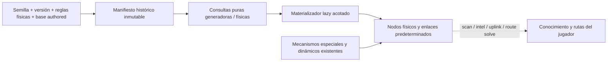

> **P3 implementado:** la extensión `historical-prologue-chain-v1` reserva una cadena procedural antes de explorar; puede añadir un único slot inicial. Conserva los sorteos ordinarios y aísla la reserva de B2. Véase [Garantía histórica del prólogo](prologue-navigation.es.md), que precisa estas excepciones a las reglas base descritas debajo.

> **4D-3e5c-B1 — información histórica.** Las partidas nuevas usan una proyección pura y separada [historical-information-v1](historical-information.es.md). No cambian identidades físicas, topología, recursos ni `historical-world-v1`. Consultar registros internos no revela ni materializa emplazamientos.

> **Actualización implementada 4D-3e4 (2026-11-05).** Los requisitos estructurados optativos del catálogo activo se compilan antes de jugar y se incorporan al manifiesto productivo. Las posiciones variables dependen de semilla/ID y las relaciones deben certificarse. Los sitios nuevos son lazy y secretos. No se ajustan densidades, cupos, hubs, cap ni topología. La creación ad hoc de lore descrita en el cuerpo anterior se ha retirado; recovery estructural sigue pendiente de e5. La referencia vigente y sus ejemplos ejecutables son [Requisitos narrativos físicos](../narrative-world-contract.es.md). El cuerpo anterior conservado a continuación es histórico donde contradiga esta actualización.

# Universo físico y generación procedural

Estado: referencia canónica implementada, actualizada en **4D-3e2**, árbol
basado en `5cdde28`, pendiente de aprobación externa.
Inglés: [world-generation.md](world-generation.md).
El contrato detallado, demostración numérica, comparación y limitaciones están
en [Integración del worldgen histórico](../design/historical-worldgen-integration.es.md).

## 1. Alcance y capas

Emplazamientos históricos, nodos materializados, conocimiento del jugador y
rutas operativas son capas distintas. `historical-world-v1` define existencia
antes de explorar; cálculo e inserción siguen lazy. `SpaceNode.links` contiene
enlaces físicos; `known_links` publica rutas del jugador por separado.
`SpaceGraph.edges` sigue como campo compatible sin uso. Existir históricamente
no determina elegibilidad narrativa ni para recuperación.

## 2. Definición y modelos

Bootstrap registra la huella de reglas. Materializar/guardar por primera vez
fija la definición completa; las consultas puras no mutan el estado. Después
se rechazan cambios de semilla, versión o configuración física. Se captura
`MetaState.rng_seed`; `WorldState.rng_seed` permanece legacy. `debug seed`
rechaza cambiar un universo fijado antes de modificar el estado. No hay caché
global mutable del universo.

| Campo / API | Significado |
| --- | --- |
| `WorldState.manifest_definition`, `universe_version`, `universe_rules_key` | Snapshot fijado y comprobación de compatibilidad. |
| `SpaceNode.historical_key`, `generation_sector_id` | Identidad histórica y procedencia; ausentes para especiales/dinámicos. |
| `SectorGenState.node_ids` | Todos los residentes físicos materializados. |
| `generation_node_ids`, hubs y contadores históricos | Miembros materializados de la cohorte generadora y su topología. |
| `generated_sectors`, `physical_inventory_complete` | Marcadores de generación física; el segundo certifica explícitamente inventario completo. |
| `intersector_link_pairs` | Campo compatible inerte; no decide asignación histórica. |
| `manifest.query_manifest` | Cohortes generadoras completas solicitadas y aristas incidentes. |
| `manifest.query_physical_sectors` | Inventario histórico completo por posición física real en el dominio certificado. |
| `catalog.catalog_sectors` | Evidencia de existencia generadora sin permiso de materialización ni elegibilidad narrativa/rutas. |

## 3. Coordenadas, sectores y regiones

### Coordenadas operacionales

Las posiciones de juego se expresan en años luz como `(x_ly, y_ly, z_ly)`. Los
sectores son cubos lógicos de **10 ly por eje** (`SECTOR_SIZE_LY = 10.0`). El id
se calcula con `floor(coordenada / 10)` en los tres ejes y se formatea como, por
ejemplo, `S+000_+000_+000`.

El formato canónico es una `S` mayúscula seguida de tres índices decimales con
signo separados por guiones bajos. Cada índice usa el resultado de
`{value:+04d}`: el signo es obligatorio, la anchura mínima es de cuatro
caracteres incluido el signo y los valores mayores se amplían. La generación histórica tiene
el dominio numérico explícito descrito más abajo. Por ello `S+012_-013_+014` y
`S+12345_-12346_+000` son válidos, mientras que un signo ausente, padding no
canónico, `-000`, otro prefijo o caracteres adicionales no lo son.

El uso de `floor` importa para coordenadas negativas: `x=-0.1` pertenece al
sector `-1`, no al sector `0`.

### Regiones físicas

Las coordenadas operacionales se transforman a coordenadas galácticas mediante:

- escala operacional → física: `1.0`;
- origen operacional físico: `(250000, 0, 0)` ly;
- centro físico galáctico: `(0, 0, 0)`;
- bulge: radio menor de `10000` ly;
- disk: radio menor de `400000` ly;
- halo: el resto.

Por tanto, el origen operacional está en `disk`. El modelo también define un
radio galáctico de `500000` ly, pero **no impide generar más allá de ese radio**;
`inside_galaxy` solo se expone como diagnóstico mediante
`galactic_margins_for_op_pos`.

El generador selecciona la plantilla regional usando la región del centro del
sector. Después recalcula la región de cada nodo a partir de sus coordenadas
reales.

## 4. Consumidores lazy y materialización

`ensure_sector_generated(state, sector_id)` conserva su API. Siguen siendo
consumidores scan, preparación de uplink/pools, intel sectorial o de ID procedural
exacto, gateways de recuperación, diagnósticos worldgen y la rama de bootstrap
no UNKNOWN. Prólogo comienza en UNKNOWN; cambiar a ECHO en sandbox no genera
sectores por sí mismo.

Cada solicitud expande su unión 3×3 XY en el mismo Z físico. Consulta el inventario
inverso completo, calcula dependencias históricas finitas, prepara propiedades
y colisiones y después inserta nodos y aristas con ambos extremos presentes.
No inserta dependencias ajenas a la unión física sólo para completar enlaces.
Los vecinos posteriores añaden las mismas aristas predeterminadas. Repetir
preserva IDs, recursos y conocimiento.

`debug worldgen sector` sigue materializando antes de mostrar: no es inspección
pura. Consulta/materialización interna no añade nodos conocidos, contactos,
rutas conocidas, archivos ni pools, ni avanza el RNG de juego.

Límites técnicos: 64 sectores solicitados; unión física expandida máxima de 576;
hasta 2.048 nodos nuevos por transacción y 32.768 cohortes calculadas por sesión.
La inversa inspecciona hasta 20 posibles procedencias por sector físico.
Agotar dominio o trabajo es error antes de insertar, nunca evidencia de vacío.
Se soporta CPython 3.12 binary64, implementación gaussiana fijada e índices
`abs(index) <= 2**48-32` (margen interior de cuatro para la inversa física).
La demostración está en el contrato detallado.

## 5. Guardrail inicial fijo

Se evalúan criterio y claves RNG vigentes sobre el 3×3 XY fijo del origen,
independientemente de la primera solicitud runtime. Se conservan overrides y
promoción determinista de vecino temprano; no se fuerza una tirada natural de
hub. `sparse_guardrail_done` pasa a ser metadato runtime, no origen de decisiones
históricas. No garantiza conectividad ni progresión universal.

## 6. Selección, identidad y distribución de nodos

Las plantillas regionales activas definen pesos de arquetipo, dispersión Z y
salvage:

| Región | `z_sigma` | Pesos `empty / ruin / corridor / isolated / graveyard` | Scrap | Módulos declarados |
| --- | ---: | --- | --- | --- |
| `bulge` | 0.8 | 30 / 30 / 10 / 10 / 20 | 15–60 | 1–3, `['tech','rare']` |
| `disk` | 0.3 | 25 / 35 / 20 / 15 / 5 | 10–40 | 0–2, `common` |
| `halo` | 2.0 | 50 / 25 / 5 / 5 / 15 | 5–25 | 0–1, `['tech','rare']` |

Los arquetipos activos definen densidad y topología:

| Arquetipo | Total objetivo | Tipos/restricciones | Hub jugable | Enlaces intersectoriales |
| --- | ---: | --- | --- | --- |
| `empty` | 0–1 | `ship` o `derelict`; sin station/relay/waystation | 0 % | máximo 0 |
| `ruin_field` | 1–3 | station≤1, relay≤1, ship≤2, derelict≤3; sin waystation | 20 % | máximo 1, p=0.18 |
| `relay_corridor` | 2–3 | relay≤1, waystation≤1, ship≤1, derelict≤2; sin station | 90 % | máximo 2, p=0.85 |
| `isolated_station` | 1–2 | station≤1, waystation≤1, ship≤1, derelict≤1; sin relay | 95 % | máximo 1, p=0.45 |
| `graveyard` | 1–3 | relay≤1, ship≤2, derelict≤2; sin station/waystation | 4 % | máximo 1, p=0.06 |

La probabilidad de enlaces internos extra es respectivamente 0, 0.12, 0.20,
0 y 0.05 en el orden anterior.

Sólo los ocupantes authored inmutables de una cohorte generadora consumen sus
cupos. Los especiales runtime y la entrada Z ajena no los consumen. La base
authored que supera caps se conserva sin slots extra. Se mantiene el muestreo
XY y gaussiano Z sin truncar; la región real se recalcula por coordenadas.

Las direcciones históricas incluyen ámbito, namespace e ID authored literal o
`(sector generador, índice)`. No cambian IDs operativos authored. Los procedurales
usan `S…:WG1_<hash completo del ámbito>_<índice>`, con escape `WG1C<n>`
determinista contra IDs authored inmutables. El registro no cambia la asignación.
El hint legacy de 24 bits sólo aporta nombre/orden de hubs. La intel usa
`resolve_operative_id` para resolver IDs nuevos exactos a su sector físico.

La inversa incluye procedencias XY destino/anterior por redondeo lejano y cinco
índices Z posibles. La completitud se demuestra por cota finita del muestreador
implementado, sin truncarlo. Sector generador y físico quedan diferenciados.

## 7. Topología histórica

Cada cohorte generadora no vacía elige hub topológico, prefiriendo hub jugable y
luego orden de hint legacy con identidad para desempatar. Estrellas internas y
aristas extra conservan probabilidades/RNG. Los pares intersectoriales son los
ocho vecinos XY con igual Z generador, unidos sólo por sus hubs, dentro de ambos
presupuestos y del cap de 45 ly.

Los pares del 3×3 inicial fijo tienen prioridad en orden legacy canónico.
Ocho emparejamientos fijos por paridad asignan después los demás pares viables
con sus tiradas existentes. Las dependencias de grado de rondas anteriores son
finitas (hasta ocho saltos vecinales); la asignación maximal recíproca no depende
del orden de materialización. Top-k mutuo queda sólo para comparar el prototipo.

No hay autoaristas ni publicación automática de rutas conocidas. Siguen siendo
posibles sectores vacíos, componentes aisladas, cero salidas y callejones.
Un desbordamiento Z puede separar miembros de la cohorte; hubs y caps deben
consultarse por procedencia, sin confundir residencia física y propiedad.

## 8. Contenido authored y especial

`load_locations()` sigue leyendo `data/locations/*.json` sin recursión;
bootstrap carga antes de insertar procedurales. UNKNOWN, ECHO_7, HARBOR_12 y
ARCHIVE_01 conservan coordenadas, nombres, kinds, radiación y salvage.
UNKNOWN ocupa cupo fijo en el origen incluso tras su retirada normal y nunca
se recrea. ECHO_7 procede de su declaración activa; se elimina el fallback
redundante que lo fabricaba si faltaba. RETORNO_SHIP conserva comportamiento
de nave/filesystem y queda fuera de cohortes de destinos.

Se rechazan IDs authored duplicados. Una futura estación específica puede usar
el mecanismo físico existente sin necesitar azar de worldgen. Declarar no
revela salvo flags explícitos vigentes. La prosa sola no declara ni revela.
`data/locations/templates/*.json` sigue inactivo y no se carga automáticamente.

Los especiales/dinámicos de lore, failsafes y tránsito continúan en runtime,
fuera de cupos/identidades históricas. Sustituirlos pertenece a fases posteriores.

## 9. Configuración efectiva

| Fuente | Responsabilidad efectiva |
| --- | --- |
| `model/world.py` | Tamaño de sector, ids, modelos y límite delegado de salto. |
| `config/balance.py` | Semilla por defecto, transformación galáctica, cap de 45 ly, drones recuperables y radiación procedural. |
| `data/worldgen/templates/*.json` | Pesos regionales, `z_sigma` y perfiles de salvage. |
| `data/worldgen/archetypes/*.json` | Conteos, tipos, caps, hubs y presupuestos/probabilidades de enlaces. |
| `data/modules.json` | Catálogo y pool de módulos recuperables. |

Los `radiation_base` de los JSON regionales no son consultados. La radiación
efectiva usa `PROCEDURAL_RAD_BASE`, `PROCEDURAL_RAD_REGION_MULT`, multiplicador
por tipo, variación y spikes de `Balance`. Su contrato de configuración sigue pendiente.

### Categorías regionales de módulos (F-WGEN-01 corregido en 4C-3)

Antes, `_pick_modules` trataba `['tech','rare']` como ids literales de módulos.
Ninguno existe, por lo que bulge perdía sus 1–3 módulos garantizados y halo sus
sorteos no nulos. Las categorías ahora filtran el campo `pool` del catálogo real:

| `pool` efectivo | Ids de módulos cargados, en orden de catálogo |
| --- | --- |
| `common` | `bus_stabilizer`, `aux_battery_cell`, `utility_cargo_frame`, `reinforced_frame` |
| `tech` | `micro_reactor_patch`, `selftest_rig`, `field_service_rig`, `high_density_cell` |
| `rare` | `transit_sensor_pack`, `rapid_maneuver_module` |

`load_modules()` normaliza scope y metadatos de drones; las diez definiciones
ya declaran sus categorías. No hace falta inferir rarezas ni editar datos.
Los módulos de nave y de dron participan en el salvage regional.

El selector procedural acepta una categoría como cadena o una lista de categorías.
`common` conserva sus candidatos y el comportamiento exacto del RNG;
`['tech','rare']` selecciona entre esos seis módulos. Los candidatos siguen
`module_ids` (orden de catálogo en worldgen), independientemente del orden o
duplicados de categorías. Los conteos siguen usando un `randint`, seguido de
selecciones uniformes con repetición. Disk conserva 0–2, bulge 1–3 y halo 0–1
módulos por nodo de salvage aplicable.

Los filtros vacíos o totalmente desconocidos no producen módulos ni fallback al
catálogo completo. Las listas mixtas sólo coinciden con sus categorías conocidas.
`None` conserva el valor interno por defecto sin filtro. Sólo se devuelven ids
reales del catálogo. Ningún JSON ni test establece un contrato de listas de ids
explícitos, por lo que las listas procedurales son sólo categorías. Un filtro
desconocido puede producir menos módulos que su mínimo; todos los filtros
regionales activos disponen de candidatos suficientes.

El salvage authored sigue en `_bootstrap_locations` (`bootstrap.py`), con un RNG
compartido de bootstrap y perfiles por ubicación. Los perfiles authored activos
usan `common` o `tech`; las plantillas inactivas de ubicaciones también usan
`rare` y `all`. Aunque bootstrap contiene una rama para listas de ids, ningún
JSON activo/inactivo ni test la usa. Esta corrección sólo cambia el selector
procedural y conserva el loot authored.

## 10. Propiedades estables y persistencia

Los RNG locales reutilizan helpers/claves de muestreo y probabilidad de pares.
Radiación/salvage/drones usan ahora identidad histórica completa: cambian
resultados concretos, pero se conservan probabilidades, categorías y cantidades
configuradas. No se regeneran recursos, flags dry ni agotamiento al repetir,
expandir o cargar. El loot authored conserva su RNG de bootstrap.

El esquema 3 guarda definición inmutable y procedencia en el contenedor V2 con
checksum. La validación rechaza reglas/semilla/versión distintas, propiedades
físicas/aristas históricas contradictorias e inventarios incompletos marcados
completos. No se promueven marcadores de compatibilidad no certificados.
Las partidas esquema 2 se rechazan mediante SaveLoadError EN/ES, sin migración
compleja ni borrado automático. Se mantiene fallback a backup.

## 11. Evidencia, límites y fases posteriores

El [contrato de integración](../design/historical-worldgen-integration.es.md)
contiene la comparación de diez semillas. Enlaces/componentes/oportunidades
ECHO iniciales coinciden con legacy directo canónico (20/59/51), frente al
prototipo 13/66/45. Enlaces intersectoriales exteriores disk/bulge/halo:
133/84/43 frente a legacy directo 126/86/39 e inverso 133/88/41. Los cambios
halo por cupos de procedencia son pequeños pero explícitos; se cuantifican
allí las nuevas tiradas de recursos y el coste de consultas.

La [regresión de integración](../../tests/worldgen_manifest_integration_smoke.py)
compara estado completo por orden/agrupación, materialización parcial, saves y
procesos hash-seed; inversa Z/redondeo, declaración authored, colisiones,
conocimiento y versiones incompatibles. Los testigos legacy usan fixtures
congeladas sólo de prueba. Módulos productivos conservan rangos, categorías,
acciones y agotamiento; los resultados exactos antiguos quedan como goldens
separados. El [informe de revisión](../testing/manifest-integration-review.es.md)
recoge resultados completos y fallos previos.

El radio galáctico diagnóstico sigue sin limitar generación; el dominio numérico
sí es límite técnico. `radiation_base` JSON regional sigue sin ser fuente efectiva
de radiación. No se implementan memoria de scan, nuevas probabilidades, reservas
narrativas, sustitución de ad hoc, integración nueva de F-DEAD-01, comms/radiod,
clases de estación ni balance general. D18–D20 preservan formatos de intel y la
distinción entre prosa, declaración física y revelación. La regresión completa
authored/arcos/singles/forzado sigue en e4.

## 12. Referencias de implementación

- [`src/retorno/model/world.py`](../../src/retorno/model/world.py): nodos, estado
  mundial, sectores, ids, distancias y rutas conocidas.
- [`src/retorno/model/galaxy.py`](../../src/retorno/model/galaxy.py): transformación
  física, regiones y márgenes galácticos.
- [`src/retorno/worldgen/generator.py`](../../src/retorno/worldgen/generator.py):
  pipeline procedural y topología.
- [`src/retorno/runtime/data_loader.py`](../../src/retorno/runtime/data_loader.py):
  contrato de carga de localizaciones y configuración worldgen.
- [`src/retorno/bootstrap.py`](../../src/retorno/bootstrap.py): integración de
  localizaciones authored e inicio de partida.
- [`src/retorno/core/engine.py`](../../src/retorno/core/engine.py): scan y nodos
  temporales de tránsito.
- [`src/retorno/core/lore.py`](../../src/retorno/core/lore.py),
  [`exploration_recovery.py`](../../src/retorno/core/exploration_recovery.py) y
  [`deadnodes.py`](../../src/retorno/core/deadnodes.py): creación posterior de
  nodos especiales.
- [`src/retorno/config/balance.py`](../../src/retorno/config/balance.py): constantes
  físicas y de balance.
- [`data/worldgen/`](../../data/worldgen): plantillas y arquetipos activos.
- [`data/locations/`](../../data/locations): localizaciones authored activas y
  plantillas excluidas.

- [`manifest.py`](../../src/retorno/worldgen/manifest.py) y
  [`topology.py`](../../src/retorno/worldgen/topology.py): definición productiva,
  inventario inverso, identidad y topología determinista.
