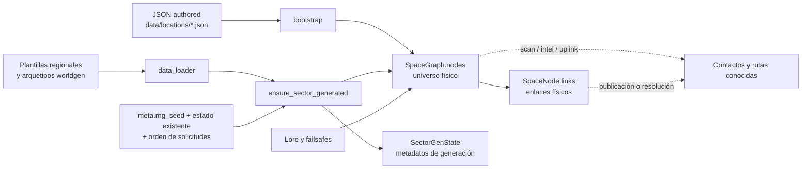

# Universo físico y generación procedural

Estado: **documentación canónica del comportamiento implementado**, revisada
contra el commit `3658577`.

Versión inglesa: [world-generation.md](world-generation.md)

## 1. Propósito y alcance

Este documento explica cómo RETORNO representa el universo físico, materializa
sectores bajo demanda e integra localizaciones authored con nodos procedurales.
Describe coordenadas, regiones, nodos, enlaces, determinismo, configuración y
persistencia del estado de generación.

No documenta en profundidad cómo el jugador descubre esos objetos, cómo se
resuelven rutas, cómo se coloca lore ni cómo actúan los failsafes. Esos sistemas
consumen y, en algunos casos, amplían el universo descrito aquí.

Etiquetas de evidencia:

- **Implementado:** comportamiento leído directamente en código o datos activos.
- **Cubierto:** además existe una prueba que lo ejercita.
- **Evidencia de diseño:** un comentario de implementación declara la finalidad.
- **Inferencia:** explicación compatible con la evidencia, pero sin decisión de
  diseño explícita.
- **Pendiente:** no está garantizado o necesita una decisión/verificación.

## 2. Modelo conceptual

RETORNO mantiene dos capas distintas:

1. El **universo físico materializado**: nodos existentes, coordenadas y enlaces
   físicos en `WorldState.space`.
2. El **conocimiento del jugador**: contactos, intel y rutas conocidas en
   `known_contacts`, `known_nodes`, `known_intel`, `intel` y `known_links`.

Un nodo puede existir físicamente sin haber sido descubierto. Un sector puede
estar generado sin que sus nodos sean conocidos. Un enlace físico en
`SpaceNode.links` tampoco se convierte automáticamente en una ruta conocida.

### Modelos y responsabilidades

| Modelo | Responsabilidad implementada |
| --- | --- |
| `SpaceNode` | Identidad, tipo, coordenadas, región, radiación, salvage, enlaces físicos y flags de hub. |
| `SpaceGraph.nodes` | Registro canónico de nodos físicos materializados por `node_id`. |
| `SpaceGraph.edges` | Campo de compatibilidad actualmente no utilizado para la topología; la implementación consulta `SpaceNode.links`. |
| `SectorGenState` | Arquetipo, nodos observados, hubs y contadores de enlaces creados por worldgen para un sector. |
| `WorldState.generated_sectors` | Sectores cuyo paso de generación ya se ejecutó, incluso si quedaron vacíos. |
| `WorldState.intersector_link_pairs` | Pares de sectores cuya oportunidad de enlace ya fue evaluada. |
| `known_*` e `intel` | Conocimiento del jugador, separado del grafo físico. |

`is_hub` significa que el nodo es un hub utilizable por sistemas de juego.
`is_topology_hub` identifica el nodo que worldgen usa como centro de la
topología del sector. Un sector con nodos siempre intenta tener un topology hub;
este no tiene por qué ser un hub jugable.

## 3. Coordenadas, sectores y regiones

### Coordenadas operacionales

Las posiciones de juego se expresan en años luz como `(x_ly, y_ly, z_ly)`. Los
sectores son cubos lógicos de **10 ly por eje** (`SECTOR_SIZE_LY = 10.0`). El id
se calcula con `floor(coordenada / 10)` en los tres ejes y se formatea como, por
ejemplo, `S+000_+000_+000`.

El uso de `floor` importa para coordenadas negativas: `x=-0.1` pertenece al
sector `-1`, no al sector `0`.

### Regiones físicas

Las coordenadas operacionales se transforman a coordenadas galácticas mediante:

- escala operacional → física: `1.0`;
- origen operacional físico: `(250000, 0, 0)` ly;
- centro físico galáctico: `(0, 0, 0)`;
- bulge: radio menor de `10000` ly;
- disk: radio menor de `400000` ly;
- halo: el resto.

Por tanto, el origen operacional está en `disk`. El modelo también define un
radio galáctico de `500000` ly, pero **no impide generar más allá de ese radio**;
`inside_galaxy` solo se expone como diagnóstico mediante
`galactic_margins_for_op_pos`.

El generador selecciona la plantilla regional usando la región del centro del
sector. Después recalcula la región de cada nodo a partir de sus coordenadas
reales.

## 4. Cuándo se genera el universo

La entrada pública es `ensure_sector_generated(state, sector_id)`. La generación
es lazy: se solicita cuando otro subsistema necesita que una zona exista.

Solicitantes actuales relevantes:

- `scan`, para materializar los sectores cuyos índices caen dentro de la caja
  delimitadora del radio de búsqueda;
- preparación de pools/rutas de uplink;
- importación de intel `SECTOR`, y referencias a determinados nodos
  procedurales;
- creación de gateways de recuperación de exploración;
- comandos de diagnóstico de worldgen;
- una rama de bootstrap para un nodo inicial distinto de `UNKNOWN`.

> **Advertencia:** `debug worldgen sector <sector_id>` no es una inspección de
> solo lectura. `render_debug_worldgen_sector` llama a
> `ensure_sector_generated` antes de mostrar el diagnóstico, por lo que puede
> materializar el sector solicitado, su vecindad 3×3 y sus nodos y enlaces. Ese
> estado pasa a formar parte del universo de la partida.

El prólogo actual comienza en `UNKNOWN`, por lo que esa rama de bootstrap no
genera el sector inicial. El modo sandbox cambia después a `ECHO_7`, pero tampoco
llama explícitamente al generador en ese paso. En ambos casos la primera
materialización normal sigue siendo bajo demanda.

Una solicitud individual no genera solo el sector pedido. Construye la unión de
su vecindad **3×3 en XY**, manteniendo el mismo índice Z. Si un consumidor, como
`scan`, solicita varios sectores o varios planos Z, la unión materializada puede
ser mayor.

Materializar no equivale a revelar: worldgen no añade por sí mismo los nodos
nuevos a `known_nodes` o `known_contacts`.

## 5. Flujo de generación

Para cada conjunto solicitado se ejecuta este flujo:

1. Cargar `data/worldgen/templates/*.json` y
   `data/worldgen/archetypes/*.json` con glob no recursivo.
2. Expandir cada sector solicitado a su anillo 3×3 XY y ordenar los ids.
3. Aplicar, una sola vez, el guardrail de la vecindad del origen cuando el
   conjunto contiene el sector de `(0,0,0)`.
4. Para cada sector aún no generado:
   1. calcular región desde el centro;
   2. escoger arquetipo por pesos regionales;
   3. contar los nodos authored o especiales que ya están físicamente dentro;
   4. decidir el total objetivo y los tipos restantes;
   5. crear nodos, coordenadas, radiación y salvage;
   6. registrar `SectorGenState` y marcar el sector como generado.
5. Construir una estrella de enlaces internos alrededor del topology hub y
   evaluar enlaces internos extra.
6. Evaluar, una vez por pareja, enlaces entre topology hubs de sectores vecinos
   recién materializados.

### Guardrail del origen

**Evidencia de diseño:** los comentarios del generador declaran una topología
dispersa y aceptan dead ends locales. El guardrail intenta evitar que la primera
vecindad sea un bloqueo trivial; no promete progreso para todas las ramas.

- Si el arquetipo del origen no es `relay_corridor`, `isolated_station` o
  `ruin_field`, se sustituye por `relay_corridor` para esa generación.
- Si ningún vecino tiene arquetipo `relay_corridor` o `isolated_station`, uno se
  promociona determinísticamente y se fuerza allí la creación de un hub jugable.
- `sparse_guardrail_done` persiste y evita repetir el mecanismo.

Si ya existe un vecino con uno de esos arquetipos, el código no fuerza que su
tirada natural de hub tenga éxito ni que obtenga un enlace intersectorial. Por
tanto, “guardrail” no debe documentarse como garantía formal de conectividad.

## 6. Selección y distribución de nodos

Las plantillas regionales activas definen pesos de arquetipo, dispersión Z y
salvage:

| Región | `z_sigma` | Pesos `empty / ruin / corridor / isolated / graveyard` | Scrap | Módulos declarados |
| --- | ---: | --- | --- | --- |
| `bulge` | 0.8 | 30 / 30 / 10 / 10 / 20 | 15–60 | 1–3, `['tech','rare']` |
| `disk` | 0.3 | 25 / 35 / 20 / 15 / 5 | 10–40 | 0–2, `common` |
| `halo` | 2.0 | 50 / 25 / 5 / 5 / 15 | 5–25 | 0–1, `['tech','rare']` |

Los arquetipos activos definen densidad y topología:

| Arquetipo | Total objetivo | Tipos/restricciones | Hub jugable | Enlaces intersectoriales |
| --- | ---: | --- | --- | --- |
| `empty` | 0–1 | `ship` o `derelict`; sin station/relay/waystation | 0 % | máximo 0 |
| `ruin_field` | 1–3 | station≤1, relay≤1, ship≤2, derelict≤3; sin waystation | 20 % | máximo 1, p=0.18 |
| `relay_corridor` | 2–3 | relay≤1, waystation≤1, ship≤1, derelict≤2; sin station | 90 % | máximo 2, p=0.85 |
| `isolated_station` | 1–2 | station≤1, waystation≤1, ship≤1, derelict≤1; sin relay | 95 % | máximo 1, p=0.45 |
| `graveyard` | 1–3 | relay≤1, ship≤2, derelict≤2; sin station/waystation | 4 % | máximo 1, p=0.06 |

La probabilidad de enlaces internos extra es respectivamente 0, 0.12, 0.20,
0 y 0.05 en el orden anterior.

Los nodos existentes cuentan contra el total objetivo y los caps. Worldgen no
elimina nodos authored si el sector ya supera esos límites; simplemente deja de
crear slots adicionales.

Para cada slot procedural:

- X e Y se eligen uniformemente dentro del sector;
- Z se elige mediante una normal centrada en el centro Z del sector y con
  `z_sigma` regional;
- el id usa prefijo por tipo y 24 bits pseudoaleatorios; los `ship` usan
  `WRECK_`;
- una colisión de id se resuelve con sufijos griegos y, si fuera necesario, una
  nueva base;
- salvage y radiación usan semillas derivadas específicas del nodo.

La normal Z no está truncada. Un resultado extremo puede colocar físicamente un
nodo fuera del índice Z solicitado. Esta posibilidad no está cubierta por una
prueba de límites.

## 7. Enlaces físicos

### Enlaces internos

Si el sector contiene nodos, se elige un topology hub:

1. el primer hub jugable por `node_id`, si existe;
2. en caso contrario, el primer nodo por `node_id`.

Todos los demás nodos se enlazan bidireccionalmente con ese hub. Después cada
nodo no-hub puede recibir un enlace extra según el arquetipo. Los enlaces se
guardan en ambos `SpaceNode.links`.

### Enlaces intersectoriales

Solo se consideran los ocho vecinos XY del mismo nivel Z. El enlace une los
topology hubs y requiere:

- que ambos sectores y hubs existan;
- presupuesto disponible en ambos arquetipos;
- superar una tirada cuya probabilidad es el mínimo de las dos probabilidades;
- distancia no superior a `Balance.MAX_ROUTE_HOP_LY`.

El par se registra como evaluado antes de comprobar el resultado. No se vuelve a
intentar aunque más tarde aparezca un hub nuevo.

### Límite de salto

`MAX_ROUTE_HOP_LY = 45.0` es el límite duro usado por el generador para enlaces
internos e intersectoriales. También se aplica en publicación/resolución de
rutas y viaje, aunque esos usos pertenecen al subsistema de navegación.

No existe una garantía de conectividad global. Son resultados válidos:

- sectores `empty` con cero nodos;
- sectores sin salida intersectorial;
- componentes físicas desconectadas;
- ramas locales sin continuación.

## 8. Contenido authored y procedural

`load_locations()` lee únicamente `data/locations/*.json`. En bootstrap, las
definiciones se procesan por nombre de archivo ordenado antes de worldgen.

Localizaciones activas:

- `UNKNOWN`: origen físico y contacto conocido al inicio;
- `ECHO_7`: station/hub authored en `(0,0,0)`;
- `HARBOR_12`: station/hub authored;
- `ARCHIVE_01`: derelict authored;
- `RETORNO_SHIP`: definición especial de la nave.

`RETORNO_SHIP` no se inserta como destino en `SpaceGraph`: bootstrap omite su
`node_id`, pero sí instala sus archivos en el filesystem de la nave.

Las localizaciones authored conservan coordenadas y radiación explícitas. Su
región se recalcula con el modelo físico. Si no declaran `is_hub`, station,
relay y waystation se consideran hubs; `is_topology_hub` hereda ese valor salvo
configuración explícita.

Cuando posteriormente se genera su sector, esos nodos ya existentes:

- cuentan para el total y los caps del arquetipo;
- pueden convertirse en topology hub;
- participan en los enlaces internos.

Los ids authored duplicados no se validan: la primera definición que creó el id
permanece y las posteriores no la sustituyen. Los ids procedurales sí evitan
colisiones contra todos los nodos ya materializados.

`data/locations/templates/*.json` no se carga y no participa automáticamente.
Su relación con las definiciones activas está inventariada en
[el contrato de carga](../content-loading.es.md).

### Tratamiento especial del origen

El generador contiene un fallback `_ensure_fixed_origin_hub`: al generar el
sector del origen crea `ECHO_7` si ese id no existe. En la configuración actual
la definición authored ya lo crea, por lo que el fallback normalmente no actúa.

## 9. Configuración efectiva

| Fuente | Responsabilidad efectiva |
| --- | --- |
| `model/world.py` | Tamaño de sector, ids, modelos y límite delegado de salto. |
| `config/balance.py` | Semilla por defecto, transformación galáctica, cap de 45 ly, drones recuperables y radiación procedural. |
| `data/worldgen/templates/*.json` | Pesos regionales, `z_sigma` y perfiles de salvage. |
| `data/worldgen/archetypes/*.json` | Conteos, tipos, caps, hubs y presupuestos/probabilidades de enlaces. |
| `data/modules.json` | Catálogo y pool de módulos recuperables. |

Dos campos/configuraciones requieren atención:

- Los `radiation_base` de los JSON regionales no son consultados. La radiación
  efectiva usa `PROCEDURAL_RAD_BASE`, `PROCEDURAL_RAD_REGION_MULT`, multiplicador
  por tipo, variación y spikes de `Balance`.
- En `_pick_modules`, una lista `modules_pool` se interpreta como una lista de
  **ids de módulo**, no como etiquetas de pool. Bulge y halo declaran
  `['tech','rare']`, pero no existen módulos con esos ids; actualmente esa
  selección queda vacía. No se ha establecido si el problema está en los datos
  o en la semántica esperada del loader.

## 10. Determinismo

Worldgen deriva RNG locales con BLAKE2b a partir de `state.meta.rng_seed` y
claves como sector, arquetipo, slot, nodo o pareja de sectores. La misma semilla,
el mismo estado previo y la misma secuencia de solicitudes reproducen el mismo
resultado. Esto está cubierto parcialmente por pruebas.

El campo `WorldState.rng_seed` no es la fuente usada por el generador; la fuente
efectiva es `MetaState.rng_seed`.

El determinismo **no es independiente del orden de acciones**:

- los presupuestos intersectoriales se consumen cuando se evalúan parejas;
- cada pareja se evalúa una sola vez;
- el guardrail se ejecuta en el primer cluster que contiene el origen;
- ids existentes y nodos authored influyen en slots y colisiones.

Una comprobación diagnóstica con semilla `2` y el mismo conjunto de tres
solicitudes en orden inverso produjo los mismos nodos pero una arista
intersectorial distinta. Este comportamiento no tiene todavía una prueba de
regresión ni una decisión de diseño documentada.

El salvage authored usa un único RNG durante el recorrido ordenado de archivos;
añadir una definición authored activa puede desplazar tiradas de las siguientes.
El salvage procedural usa semillas por nodo y es más localmente estable.

Cambiar la semilla después de materializar sectores no regenera los existentes,
por lo que puede producir un mundo con sectores creados bajo semillas distintas.

## 11. Invariantes y restricciones confirmadas

- Un sector marcado en `generated_sectors` no vuelve a ejecutar su generación.
- Una solicitud simple expande un anillo 3×3 XY en el mismo Z.
- Generar no revela contactos ni rutas al jugador. **Cubierto.**
- Los enlaces creados por worldgen son bidireccionales y no superan 45 ly.
  **Cubierto.**
- Un sector con nodos recibe un topology hub durante la construcción interna.
- Un topology hub no implica necesariamente un hub jugable.
- `empty` puede producir cero nodos y nunca crea enlaces intersectoriales.
- El guardrail solo se consume una vez y no garantiza conectividad global.
- Las definiciones bajo `data/locations/templates/` no intervienen.
- Los metadatos de `SectorGenState` describen el trabajo de worldgen; enlaces o
  nodos añadidos por otros subsistemas no siempre incrementan sus contadores.

## 12. Casos límite y condiciones de fallo

- `_parse_sector_id` convierte silenciosamente un id malformado en coordenadas
  `(0,0,0)`. Algunas entradas de UI validan antes, pero el helper interno no
  rechaza el valor; falta cobertura para intel de sector malformada.
- Un sector vacío se marca como generado e `internal_links_built`; nodos añadidos
  después no provocan una reconstrucción automática de la topología interna.
- `intersector_link_pairs` impide reintentar una pareja fallida aunque cambie el
  estado físico posterior.
- La distribución gaussiana Z puede colocar un nodo fuera del sector solicitado.
- No existe límite efectivo que prohíba worldgen fuera del radio galáctico.
- JSON ausentes o incompletos tienen fallbacks parciales; rangos inválidos de
  salvage o valores no convertibles pueden producir excepciones.
- Los nodos authored pueden hacer que un sector exceda los máximos del
  arquetipo; esos máximos gobiernan la creación adicional, no validan el total.
- `SpaceGraph.edges` puede inducir a error a nuevos consumidores: la topología
  vigente reside en `SpaceNode.links`.

## 13. Interacciones con otros subsistemas

- **Exploración:** scan solicita generación y después decide qué nodos se
  descubren; existencia y visibilidad permanecen separadas.
- **Navegación:** consume nodos físicos, publica `known_links` y aplica el mismo
  cap de 45 ly, pero las rutas conocidas no son el grafo físico.
- **Lore/uplink:** fuerza la materialización del sector actual para preparar
  pools y candidatos.
- **Failsafes:** recuperación, lore forzado y deadnodes pueden crear nodos
  físicos después de worldgen. `register_hidden_anchored_node` crea un enlace
  físico al ancla si está a ≤45 ly y sincroniza metadatos solo cuando el sector
  ya tiene estado. Un gateway de recuperación también puede solicitar worldgen.
- **Viaje abortado:** crea un nav point temporal y enlaces conocidos hacia los
  extremos, no una arista física normal de worldgen.
- **Persistencia:** `generated_sectors`, `sector_states`, pares evaluados, flags
  de hubs y guardrail forman parte del save.

## 14. Pruebas y estado de verificación

El código productivo se revisó en el commit `3658577`; las pruebas se ejecutaron
posteriormente, después de actualizar `worldgen_sparse_archetypes_smoke.py`,
sobre el árbol de trabajo de la Fase 3A.1:

| Prueba | Resultado | Cobertura relevante |
| --- | --- | --- |
| `galaxy_physical_model_smoke.py` | PASSED | Transformación física, región disk del origen y márgenes. |
| `procedural_radiation_smoke.py` | PASSED | Determinismo, orden regional y preservación de radiación authored. |
| `route_hop_cap_smoke.py` | PASSED | Cap de viaje y cap de enlaces worldgen. |
| `debug_worldgen_graph_smoke.py` | PASSED | Diagnóstico de sector y grafo físico. |
| `debug_galaxy_smoke.py` | PASSED | Diagnóstico galáctico y mapa. |
| `save_load_smoke.py` | PASSED | Persistencia de `SectorGenState`, guardrail y flags de hub. |
| `scan_job_smoke.py` | PASSED | Scan, materialización indirecta y descubrimiento. |
| `worldgen_sparse_archetypes_smoke.py` | PASSED | Catálogo y caps activos, tipos prohibidos/permitidos, conteos por arquetipo, enlaces internos al topology hub, dispersión, determinismo con el mismo orden, guardrail y no revelación de vecinos. |

Lagunas de verificación:

- no hay una prueba que fije o rechace la dependencia del orden de generación;
- no se prueban ids de sector malformados;
- no se comprueba que Z permanezca dentro del sector;
- no se prueban duplicados authored ni sectores que ya excedan caps;
- no hay una prueba de frontera física de la galaxia;
- no se valida la semántica de `modules_pool` como lista ni el uso de
  `radiation_base` regional;
- no se verifica la reconstrucción de topología tras añadir nodos especiales a
  sectores ya generados o vacíos;
- no existe todavía una prueba que detecte automáticamente divergencias entre
  la tabla canónica de este documento y futuros cambios intencionados de los
  JSON; cualquier cambio de reglas deberá actualizar datos, test y documentación
  conjuntamente.

## 15. Referencias de implementación

- [`src/retorno/model/world.py`](../../src/retorno/model/world.py): nodos, estado
  mundial, sectores, ids, distancias y rutas conocidas.
- [`src/retorno/model/galaxy.py`](../../src/retorno/model/galaxy.py): transformación
  física, regiones y márgenes galácticos.
- [`src/retorno/worldgen/generator.py`](../../src/retorno/worldgen/generator.py):
  pipeline procedural y topología.
- [`src/retorno/runtime/data_loader.py`](../../src/retorno/runtime/data_loader.py):
  contrato de carga de localizaciones y configuración worldgen.
- [`src/retorno/bootstrap.py`](../../src/retorno/bootstrap.py): integración de
  localizaciones authored e inicio de partida.
- [`src/retorno/core/engine.py`](../../src/retorno/core/engine.py): scan y nodos
  temporales de tránsito.
- [`src/retorno/core/lore.py`](../../src/retorno/core/lore.py),
  [`exploration_recovery.py`](../../src/retorno/core/exploration_recovery.py) y
  [`deadnodes.py`](../../src/retorno/core/deadnodes.py): creación posterior de
  nodos especiales.
- [`src/retorno/config/balance.py`](../../src/retorno/config/balance.py): constantes
  físicas y de balance.
- [`data/worldgen/`](../../data/worldgen): plantillas y arquetipos activos.
- [`data/locations/`](../../data/locations): localizaciones authored activas y
  plantillas excluidas.
