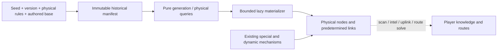

> **Implemented 4D-3e4 update (2026-11-05).** Optional structured requirements from the active catalogue compile before play into the productive manifest. Variable positions depend on seed/ID and relations must be certified. New sites are lazy and secret. Density, quotas, hubs, cap and topology are not retuned. Ad hoc lore creation described in the older body has been removed; structural recovery still awaits e5. The current contract and executable examples are [Physical narrative requirements](../narrative-world-contract.md). The earlier body retained below is historical wherever it contradicts this update.

# Physical universe and procedural generation

Status: canonical implemented reference, updated for **4D-3e2**, working tree
based on `5cdde28`, pending external approval.
Spanish: [world-generation.es.md](world-generation.es.md).
The detailed contract, numerical proof, comparisons and limitations are in
[Historical worldgen integration](../design/historical-worldgen-integration.md).

## 1. Scope and layers

Historical sites, materialized nodes, player knowledge and operational routes
are separate. `historical-world-v1` defines existence before exploration;
calculation and insertion remain lazy. `SpaceNode.links` stores physical links;
`known_links` publishes player routes separately. `SpaceGraph.edges` remains an
unused compatibility field. Historical existence does not establish lore or
recovery eligibility.

## 2. Definition and models

Bootstrap records the current rules fingerprint. First materialization/save
pins the complete immutable definition; pure queries do not mutate state.
Changed seed, version or physical configuration is rejected after pinning.
The effective seed input is `MetaState.rng_seed`; `WorldState.rng_seed` remains
legacy. `debug seed` rejects changes to a pinned universe before changing state.
No mutable global universe cache exists.

| Field / API | Meaning |
| --- | --- |
| `WorldState.manifest_definition`, `universe_version`, `universe_rules_key` | Pinned universe snapshot and compatibility check. |
| `SpaceNode.historical_key`, `generation_sector_id` | Historical identity and generation provenance; absent for special/dynamic sites. |
| `SectorGenState.node_ids` | All materialized physical residents. |
| `generation_node_ids`, topology/playable hubs, historical counters | Materialized generation-cohort members and their topology. |
| `generated_sectors`, `physical_inventory_complete` | Physical generation markers; the latter explicitly certifies inventory completeness. |
| `intersector_link_pairs` | Inert compatibility field; no historical allocation authority. |
| `manifest.query_manifest` | Complete requested generation cohorts and incident edges. |
| `manifest.query_physical_sectors` | Complete historical inventory by actual physical position in the certified domain. |
| `catalog.catalog_sectors` | Generation-cohort existence evidence, without materialization permission or route/lore eligibility. |

## 3. Coordinates, sectors, and regions

### Operational coordinates

Game positions use light years as `(x_ly, y_ly, z_ly)`. Sectors are logical
cubes of **10 ly per axis** (`SECTOR_SIZE_LY = 10.0`). Their id applies
`floor(coordinate / 10)` on all three axes and formats the result as, for
example, `S+000_+000_+000`.

The canonical format is capital `S` followed by three signed decimal indices
separated by underscores. Each index uses the result of `{value:+04d}`: the
sign is mandatory, the minimum width is four characters including the sign,
and larger values expand. Historical generation has the explicit numerical
domain described below. Thus
`S+012_-013_+014` and `S+12345_-12346_+000` are valid, while a missing sign,
noncanonical padding, `-000`, a different prefix, or extra characters are not.

Using `floor` matters for negative positions: `x=-0.1` belongs to sector `-1`,
not sector `0`.

### Physical regions

Operational coordinates are mapped to galactic coordinates with:

- operational-to-physical scale: `1.0`;
- physical operational origin: `(250000, 0, 0)` ly;
- physical galactic center: `(0, 0, 0)`;
- bulge: radius below `10000` ly;
- disk: radius below `400000` ly;
- halo: everything else.

The operational origin is therefore in `disk`. The model also declares a
`500000` ly galactic radius, but **does not prevent generation beyond it**;
`inside_galaxy` is diagnostic output from `galactic_margins_for_op_pos` only.

The generator selects the regional template from the sector center's region. It
then recalculates every node's region from its actual coordinates.

## 4. Lazy consumers and materialization

`ensure_sector_generated(state, sector_id)` retains its API. Scan, uplink/pool
preparation, sector intel, exact procedural-ID intel, recovery gateways, worldgen
diagnostics and the non-UNKNOWN bootstrap branch remain consumers. Prologue
starts at UNKNOWN; switching to sandbox ECHO does not itself generate sectors.

Each request expands its 3×3 XY union at the same physical Z. It looks up the
complete inverse physical inventory, computes finite historical topology
dependencies, stages properties/collision checks, then inserts nodes and links
whose endpoints both exist. Dependencies outside the physical union are not
inserted merely to complete links. Later neighbors attach the same predetermined
edges. Repeated requests preserve IDs, resources and knowledge.

`debug worldgen sector` still materializes before rendering. It is not a pure
inspection. Internal queries and materialization add no known nodes, contacts,
known links, files or pools and do not advance gameplay RNG.

Technical bounds: 64 public requested sectors; expanded physical union at most
576; at most 2,048 new nodes per transaction and 32,768 computed generation
cohorts per session. Inverse queries inspect at most 20 possible source sectors
per physical target. Domain or work exhaustion is an error before insertion,
never evidence of empty space. Supported sampling is CPython 3.12 binary64 with
the pinned Gaussian implementation and `abs(index) <= 2**48-32` (four-index
margin for physical inverse requests). See the proof in the detailed contract.

## 5. Fixed initial guardrail

The existing criterion and RNG keys are evaluated against the fixed origin 3×3
XY neighborhood independently of the first runtime request. Origin overrides
and deterministic early-neighbor promotion remain; naturally selected hub rolls
are not forced. `sparse_guardrail_done` is now runtime metadata, not a source of
historical choices. This is not a global connectivity or progression guarantee.

## 6. Node selection, identity and distribution

Active regional templates define archetype weights, Z dispersion, and salvage:

| Region | `z_sigma` | Weights `empty / ruin / corridor / isolated / graveyard` | Scrap | Declared modules |
| --- | ---: | --- | --- | --- |
| `bulge` | 0.8 | 30 / 30 / 10 / 10 / 20 | 15–60 | 1–3, `['tech','rare']` |
| `disk` | 0.3 | 25 / 35 / 20 / 15 / 5 | 10–40 | 0–2, `common` |
| `halo` | 2.0 | 50 / 25 / 5 / 5 / 15 | 5–25 | 0–1, `['tech','rare']` |

Active archetypes define density and topology:

| Archetype | Target total | Kinds/restrictions | Playable hub | Intersector links |
| --- | ---: | --- | --- | --- |
| `empty` | 0–1 | `ship` or `derelict`; no station/relay/waystation | 0% | maximum 0 |
| `ruin_field` | 1–3 | station≤1, relay≤1, ship≤2, derelict≤3; no waystation | 20% | maximum 1, p=0.18 |
| `relay_corridor` | 2–3 | relay≤1, waystation≤1, ship≤1, derelict≤2; no station | 90% | maximum 2, p=0.85 |
| `isolated_station` | 1–2 | station≤1, waystation≤1, ship≤1, derelict≤1; no relay | 95% | maximum 1, p=0.45 |
| `graveyard` | 1–3 | relay≤1, ship≤2, derelict≤2; no station/waystation | 4% | maximum 1, p=0.06 |

Extra internal-link probabilities are respectively 0, 0.12, 0.20, 0, and 0.05
in the order above.

Only the immutable authored occupants of a generation cohort consume its
quotas. Special runtime nodes and foreign Z inflow do not. Authored over-cap
bases are retained without extra slots. X/Y sampling and untruncated Gaussian Z
remain unchanged; actual node regions are recalculated from coordinates.

Historical addresses use scope, namespace and authored raw ID or procedural
`(generation sector, slot index)`. Authored operative IDs are unchanged.
Procedural operative IDs are `S…:WG1_<full scope hash>_<slot>`, with deterministic
`WG1C<n>` escaping against immutable authored IDs. The registry cannot change
allocation. The 24-bit legacy hint only supplies names/hub ordering.
`resolve_operative_id` resolves exact new IDs to their physical sector for intel.

The inverse query includes target/preceding X/Y sources to account for rounding
at large coordinates and five possible Z source indices. A finite bound on the
implemented Gaussian, not truncation, proves completeness. Generation sector
and physical sector remain explicit and distinct.

## 7. Historical topology

Each nonempty generation cohort chooses a topology hub, preferring a playable
hub and then legacy-hint order with identity tie breaking. Internal stars and
optional extra edges retain existing probability/RNG rules. Intersector pairs
are the eight XY neighbors at the same generation Z, joined only through their
cohort hubs, within both budgets and the 45 ly cap.

The fixed initial 3×3 pairs get priority in canonical legacy order. Eight fixed
parity matchings then allocate all remaining viable pairs using existing pair
rolls. Earlier-round degree dependencies are finite (at most eight neighbor
hops); the reciprocal maximal allocation is independent of materialization
order. Mutual top-k remains only the experimental comparison policy.

No self edges or automatic known routes are created. Empty sectors, isolated
components, zero exits and dead ends remain possible. Physical Z spill can
separate members of a generation cohort; metadata consumers must use provenance
for hubs and caps rather than assuming physical membership equals ownership.

## 8. Authored and special content

`load_locations()` still reads `data/locations/*.json` non-recursively, with
bootstrap loading before procedural insertion. UNKNOWN, ECHO_7, HARBOR_12 and
ARCHIVE_01 preserve existing coordinates, names, kinds, radiation and salvage.
UNKNOWN counts toward the fixed origin quota even after its normal removal;
it is never recreated. ECHO_7 comes from its active declaration; the redundant
fallback that manufactured a missing ECHO was removed. RETORNO_SHIP keeps its
ship/filesystem behavior and is excluded from destination cohorts.

Duplicate authored IDs are rejected. A future specific station can use the
existing physical declaration mechanism without requiring a random worldgen
roll. Declaration does not reveal it unless explicit existing reveal flags ask
for that. Prose alone neither declares nor reveals a place. Inactive
`data/locations/templates/*.json` still does not load automatically.

Special/dynamic nodes from existing lore, failsafes and transit continue in
runtime, outside historical quotas/identities. Their replacement is future work.

## 9. Effective configuration

| Source | Effective responsibility |
| --- | --- |
| `model/world.py` | Sector size, ids, models, and delegated hop cap. |
| `config/balance.py` | Default seed, galactic mapping, 45 ly cap, recoverable drones, and procedural radiation. |
| `data/worldgen/templates/*.json` | Regional weights, `z_sigma`, and salvage profiles. |
| `data/worldgen/archetypes/*.json` | Counts, kinds, caps, hubs, and link budgets/probabilities. |
| `data/modules.json` | Recoverable module catalog and pools. |

Regional JSON `radiation_base` values are not read. Effective radiation uses
`PROCEDURAL_RAD_BASE`, `PROCEDURAL_RAD_REGION_MULT`, kind multiplier, variation,
and spikes from `Balance`. Its configuration contract remains pending.

### Regional module categories (F-WGEN-01 fixed in 4C-3)

Previously, `_pick_modules` treated `['tech','rare']` as literal module ids.
Neither exists, so bulge lost its guaranteed 1–3 modules and halo lost nonzero
module rolls. Categories now filter the real catalog's `pool` field:

| Effective `pool` | Loaded module ids, in catalog order |
| --- | --- |
| `common` | `bus_stabilizer`, `aux_battery_cell`, `utility_cargo_frame`, `reinforced_frame` |
| `tech` | `micro_reactor_patch`, `selftest_rig`, `field_service_rig`, `high_density_cell` |
| `rare` | `transit_sensor_pack`, `rapid_maneuver_module` |

`load_modules()` normalizes scope and drone metadata; all ten definitions
already declare their categories. No rarity inference or data edits are needed.
Both ship and drone modules participate in regional salvage.

The procedural selector accepts a category string or a list of categories.
`common` retains its candidates and exact RNG behavior; `['tech','rare']` selects
from those six modules. Candidates follow `module_ids` (catalog order in worldgen),
regardless of category order or duplicates. Counts still use one `randint`, then
uniform choices with replacement. Disk retains 0–2, bulge 1–3, and halo 0–1
modules per applicable salvage node.

Empty or entirely unknown filters yield no modules without a whole-catalog
fallback. Mixed lists match only their known categories. `None` retains the
internal unfiltered default. Only real catalog ids can be returned. No JSON or
test establishes an explicit-id-list contract, so procedural lists are categories
only. An unknown filter can yield fewer modules than its minimum; all active
regional filters have sufficient candidates.

Authored salvage stays in `_bootstrap_locations` (`bootstrap.py`), with a shared
bootstrap RNG and per-location profiles. Active authored profiles use `common`
or `tech`; inactive location templates also use `rare` and `all`. Although
bootstrap contains an id-list branch, no active/inactive JSON or test uses it.
This correction changes only the procedural picker and preserves authored loot.

## 10. Stable properties and persistence

Local RNGs reuse canonical helpers and keys for sampling and pair probabilities.
Radiation/salvage/drone seeds now use full historical identity; exact procedural
loot rolls change, while all probabilities, categories and configured quantities
stay unchanged. Existing resources, dry flags and depletion are never regenerated
on repeat queries, later expansion or load. Authored loot keeps bootstrap RNG.

Save schema 3 stores the immutable definition and provenance in the existing V2
checked container. Validation rejects changed rules/seed/version, contradictory
historical physical properties/edges and incomplete inventories marked complete.
Uncertified compatibility markers are not promoted into complete inventories.
Old schema-2 worlds are rejected through SaveLoadError, with EN/ES feedback,
no complex migration and no automatic file deletion. Backup fallback remains.

## 11. Evidence, limits and subsequent phases

The [integration contract](../design/historical-worldgen-integration.md) contains
the full ten-seed comparison. Initial links/components/ECHO opportunity totals
match canonical forward legacy (20/59/51), versus prototype 13/66/45. Exterior
intersector edges are disk/bulge/halo 133/84/43 versus legacy forward 126/86/39
and reverse 133/88/41. Halo source-owned quota changes are small but explicit;
resource re-seeding and measured query overhead are quantified there.

The [integration regression](../../tests/worldgen_manifest_integration_smoke.py)
compares full state across order/grouping, partial materialization, saves and
hash-seed processes, inverse Z/rounding bounds, authored declaration, collisions,
knowledge integrity and incompatible versions. Historical legacy witnesses run
against test-only frozen fixtures. Productive module regressions retain ranges,
category membership, actions and depletion; exact old rolls remain separate
goldens. See the [review report](../testing/manifest-integration-review.md) for
all results and pre-existing failures.

The galactic diagnostic radius remains nonbinding; the numerical domain is a
technical limit. Regional JSON `radiation_base` still is not the effective
radiation source. No scan memory, new detection probabilities, lore host
reservations, ad hoc replacement, new F-DEAD-01 integration, comms/radiod,
station classes or general balance change is implemented. D18–D20 retain explicit
intel formats and distinguish prose, physical declaration and reveal. Complete
authored/arc/single/forced-content authoring regression remains e4.

## 12. Implementation references

- [`src/retorno/model/world.py`](../../src/retorno/model/world.py): nodes, world
  state, sectors, ids, distances, and known routes.
- [`src/retorno/model/galaxy.py`](../../src/retorno/model/galaxy.py): physical
  mapping, regions, and galactic margins.
- [`src/retorno/worldgen/generator.py`](../../src/retorno/worldgen/generator.py):
  procedural pipeline and topology.
- [`src/retorno/runtime/data_loader.py`](../../src/retorno/runtime/data_loader.py):
  loading contract for locations and worldgen configuration.
- [`src/retorno/bootstrap.py`](../../src/retorno/bootstrap.py): authored-location
  integration and initial state.
- [`src/retorno/core/engine.py`](../../src/retorno/core/engine.py): scan and
  temporary transit nodes.
- [`src/retorno/core/lore.py`](../../src/retorno/core/lore.py),
  [`exploration_recovery.py`](../../src/retorno/core/exploration_recovery.py), and
  [`deadnodes.py`](../../src/retorno/core/deadnodes.py): later special-node
  creation.
- [`src/retorno/config/balance.py`](../../src/retorno/config/balance.py): physical
  and balance constants.
- [`data/worldgen/`](../../data/worldgen): active templates and archetypes.
- [`data/locations/`](../../data/locations): active authored locations and
  excluded templates.

- [`manifest.py`](../../src/retorno/worldgen/manifest.py) and
  [`topology.py`](../../src/retorno/worldgen/topology.py): productive definition,
  inverse inventory, identity and deterministic topology.
