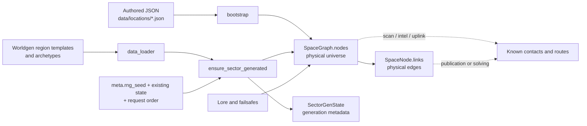

# Physical universe and procedural generation

Status: **canonical documentation of implemented behavior**, reviewed against
commit `3658577`, with the Phase 4C-3 module-filter correction reviewed on top
of `4fd3909` on 2026-11-04.

Spanish version: [world-generation.es.md](world-generation.es.md)

## 1. Purpose and scope

This document explains how RETORNO represents the physical universe,
materializes sectors on demand, and integrates authored locations with
procedural nodes. It covers coordinates, regions, nodes, links, determinism,
configuration, and persisted generation state.

It does not fully document player discovery, route solving, lore placement, or
failsafes. Those systems consume and sometimes extend the universe described
here.

Evidence labels:

- **Implemented:** read directly from code or active data.
- **Covered:** also exercised by a test.
- **Design evidence:** an implementation comment states the purpose.
- **Inference:** consistent with evidence, but not an explicit design decision.
- **Pending:** not guaranteed or awaiting a decision/verification.

## 2. Conceptual model

RETORNO maintains two separate layers:

1. The **materialized physical universe**: existing nodes, coordinates, and
   physical links in `WorldState.space`.
2. **Player knowledge**: contacts, intel, and known routes in `known_contacts`,
   `known_nodes`, `known_intel`, `intel`, and `known_links`.

A node can physically exist without being discovered. A sector can be generated
without its nodes becoming known. A physical edge in `SpaceNode.links` does not
automatically become a known route either.

### Models and responsibilities

| Model | Implemented responsibility |
| --- | --- |
| `SpaceNode` | Identity, kind, coordinates, region, radiation, salvage, physical links, and hub flags. |
| `SpaceGraph.nodes` | Canonical registry of materialized physical nodes by `node_id`. |
| `SpaceGraph.edges` | Currently unused compatibility field; the implementation reads `SpaceNode.links` for topology. |
| `SectorGenState` | Archetype, observed nodes, hubs, and worldgen-created link counters for one sector. |
| `WorldState.generated_sectors` | Sectors whose generation pass has run, including empty sectors. |
| `WorldState.intersector_link_pairs` | Sector pairs whose link opportunity has already been evaluated. |
| `known_*` and `intel` | Player knowledge, separate from the physical graph. |

`is_hub` marks a node usable as a gameplay hub. `is_topology_hub` marks the node
worldgen uses as the sector's topology center. A sector with nodes attempts to
have a topology hub; it need not be a playable hub.

## 3. Coordinates, sectors, and regions

### Operational coordinates

Game positions use light years as `(x_ly, y_ly, z_ly)`. Sectors are logical
cubes of **10 ly per axis** (`SECTOR_SIZE_LY = 10.0`). Their id applies
`floor(coordinate / 10)` on all three axes and formats the result as, for
example, `S+000_+000_+000`.

The canonical format is capital `S` followed by three signed decimal indices
separated by underscores. Each index uses the result of `{value:+04d}`: the
sign is mandatory, the minimum width is four characters including the sign,
and larger values expand without an arbitrary numeric limit. Thus
`S+012_-013_+014` and `S+12345_-12346_+000` are valid, while a missing sign,
noncanonical padding, `-000`, a different prefix, or extra characters are not.

Using `floor` matters for negative positions: `x=-0.1` belongs to sector `-1`,
not sector `0`.

### Physical regions

Operational coordinates are mapped to galactic coordinates with:

- operational-to-physical scale: `1.0`;
- physical operational origin: `(250000, 0, 0)` ly;
- physical galactic center: `(0, 0, 0)`;
- bulge: radius below `10000` ly;
- disk: radius below `400000` ly;
- halo: everything else.

The operational origin is therefore in `disk`. The model also declares a
`500000` ly galactic radius, but **does not prevent generation beyond it**;
`inside_galaxy` is diagnostic output from `galactic_margins_for_op_pos` only.

The generator selects the regional template from the sector center's region. It
then recalculates every node's region from its actual coordinates.

Phase 4D-3e1 adds a separate [read-only preexistence catalog](../design/procedural-preexistence.md).
It never calls sector generation, expands neighborhoods or grants discovery.
Its canonical slot samples are conditional, not verified preexisting locations;
the audit and regression witnesses explain why legacy generation cannot certify
latent existence independently of materialization order.

## 4. When the universe is generated

The public entry point is `ensure_sector_generated(state, sector_id)`.
Generation is lazy and is requested when another subsystem needs an area to
exist.

Current relevant callers include:

- `scan`, to materialize sectors whose indices fall within the search radius's
  axis-aligned bounding box;
- uplink route/pool preparation;
- `SECTOR` intel imports and some procedural-node references;
- exploration-recovery gateway creation;
- worldgen diagnostic commands;
- a bootstrap branch for an initial node other than `UNKNOWN`.

> **Warning:** `debug worldgen sector <sector_id>` is not a read-only
> inspection. `render_debug_worldgen_sector` calls `ensure_sector_generated`
> before rendering its output, so it can materialize the requested sector, its
> 3×3 neighborhood, and their nodes and links. That state becomes part of the
> run's universe.

The current prologue starts at `UNKNOWN`, so that bootstrap branch does not
generate the initial sector. Sandbox mode later switches to `ECHO_7`, but does
not explicitly call the generator during that switch either. Normal first
materialization remains on demand.

A single request does not generate only the requested sector. It creates the
union of its **3×3 XY neighborhood** at the same Z index. A caller such as
`scan` can request several sectors or Z planes, producing a larger union.

Materialization is not revelation: worldgen does not add newly created nodes to
`known_nodes` or `known_contacts`.

## 5. Generation flow

Each requested set follows this flow:

1. Load `data/worldgen/templates/*.json` and
   `data/worldgen/archetypes/*.json` with non-recursive globs.
2. Expand each requested sector to its 3×3 XY ring and sort the ids.
3. Apply the one-time origin-neighborhood guardrail when the set contains the
   sector at `(0,0,0)`.
4. For each sector not already generated:
   1. derive region from its center;
   2. choose an archetype from regional weights;
   3. count authored or special nodes already physically inside it;
   4. choose the target total and remaining kinds;
   5. create nodes, coordinates, radiation, and salvage;
   6. record `SectorGenState` and mark the sector generated.
5. Build an internal star around the topology hub and evaluate optional extra
   internal links.
6. Evaluate links between topology hubs of newly materialized neighboring
   sectors, once per sector pair.

### Origin guardrail

**Design evidence:** generator comments explicitly describe sparse topology and
accept local dead ends. The guardrail tries to avoid a trivial hard stop in the
first neighborhood; it does not promise progress on every branch.

- If the origin archetype is not `relay_corridor`, `isolated_station`, or
  `ruin_field`, it is overridden with `relay_corridor` for that generation.
- If no neighbor has archetype `relay_corridor` or `isolated_station`, one is
  deterministically promoted and forced to create a playable hub.
- `sparse_guardrail_done` persists and prevents rerunning the mechanism.

If a neighbor already has one of those archetypes, the code does not force its
natural hub roll to succeed or guarantee an intersector edge. The guardrail must
not be documented as a formal connectivity guarantee.

## 6. Node selection and distribution

Active regional templates define archetype weights, Z dispersion, and salvage:

| Region | `z_sigma` | Weights `empty / ruin / corridor / isolated / graveyard` | Scrap | Declared modules |
| --- | ---: | --- | --- | --- |
| `bulge` | 0.8 | 30 / 30 / 10 / 10 / 20 | 15–60 | 1–3, `['tech','rare']` |
| `disk` | 0.3 | 25 / 35 / 20 / 15 / 5 | 10–40 | 0–2, `common` |
| `halo` | 2.0 | 50 / 25 / 5 / 5 / 15 | 5–25 | 0–1, `['tech','rare']` |

Active archetypes define density and topology:

| Archetype | Target total | Kinds/restrictions | Playable hub | Intersector links |
| --- | ---: | --- | --- | --- |
| `empty` | 0–1 | `ship` or `derelict`; no station/relay/waystation | 0% | maximum 0 |
| `ruin_field` | 1–3 | station≤1, relay≤1, ship≤2, derelict≤3; no waystation | 20% | maximum 1, p=0.18 |
| `relay_corridor` | 2–3 | relay≤1, waystation≤1, ship≤1, derelict≤2; no station | 90% | maximum 2, p=0.85 |
| `isolated_station` | 1–2 | station≤1, waystation≤1, ship≤1, derelict≤1; no relay | 95% | maximum 1, p=0.45 |
| `graveyard` | 1–3 | relay≤1, ship≤2, derelict≤2; no station/waystation | 4% | maximum 1, p=0.06 |

Extra internal-link probabilities are respectively 0, 0.12, 0.20, 0, and 0.05
in the order above.

Existing nodes count against the target total and caps. Worldgen does not remove
authored nodes when a sector already exceeds those limits; it simply stops
adding slots.

For every procedural slot:

- X and Y are uniform inside the sector;
- Z is a normal distribution centered on the sector's Z center with regional
  `z_sigma`;
- the id uses a kind prefix and 24 pseudo-random bits; `ship` becomes `WRECK_`;
- id collisions use Greek suffixes and, if necessary, a new base;
- salvage and radiation use node-specific derived seeds.

The Z normal distribution is not truncated. An extreme result can physically
place a node outside the requested Z index. Phase 4D-3e1 characterizes this
explicitly, including its effect on another sector's quota; it does not clamp Z.

## 7. Physical links

### Internal links

If a sector contains nodes, its topology hub is selected as:

1. the first playable hub by `node_id`, if one exists;
2. otherwise the first node by `node_id`.

Every other node is linked bidirectionally to that hub. Each non-hub node may
then receive an extra edge according to the archetype. Edges are stored in both
nodes' `SpaceNode.links`.

### Intersector links

Only the eight XY neighbors at the same Z level are considered. A link joins
their topology hubs and requires:

- both sectors and hubs to exist;
- remaining budget on both archetypes;
- a roll using the lower of the two link probabilities;
- distance no greater than `Balance.MAX_ROUTE_HOP_LY`.

The pair is recorded as evaluated before the outcome is known. It is not retried
if a hub appears later.

### Hop cap

`MAX_ROUTE_HOP_LY = 45.0` is the hard cap used by worldgen for internal and
intersector edges. Route publication/solving and travel also use it, although
those uses belong to navigation.

There is no global connectivity guarantee. Valid outcomes include:

- `empty` sectors with zero nodes;
- sectors with no intersector exit;
- disconnected physical components;
- local branches with no continuation.

## 8. Authored and procedural content

`load_locations()` reads only `data/locations/*.json`. Bootstrap processes the
definitions in sorted filename order before worldgen.

Active locations:

- `UNKNOWN`: physical origin and initially known contact;
- `ECHO_7`: authored station/hub at `(0,0,0)`;
- `HARBOR_12`: authored station/hub;
- `ARCHIVE_01`: authored derelict;
- `RETORNO_SHIP`: special ship definition.

`RETORNO_SHIP` is not inserted into `SpaceGraph` as a destination: bootstrap
skips its `node_id`, but installs its files in the ship filesystem.

Authored locations retain explicit coordinates and radiation. Their region is
recomputed through the physical model. Without explicit `is_hub`, station,
relay, and waystation default to hubs; `is_topology_hub` inherits that value
unless explicitly configured.

When their sector is later generated, existing authored nodes:

- count toward archetype totals and caps;
- can become the topology hub;
- participate in internal links.

Duplicate authored ids are not validated: the first definition that created the
id remains and later definitions do not replace it. Procedural ids do check for
collisions against every materialized node.

`data/locations/templates/*.json` is not loaded and does not participate
automatically. Its relationship to active definitions is inventoried in the
[content loading contract](../content-loading.md).

### Special origin handling

The generator has an `_ensure_fixed_origin_hub` fallback that creates `ECHO_7`
when the origin sector is generated and that id does not exist. The active
authored definition normally creates it first, so the fallback usually does
nothing.

## 9. Effective configuration

| Source | Effective responsibility |
| --- | --- |
| `model/world.py` | Sector size, ids, models, and delegated hop cap. |
| `config/balance.py` | Default seed, galactic mapping, 45 ly cap, recoverable drones, and procedural radiation. |
| `data/worldgen/templates/*.json` | Regional weights, `z_sigma`, and salvage profiles. |
| `data/worldgen/archetypes/*.json` | Counts, kinds, caps, hubs, and link budgets/probabilities. |
| `data/modules.json` | Recoverable module catalog and pools. |

Regional JSON `radiation_base` values are not read. Effective radiation uses
`PROCEDURAL_RAD_BASE`, `PROCEDURAL_RAD_REGION_MULT`, kind multiplier, variation,
and spikes from `Balance`. Its configuration contract remains pending.

### Regional module categories (F-WGEN-01 fixed in 4C-3)

Previously, `_pick_modules` treated `['tech','rare']` as literal module ids.
Neither exists, so bulge lost its guaranteed 1–3 modules and halo lost nonzero
module rolls. Categories now filter the real catalog's `pool` field:

| Effective `pool` | Loaded module ids, in catalog order |
| --- | --- |
| `common` | `bus_stabilizer`, `aux_battery_cell`, `utility_cargo_frame`, `reinforced_frame` |
| `tech` | `micro_reactor_patch`, `selftest_rig`, `field_service_rig`, `high_density_cell` |
| `rare` | `transit_sensor_pack`, `rapid_maneuver_module` |

`load_modules()` normalizes scope and drone metadata; all ten definitions
already declare their categories. No rarity inference or data edits are needed.
Both ship and drone modules participate in regional salvage.

The procedural selector accepts a category string or a list of categories.
`common` retains its candidates and exact RNG behavior; `['tech','rare']` selects
from those six modules. Candidates follow `module_ids` (catalog order in worldgen),
regardless of category order or duplicates. Counts still use one `randint`, then
uniform choices with replacement. Disk retains 0–2, bulge 1–3, and halo 0–1
modules per applicable salvage node.

Empty or entirely unknown filters yield no modules without a whole-catalog
fallback. Mixed lists match only their known categories. `None` retains the
internal unfiltered default. Only real catalog ids can be returned. No JSON or
test establishes an explicit-id-list contract, so procedural lists are categories
only. An unknown filter can yield fewer modules than its minimum; all active
regional filters have sufficient candidates.

Authored salvage stays in `_bootstrap_locations` (`bootstrap.py`), with a shared
bootstrap RNG and per-location profiles. Active authored profiles use `common`
or `tech`; inactive location templates also use `rare` and `all`. Although
bootstrap contains an id-list branch, no active/inactive JSON or test uses it.
This correction changes only the procedural picker and preserves authored loot.

## 10. Determinism

Worldgen derives local RNGs with BLAKE2b from `state.meta.rng_seed` and keys such
as sector, archetype, slot, node, or sector pair. The same seed, prior state, and
request sequence reproduce the same result. Tests cover this partially.

`WorldState.rng_seed` is not the generator's source; the effective source is
`MetaState.rng_seed`.

Determinism is **not action-order independent**:

- intersector budgets are consumed as pairs are evaluated;
- each pair is evaluated once;
- the guardrail runs for the first cluster containing the origin;
- existing ids and authored nodes affect slots and collisions.

The 4D-3e1 [characterization regression](../../tests/worldgen_preexistence_characterization_smoke.py)
now fixes concrete witnesses, not a new intended policy: seed `2`, requests
`(20,20,0)`, `(22,20,0)`, `(20,22,0)` versus reverse, gives identical nodes but
two different undirected edges. Seed `29`, `(1,0,0)` then `(-1,0,0)` versus
reverse, changes a shared sector's archetype and nodes through the initial
guardrail. Seed `271828` at `(15126,0,0)` has an outlier above Z=10 which changes
the later `(15126,0,1)` quota; reversing generation produces different nodes.
The [catalog design](../design/procedural-preexistence.md) documents stable
sample addresses separately from conditional existence and final allocated ids.

Authored salvage uses one RNG across sorted location files, so adding an active
definition can shift later rolls. Procedural salvage uses per-node seeds and is
more locally stable.

Changing the seed after sectors are materialized does not regenerate them, so a
world can contain sectors produced under different seeds.

## 11. Confirmed invariants and restrictions

- A sector in `generated_sectors` does not run generation again.
- One simple request expands a 3×3 XY ring at the same Z.
- Generation does not reveal contacts or routes. **Covered.**
- Worldgen-created edges are bidirectional and no longer than 45 ly.
  **Covered.**
- A sector with nodes receives a topology hub during internal-link building.
- A topology hub is not necessarily a playable hub.
- `empty` can create zero nodes and never creates intersector edges.
- The guardrail is consumed once and does not guarantee global connectivity.
- Definitions under `data/locations/templates/` do not participate.
- `SectorGenState` counters describe worldgen work; nodes or edges from other
  subsystems do not always increment them.

## 12. Edge cases and failure conditions

- Since Phase 4C-2b, `_parse_sector_id` rejects noncanonical ids with
  `ValueError`, and `ensure_sector_generated` validates before any world
  mutation. `SECTOR:` imports turn that error into localized feedback and do
  not register sector intel; other valid lines in the same file still run.
- An empty sector is marked generated and `internal_links_built`; nodes added
  later do not automatically rebuild its internal topology.
- `intersector_link_pairs` prevents retrying a failed pair after physical state
  changes.
- Gaussian Z placement can put a node outside the requested sector.
- No effective boundary prevents worldgen outside the physical galaxy radius.
- Missing/incomplete JSON has partial fallbacks; invalid salvage ranges or
  non-convertible values can raise exceptions.
- Authored nodes can make a sector exceed archetype maxima; those maxima govern
  additional creation, not total validation.
- `SpaceGraph.edges` can mislead new consumers: active topology lives in
  `SpaceNode.links`.

## 13. Interactions with other subsystems

- **Exploration:** scan requests generation and then decides which nodes become
  known; existence and visibility stay separate.
- **Navigation:** consumes physical nodes, publishes `known_links`, and applies
  the same 45 ly cap, but known routes are not the physical graph.
- **Lore/uplink:** materializes the current sector while preparing pools and
  candidates.
- **Failsafes:** recovery, forced lore, and deadnodes can create physical nodes
  after worldgen. `register_hidden_anchored_node` adds an anchored physical edge
  at ≤45 ly and syncs metadata only when the sector already has state. Recovery
  gateways may also request worldgen.
- **Travel abort:** creates a temporary nav point and known links to both ends,
  not a normal physical worldgen edge.
- **Persistence:** `generated_sectors`, `sector_states`, evaluated pairs, hub
  flags, and the guardrail are saved.

## 14. Tests and verification status

The production code was originally reviewed at commit `3658577`; the original
tests were run later, after updating `worldgen_sparse_archetypes_smoke.py`, on
the Phase 3A.1 working tree. Phase 4C-2b later added the strict sector-id
regression and reran the relevant tests. Phase 4C-3 added the module-pool
regression and reran the relevant smokes on 2026-11-04:

| Test | Result | Relevant coverage |
| --- | --- | --- |
| `galaxy_physical_model_smoke.py` | PASSED | Physical mapping, disk origin, and margins. |
| `procedural_radiation_smoke.py` | PASSED | Determinism, regional ordering, and authored radiation preservation. |
| `route_hop_cap_smoke.py` | PASSED | Travel cap and worldgen edge cap. |
| `debug_worldgen_graph_smoke.py` | PASSED | Sector and physical-graph diagnostics. |
| `debug_galaxy_smoke.py` | PASSED | Galaxy diagnostics and map. |
| `save_load_smoke.py` | PASSED | Persistence of `SectorGenState`, guardrail, and hub flags. |
| `scan_job_smoke.py` | PASSED | Scan, indirect materialization, and discovery. |
| `worldgen_sparse_archetypes_smoke.py` | PASSED | Active catalog and caps, allowed/forbidden kinds, per-archetype counts, internal links to the topology hub, sparse distribution, same-order determinism, guardrail, and no neighbor revelation. |
| `sector_intel_validation_smoke.py` | PASSED | Canonical minimum/wide signed ids, existing/lazy sectors, rejection without serializable-state mutation, sector-only `[INTEL]` blocks without corrupt recovery/RNG use, localized public feedback, and continued processing of other valid lines. |
| `worldgen_modules_pool_smoke.py` | PASSED | Real loader, category unions, common RNG compatibility, ranges/zeros, empty/unknown filters, valid ids, regional clusters, same-sequence determinism, authored/unrelated-state preservation, temporary save/load, and normal drone recovery/depletion. |

The module regression uses seeds `1` and `2` with the request sequence
`S+020_+000_+000` → `S-25000_+000_+000` → `S+16000_+000_+000` →
`S+000_+000_+000`. The first three centers map to galactic X coordinates
250205, 5, and 410005 ly, including the operational origin's 250000 ly offset.
Target-sector counts, in sorted node-id order, are:

| Seed | Disk (`relay_corridor`) | Bulge (`ruin_field`) | Halo (`empty`) |
| --- | --- | --- | --- |
| `1` | 0, 2, 2 | 1, 2 | 0 |
| `2` | 0, 1 | 2, 3 | 1 |

Before correction, category-union selection failed with `(0, ['tech','rare'], [])`;
real integration independently failed with bulge counts `[0,0]` for seed `1`.
Both now pass. The regression covers all generated nodes, including Gaussian Z
outliers outside recorded sector metadata. Sandbox seed `2` deploys D1 normally
to procedural `DERELICT_36B4F8`: the first module job misses and the second
recovers `transit_sensor_pack` at the configured find probability. Temporary
save/load preserves remaining modules and cargo without replenishing loot on
repeated generation requests.

Verification gaps:

- generation-order dependence and Z outflow now have 4D-3e1 regression witnesses;
  changing those behaviors still needs an approved worldgen design;
- authored duplicates and already-over-cap sectors are untested;
- there is no physical galaxy-boundary test;
- regional `radiation_base` configuration semantics remain unresolved;
- topology rebuilding after special-node insertion into generated/empty sectors
  is untested;
- there is no automated check that the canonical table in this document tracks
  future intentional JSON changes; any rule change must update data, test, and
  documentation together.

## 15. Implementation references

- [`src/retorno/model/world.py`](../../src/retorno/model/world.py): nodes, world
  state, sectors, ids, distances, and known routes.
- [`src/retorno/model/galaxy.py`](../../src/retorno/model/galaxy.py): physical
  mapping, regions, and galactic margins.
- [`src/retorno/worldgen/generator.py`](../../src/retorno/worldgen/generator.py):
  procedural pipeline and topology.
- [`src/retorno/runtime/data_loader.py`](../../src/retorno/runtime/data_loader.py):
  loading contract for locations and worldgen configuration.
- [`src/retorno/bootstrap.py`](../../src/retorno/bootstrap.py): authored-location
  integration and initial state.
- [`src/retorno/core/engine.py`](../../src/retorno/core/engine.py): scan and
  temporary transit nodes.
- [`src/retorno/core/lore.py`](../../src/retorno/core/lore.py),
  [`exploration_recovery.py`](../../src/retorno/core/exploration_recovery.py), and
  [`deadnodes.py`](../../src/retorno/core/deadnodes.py): later special-node
  creation.
- [`src/retorno/config/balance.py`](../../src/retorno/config/balance.py): physical
  and balance constants.
- [`data/worldgen/`](../../data/worldgen): active templates and archetypes.
- [`data/locations/`](../../data/locations): active authored locations and
  excluded templates.
