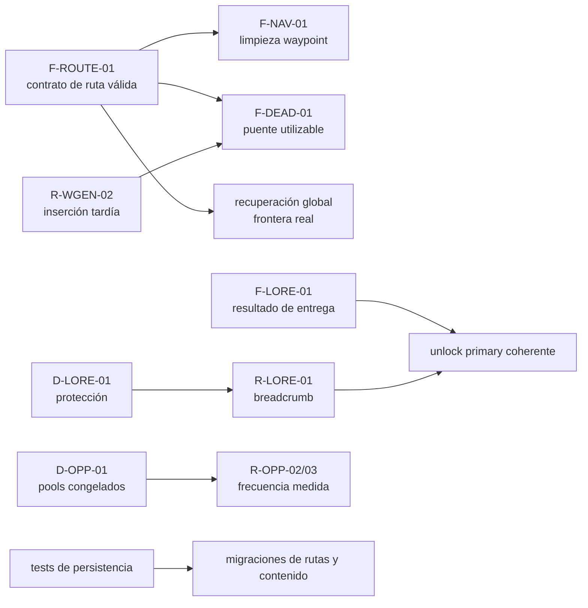

# Auditoría transversal y plan de estabilización

Versión inglesa: [stabilization-audit.md](stabilization-audit.md)

Esta auditoría se realizó sobre el árbol limpio en `320d06c` el 2026-11-02.
Consolida las referencias canónicas sin sustituirlas y no modifica mecánicas,
tests, balance ni contenido.

> **Actualización de Fases 4A/4B:** el desarrollador resolvió posteriormente parte
> de las decisiones que aquí figuran abiertas. El
> [contrato de navegación y recuperación](../design/navigation-recovery-contract.es.md)
> prevalece para validez de rutas, cadenas deadnode, nodos visitados, recepción
> diferida, protección narrativa y política de partidas. Las matrices de esta
> auditoría se conservan como diagnóstico del comportamiento observado.

## 0. Cierre de Fase 4B y actualizaciones hasta 4D-2

Las decisiones abiertas de esta auditoría se cierran o reasignan así:

- la prealfa no requiere migraciones entre versiones; sí exige integridad y
  save/load de la versión vigente, rechazo explícito de incompatibles y ninguna
  eliminación automática de partidas;
- `comms`/`radiod` serán la dependencia de recepción para señal y broadcast;
  uplink conserva `data_core`/`datad` y salvage no usa radio;
- los failsafes garantizan oportunidades coherentes, no supervivencia, recursos
  gratuitos ni reparación universal;
- las categorías `modules_pool` son filtros para módulos reales; sus metadatos
  quedaron auditados y F-WGEN-01 corregido en 4C-3;
- singles, pools uplink, `radiation_base`, orden de worldgen y balance general
  siguen en estudios independientes.

La matriz ejecutiva vigente, con criterios completos en el contrato, es:

| ID | Prioridad | Prueba previa | Fase |
| --- | --- | --- | --- |
| F-LORE-01 — `uplink_only` sin efecto | **Corregido** | `uplink_only_delivery_retry_smoke.py` | **4C-1 completada** |
| F-SENS-01 — factor `UPGRADED` | **Corregido** | `sensor_detection_factor_smoke.py` | **4C-2a completada** |
| F-WGEN-02 — `SECTOR` malformado | **Corregido** | `sector_intel_validation_smoke.py` | **4C-2b completada** |
| F-INTEL-01 — `intel N` antiguo | **Corregido** | `intel_recent_order_smoke.py` | **4C-2c completada** |
| F-DEAD-02 — cooldown en `t=0` | **Corregido** | `deadnode_cooldown_zero_smoke.py` | **4C-2d completada** |
| F-WGEN-01 — filtros `modules_pool` | **Corregido** | `worldgen_modules_pool_smoke.py` | **4C-3 completada** |
| F-ROUTE-01 — integridad de rutas conocidas | **Corregido** | `known_routes_integrity_smoke.py` | **4D-1 completada** |
| F-NAV-01 — waypoint detenido y limpieza | **Corregido** | `nav_abort_waypoint_cleanup_smoke.py`: scan, solve/viaje C/A/B, abortos repetidos, referencias/jobs, cinco fases save/load | **4D-2 completada** |

El orden anterior sustituye las prioridades históricas de las secciones 4, 7 y
8 cuando entren en conflicto. F-LORE-01 quedó corregido posteriormente en 4C-1,
F-SENS-01 en 4C-2a, F-WGEN-02 en 4C-2b, F-INTEL-01 en 4C-2c y F-DEAD-02 en
4C-2d, y F-WGEN-01 en 4C-3; el texto histórico de las matrices describe la evidencia previa cuando
se identifica expresamente.

### Cierre de Fase 4C-3: F-WGEN-01 (2026-11-04)

La auditoría previa confirmó diez módulos reales con metadatos `pool` explícitos:
cuatro `common`, cuatro `tech` y dos `rare`. La
[referencia de worldgen](../systems/world-generation.es.md#categorías-regionales-de-módulos-f-wgen-01-corregido-en-4c-3)
registra sus ids y la distinción authored/procedural. Ningún JSON ni test usa
listas de ids explícitos. Las listas regionales ahora filtran categorías del
catálogo; los filtros vacíos/desconocidos no seleccionan silenciosamente todo
el catálogo. Se conservan conteos, orden de candidatos, política de repetición
y llamadas RNG de conteo/selección.

`tests/worldgen_modules_pool_smoke.py` se añadió antes de cambiar producción:
la selección compuesta falló con `(0, ['tech','rare'], [])` y la integración real
independiente con conteos bulge `[0,0]` para seed `1`. Ahora pasa con seeds `1`
y `2`, clusters reales disk/bulge/halo, ceros legítimos disk/halo, pertenencia a
categorías e ids válidos, determinismo con igual secuencia, preservación authored
y del estado ajeno, y save/load temporal. Los trabajos normales de despliegue y
salvage de módulo recuperan `transit_sensor_pack` del procedural
`DERELICT_36B4F8` con seed `2` al segundo intento; depleción y cargo persisten.
La referencia de worldgen registra sectores, orden y conteos. Una captura temporal
de `WorldState` anterior a corregir coincidió además en todos los campos
posteriores salvo las listas de módulos procedurales bulge/halo para ambas seeds
(17 y 19 nodos modificados respectivamente).

Pasaron los once smokes requeridos, más `drone_modular_v1_smoke.py`,
`debug_worldgen_graph_smoke.py` y `scan_job_smoke.py` (14/14). F-WGEN-01 e IT-10
quedan cubiertos; `radiation_base`, independencia del orden de generación y
estudios de balance siguen pendientes. La fila de riesgo F-WGEN-01 inferior
conserva el diagnóstico histórico anterior a corregir; la matriz ejecutiva
superior muestra su estado vigente.

### Cierre de Fase 4D-1: F-ROUTE-01

Estado inicial limpio: `main` y `origin/main` en `45f2900`, cierre publicado de
4C-3, sin staging. El inventario de productores/consumidores está en la
[referencia canónica de navegación](../systems/discovery-navigation-intel.es.md#rutas-operativas-y-pistas-históricas-4d-1).
La causa combinaba `is_hop_within_cap` aceptando distancia ausente, publicación
sin validación y recorridos crudos de `known_links`.

Antes de cambiar producción, `known_routes_integrity_smoke.py` (seed `271828`)
dejó nueve grupos en rojo; el caso de solve/viaje válido ya pasó:

| Grupo de aserciones | Fallo reproducido antes de corregir |
| --- | --- |
| `_assert_hops_and_publication` | Un extremo ausente pasaba el criterio de salto. |
| `_assert_import_history_and_locales` | Se publicaba `A -> MISSING`. |
| `_assert_components_and_views` | La arista inválida contaminaba el componente alcanzable. |
| `_assert_recovery_frontier` | Aparecía una frontera fantasma. |
| `_assert_deadnode_candidates` | La ruta inválida excluía un candidato deadnode. |
| `_assert_lazy_sector` | La parte válida SECTOR/LINK pasaba; un literal prefijado no resuelto quedaba operativo. |
| `_assert_job_endpoint_disappears` | El trabajo completado publicaba un extremo desaparecido. |
| `_assert_waypoint_is_inert_after_removal` | El waypoint eliminado seguía operativo. |
| `_assert_persistence` | La arista inválida cargada seguía operativa. |

Tras corregir pasan los diez grupos: saltos válidos e inclusivos a 45 ly,
rechazo dangling/sobre cap, sentido inverso y dirigido, componentes mixtos,
contactos/historial/export EN/ES, sectores lazy, recuperación global real,
candidatos deadnode sin crear puentes, viaje/jobs, waypoint inerte y save/load
repetido. La proyección compartida es idempotente y de sólo lectura: no requiere
poda destructiva al cargar ni cambia formato, historial o referencias pendientes.
Los incompatibles se rechazan sin borrar ni modificar el archivo.

La fixture de cap ahora inyecta expresamente una arista obsoleta porque el
publicador ya la rechaza. Las dos fixtures de compleción CLI/Textual ahora usan
un nodo físico sintético dentro del cap, en lugar de depender de `CURL_12`
ausente. No se activó contenido authored inactivo. El diagnóstico histórico
F-ROUTE-01 inferior se conserva; su cierre está en la matriz vigente superior.
Al cerrar 4D-1, F-NAV-01 y F-DEAD-01 seguían pendientes. Operatividad/limpieza
de waypoint se completaron después en 4D-2; puentes, umbrales, cooldowns y
topología siguen fuera de esa fase. Las regresiones 4C permanecen verdes.

Validación final de 4D-1: 31/31 smokes pasan, incluidas las regresiones 4C,
rutas, recuperación, deadnodes, worldgen lazy, persistencia y compleción
CLI/Textual. Compilación Python, enlaces locales y paridad técnica EN/ES
verificados; Ruff no está instalado y no se añadieron dependencias.

## 1. Resumen ejecutivo

La integración usa tres capas legítimamente distintas —universo físico,
conocimiento y rutas publicadas—, pero varios consumidores no aplican el mismo
criterio de validez. Los problemas de mayor prioridad son:

1. F-ROUTE-01 quedó corregido en 4D-1: los registros inválidos de `known_links`
   ya no son rutas/fronteras operativas. Operatividad de waypoint y limpieza
   de referencias vivas F-NAV-01 se completaron después en 4D-2.
2. Deadnodes coloca el puente cerca del objetivo, no de un origen alcanzable, y
   publica una pista desde el nodo actual sin validar 45 ly. En la sonda, el
   puente quedó a 99,38 ly, sin enlaces físicos ni pool, y la importación rechazó
   la ruta.
3. F-LORE-01 reproducía que una pieza `uplink_only` inválida o sobre cap se
   marcaba `delivered` sin ruta, evento, archivo ni unlock. 4C-1 ya exige un
   efecto válido y conserva pendientes reintentables.

F-SENS-01 quedó corregido posteriormente en 4C-2a: los sensores `UPGRADED` usan
ahora el factor nominal y cualquier bonificación mayor queda para estudio de
balance. F-WGEN-02 quedó corregido después en 4C-2b: los ids de sector
malformados se rechazan sin mutar mundo ni intel. F-INTEL-01 quedó corregido en
4C-2c: todos los listados muestran primero los registros más recientes y
desempatan de forma determinista por inserción. F-DEAD-02 quedó corregido en
4C-2d: una acción en `t = 0` inicia el mismo cooldown de cinco años que un
timestamp positivo y sigue aplicándose tras save/load. F-WGEN-01 quedó corregido
en 4C-3: bulge/halo ya recuperan módulos reales filtrados por sus categorías
`modules_pool`, respetando los conteos regionales.

No se clasifican como bugs dos políticas sin decisión: `route solve` hacia un
nodo físico no descubierto dentro de sensores/cap es deliberado; y los pools de
uplink congelados tienen cobertura y contrato actual, aunque su efecto sobre
oportunidades posteriores debe medirse. Tampoco hay evidencia de partida para
cambiar la probabilidad de singles.

## 2. Matriz de riesgos

Severidad: **alta** puede bloquear progresión o consumir contenido irrepetible;
**media** degrada una mecánica relevante con alternativa parcial; **baja** afecta
presentación o estados límite. “Frecuencia desconocida” significa que no hay
telemetría ni muestra de partidas, no que el caso sea improbable.

### 2.1 Defectos funcionales verificables

| ID | Problema | Subsistemas | Evidencia | Precondiciones | Consecuencia para el jugador | Severidad | Frecuencia | Recuperación actual | Pruebas existentes | Pruebas necesarias | Decisión pendiente | Orden |
| --- | --- | --- | --- | --- | --- | --- | --- | --- | --- | --- | --- | --- |
| F-ROUTE-01 | Rutas conocidas inexistentes o sobre-cap cuentan como frontera/ruta para recuperación y deadnodes, pero viaje las rechaza. | Intel, `WorldState`, viaje, recuperación, deadnodes, save | Implementación + sonda en memoria | Importar `LINK` con extremo inexistente, cargar estado obsoleto o conservar arista inválida | Frontera fantasma; no se activa rescate y el destino no entra en deadnodes | Alta | Desconocida; el import dangling está disponible al jugador | No hay comando de limpieza; otras rutas independientes pueden seguir funcionando | `route_hop_cap_smoke` sólo cubre rechazo de viaje | Import dangling/sobre-cap → frontera → deadnodes → viaje, antes/después de sanear | Política de rechazo/migración para saves | 1 |
| F-NAV-01 — diagnóstico histórico; corregido en 4D-2 | `_clear_tmp_node` eliminaba el waypoint y su entrada, pero dejaba referencias inversas en los extremos. | Viaje abortado, rutas, recuperación, persistencia | Implementación + sonda + regresión 4D-2 | `nav abort` y posterior salida del waypoint | Antigua ruta fantasma de juego normal | Alta antes de corregir | Desconocida | Limpieza dirigida implementada | `nav_abort_waypoint_cleanup_smoke.py` | Cubierto: exploración normal en T, viajes C/A/B, referencias/jobs vivos, abortos repetidos, historial y save/load | Sin migración ni saneado global | Cerrado |
| F-DEAD-01 | El puente deadnode se crea junto al objetivo y la pista parte del nodo actual sin validar cap; además no tiene enlace físico ni pool. | Deadnodes, intel, navegación, worldgen, pools | Implementación + sonda: 99,38 ly y ruta descartada | Objetivo inaccesible lejano alcanza umbral `dead` | Dos intentos indirectos pueden ser inutilizables; el directo puede seguir sobre-cap | Alta | Desconocida | Repetición cada 5 años y pista directa, sin garantía de utilidad | No hay test dedicado | Origen alcanzable → umbral → puente bajo cap → import → viaje; casos lejano, sector generado/no generado | Contrato del puente: origen, topología, pool y persistencia | 2 |
| F-LORE-01 — corregido 4C-1 | `uplink_only` se marcaba entregado aunque el LINK fuera inválido/sobre-cap y no hubiera efecto. | Scheduler, primaries, intel, persistencia | Implementación + regresión sintética | Pieza asignada a `uplink_only` con línea no parseable o salto inválido | Contenido irrepetible consumido y primary no desbloqueado | Alta antes de corregir | Cero con los datos activos actuales | Fallos conservan asignación/pendiente; reintento público no repite el pool | `uplink_only_delivery_retry_smoke.py` | Cubierto: malformed, ausente, sobre-cap, nuevo/preexistente, retry y save/load | Implementado | Cerrado |
| F-SENS-01 — corregido 4C-2a | `UPGRADED` superaba el gate pero faltaba en el mapa de detección y caía a `CRITICAL` (0,35). | Scan, sistemas, balance | Implementación + regresión determinista | Sensores en estado `UPGRADED` | Una mejora detectaba menos que nominal | Media antes de corregir | Desconocida | Factor nominal; excepción de entrada de recuperación intacta | `sensor_detection_factor_smoke.py` | Cubierto: factores, umbrales, límites, gates y excepción de recuperación | Nominal 1.00 implementado; una bonificación mayor sigue en balance | Cerrado |
| F-WGEN-01 | Lista `modules_pool: ["tech", "rare"]` se interpreta como ids; no existen esos ids y la selección queda vacía. | Templates, módulos, worldgen, salvage | Datos activos + implementación + sonda | Nodo salvage en bulge; en halo cuando el conteo sorteado es 1 | Pérdida sistemática de módulos configurados, segura en bulge (`min=1`) | Media | En cada perfil bulge aplicable; halo depende del sorteo | No existe recuperación del loot omitido | Worldgen no afirma pools de módulos | Semillas por región: conteos y pertenencia a categorías | Categorías como filtros aprobadas; falta mapear metadatos reales | 4 |
| F-WGEN-02 — corregido 4C-2b | `_parse_sector_id` convertía ids malformados a `(0,0,0)`; `SECTOR:` podía materializar el origen y registrar el id inválido. Los bloques `[INTEL]` sólo de sector entraban además primero en recuperación corrupta. | Intel, worldgen, estado sectorial | Implementación + sonda + regresión pública | Importar `SECTOR: <malformado>` directamente o dentro de un bloque sólo de sector | Mutación inesperada del origen, intel incoherente o efectos ajenos de RNG/recuperación | Media antes de corregir | Desconocida | La validación canónica precede a generación; los bloques explícitos sólo de sector omiten recovery corrupta; la entrada pública inválida recibe feedback localizado sin mutación | `sector_intel_validation_smoke.py` | Cubierto: ids canónicos existentes/lazy/amplios, formatos inválidos, estado serializable, bloques sólo de sector vía import/cat, EN/ES, RNG y continuación de líneas válidas | Componentes canónicos `{value:+04d}` y dispatch acotado de bloques implementados | Cerrado |
| F-INTEL-01 — corregido 4C-2c | `intel N` ordenaba ascendente y cortaba al inicio pese a anunciar “latest”. | CLI/Textual, historial intel | Implementación + regresión pública determinista | Más de N registros o timestamps iguales | Ocultaba los registros recientes solicitados o dejaba el desempate sin contrato | Baja antes de corregir | Frecuente cuando el historial supera el límite | Vista temporal reciente primero; show/export sin cambios | `intel_recent_order_smoke.py` | Cubierto: historiales vacío/único/de 25 items, límites 1/2/amplio/all/default, empates, EN/ES, Textual, show/export y ausencia de mutación | `(timestamp, índice_de_inserción)` descendente implementado | Cerrado |
| F-DEAD-02 — corregido 4C-2d | El cooldown sólo se aplicaba si `last_action_t > 0`; las acciones en `t=0` podían repetirse inmediatamente. | Deadnodes, reloj, persistencia | Implementación + regresión focalizada determinista | Umbral alcanzado en `t=0` por fixture/debug/estado migrado | Podían emitirse varias pistas sin esperar | Baja antes de corregir | Muy baja/desconocida en juego normal | `attempts > 0` distingue una acción previa y cero sigue siendo timestamp válido | `deadnode_cooldown_zero_smoke.py` | Cubierto: primera acción, evaluaciones inmediata/anterior al límite/en el límite, tiempo positivo, candidatos nuevos/independientes, efectos observables y save/load | Se reutiliza el contador persistente existente; sin cambio de esquema ni balance | Cerrado |

### 2.2 Riesgos potenciales que necesitan reproducirse o medirse

| ID | Problema | Subsistemas | Evidencia | Precondiciones | Consecuencia para el jugador | Severidad | Frecuencia | Recuperación actual | Pruebas existentes | Pruebas necesarias | Decisión pendiente | Orden |
| --- | --- | --- | --- | --- | --- | --- | --- | --- | --- | --- | --- | --- |
| R-LORE-01 | Un nodo ad hoc puede recibir una pieza forzada sin breadcrumb en ningún pool conocido. | Scheduler, pools, ad hoc, deadnodes | Flujo confirmado + sonda; bloqueo permanente no demostrado | Todos los pools conocidos están limpios/ausentes | Receptor oculto y pieza asignada sin vía inicial | Alta | Cero con arcos activos actuales; desconocida al activar force | Scan si está cerca; deadnodes tras décadas/uplinks | Fixture histórica falla antes de validar el flujo | Caso con host válido y caso sin host; comprobar descubrimiento/entrega | ¿Debe fallar la asignación, reservar deuda o crear canal alternativo? | 3 |
| R-LORE-02 | Deadnodes o gateway global pueden revelar/reutilizar un receptor procedural protegido. | Lore, locks, failsafes, scan | Implementación; no hay arco activo ni reproducción E2E | Primary/ad hoc oculto coincide con candidato de rescate | Bypass de ritmo narrativo o unlock fuera de secuencia | Alta | Cero hoy; desconocida con arcos | El contenido puede seguir entregándose, pero ya revelado | Ninguna | Arco sintético protegido frente a scan, deadnodes, gateway e intel corrupta | Alcance real del lock; scan deliberado o no | 3 |
| R-OPP-01 | El pool uplink congelado omite nodos materializados o desbloqueados después. | Pools, worldgen lazy, uplink | Implementación + `uplink_once_per_node_smoke` | Inicializar pool antes de expandir universo | Menos rutas/oportunidades que las disponibles posteriormente | Media | Desconocida | Scan, imports, otros hubs y recuperación global | Cubre congelación y consumo, no impacto de progreso | Pool inicial → expansión → uplink → alternativas restantes | Mantener snapshot, refrescar o versionar | 5 |
| R-OPP-02 | Un contacto puede descubrirse y visitarse antes del siguiente ciclo anual; su ventana se cierra sin haber sido candidato. | Scheduler, reloj, pools, navegación | Implementación | Descubrimiento/visita entre ciclos; pieza elegible para ese pool | Pérdida de oportunidad narrativa sin error visible | Media | Desconocida | Otros pools/ciclos para piezas no asignadas | Stress con intervalo 0 no representa balance real | Simulación multi-seed con calendario/visitas controladas | Política de reserva, deuda o cierre | 5 |
| R-OPP-03 | La frecuencia real de los cinco singles activos no está medida. | Balance, scheduler, contenido, estilo de juego | Probabilidad teórica por pieza/ciclo; sin datos de partidas | Elegibilidad, pools abiertos y calendario anual | Contenido excesivamente raro o concentrado; no demostrado | Media | Desconocida | Ciclos futuros mientras existan candidatos | Compatibilidad sólo con probabilidad forzada a 1 | Simulación de cohortes y trazas de partidas antes de tocar balance | Umbral de frecuencia aceptable | 5 |
| R-WGEN-01 | El mismo conjunto de sectores puede producir distinta arista intersectorial según orden de solicitudes. | Worldgen, determinismo, save | Diagnóstico previo con seed 2 | Solicitudes en orden distinto | Reproducibilidad parcial; mapas divergentes | Media | Confirmada para una seed, prevalencia desconocida | Ninguna; el mundo persistido conserva su versión | Determinismo sólo para misma secuencia | Regresión A→B→C frente a C→B→A con contrato explícito | ¿Determinismo incluye independencia de orden? | 5 |
| R-WGEN-02 | Nodos añadidos tras `internal_links_built` no reconstruyen topología; puentes ni siquiera añaden enlace manual. | Worldgen, ad hoc, deadnodes | Implementación; impacto general sin matriz | Inserción tardía en sector generado/vacío | Nodo físico huérfano o metadatos incoherentes | Media | Desconocida | Ad hoc anclado aporta enlace manual; bridge no | Sin cobertura de inserción tardía | Sector vacío/cerrado + cada tipo de inserción | Política de mutación topológica posterior | 2 |
| R-SAVE-01 | Estados de recuperación persisten, pero cambios/eliminación de definiciones de lore pueden dejar asignaciones sin pieza; no hay prueba versionada específica. | Save/load, scheduler, failsafes | Código + sondas temporales; deriva de contenido es hipótesis | Guardar antes/después de rescate o cambiar contenido entre versiones | Duplicados, push pendiente o entrega imposible tras actualización | Media | Desconocida | Compatibilidad parcial por `__setstate__`; no migra ids de contenido | `save_load_smoke` general | Save/load específico global, deadnode, ad hoc y single; fixture de definición ausente | Política de migración/versionado de contenido | 6 |

### 2.3 Decisiones de diseño abiertas

| ID | Problema | Subsistemas | Evidencia | Precondiciones | Consecuencia para el jugador | Severidad | Frecuencia | Recuperación actual | Pruebas existentes | Pruebas necesarias | Decisión pendiente | Orden |
| --- | --- | --- | --- | --- | --- | --- | --- | --- | --- | --- | --- | --- |
| D-NAV-01 | `route solve` permite un nodo físico no descubierto dentro de sensores y cap. | Navegación, descubrimiento | Decisión confirmada por el desarrollador | Conocer/escribir el id exacto | Permite navegación por conocimiento externo | No es defecto | Deliberada | N/A | Cobertura indirecta | Caracterización explícita para no regresarlo | Revisar conveniencia sólo más adelante | Conservar |
| D-OPP-01 | Snapshot y consumo único de pools uplink. | Pools, uplink, worldgen | Contrato implementado y testado | Expansión posterior | Oportunidad limitada por orden temporal | Abierta | Desconocida | Otros canales/failsafes | `uplink_once_per_node_smoke` | Medición R-OPP-01 antes de cambio | Confirmar snapshot estricto o refresco controlado | 5 |
| D-DEAD-01 | Umbrales `stuck` no actúan; sólo `dead`; “uplink útil” es contador condicional. | Deadnodes, lore, debug | Implementación | Contacto candidato persistente | Diagnóstico y expectativa temporal ambiguos | Abierta | Cada deadnode | Acción al umbral `dead` | Sólo sonda temporal | Caracterización de ambas escalas y contadores | Implementar fase stuck, renombrar o retirar | 2 |
| D-LORE-01 | El lock de primary no es barrera global. | Lore, scan, failsafes, intel | Implementación; sin contenido activo | Activar arcos con target protegido | Ritmo narrativo variable por canal | Abierta | Cero hoy | Unlock posterior aún posible | Ninguna E2E | Matriz de canales de revelación | Qué bypasses son deliberados | 3 |
| D-REC-01 | El llamado `dock_hint` se entrega en llegada, sin dock. | Recuperación, motor, nomenclatura | Implementación + test que no distingue llegada/dock | Llegar a entrada global | Acceso al gateway antes de dock | Abierta | Cada cadena global usada | Pista salvage alternativa | Recovery smoke sólo observa después | Aserción justo tras llegada y después de dock | Confirmar llegada o exigir dock; alinear nombre/test | 2 |
| D-WGEN-01 | `radiation_base` regional de JSON está inactivo; manda `Balance`. | Worldgen, balance, datos | Implementación y datos | Generación procedural | Configuración aparente sin efecto | Abierta | Todo worldgen | Radiación efectiva sí existe por Balance | `procedural_radiation_smoke` cubre modelo efectivo | Contrato de precedencia y validación de campo muerto | Eliminar campo o integrarlo | 4 |
| D-WGEN-02 | El alcance de determinismo frente al orden no está definido. | Worldgen, QA, saves | R-WGEN-01 | Orden distinto | Dificulta reproducir/reportar mundos | Abierta | Desconocida | Seed + secuencia exacta reproducen | Parcial | Prueba dual condicionada al contrato | Aceptar dependencia o estabilizar pares | 5 |
| D-LORE-02 | No hay objetivo de frecuencia para singles; 0,05 × peso por ciclo es sólo tasa teórica condicionada. | Balance, narrativa, scheduler | Configuración; sin telemetría | Juego normal con elegibilidad variable | No se puede juzgar si el contenido es demasiado raro | Abierta | Desconocida | Ciclos posteriores | Stress no representativo | Cohortes multi-seed y trazas reales anonimizadas | Definir métrica antes de rebalancear | 5 |

## 3. Dependencias entre problemas

- La validez canónica de rutas debe resolverse antes de ajustar deadnodes o
  recuperación: de otro modo cada subsistema volvería a definir “utilizable”.
  Debe reutilizar `distance_between_nodes_ly`, `is_hop_within_cap` y
  `add_known_link`, añadiendo una única validación/normalización compartida si
  hace falta, no parsers paralelos.
- La limpieza de waypoint es una fuente concreta de rutas fantasma y debe entrar
  en el mismo lote y migración.
- El puente deadnode depende además de una política para inserciones topológicas
  tardías; corregir sólo el texto de la pista no decide pool/enlace físico.
- La semántica de “entregado con efecto” debe fijarse antes de unificar unlocks
  o activar arcos.
- Breadcrumb y protección de primaries requieren una decisión común sobre qué
  mecanismos pueden revelar objetivos ocultos.
- No debe cambiarse snapshot, ventanas o probabilidades hasta medir juntos
  elegibilidad, ritmo de visitas y persistencia.

## 4. Propuesta de prioridades

| Prioridad | Resultado | Alcance recomendado | Criterio de salida |
| --- | --- | --- | --- |
| P0 — Caracterización | Convertir sondas críticas en regresiones aisladas | Rutas inválidas, waypoint, `UPGRADED`, intel, módulos, sector inválido, entrega sin efecto, persistencia | Tests rojos sólo donde se va a corregir; decisiones deliberadas fijadas en verde |
| P1 — Integridad de rutas | Una ruta publicada es viajable o está explícitamente marcada/no publicada | Criterio común/importadores completados en 4D-1; limpieza waypoint F-NAV-01 completada en 4D-2; proyección de saves vigentes de sólo lectura sin poda global | Ninguna arista dangling/sobre-cap cuenta como frontera o resolución deadnode |
| P2 — Recuperación | Deadnodes y recuperación sólo ofrecen oportunidades consumibles | Origen de puente alcanzable, cap, topología/pool, cooldown y semántica `stuck`; confirmar llegada/dock | Cadena deadnode E2E y save/load verde |
| P3 — Integridad narrativa | No consumir piezas sin efecto ni asignarlas sin política de acceso | Resultado de entrega, retry, breadcrumb, unlock y protección | Primaries sintéticos cubren éxito, fallo y ruta preexistente |
| P4 — Defectos acotados de datos/UI | Reparaciones independientes y de bajo riesgo | `UPGRADED`, ids de sector, orden intel y `modules_pool` corregidos; campo de radiación pendiente de decisión | Matrices por estado/región y errores públicos claros |
| P5 — Política de oportunidades | Decidir con evidencia, no intuición | Pools congelados, ventanas, ciclo anual, singles, determinismo de orden | Simulación reproducible y umbral de producto aprobado |
| P6 — Persistencia/migración | Mantener invariantes al cargar estados antiguos | Saneado de rutas, ids temporales, recovery/lore versionado | Tests temporales antes/después y estrategia de compatibilidad documentada |

P0 no implica incorporar todos los arneses como utilidades compartidas. Los
smokes actuales usan builders locales; conviene mantener fixtures pequeñas en
cada test hasta que tres o más pruebas demuestren una abstracción común real.

## 5. Plan mínimo de pruebas de integración

Todas deben usar `/home/jon/prog/retorno_case/retorno_venv/bin/python`, seeds
literales, `create_initial_state_sandbox/prologue`, `Engine` y
`TemporaryDirectory`. Ninguna debe resolver rutas de saves reales.

| ID | Flujo y montaje controlado | Aserciones mínimas | Infraestructura / fixture |
| --- | --- | --- | --- |
| IT-01 | Seed fija: generar sector, scan, descubrir objetivo físico cercano, `route solve`, completar job, viajar y completar llegada | Generar no revela; scan sí; solve publica bajo cap; viaje exige ruta; llegada actualiza visita/pool | Reusar Engine, worldgen y helpers de ETA de smokes; fixture local de dos nodos |
| IT-02 | Inicializar pool uplink, materializar hub posterior, ejecutar uplink y después otro canal de descubrimiento | Snapshot no cambia hoy; consumo es único; el hub tardío conserva una vía alternativa o el test documenta la pérdida | Extender `uplink_once_per_node_smoke`; sin helper nuevo |
| IT-03 | Estado sin frontera → recuperación global → importar entrada → solve/viaje → llegada → importar gateway → viaje | Una sola generación, distancias bajo cap, broadcast en el evento acordado, rutas viajables | Extender `exploration_recovery_smoke`; seed fija |
| IT-04 | Contacto lejano sin ruta → avanzar contador/tiempo → deadnode → importar pista → viajar al puente → resolver objetivo | Cada pista publicada pasa validador; puente tiene integración decidida; cooldown y attempts persisten | Extender la fixture focalizada de cooldown en una prueba E2E de rutas separada; F-DEAD-01 sigue abierto |
| IT-05 | Arco sintético hard sin candidato → ad hoc → breadcrumb en host conocido → importar la ruta → viaje → trigger → entrega/unlock | Nodo oculto, breadcrumb recuperable, ruta bajo cap, pieza no `delivered` antes de efecto | Reparar fixture forced-hidden y añadir test E2E separado |
| IT-06 | Importar LINK inexistente y sobre-cap; cargar arista obsoleta; ejecutar frontera, deadnodes y viaje | Rechazo/no publicación; ningún falso frontier; contacto conserva semántica decidida; migración idempotente | Nueva fixture de rutas inválidas; reutilizar parser y Engine |
| IT-07 | Guardar antes y después de activar recuperación global/deadnode; cargar dos veces | IDs, paths, pools, thresholds, attempts y bridge persisten; no se duplica generación/pista | El cooldown deadnode en tiempo cero está cubierto con `TemporaryDirectory`; queda la persistencia de la cadena global/deadnode completa |
| IT-08 | Filtrar un single real activo, probabilidad/intervalo controlados, receptor conocido abierto, trigger, lectura/import, save/load | Binding correcto, un solo delivery, contenido real legible, efecto intel esperado (ninguno si el archivo no contiene intel), persistencia | Loader real + filtro local; no copiar el contenido al test |
| IT-09 — cubierto 4D-2 | Viaje → abort → scan → solve C → viaje C/A/B; abortos repetidos y save/load | Waypoint ausente de nodos/rutas/índices/jobs vivos; historial conservado | `nav_abort_waypoint_cleanup_smoke.py` |
| IT-10 | Generar bulge/halo/disk con seeds conocidas y nodo salvage aplicable | Conteo respeta min/max y cada módulo pertenece a la semántica aprobada; determinismo | Reusar loader y descriptor de worldgen; tabla de seeds explícita |

La sonda de auditoría en memoria confirmó F-ROUTE-01, F-NAV-01, F-DEAD-01,
F-LORE-01, F-SENS-01, F-WGEN-01, F-WGEN-02 y F-INTEL-01, además del escenario
R-LORE-01. `sector_intel_validation_smoke.py` reprodujo después F-WGEN-02 antes
de la corrección 4C-2b y pasa tras ella. `intel_recent_order_smoke.py` reprodujo
también F-INTEL-01 antes de 4C-2c y pasa tras la corrección del renderer.
`deadnode_cooldown_zero_smoke.py` reprodujo F-DEAD-02 antes de 4C-2d y ahora
pasa en el límite exacto del cooldown y tras save/load. Una sonda temporal adicional colocó el single real
`sig_echo_fragment_01`, lo entregó por `captured_signal`, leyó/importó su texto
sin producir intel —resultado correcto para ese asset— y confirmó persistencia.
Otra sonda con slots temporales confirmó que recuperación global y deadnodes
persisten sin duplicar la generación global tras la primera carga. Estas sondas
no sustituyen regresiones versionadas.

Las pruebas existentes ejecutadas en esta auditoría dieron PASS para scan, cap
de salto, sugerencias de origen, pool uplink único, recuperación global, failsafe
de uplink, save/load, worldgen sparse y preferencia/unlock de canales. Las tres
fixtures históricas fallaron en las expectativas inventariadas en la sección 6.

## 6. Tratamiento de fixtures obsoletas

### `forced_hidden_ad_hoc_smoke.py`

- Debe seguir siendo **sintética**: prueba infraestructura, no contenido activo.
- Crear explícitamente un `BREADCRUMB_HOST` físico, conocido, no visitado y con
  pool abierto; no usar `HARBOR_12` ni hacer conocidos todos los authored.
- Marcar los demás pools como no elegibles y afirmar que el breadcrumb aparece
  sólo en el host.
- Separar un segundo caso “sin host elegible” que documente el comportamiento
  decidido: no asignar, deuda pendiente o fallback. No convertir el silencio
  actual en garantía por accidente.

### `lore_secondary_count_weights_hard_smoke.py`

- Mantener contenido sintético y casos separados por función.
- Para `count=1`, crear un receptor físico conocido, no visitado, con pool
  abierto antes del tick; fijar probabilidad a 1 e intervalo a 0 dentro de
  `try/finally`.
- Ejecutar cada caso de forma independiente para que un fallo de `count` no
  oculte weights y hard-force. El runner puede agregar resultados sólo después.
- Conservar `weight=0/1`, constraints hard y no-relax; no activar templates.

### `debug_lore_arcs_smoke.py`

- Dividir contrato real y formato sintético.
- Con datos activos reales, afirmar `load_arcs() == []`, salida `(none)` y línea
  de estado del scheduler; no exigir `primary:`.
- Con un loader monkeypatched a un arco mínimo sintético, afirmar `primary:`,
  estado assigned/unplaced/delivered y claves canónicas.
- Restaurar loaders en `finally`; no mover JSON fuera de `templates/`.

Como cobertura activa independiente, IT-08 debe usar un single real del índice.
Las fixtures de algoritmos no deben depender de nombres narrativos authored.

## 7. Decisiones que requieren intervención del desarrollador

1. F-ROUTE-01 resuelto en 4D-1: las pistas/contactos se conservan y la
   proyección excluye rutas inválidas sin poda destructiva de saves vigentes.
2. Elegir el contrato físico del puente deadnode: origen alcanzable, enlace,
   pool, sector y estrategia cuando el objetivo está a más de un salto.
3. `uplink_only` ya tiene éxito/reintento definido e implementado; sigue abierta
   la política de una pieza forzada sin breadcrumb.
4. Determinar qué mecanismos pueden revelar un primary protegido. La decisión
   deliberada sobre `route solve` no responde por scan, deadnodes o gateways.
5. Confirmar llegada frente a dock para la pista del gateway.
6. Confirmar snapshot estricto de uplink y política de ventanas sólo después de
   medir R-OPP-01/02.
7. `modules_pool` quedó resuelto en 4C-3; decidir todavía el destino de `radiation_base`.
8. Definir si el determinismo debe ser independiente del orden de generación.
9. Establecer una métrica de frecuencia de singles antes de cambiar balance.
10. Decidir si `stuck` es una fase real y qué cuenta como uplink deadnode.

## 8. Secuencia de trabajo recomendada

1. Reparar las tres fixtures sin cambios productivos y añadir caracterizaciones
   para decisiones deliberadas.
2. Mantener IT-06 y el criterio común completados en 4D-1, además de IT-09
   y operatividad/limpieza de waypoint F-NAV-01 completadas en 4D-2.
3. Mantener regresiones de recuperación y componentes tras la limpieza acotada del waypoint.
4. Acordar el puente y completar IT-04 + IT-07 antes de tocar deadnodes.
5. Mantener cerrada la regresión F-LORE-01; acordar todavía breadcrumb y
   protección y completar el IT-05 de arco forzado antes de ampliar esas rutas.
6. Mantener cerrada la regresión `UPGRADED`; corregir listado intel e id
   sectorial como cambios acotados separados.
7. Mantener la regresión IT-10 de `modules_pool`; resolver `radiation_base` por separado.
8. Ejecutar simulación multi-seed de oportunidades y decidir pools, ventanas,
   singles y determinismo sin rebalancear antes.
9. Cerrar con suite completa, save/load/migraciones, paridad documental y una
   matriz de regresión actualizada.

Cada paso que cambie comportamiento deberá actualizar la referencia canónica
propietaria, ayuda/manuales si son observables y la matriz de tests. Esta fase no
autoriza ninguno de esos cambios.

## 9. Referencias

Documentación canónica:

- [Contrato de carga](../content-loading.es.md)
- [Universo físico y worldgen](../systems/world-generation.es.md)
- [Descubrimiento, navegación e intel](../systems/discovery-navigation-intel.es.md)
- [Scheduler de lore](../systems/lore-scheduler.es.md)
- [Failsafes y recuperación](../systems/exploration-failsafes.es.md)

Implementación propietaria:

- [`model/world.py`](../../src/retorno/model/world.py): conocimiento, rutas y
  estado persistente.
- [`core/engine.py`](../../src/retorno/core/engine.py): scan, route solve, viaje,
  waypoint y orden de jobs/failsafes.
- [`cli/repl.py`](../../src/retorno/cli/repl.py): importadores, uplink, intel y
  comandos públicos.
- [`core/lore.py`](../../src/retorno/core/lore.py): pools, scheduler, entrega,
  locks y nodos ad hoc.
- [`core/exploration_recovery.py`](../../src/retorno/core/exploration_recovery.py)
  y [`core/deadnodes.py`](../../src/retorno/core/deadnodes.py): recuperación.
- [`worldgen/generator.py`](../../src/retorno/worldgen/generator.py),
  [`data/worldgen/templates`](../../data/worldgen/templates) y
  [`config/balance.py`](../../src/retorno/config/balance.py): generación y
  configuración efectiva.
- [`io/save_load.py`](../../src/retorno/io/save_load.py): persistencia V2,
  checksum y fallback a backup.

### Fase 4D-2: waypoints detenidos y F-NAV-01

Requisito previo verificado: `main` limpio, HEAD y `origin/main` publicado en
`32c74c9` (F-ROUTE-01), staging vacío. La primera consulta vio `4fd3909`;
el checkout se actualizó externamente a `32c74c9` antes de editar.
`tests/nav_abort_waypoint_cleanup_smoke.py` reprodujo siete grupos fallidos
antes de modificar producción (tres ya pasaban): scan bloqueado por tipo,
autocompletado CLI ocultando C, viaje a C resuelto rechazado, ruta inversa tras
llegada, save/load conservando la restricción, segundo aborto hacia C bloqueado
y T1 eliminado conservado en `active_tmp_from`. Otra prueba roja detectó un
job solve activo operando desde T1 eliminado antes de añadir su limpieza.

El contrato corregido permite permanecer y explorar en T con gates normales,
resolver y viajar a C, o regresar a A / continuar a B. La posición al 25% de
`(0,0,0) -> (8,4,2)` es `(2,1,0.5)`; un segundo aborto a mitad de camino hacia
`C=(2,1.1,0.5)` queda en `(2,1.05,0.5)` con tolerancia de coma flotante.
Ningún aborto avanza tiempo, produce llegada ni regala desplazamiento. Se
conservan cap inclusivo de 45 ly, probabilidades/gates normales de sensores,
dirección de rutas y F-ROUTE-01.

La referencia canónica de navegación mantiene el inventario temporal.
La limpieza es dirigida e idempotente, conserva rutas permanentes, contactos
legítimos e intel histórica; finaliza como cancelados los jobs scan/solve del
waypoint mediante eventos localizados existentes. Tres ciclos temporales de
save/load en cada una de cinco fases conservan coordenadas, viaje, jobs y rutas:
A→B activo, T detenido, T→C resuelto, T→C activo y llegada/limpieza en C.
Los abortos repetidos también sobreviven a save/load y permiten continuar
exploración/navegación normal. Sin partidas reales, migración de esquema,
trabajo F-DEAD-01 ni cambios de worldgen o balance.

Validación final: **31/31 comprobaciones pasan** (30 scripts smoke y estilo de
manuales), incluidos los doce grupos de la nueva regresión. Todos los comandos
Python usaron el entorno virtual canónico del checkout. También pasan
`compileall -q src tests`, `git diff --check`, enlaces locales de documentación,
identificadores técnicos coincidentes en secciones de waypoint/adiciones de
manuales EN/ES y diccionarios localizados de UI modificados. No se instaló Ruff.

| Grupo de validación | Scripts de `tests/` (todos pasan) |
| --- | --- |
| Waypoints, descubrimiento y rutas | `nav_abort_waypoint_cleanup_smoke.py`, `scan_job_smoke.py`, `route_hop_cap_smoke.py`, `route_solve_out_of_range_origins_smoke.py`, `known_routes_integrity_smoke.py`, `contacts_smoke.py`, `contacts_sector_smoke.py` |
| Mapas, CLI/Textual y jobs | `nav_map_galaxy_smoke.py`, `nav_map_galaxy_dependencies_smoke.py`, `nav_map_galaxy_determinism_smoke.py`, `textual_completion_context_smoke.py`, `drone_completion_context_smoke.py`, `textual_active_jobs_job_id_smoke.py`, `job_id_numbering_smoke.py` |
| Recuperación, persistencia y estabilización 4C | `save_load_smoke.py`, `exploration_recovery_smoke.py`, `uplink_authored_and_failsafe_smoke.py`, `uplink_once_per_node_smoke.py`, `deadnode_cooldown_zero_smoke.py`, `sensor_detection_factor_smoke.py`, `sector_intel_validation_smoke.py`, `intel_recent_order_smoke.py`, `worldgen_modules_pool_smoke.py`, `uplink_only_delivery_retry_smoke.py`, `lore_channel_preference_and_unlock_smoke.py`, `forced_hidden_ad_hoc_smoke.py`, `energy_policy_smoke.py` |
| Contexto físico y documentación | `transit_radiation_progression_smoke.py`, `worldgen_sparse_archetypes_smoke.py`, `debug_worldgen_graph_smoke.py`, `manuals_style_check.py` |

La primera tanda amplia pasó 30/31 comprobaciones. El smoke de radiación falló
antes de navegar porque faltaba el authored inactivo `DERELICT_A3`. Su fixture
usa ahora dos extremos físicos sintéticos; sus aserciones de interpolación no
cambian. No se activó contenido authored. La nueva fixture de waypoint usa
sectores controlados, nave con suministro energético, viajes reales cortos y
datos de survey pendientes para que recuperación/balance energético no oculten
las comprobaciones de navegación. HEAD sigue en `32c74c9`; cambios sin stage,
sin commit ni push. F-DEAD-01 y fases posteriores siguen sin iniciarse.

#### Revisión final de eventos de limpieza (4D-2)

Tres grupos de regresión adicionales cubren llegada, aborto repetido y limpieza
defensiva al finalizar docking (waypoint retenido de forma controlada; la
llegada normal lo elimina antes del docking). Antes de corregir, llegada
registraba `E00011` dos veces y docking registraba `E00010` dos veces en
`state.events.recent`; el aborto repetido ya pasaba. `_clear_tmp_node`
registraba y devolvía cada cancelación; después `tick` volvía a registrar el
evento devuelto.

El helper ahora devuelve eventos sin registrarlos. `tick` registra eventos de
llegada/jobs una vez en su punto existente; `TravelAbort` registra expresamente
los de limpieza una vez. Sin deduplicación global ni cambios físicos o de
reglas de navegación. Pasan los **15 grupos de regresión de waypoint** y los
**31/31 controles** originales. Los nuevos casos verifican un evento devuelto
y una entrada histórica por cancelación, una finalización terminal, ids de
evento/job coherentes, salida de jobs activos, historial terminal, presentación
CLI/Textual EN/ES, ticks posteriores y tres ciclos temporales save/load sin
duplicados ni cambios de ids/secuencias terminales. También pasan compilación
Python y `git diff --check`. Se conservan los 16 archivos pendientes originales;
esta revisión sólo cambia engine, regresión y esta auditoría EN/ES.

### Fase 4D-3b: núcleo de propuestas deadnode de sólo lectura

`main` inicial limpio, HEAD y `origin/main` remoto verificado: `b7bb68b`.
El [diseño del núcleo](../design/deadnode-chain-planner.es.md) documenta API
tipada independiente, inventario de capacidades, orígenes dirigidos, consultas
canónicas de cupos/tipos, progresión informativa y dependencias de materialización
y recepción pendientes. Sólo calcula propuestas. `evaluate_dead_nodes`, worldgen,
navegación, persistencia de planes activos, umbrales, intentos y cooldowns no
cambian. **F-DEAD-01 sigue abierto.**

`deadnode_chain_planner_smoke.py` supera los 28 grupos de aserciones de la matriz
4D-3b: cap inclusivo, 70/100 ly, cadena existente 35+35+30 ly y mixta,
tipos/capacidades, cupos regionales, fuentes no disponibles, escalas visitadas
sin información nueva, orígenes dirigidos, protección, colocación lazy/tardía,
ids estables/sin colisión, doce saltos, inmutabilidad completa de estado/RNG y
tres ciclos save/load. Dos subprocesos con `PYTHONHASHSEED=1/97` producen
propuestas idénticas. La exclusión de interfaces de datos en `waystation` se
comprueba además mediante la acción real de Engine. Nunca se modifican sectores
generados ni pendientes de generar.

Con seed `271828`, A=(0,25,1), 45 ly no exige intermediarios, 70 ly exige uno
y 100 ly admite dos (`relay`, `station`) en cupos canónicos respaldados.
Estas propuestas con señal de recuperación están condicionadas. La falta de
cupos en y=1 devuelve un testigo geométrico incompleto, sin inventar capacidad.
Una pista válida legible ya almacenada puede usar mecánicas existentes; incluso
esa propuesta no publica nada ni constituye una recuperación confirmada.

Validación: pasan la regresión nueva y los 31 controles anteriores (32/32,
incluidos los nueve smokes de referencia de 4D-3a). Pasan compilación Python,
`git diff --check`, enlaces locales y paridad técnica EN/ES. Una aserción inicial
usaba igualdad exacta de floats para tercios; se ajustó a tolerancia numérica
sin cambiar geometría productiva ni cap. No se instalaron dependencias.
Ningún comando del jugador cambia, por lo que no procede modificar manuales/help.
Sin commit, push, staging, materialización ni integración posterior.
