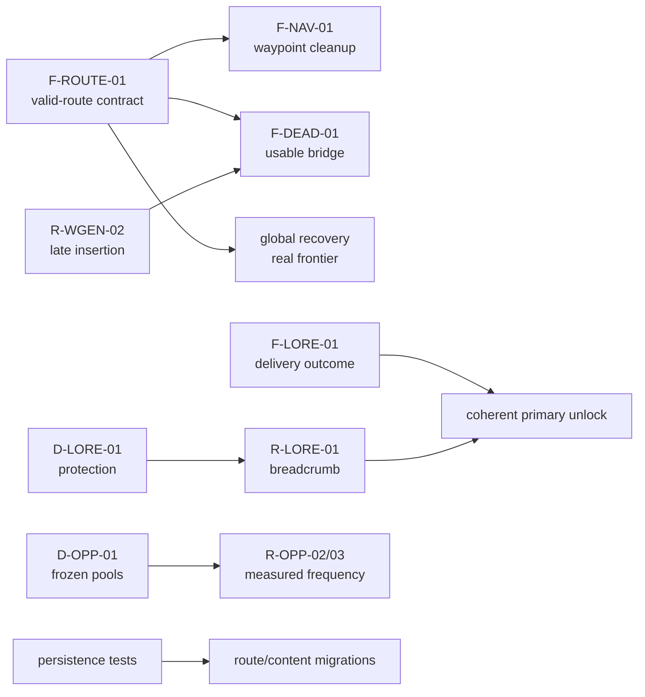

# Cross-system audit and stabilization plan

Spanish version: [stabilization-audit.es.md](stabilization-audit.es.md)

This audit was performed on the clean tree at `320d06c` on 2026-11-02. It
consolidates the canonical references without replacing them and changes no
mechanics, tests, balance, or content.

> **Phase 4A/4B update:** the developer later resolved some decisions shown as
> open here. The
> [navigation and recovery contract](../design/navigation-recovery-contract.md)
> takes precedence for route validity, deadnode chains, visited nodes, deferred
> reception, narrative protection, and save policy. These audit matrices are
> retained as a diagnosis of the behavior that was observed.

## 0. Phase 4B closure and 4C-1 update

Open decisions in this audit are closed or reassigned as follows:

- pre-alpha does not require cross-version migrations; it does require
  current-version integrity and save/load, explicit incompatible-save rejection,
  and no automatic save deletion;
- `comms`/`radiod` will gate signal and broadcast reception; uplink retains
  `data_core`/`datad`, while salvage does not use radio;
- failsafes guarantee coherent opportunities, not survival, free resources, or
  universal repair;
- `modules_pool` categories filter real modules; metadata must be audited before
  implementation;
- singles, uplink pools, `radiation_base`, worldgen order, and general balance
  remain independent studies.

The current executive matrix, with full criteria in the contract, is:

| ID | Priority | Test before correction | Phase |
| --- | --- | --- | --- |
| F-LORE-01 — no-effect `uplink_only` | **Fixed** | `uplink_only_delivery_retry_smoke.py` | **4C-1 complete** |
| F-SENS-01 — `UPGRADED` factor | **Fixed** | `sensor_detection_factor_smoke.py` | **4C-2a complete** |
| F-WGEN-02 — malformed `SECTOR` | **Fixed** | `sector_intel_validation_smoke.py` | **4C-2b complete** |
| F-INTEL-01 — old `intel N` | P2 low | controlled timestamps and limits 1/2/unlimited | 4C-2c |
| F-DEAD-02 — cooldown at `t=0` | P2 low | zero, immediate reevaluation, and post-cooldown | 4C-2d |
| F-WGEN-01 — `modules_pool` filters | P1 medium | metadata plus per-region seeds | 4C-3 |

This ordering supersedes historical priorities in sections 4, 7, and 8 where
they conflict. F-LORE-01 was subsequently fixed in 4C-1, F-SENS-01 in 4C-2a,
and F-WGEN-02 in 4C-2b; historical matrix text describes the pre-fix evidence
where explicitly identified.

## 1. Executive summary

Integration legitimately uses three distinct layers—the physical universe,
knowledge, and published routes—but several consumers do not apply the same
validity criterion. The highest-priority problems are:

1. `known_links` may contain nonexistent destinations or hops above the cap.
   Travel rejects them, while global recovery and deadnodes treat them as valid
   routes/frontiers. `nav abort` can produce nonexistent references of this kind
   during normal play.
2. Deadnodes places its bridge near the target rather than a reachable origin
   and publishes a hint from the current node without validating 45 ly. In the
   probe, the bridge was 99.38 ly away, had no physical links or pool, and route
   import rejected it.
3. F-LORE-01 reproduced an invalid or over-cap `uplink_only` piece being marked
   `delivered` without route, event, file, or unlock. 4C-1 now requires a valid
   effect and preserves retryable pending state.

F-SENS-01 was subsequently corrected in 4C-2a: `UPGRADED` sensors now use the
nominal factor, with any larger bonus left to balance study. F-WGEN-02 was then
corrected in 4C-2b: malformed sector ids are rejected without world or intel
mutation. Remaining smaller confirmed defects are: `intel N` shows the N oldest
records; bulge/halo recover no modules because of `modules_pool`
interpretation; and the deadnode cooldown can be bypassed exactly at `t = 0`.

Two undecided policies are not classified as bugs. Allowing `route solve` for
an undiscovered physical node inside sensors/cap is deliberate. Frozen uplink
pools are covered and match the current contract, although their impact on later
opportunities should be measured. There is also no play evidence supporting a
change to single probabilities.

## 2. Risk matrix

Severity: **high** can block progression or consume one-shot content;
**medium** degrades a relevant mechanic with partial alternatives; **low**
affects presentation or edge states. “Unknown frequency” means there is no
telemetry or play sample, not that the case is unlikely.

### 2.1 Verifiable functional defects

| ID | Problem | Subsystems | Evidence | Preconditions | Player consequence | Severity | Frequency | Current recovery | Existing tests | Tests needed | Pending decision | Order |
| --- | --- | --- | --- | --- | --- | --- | --- | --- | --- | --- | --- | --- |
| F-ROUTE-01 | Nonexistent or over-cap known routes count as frontier/route for recovery and deadnodes, but travel rejects them. | Intel, `WorldState`, travel, recovery, deadnodes, save | Implementation + in-memory probe | Import `LINK` with missing endpoint, load stale state, or retain invalid edge | Phantom frontier; rescue stays off and target is excluded from deadnodes | High | Unknown; dangling import is player-accessible | No cleanup command; unrelated valid routes may still work | `route_hop_cap_smoke` covers travel rejection only | Dangling/over-cap import → frontier → deadnodes → travel, before/after sanitation | Rejection and save-migration policy | 1 |
| F-NAV-01 | `_clear_tmp_node` removes the waypoint and its own entry but leaves reverse references at both endpoints. | Aborted travel, routes, recovery, persistence | Implementation + probe | `nav abort` followed by leaving the waypoint | Phantom route created by normal play; may trigger F-ROUTE-01 | High | Unknown | None automatic | No focused coverage | Abort → resume → arrival → temporary id absent everywhere, including after save/load | Cleanup itself needs no design; migration of existing states does | 1 |
| F-DEAD-01 | Deadnode bridge is created near the target and its hint starts at current node without cap validation; it also has no physical link or pool. | Deadnodes, intel, navigation, worldgen, pools | Implementation + probe: 99.38 ly and dropped route | Distant inaccessible target reaches `dead` threshold | Both indirect attempts may be unusable; direct attempt can remain over-cap | High | Unknown | Repeats every 5 years, then direct hint, with no usefulness guarantee | No dedicated test | Reachable origin → threshold → under-cap bridge → import → travel; far/generated/un generated sectors | Bridge origin, topology, pool, persistence contract | 2 |
| F-LORE-01 — fixed in 4C-1 | `uplink_only` was marked delivered when LINK was invalid/over-cap and had no effect. | Scheduler, primaries, intel, persistence | Implementation + synthetic regression | Piece bound to `uplink_only` with unparsable line or invalid hop | One-shot content consumed and primary remains locked | High before fix | Zero with current active data | Failures retain assignment/pending state; public retry does not repeat the pool | `uplink_only_delivery_retry_smoke.py` | Covered: malformed, missing, over-cap, new/preexisting, retry, and save/load | Implemented | Closed |
| F-SENS-01 — fixed in 4C-2a | `UPGRADED` passed the gate but was absent from the detection map and fell back to `CRITICAL` (0.35). | Scan, systems, balance | Implementation + deterministic regression | Sensors are `UPGRADED` | Upgrade detected less than nominal | Medium before fix | Unknown | Nominal factor; recovery-entry guarantee unchanged | `sensor_detection_factor_smoke.py` | Covered: factors, thresholds, clamps, gates, and recovery exception | Nominal 1.00 implemented; larger bonus remains balance work | Closed |
| F-WGEN-01 | List `modules_pool: ["tech", "rare"]` is interpreted as module ids; those ids do not exist and selection is empty. | Templates, modules, worldgen, salvage | Active data + implementation + probe | Bulge salvage node; halo when rolled count is 1 | Configured modules are systematically lost; guaranteed in bulge (`min=1`) | Medium | Every applicable bulge profile; halo depends on roll | No recovery for omitted loot | Worldgen does not assert module pools | Per-region seeds: counts and category membership | Categories as filters approved; actual metadata mapping remains | 4 |
| F-WGEN-02 — fixed in 4C-2b | `_parse_sector_id` mapped malformed ids to `(0,0,0)`; `SECTOR:` could materialize origin and record the invalid id. Sector-only `[INTEL]` blocks also entered corrupt recovery first. | Intel, worldgen, sector state | Implementation + probe + public regression | Import `SECTOR: <malformed>` directly or inside a sector-only block | Unexpected origin mutation, incoherent intel, or unrelated RNG/recovery effects | Medium before fix | Unknown | Canonical validation precedes generation; explicit sector-only blocks bypass corrupt recovery; invalid public input receives localized feedback without mutation | `sector_intel_validation_smoke.py` | Covered: existing/lazy/wide canonical ids, invalid forms, serialized state, sector-only blocks via import/cat, EN/ES, RNG, and continued valid lines | Canonical `{value:+04d}` components and narrow block dispatch implemented | Closed |
| F-INTEL-01 | `intel N` sorts ascending and slices from start despite advertising “latest”. | CLI/UI, intel history | Implementation + probe | More than N records | Requested recent records are hidden | Low | Common once history exceeds limit | `intel show` if id is known; full export | No coverage | Three timestamps, limits 1/2/unlimited | Choose stable display order | 1 |
| F-DEAD-02 | Cooldown applies only when `last_action_t > 0`; actions at `t=0` can repeat immediately. | Deadnodes, clock | Implementation + earlier probe | Threshold reached at `t=0` through fixture/debug/migrated state | Two indirect and one direct hint without waiting | Low | Very low/unknown in normal play | State progresses, but with spam | No test | `t=0` and positive case after 5 years | Represent absence as `None` or explicit condition | 4 |

### 2.2 Potential risks requiring reproduction or measurement

| ID | Problem | Subsystems | Evidence | Preconditions | Player consequence | Severity | Frequency | Current recovery | Existing tests | Tests needed | Pending decision | Order |
| --- | --- | --- | --- | --- | --- | --- | --- | --- | --- | --- | --- | --- |
| R-LORE-01 | An ad hoc node may receive a forced piece with no breadcrumb in any known pool. | Scheduler, pools, ad hoc, deadnodes | Flow confirmed + probe; permanent lock not proven | All known pools are clean/absent | Hidden receiver and assigned piece with no initial path | High | Zero with current active arcs; unknown when force is enabled | Nearby scan; deadnodes after decades/uplinks | Historical fixture fails before validating flow | Valid host and no-host cases; verify discovery/delivery | Should assignment fail, accrue debt, or create alternate channel? | 3 |
| R-LORE-02 | Deadnodes or global gateway reuse may expose a protected procedural receiver. | Lore, locks, failsafes, scan | Implementation; no active arc or E2E reproduction | Protected primary/ad hoc node becomes rescue candidate | Narrative pacing bypass or out-of-sequence unlock | High | Zero today; unknown with arcs | Content can still deliver, but is already exposed | None | Synthetic protected arc against scan, deadnodes, gateway, corrupt intel | Actual lock scope; whether scan is deliberate | 3 |
| R-OPP-01 | Frozen uplink pool omits nodes materialized or unlocked later. | Pools, lazy worldgen, uplink | Implementation + `uplink_once_per_node_smoke` | Pool initialized before universe expansion | Fewer routes/opportunities than later state offers | Medium | Unknown | Scan, imports, other hubs, global recovery | Covers freeze and one-shot use, not progression impact | Initial pool → expansion → uplink → remaining alternatives | Keep snapshot, refresh, or version | 5 |
| R-OPP-02 | Contact may be discovered and visited before next annual cycle, closing its window before candidacy. | Scheduler, clock, pools, navigation | Implementation | Discovery/visit between cycles; piece eligible there | Narrative opportunity disappears silently | Medium | Unknown | Other pools/cycles for unassigned pieces | Interval-0 stress is not representative | Multi-seed simulation with controlled calendar/visits | Reservation, debt, or closure policy | 5 |
| R-OPP-03 | Actual frequency of five active singles is unmeasured. | Balance, scheduler, content, play style | Theoretical per-piece/cycle rate only; no play data | Eligibility, open pools, annual calendar | Content may be too rare or clustered; unproven | Medium | Unknown | Later cycles while candidates exist | Compatibility only with probability forced to 1 | Cohort simulation and anonymized play traces before balance changes | Acceptable frequency target | 5 |
| R-WGEN-01 | Same sector set can produce a different intersector edge under different request order. | Worldgen, determinism, saves | Earlier diagnostic with seed 2 | Requests made in different order | Partial reproducibility; divergent maps | Medium | Confirmed for one seed, prevalence unknown | None; persisted world keeps its version | Determinism only for same sequence | A→B→C versus C→B→A regression under explicit contract | Does determinism include order independence? | 5 |
| R-WGEN-02 | Nodes inserted after `internal_links_built` do not rebuild topology; bridges do not even add a manual link. | Worldgen, ad hoc, deadnodes | Implementation; general impact not matrix-tested | Late insertion into generated/empty sector | Orphan physical node or inconsistent metadata | Medium | Unknown | Anchored ad hoc adds manual link; bridge does not | No late-insertion coverage | Closed empty sector + each insertion type | Post-generation topology mutation policy | 2 |
| R-SAVE-01 | Recovery state persists, but changed/removed lore definitions may strand assignments; no versioned focused test exists. | Save/load, scheduler, failsafes | Code + temporary probes; content drift is hypothesis | Save before/after recovery or change content between versions | Duplicates, pending push, or impossible delivery after update | Medium | Unknown | Partial `__setstate__` compatibility; no content-id migration | Generic `save_load_smoke` | Focused global/deadnode/ad hoc/single save/load; missing-definition fixture | Content migration/versioning policy | 6 |

### 2.3 Open design decisions

| ID | Problem | Subsystems | Evidence | Preconditions | Player consequence | Severity | Frequency | Current recovery | Existing tests | Tests needed | Pending decision | Order |
| --- | --- | --- | --- | --- | --- | --- | --- | --- | --- | --- | --- | --- |
| D-NAV-01 | `route solve` accepts an undiscovered physical node inside sensors and cap. | Navigation, discovery | Developer-confirmed decision | Player knows/types exact id | Navigation through external knowledge | Not a defect | Deliberate | N/A | Indirect coverage | Explicit characterization to prevent accidental regression | Review desirability only later | Preserve |
| D-OPP-01 | One-shot snapshot uplink pools. | Pools, uplink, worldgen | Implemented and tested contract | Later expansion | Opportunity depends on temporal order | Open | Unknown | Other channels/failsafes | `uplink_once_per_node_smoke` | Measure R-OPP-01 before change | Confirm strict snapshot or controlled refresh | 5 |
| D-DEAD-01 | `stuck` thresholds do nothing; only `dead` acts; “useful uplink” is conditional counter. | Deadnodes, lore, debug | Implementation | Persistent candidate contact | Ambiguous diagnostics and timing expectations | Open | Every deadnode | Acts at `dead` | Temporary probe only | Characterize both scales and counters | Implement stuck phase, rename, or remove | 2 |
| D-LORE-01 | Primary lock is not a global barrier. | Lore, scan, failsafes, intel | Implementation; no active content | Enable arcs with protected target | Narrative pacing varies by channel | Open | Zero today | Later unlock remains possible | No E2E test | Revelation-channel matrix | Which bypasses are deliberate | 3 |
| D-REC-01 | The field named `dock_hint` is delivered on arrival without docking. | Recovery, engine, naming | Implementation + test that does not distinguish arrival/dock | Reach recovery entry | Gateway access before docking | Open | Every used global chain | Salvage hint is alternate path | Recovery smoke observes only afterward | Assertion immediately after arrival and after dock | Confirm arrival or require dock; align name/test | 2 |
| D-WGEN-01 | Regional JSON `radiation_base` is inactive; `Balance` wins. | Worldgen, balance, data | Implementation and active data | Procedural generation | Apparent configuration has no effect | Open | All worldgen | Effective Balance radiation exists | `procedural_radiation_smoke` covers effective model | Precedence contract and dead-field validation | Remove field or integrate it | 4 |
| D-WGEN-02 | Determinism scope with respect to request order is undefined. | Worldgen, QA, saves | R-WGEN-01 | Different order | Harder world reproduction/reporting | Open | Unknown | Seed + exact sequence reproduces | Partial | Dual-order test conditional on contract | Accept dependency or stabilize pair evaluation | 5 |
| D-LORE-02 | Singles have no frequency target; 0.05 × weight per cycle is only a conditional theoretical rate. | Balance, narrative, scheduler | Configuration; no telemetry | Normal play with variable eligibility | Cannot judge whether content is too rare | Open | Unknown | Later cycles | Nonrepresentative stress | Multi-seed cohorts and anonymized real traces | Define metric before rebalancing | 5 |

## 3. Dependencies between problems

- Canonical route validity must be resolved before deadnodes or recovery are
  adjusted; otherwise each subsystem will redefine “usable.” Reuse
  `distance_between_nodes_ly`, `is_hop_within_cap`, and `add_known_link`, adding
  one shared validation/normalization path only if needed, not parallel parsers.
- Waypoint cleanup is a concrete producer of phantom routes and belongs in the
  same change and migration.
- Deadnode bridge also depends on a late-topology insertion policy; changing
  hint text alone does not decide its pool or physical link.
- “Delivered with effect” semantics must be fixed before unlock paths are
  unified or arcs are activated.
- Breadcrumb and primary protection require one decision about which mechanisms
  may reveal hidden targets.
- Snapshot, windows, and probabilities should not change until eligibility,
  visit pace, and persistence are measured together.

## 4. Proposed priorities

| Priority | Outcome | Recommended scope | Exit criterion |
| --- | --- | --- | --- |
| P0 — Characterization | Turn critical probes into isolated regressions | Invalid routes, waypoint, `UPGRADED`, intel, modules, invalid sector, no-effect delivery, persistence | Red tests only where a fix is planned; deliberate decisions locked green |
| P1 — Route integrity | Published route is travelable or explicitly marked/not published | Shared validator, importers, waypoint cleanup, save normalization | No dangling/over-cap edge counts as frontier or deadnode resolution |
| P2 — Recovery | Deadnodes/recovery offer only consumable opportunities | Reachable bridge origin, cap, topology/pool, cooldown, `stuck`; confirm arrival/dock | Deadnode E2E and save/load green |
| P3 — Narrative integrity | Do not consume pieces without effect or assign without access policy | Delivery outcome, retry, breadcrumb, unlock, protection | Synthetic primaries cover success, failure, and preexisting route |
| P4 — Bounded data/UI defects | Independent low-risk repairs | `UPGRADED` and sector ids fixed; intel order, `modules_pool`, and radiation field remain after their decisions | State/region matrices and clear public errors |
| P5 — Opportunity policy | Decide from evidence, not intuition | Frozen pools, windows, annual cycle, singles, request-order determinism | Reproducible simulation and approved product threshold |
| P6 — Persistence/migration | Preserve invariants while loading older state | Route sanitation, temporary ids, recovery/lore versioning | Before/after temporary tests and documented compatibility strategy |

P0 does not imply turning every harness into shared test infrastructure. Current
smokes use local builders; keep fixtures small and local until at least three
tests demonstrate a genuine shared abstraction.

## 5. Minimum integration test plan

All tests should use `/home/jon/prog/retorno_case/retorno_venv/bin/python`,
literal seeds, `create_initial_state_sandbox/prologue`, `Engine`, and
`TemporaryDirectory`. None should resolve or open real saves.

| ID | Controlled flow/setup | Minimum assertions | Infrastructure / fixture |
| --- | --- | --- | --- |
| IT-01 | Fixed seed: generate sector, scan, discover nearby physical target, `route solve`, complete job, travel, complete arrival | Generation does not reveal; scan does; solve publishes under cap; travel requires route; arrival updates visit/pool | Reuse Engine, worldgen, and ETA helpers; local two-node fixture |
| IT-02 | Initialize uplink pool, materialize late hub, run uplink, then another discovery channel | Snapshot stays fixed today; consumption is one-shot; late hub retains another path or test records loss | Extend `uplink_once_per_node_smoke`; no new helper |
| IT-03 | No-frontier state → global recovery → import entry → solve/travel → arrival → import gateway → travel | One generation, distances under cap, broadcast at agreed event, travelable routes | Extend `exploration_recovery_smoke`; fixed seed |
| IT-04 | Distant contact without route → advance counter/time → deadnode → import hint → travel to bridge → resolve target | Every published hint passes validator; bridge has chosen integration; cooldown/attempts persist | New synthetic deadnode fixture; no equivalent exists |
| IT-05 | Synthetic hard arc without candidate → ad hoc → breadcrumb in known host → import route → travel → trigger → delivery/unlock | Hidden node, recoverable breadcrumb, under-cap route, piece not `delivered` before effect | Repair forced-hidden fixture and add separate E2E test |
| IT-06 | Import missing and over-cap LINK; load stale edge; run frontier, deadnodes, travel | Reject/do not publish; no false frontier; contact keeps chosen semantics; migration is idempotent | New invalid-route fixture; reuse parser and Engine |
| IT-07 | Save before and after global/deadnode activation; load twice | IDs, paths, pools, thresholds, attempts, bridge persist; no duplicate generation/hint | Extend `save_load_smoke` or focused test with `TemporaryDirectory` |
| IT-08 | Filter one real active single, controlled probability/interval, known open receiver, trigger, read/import, save/load | Correct binding, one delivery, real asset readable, expected intel effect (none when asset has none), persistence | Real loader + local filter; do not copy content into test |
| IT-09 | Travel → abort → optional save/load → resume to each endpoint | Waypoint absent from nodes, routes, applicable knowledge/intel/fine ranges, and components | New local test for `TravelAbort`/`_clear_tmp_node` |
| IT-10 | Generate bulge/halo/disk with known seeds and applicable salvage node | Count follows min/max and every module matches approved tag/id semantics; deterministic | Reuse loader and worldgen descriptor; explicit seed table |

The in-memory audit probe confirmed F-ROUTE-01, F-NAV-01, F-DEAD-01,
F-LORE-01, F-SENS-01, F-WGEN-01, F-WGEN-02, and F-INTEL-01, plus the
R-LORE-01 setup. F-WGEN-02 was later reproduced by
`sector_intel_validation_smoke.py` before the 4C-2b correction and passes after
it. A second temporary probe placed real active single
`sig_echo_fragment_01`, delivered it through `captured_signal`, read/imported
its text with no intel effect—the correct result for that asset—and confirmed
persistence. A third temporary-slot probe confirmed that global recovery and
deadnode state persist without duplicating global generation after first load.
These probes do not replace versioned regressions.

Existing tests run during this audit passed for scan, hop cap, alternative
origins, one-shot uplink pool, global recovery, uplink failsafe, save/load,
sparse worldgen, and channel preference/unlock. The three historical fixtures
failed at the expectations inventoried in section 6.

## 6. Treatment of stale fixtures

### `forced_hidden_ad_hoc_smoke.py`

- Keep it **synthetic**: it tests infrastructure, not active content.
- Explicitly create a physical, known, unvisited `BREADCRUMB_HOST` with an open
  pool; do not use `HARBOR_12` or reveal every authored node.
- Make other pools ineligible and assert the breadcrumb appears only in host.
- Add a separate “no eligible host” case for the chosen behavior: no assignment,
  pending debt, or fallback. Do not accidentally turn current silence into a
  guarantee.

### `lore_secondary_count_weights_hard_smoke.py`

- Keep synthetic content and separate functions.
- For `count=1`, create a known, unvisited physical receiver with an open pool
  before tick; set probability to 1 and interval to 0 inside `try/finally`.
- Run each case independently so a count failure does not hide weights and
  hard-force cases. Aggregate only after individual execution.
- Preserve weight 0/1, hard constraints, and no-relax; do not activate templates.

### `debug_lore_arcs_smoke.py`

- Split real-data contract from synthetic formatting.
- With real active data, assert `load_arcs() == []`, `(none)` output, and the
  scheduler status line; do not require `primary:`.
- With a loader monkeypatched to one minimal synthetic arc, assert `primary:`,
  assigned/unplaced/delivered status, and canonical keys.
- Restore loaders in `finally`; do not move JSON files out of `templates/`.

As separate active coverage, IT-08 should use one real indexed single.
Algorithm fixtures should not depend on authored narrative names.

## 7. Decisions requiring developer input

1. Decide whether invalid route is rejected, retained only as contact/intel, or
   explicitly marked non-navigable, and how existing saves are sanitized.
2. Choose deadnode bridge physical contract: reachable origin, link, pool,
   sector, and strategy when target is more than one hop away.
3. `uplink_only` success/retry is now defined and implemented; policy for a
   forced piece without a breadcrumb remains open.
4. Determine which mechanisms may reveal a protected primary. The deliberate
   `route solve` decision does not answer for scan, deadnodes, or gateways.
5. Confirm arrival versus dock for gateway hint.
6. Confirm strict uplink snapshot and window policy only after R-OPP-01/02 are
   measured.
7. Define list-valued `modules_pool` semantics and the fate of `radiation_base`.
8. Define whether determinism must be independent of generation order.
9. Set a single-frequency metric before changing balance.
10. Decide whether `stuck` is a real phase and what counts as deadnode uplink.

## 8. Recommended work sequence

1. Repair the three fixtures without product changes and add characterization
   for deliberate decisions.
2. Add IT-06 and IT-09, agree route contract, and centralize validation.
3. Fix/sanitize phantom routes and waypoint; then revalidate recovery and known
   components.
4. Agree bridge contract and complete IT-04 + IT-07 before changing deadnodes.
5. Keep the closed F-LORE-01 regression; still agree breadcrumb and protection
   and complete the forced-arc IT-05 before extending those paths.
6. Keep the closed `UPGRADED` regression; fix intel listing and sector id as
   separate bounded changes.
7. Resolve `modules_pool`/`radiation_base` with IT-10 and review existing data.
8. Run multi-seed opportunity simulation and decide pools, windows, singles,
   and determinism without premature rebalancing.
9. Close with full suite, save/load/migrations, documentation parity, and an
   updated regression matrix.

Every behavior-changing step must update its owning canonical reference, public
help/manuals when observable, and the test matrix. This phase authorizes none of
those changes.

## 9. References

Canonical documentation:

- [Content loading contract](../content-loading.md)
- [Physical universe and worldgen](../systems/world-generation.md)
- [Discovery, navigation, and intel](../systems/discovery-navigation-intel.md)
- [Lore scheduler](../systems/lore-scheduler.md)
- [Failsafes and recovery](../systems/exploration-failsafes.md)

Owning implementation:

- [`model/world.py`](../../src/retorno/model/world.py): knowledge, routes, and
  persistent state.
- [`core/engine.py`](../../src/retorno/core/engine.py): scan, route solve, travel,
  waypoint, and job/failsafe ordering.
- [`cli/repl.py`](../../src/retorno/cli/repl.py): importers, uplink, intel, and
  public commands.
- [`core/lore.py`](../../src/retorno/core/lore.py): pools, scheduler, delivery,
  locks, and ad hoc nodes.
- [`core/exploration_recovery.py`](../../src/retorno/core/exploration_recovery.py)
  and [`core/deadnodes.py`](../../src/retorno/core/deadnodes.py): recovery.
- [`worldgen/generator.py`](../../src/retorno/worldgen/generator.py),
  [`data/worldgen/templates`](../../data/worldgen/templates), and
  [`config/balance.py`](../../src/retorno/config/balance.py): generation and
  effective configuration.
- [`io/save_load.py`](../../src/retorno/io/save_load.py): V2 persistence,
  checksum, and backup fallback.
